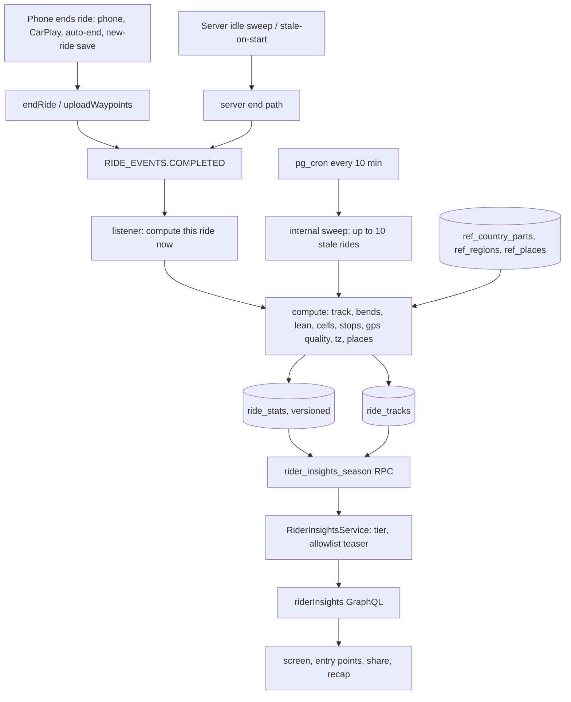
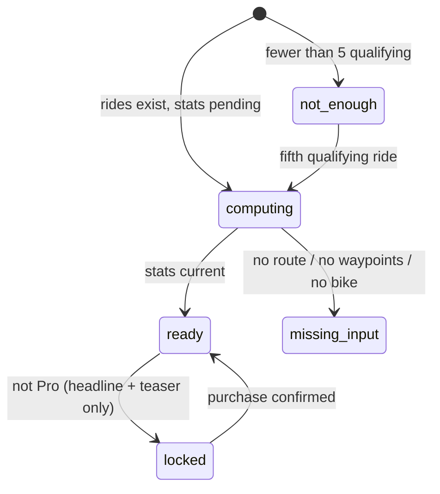
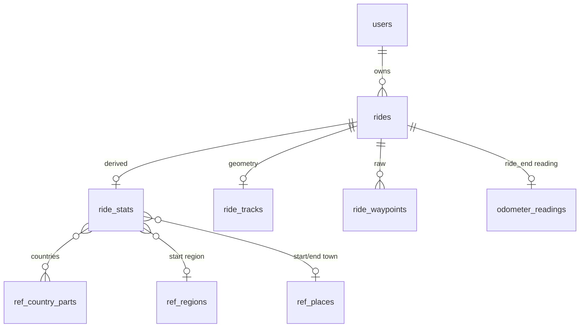
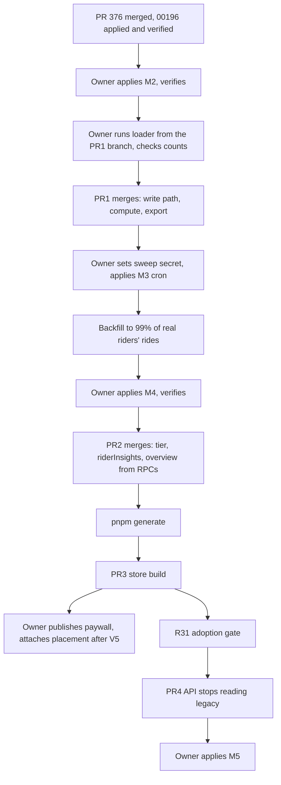

# Rider Insights Redesign - Plan

## Goal Capsule

- **Objective:** a rider who records rides opens one screen after any ride and sees where, when and how they ride, in their own roads and places.
  - The free layer is worth coming back to, and a Pro layer explains it well enough that free riders pay for it.
  - Afterwards the screen is reached from Home, My Rides, Profile and the ride summary, and every number on it is correct and comes from the server.
- **Means:** the Road Atlas design, as a short scroll with full-screen detail pages, over a rebuilt server-side ride data layer (KTD1, KTD2).
  - Per-ride derived stats, computed once and versioned, replace client and rollup aggregation, and the legacy ride analytics are retired.
- **Product authority:** the owner (Andrej).
  - The design canvas `https://claude.ai/artifact/NtvuXcYE3g5Wta9hu3Rnz5` is the visual reference.
  - Where the canvas disagrees with an R-ID, the R-ID wins.
  - The canvas's own back button and single lean value are not requirements. Country ovals show plate letters mapped from ISO codes (U11).
- **Execution profile:** four PRs (PR1 to PR4 under Implementation Units). PR3 is the single store build that carries all mobile work.
  - The PRs are separate because owner-applied migrations, a production backfill, a store build and an adoption window sit between them.
  - Each migration is applied and verified on production before the PR that uses it merges, because the API deploys on merge (KTD20).
  - The security fix for 00139/00143 (PR #376, migration 00196) is a prerequisite outside this plan.
- **Stop conditions:** stop and ask the owner when:
  - a migration's post-apply verification fails;
  - the custom-variable device test (U10) crashes;
  - the season RPC still exceeds the 300 ms gate for the heaviest real rider after tuning;
  - work would change what is free today (R1);
  - work would change who qualifies (R15).
- **Who finishes:**
  - Agents implement each PR and run `ce-code-review` before any merge.
  - The owner:
    - applies migrations through the Management API and runs the reference-data loader;
    - publishes the RevenueCat paywall and attaches the placement after the V5 test;
    - buys the Open-Meteo licence;
    - confirms the synthetic account list;
    - starts the store build;
    - gives the go for cleanup.

---

## Product Contract

**Product Contract preservation:** changed on 2026-11-09 by owner decisions (see Key Decisions):
- R3, R5–R10, R11–R14 and R16 are rewritten in place.
- AE1, AE3, AE4 and AE5 are rewritten.
- R21–R35 are new.
- The Scope Boundaries now allow the Atlas poster and cost per km.

### Summary

The buried "Roads I've ridden" heatmap is replaced by a Rider insights screen in the Road Atlas design.

- **Main screen:** a short scroll with the rider's season on a quiet map, their other riding regions, a season ribbon and a "How you ride" list.
- **Detail pages:** each row of the list opens a full-screen page.
- **Free:** the map, totals, countries, regions, ribbon, longest ride, bikes, a basic share image and three recap cards.
- **Pro:** road character with estimated lean, territory and new roads, riding rhythm, the full best-rides ranking, an Atlas poster share image and four more recap cards.
- **Locked rows:** these show the rider's own pattern blurred and open the RevenueCat paywall.
- **Data layer:** a rebuilt server-side layer computes each ride's stats once, fixes the known recording bugs and retires the legacy rollups.

### Problem Frame

The heatmap screen is reachable from one row in My Rides. In the 90 days before 10 Oct, 98 users opened the rides tab, 34 reached the heatmap, and those 34 made 57 views. Riders with 10 or more rides are the heaviest users, yet only 1 in 13 has paid.

The data is also wrong (Sources, 2026-11-09 audit):
- "Countries" counts free-text region labels that only synthetic rides carry, so it shows 0 for every real rider.
- Rides the app auto-ends lose speed, climb and GPS quality.
- Climb has no noise threshold.
- Average speed is a mean of samples.
- GPS quality is a constant.
- Long rides are cut to 1,000 points on read.
- UTC rollups are never decremented on delete.
- About 56% of completed rides come from synthetic demo accounts.

### Key Decisions

- **Everything visible today stays free.** Governs R1, R3.
- **Road Atlas is the design.** (session-settled: user-directed — chosen over Paddock and Cluster: the rider's real roads on a real map are the most recognisable and shareable.) Governs R11, R21, R24.
- **A short main scroll, with each insight on a full-screen detail page.** (session-settled: user-directed — chosen over one long scroll, horizontal carousels, tabs and pull-up drawers: about two screens of scroll, and details keep native back and room to scroll.) Governs R22.
- **The free vs Pro line.** (session-settled: user-directed — chosen over making all image sharing Pro and over making all sharing free.) Governs R3, R5–R8, R25.
- **A locked row opens the RevenueCat paywall directly, with a headline personalised to the tapped row.** (session-settled: user-directed — chosen over a native intro sheet before the paywall.) Governs R9.
- **Locked content is the rider's own pattern, blurred.** (session-settled: user-directed — chosen over redacted or title-only cards.) Governs R9.
- **The blur carries coarse shapes only.** (session-settled: user-directed — chosen over generic fake shapes and over sending full Pro data to free clients.) Governs R14, R16.
- **The season recap is 3 free and 4 Pro cards.** (session-settled: user-directed — chosen over a Pro-only recap and over deferring it.) Governs R25.
- **Lean is a GPS-only estimate in bands.** (session-settled: user-directed — chosen over phone motion sensors in v1, which stop in the background on Android.) Governs R23.
- **Recording additions ship with the build.** (session-settled: user-directed — chosen over an earlier OTA.) Governs R26.
- **Distance since last service is free and lives in the bike hub.** (session-settled: user-directed — chosen over a Pro Bikes field.) Governs R8, R34.
- **Synthetic demo accounts are flagged, not deleted.** (session-settled: user-directed — chosen over treating them as real and over stopping the generator.) Governs R30.
- **Legacy ride analytics are refactored as part of this work.** (session-settled: user-directed — the owner asked for the related database to be restructured and legacy code replaced.) Governs R27–R29, R31.
- **The summary card follows the paywall plumbing plan's rules.** (session-settled: user-directed — chosen over a paywall on every free summary: the plumbing plan already caps how often that card can open a paywall.) Governs R13.
- **Legacy cleanup waits for adoption and the owner's go.** (session-settled: user-directed — chosen over a 60-day time fallback.) Governs R31.
- **The data export carries derived stats, stops and routes.** (session-settled: user-directed — chosen over stats only.) Governs R35.
- **One store build carries all the mobile work.** (session-settled: user-directed — chosen over an early recording-only build.)

<!-- ce-section: work-relationships -->
### How This Work Fits Together

- **Security fix (PR #376, migration 00196).** It revokes public execute on the rollup functions and restores the visibility policies. This plan's migrations are numbered from 00197.
- **Ride rework phases 3a/3b (#373, #374, merged).** This plan builds on the persisted ride record, `RideSource` and the `new_ride` save trigger.
- **Ride-moment paywall plumbing (`docs/plans/2026-10-10-1621-feat-ride-moment-paywall-plumbing-plan.md`).**
  - It owns the qualifying-ride rule (its R1), which R15 uses.
  - It owns the summary card and when that card may open a paywall (its R4, R6, R8 and R10).
- **Paywall V5 experiment (`expd7c1d56904`, running since 11 Oct, 100% enrolment).** The `rider_insights` placement is attached only after it ends.

### Actors

- A1. Rider who records rides (free or Pro).
- A2. Pro rider.
- A3. Backend computing per-ride stats and insights.
- A4. Owner, who applies migrations, loads reference data and controls paywalls.

### Requirements

**Free layer**

- R1. The free layer contains:
  - the season map, fitted to the rider's main riding region, with routes drawn beneath the map's place labels;
  - the three totals (rides, distance, countries);
  - the season recap;
  - the personal-record badges and toast;
  - the period totals and the vs-last-period trend on My Rides.
- R2. Countries are computed from route geometry, counting a country only when at least 1 km of route lies at least 500 m inside its border. This absorbs map border error on roads that follow a border.
- R3. Two share images, each in 4:5 and 9:16:
  - "Season lines" (free): the routes of the region shown on the main map, labelled with the region's name, plus the season's total distance, ride count and handle.
  - "Atlas poster" (Pro): the map, countries and road-character shares.

  "Hide ride start and end" is on by default and trims 500 m from each ride's ends. Neither image carries lean.
- R4. Share text names MotoVault.
- R24. Other riding regions appear as small static map tiles under the main map, and a tap swaps the main map to that region in place.
  - With fewer than two regions the tile row is hidden; rides with no start region are left out of tiles.
  - A swap exchanges the tapped tile with the main region. The totals band stays season-wide, and the season-lines share image follows the region shown.
  - A region is the first-level administrative area (for example "La Rioja", "Tirol") where rides start.
  - The main map shows the region with the most distance this season, and the tiles show the next three.

**Pro insight groups**

- R5. Territory: explored area in km², the share of this season's route distance on roads not ridden before, and the furthest point from home.
  - Home is the most common start cell.
- R6. Rhythm:
  - a weekday by time-of-day grid in each ride's local time;
  - the busiest slot;
  - the weekend share;
  - the typical ride, as median distance and moving time.
- R7. Best rides ranks the season's rides by distance, climb and bends per 10 km, and each ride opens.
  - The longest ride is free; the ranking switch and further places are Pro.
  - The climb comparison uses corrected climb.
- R8. Bikes: distance, rides and moving hours per bike, with rides without a bike under "Unassigned".
  - It is free.
  - Distance since last service is not part of Rider insights (R34).
- R21. Road character:
  - the share of routed distance in four bands (straight, sweeping, twisty, tight);
  - bends per 10 km;
  - the twistiest and straightest rides;
  - lean as estimated bands.
- R22. Each "How you ride" row opens a full-screen detail page with native navigation, and the main screen stays about two screens long at the default text size.
- R23. Lean appears only as the share of corners in four bands (under 20°, 20–30°, 30–40°, 40° and over), labelled as an estimate of rider and bike together.
  - It is never a single degree value, never on a share image and never ranked.
- R9. For a non-Pro rider, each Pro row shows its mini visual blurred and "Unlock".
  - Tapping presents the RevenueCat paywall with a headline and subline built from the rider's free numbers for that row.
  - Until the `rider_insights` placement is attached (after the V5 experiment, about 6 Dec 2026), Unlock opens the current offering with its generic copy. The owner accepted this gap.
- R10. Below five qualifying rides, every Pro row reads "Not enough rides yet, keep riding", with no blur and no paywall. From the fifth qualifying ride the blurred row appears.

**Recap, entry points and bike hub**

- R25. The season recap has seven cards.
  - Free: distance and rides, countries, longest ride.
  - Pro: rhythm, new roads, twistiest ride, cost per km.
  - For a non-Pro rider, Pro cards show only their title over a blur.
  - Cost per km is shown in the currency with the most spend that season, with any other currencies listed beneath.
  - It divides the bike's fuel and service spend by the odometer change over the season when readings exist at both ends, otherwise by tracked distance, and says which.
- R11. A Home card shows the rider's latest insight headline and opens the screen.
  - The headline is always a free number: the latest ride's season distance, or a newly added country when the latest ride added one. It never shows a Pro value.
  - Below five qualifying rides it reads the keep-riding line; with no rides the card is hidden.
- R12. The top of My Rides and a Profile row open the screen.
- R13. Every ride summary shows a card with a number from that ride.
  - For Pro riders the card shows the ride's new-road distance.
  - For non-Pro riders it shows that tile blurred, plus their season distance after this ride.
  - Tapping opens Rider insights. The card opens a paywall only when the plumbing plan's trigger rules allow it (its R4/R6/R8/R10).
  - While the server value is pending (null), the card shows the season distance after this ride, computed on the device. A real zero shows as 0 km.
  - Below five qualifying rides the card shows season distance and the keep-riding line, with no blurred tile, and a tap opens Rider insights without consulting the plumbing trigger.
- R34. The bike hub shows each bike's distance since its last logged service, free, or "No service logged".

**Computation and data**

- R14. Insights are computed on the backend from completed, non-deleted rides. Each group returns a status: ready, computing, not enough rides, missing input or locked.
  - A locked group carries one rounded headline value and the coarse teaser shape (KTD9), nothing else.
- R15. Qualifying rides follow the paywall plumbing plan (its R1). Today's qualifying set does not change: the app's auto-ended rides keep counting, and server-ended rides stay excluded.
  - The free totals count every completed ride.
- R16. A free response never carries a locked group's exact values, ride lists, per-ride routes or overlays.
  - Per-ride new-road distance and place fields are owner-only, and new-road distance is Pro-only.
- R26. New rides record the time zone, how the ride ended, and optional purpose, passenger and odometer at end.
  - Server-derived stats fill in stops, real GPS quality, countries, regions, towns and, once licensed, weather at ride time.
- R27. A ride's stats are correct however it ended:
  - rider (phone or CarPlay), app auto-end, server idle sweep, stale on start, or saved as the next ride starts;
  - climb ignores altitude noise under 5 m;
  - average speed is distance over moving time.
- R28. Ride detail charts and the flyover use the whole ride, not its first 1,000 points.
- R29. Season totals, period totals and personal records agree across the screen, My Rides, the widget and the web, and a deleted ride drops out everywhere.
  - Rides with no geometry still count toward totals.
- R30. Synthetic demo accounts still get their own insights (for screenshots). Their rides are excluded from other riders' baselines, from metrics and from backfill progress, and are processed last.
- R31. Legacy ride analytics are removed once at least 90% of 30-day active riders run the new build and the owner gives the go:
  - the rollup and records tables and their functions;
  - the dead ride columns (lean, thumbnail, weather, region, `is_public`).
- R35. Derived stats, stops, places and routes are part of the rider's data export, and are purged with the ride on the same schedule as its raw track.

**Measurement**

- R17. Showing and tapping a locked row emits events naming the row. Paywall events carry the placement and which offering served it.
- R18. Opening the screen is tracked separately from each entry point.

**States**

- R19. Each group has its own missing-input state, naming what is missing and never showing a number:
  - no route: Territory and Road character;
  - no waypoints: lean and moving time;
  - no bike: Bikes.
- R20. The screen, the Home card, the My Rides header and the summary card each have loading, offline, failure, computing and zero-ride states. A pending or failed request never shows a placeholder number.
- R32. Every surface supports light and dark and Dynamic Type up to AX5. Blurred content exposes no values to VoiceOver or TalkBack.
  - Each visible graphic (map, band bar, rhythm grid, ribbon, country ovals) exposes one summary accessibility label, for example "Busiest slot Saturday morning". Band shares are labelled on the bar, not told apart by colour alone.
- R33. A rider who has just bought Pro sees the unlocked groups without waiting for the webhook.

### Key Flows

- F1. Free rider after a ride
  - **Trigger:** A1 saves a qualifying ride.
  - **Steps:**
    1. The summary card shows the blurred new-roads tile and the season distance.
    2. Tapping it opens Rider insights.
    3. Road character shows a blurred band bar.
    4. "Unlock" presents the paywall with a road-character headline.
    5. After purchase the rows unlock.
  - **Covers:** R9, R13, R14, R16, R17, R33.
- F2. Pro rider
  - **Trigger:** A2 opens the screen from the Home card.
  - **Steps:**
    1. All rows show values.
    2. Road character opens its detail page with bands, rides and lean.
    3. A region tile swaps the map.
  - **Covers:** R5–R7, R21–R24.
- F3. New rider
  - **Trigger:** A1 with two rides opens the screen.
  - **Steps:** the map and totals show, and every Pro row reads "Not enough rides yet, keep riding".
  - **Covers:** R10.
- F4. First open after the update
  - **Trigger:** a rider opens the screen while their past rides are still computing.
  - **Steps:** the free totals show, uncomputed rows show the computing state with no number, and they fill in on the next open.
  - **Covers:** R14, R20.

### Acceptance Examples

- AE1. **Covers R5, R9.**
  - **Given** a non-Pro rider with 20 qualifying rides
  - **When** they open the screen
  - **Then** Territory shows its blurred teaser, "Unlock", and no value in the accessibility tree.
- AE2. **Covers R10.**
  - **Given** a rider with 4 qualifying rides and 3 test taps
  - **When** they open the screen
  - **Then** every Pro row shows the keep-riding text, and no paywall can be opened from it.
- AE3. **Covers R14, R16.**
  - **Given** a non-Pro rider
  - **When** the client requests insights
  - **Then** each Pro group is `locked` and carries exactly one rounded headline plus its KTD9 teaser, with no ride ids, routes or exact values.
- AE4. **Covers R8.**
  - **Given** a rider with two bikes and one ride without a bike
  - **When** they open Bikes
  - **Then** both bikes show distance, rides and hours, and the ride without a bike appears under "Unassigned".
- AE5. **Covers R13.**
  - **Given** a Pro rider who has just stopped a ride
  - **When** the summary has been open for at most 30 s
  - **Then** the card shows that ride's new-road distance, and tapping it opens Rider insights.
- AE6. **Covers R15, R27.**
  - **Given** a ride the app auto-ended after 30 idle minutes
  - **When** its stats are computed
  - **Then** max speed, climb and GPS quality are present, `end_source` is `client_auto`, and the ride still counts as qualifying, in personal records and for an AI summary.
- AE7. **Covers R2.**
  - **Given** a ride that starts in Spain and crosses 300 m into France
  - **When** its stats are computed
  - **Then** its countries are Spain only.

### Success Criteria

Metrics and baselines exclude the synthetic account list (R30); in PostHog this is the account cohort, not the database flag. The baseline uses the existing `heatmap_viewed` event.
- **Opening after a ride:** the share of riders with a saved ride in the last 30 days who open Rider insights within 7 days of a ride. Compare it with the same definition over the trailing 90 days before launch.
- **Return rate:** median views per viewer per 30 days, against a pre-launch baseline with the same definition.
- **Purchases:** purchases attributed to the `rider_insights` placement, judged by counts. Expect 0.2–1% of paywall views to convert.
- **Guardrails:**
  - no drop in rides per rider per week;
  - no new 1–2 star reviews mentioning a paywall;
  - zero crashes attributed to paywall custom variables.

### Scope Boundaries

- **Deferred for later:**
  - season-over-season comparison;
  - heatmap filters by year or bike;
  - a web version;
  - commute detection;
  - repeated-route comparison;
  - seasons for southern-hemisphere riders;
  - a native gyro and GPS lean recorder;
  - rhythm and territory share images;
  - a "most-ridden road" item.
- **Outside this product's identity:** new achievement badges (the existing personal-record badges stay, R1), streaks, goals, leaderboards, comparison with other riders, achievement language.
- **Considered and not built:**
  - **A dedicated worker service for the stats sweep.** The batch sizing in KTD14 keeps API latency safe at today's volume. Revisit if p95 latency on Render rises during the backfill.
  - **A fallback from `rideOverview`/`personalRecords` to the rollup read.** KTD20 guarantees M4 is live before that code deploys, and the rollup writer keeps running until cleanup as the rollback path.
  - **A hidden zone around home on share images.** Owner decision 2026-11-09: keep only the 500 m end trim. Accepted risk: many rides from one start still leave a ring of route ends around it.
  - **A `RIDER_INSIGHTS_GATING` kill switch.** A Render env change needs a redeploy, so it is no faster than reverting. A paying rider wrongly locked is covered by R33's refresh.

### Dependencies / Assumptions

- **Delivery:** the API deploys before the store build, which carries all mobile work.
- **Geometry coverage:** 82% of real riders' rides have a route polyline, and waypoints exist only since 2026-03-08. 118 of 1,471 real rides have no geometry at all.
- **Paywall timing:** the `rider_insights` placement is attached after the V5 experiment ends (around 6 Dec 2026).
- **Weather:** weather ships switched off until the Open-Meteo commercial licence is bought.

### Sources / Research

- **Issues:** GitHub #305, #267, #364; PR #376 (security).
- **Canvas:** `https://claude.ai/artifact/NtvuXcYE3g5Wta9hu3Rnz5`.
- **Paywall draft:** RevenueCat paywall `pwd643c749e2774eb7` on offering `rider_insights` (`ofrng2b9e9307e2`), unpublished, with custom variables `insight_headline` and `insight_subhead`.
- **Production audit (2026-11-09, read-only):**
  - 3,346 completed rides.
  - 14 synthetic accounts holding 1,867 rides, plus 8 synthetic-looking rides in one otherwise real account.
  - Real riders: 1,471 rides and 28,898 km.
  - `ride_waypoints` is 1.74 M rows (276 MB).
  - PostGIS 3.3.7 is installed; H3 is not available.
  - The default ACL grants new tables and functions to anon and authenticated.
- **Dossiers (machine-local, best effort):** `/tmp/compound-engineering-501/ce-plan-research/b1d1ed09/`
  - data-model.md, the source of the DDL sketches in U1;
  - repo-research.md, framework-docs.md, learnings.md, spec-flow.md;
  - review-v-*.md, the verification team.

  This plan wins any disagreement with them.
- **External:**
  - Natural Earth admin-0 1:10m; use `ISO_A2_EH`.
  - GeoNames cities15000 and `admin1CodesASCII.txt` (CC BY 4.0).
  - `h3-js` 4.5.
  - `@photostructure/tz-lookup`.
  - RevenueCat `react-native-purchases-ui` custom variables (strings only on 10.4.2).
  - `@rnmapbox/maps` `belowLayerID="road-label-simple"`.
  - TU Dresden 2020 study on phone lean accuracy.

---

## Planning Contract

### Key Technical Decisions

- KTD1. **A versioned per-ride stats row, computed on the server, is the source of every insight.**
  - `ride_stats` holds each ride's derived values with a `stats_version`, written by an idempotent upsert of a pure TypeScript compute.
  - Aggregates are SQL over those rows. A changed algorithm is a version bump and a recompute.
  - Older-version rows keep serving until the sweep replaces them (KTD22).
  - The one exception is a change of the KTD4 cell resolution, because cells at different resolutions never match. That change is fully recomputed before the API that reads it deploys.
  - Rollups and client aggregation are retired because they disagree, use UTC and miss deletes (R29).
- KTD2. **Raw inputs stay as they are, and derived data is service-written and read only through RPCs.**
  - `ride_stats`, `ride_tracks` and the reference tables have explicit `REVOKE ALL ... FROM PUBLIC, anon, authenticated`, because the project's default ACL grants new objects to both roles.
  - Every new function revokes from PUBLIC, anon and authenticated, then grants what it needs.
  - The API reads them through service-role RPCs after its own tier check, which avoids the PostgREST 1,000-row cap and keeps Pro detail on the server (R16).
- KTD3. **Geometry comes from waypoints when present, else from the polyline.**
  - Rides with neither get a `ride_stats` row with `input_source='none'`, holding distance and time from `rides`, so totals and backfill progress include them.
  - Time-based stats are null without waypoints, and the UI says "from N of M rides".
- KTD4. **Territory uses H3 resolution 9 cells computed in Node and stored as a sorted `bigint[]` on `ride_stats`.**
  - New-road share is derived at read time from each cell's first-visit date.
  - A resolution change is a version bump.
- KTD5. **Places come from PostGIS reference tables loaded by an owner-run script.**
  - `ref_country_parts`: Natural Earth admin-0, subdivided, plus each part shrunk inward by 500 m (negative `ST_Buffer` on geography). A country counts with at least 1 km of route inside the shrunk part.
  - `ref_regions`: GeoNames admin-1 names keyed by country and admin-1 code.
  - `ref_places`: GeoNames cities15000, used for the nearest town within 25 km and the start region.
  - The script connects with the `pg` driver using a database URL the owner supplies, so it can truncate and reload in one transaction and run `ST_Subdivide`.
- KTD6. **Time zone comes from the device at ride start, and the compute validates it.**
  - A non-IANA or client-edited value falls back to resolving the start point with `@photostructure/tz-lookup`.
  - The fallback also fills old rides.
  - Rhythm, seasons and day buckets use `ride_stats.local_date`, `local_dow` and `local_start_hour`.
- KTD7. **Bends algorithm v2.**
  - Resample to 20 m, take headings over 100 m chords.
  - A bend is at least 35° of same-direction turning within 400 m.
  - Bands per km: straight under 0.5, sweeping under 1.5, twisty under 3, tight 3 or more.
  - When waypoints exist, segments under 25 km/h are excluded.
  - Segments with more than 50 m between stored fixes are left out of bend detection and out of the band-share denominator. Battery-saver recording and waypoint thinning on long rides produce such gaps.
- KTD8. **Lean is estimated as atan(v·ψ̇/g) over 3–5 s windows, with a per-bike-type tyre correction.**
  - The 90th-percentile lean of each corner is binned into four bands.
  - It uses waypoints only, and only windows whose fixes are at most 1.5 s apart. Truncated rides set `wp_truncated`.
  - When fewer than half of a ride's moving distance falls in such windows (battery-saver rides, thinned long rides), `lean_bands` is null. That ride counts as missing lean input in the R19 state and in the "from N of M rides" coverage.
- KTD9. **The free teaser is an explicit allowlist per group, built from scratch rather than by stripping detail.**
  - Road character: band shares rounded to 10%.
  - Rhythm: a 7 × 4 day-part grid of 0–3, by per-rider quartile.
  - Territory: no data; the blur is a pattern drawn from the free map geometry.
  - Best rides: a count.
  - Pro recap cards: titles.
  - Every locked group also carries one rounded headline.
  - A strict Zod schema in `packages/types` is the contract. The API returns the parsed result, never the original object, so unknown keys cannot pass (governs R14, R16).
- KTD10. **Blur is a capture of the real view shown through `expo-image` `blurRadius`, not a live blur view.**
  - The capture comes from `react-native-view-shot`; map tiles use static images.
  - Until the capture exists, the row shows a neutral placeholder, never the unblurred view.
  - The captured view is hidden from accessibility.
  - The cache key includes the data hash, theme and font scale.
  - No new native dependency.
- KTD11. **The real tier is a plain function plus a service, independent of `ENTITLEMENTS_ENFORCED`.**
  - The guard's tier logic and its 60 s cache move into a dependency-free module, `apps/api/src/common/entitlements/resolve-tier.ts`, holding module-level state. `GqlAuthGuard` keeps calling it directly, so no module gains a new provider.
  - `RiderInsightsService` and the `Ride` field resolvers call the same function. `user.tier` is never used for insights, because it reads Pro for everyone while `ENTITLEMENTS_ENFORCED` is off.
  - Gating always follows the resolved tier. There is no separate gating flag.
  - `refreshEntitlement` calls a new RevenueCat REST subscriber read, rate-limited per user and reusing the existing sandbox allowlist in `revenuecat.service.ts` (serves R33).
    - When it confirms an active entitlement, it writes `pro` into the shared tier cache for 10 minutes, so every screen unlocks before the webhook lands.
    - The webhook then makes the database authoritative.
- KTD12. **Paywall presentation for insights.**
  - Offering order: the `rider_insights` placement, else current. There is no by-id fallback, so before the placement is attached, riders see their V5 experiment arm.
  - Custom variables accept any string map.
  - They are re-enabled per surface (insights only) and per platform behind a PostHog flag that is off on fetch failure, after the U10 device test.
  - Onboarding personalization stays off.
- KTD13. **Map routes render beneath labels.**
  - Use `belowLayerID="road-label-simple"` on light-v11 and dark-v11, with a guard that the layer exists.
  - The main map is the only live map on the screen. Region tiles and blur captures are Mapbox Static images.
  - Static images are requested without overlays, at an explicit center and zoom computed on the device from the region bounds.
    - In-app tiles and blur captures are at most 640 logical px per side at @2x.
    - Share bases go up to the Static API limit: 540×675 or 540×960 logical at @2x.
    - The Static API caps any side at 1,280 px and the URL at 8,192 characters.
    - Routes are drawn as SVG projected from that same center and zoom, never from auto-fitted bounds.
    - Share images use the same base image and overlay.
- KTD14. **Stats are computed when a ride completes, with a sweep for the backfill and for lost events.**
  - The `RIDE_EVENTS.COMPLETED` listener computes that one ride asynchronously.
    - The whole ride is always resampled at the KTD7 spacing.
    - Compute processes it in chunks of at most 5,000 points, yielding to the event loop between chunks and stages.
    - It aims to finish within about 2 s for a 2-hour ride.
  - While `ref_country_parts` is empty, the compute leaves the ride stale instead of writing empty places.
  - A pg_cron sweep every 10 min computes up to 10 stale rides, sequentially, yielding between rides. Synthetic accounts go last.
  - A ride is stale when it is completed and not soft-deleted, and has no `ride_stats` row, has a `stats_version` below current, or has `rides.track_updated_at` after `computed_at`. Deleted rides are never computed.
  - Weather is a separate step with its own marker.
- KTD15. **Ride end provenance is a new `end_source` column.**
  - Values: `rider_phone`, `rider_carplay`, `client_auto`, `server_idle`, `stale_on_start`, `new_ride_save`.
  - `auto_ended_reason` keeps its current meaning and values: it is set only by server ends, so today's qualifying set, records and summaries are unchanged (R15).
  - One predicate `ride_is_qualifying()` in SQL, plus `isQualifyingRide()` in `packages/types`, is shared by milestones, records and insights. A parity test runs both on the same fixtures.
- KTD16. **`endRide` updates each field only when present, so a partial payload never nulls stored stats.**
  - Distance converts with the bike's `distance_unit`.
  - New input fields tolerate bad values by dropping them to null instead of rejecting, because the sync queue never retries `BAD_USER_INPUT`.
- KTD17. **Legacy objects are replaced first and dropped last.**
  - `rideOverview` and `personalRecords` keep their GraphQL shapes and read new RPCs. KTD20 guarantees M4 is live before that code deploys.
  - The rollup writer keeps running until cleanup.
  - Deprecated fields still resolve: `region` returns the start country's name, batched; `maxLeanAngle` returns null.
  - Cleanup (gated by R31) drops columns without CASCADE, and only after migration 00196 is verified live.
- KTD18. **A season is the calendar year in the rider's local zone.**
  - The previous season stays on screen until the new season has five qualifying rides.
  - The R10 threshold is evaluated on the season shown.
- KTD19. **Every migration's footer carries post-apply verification queries** (ACLs including `proacl`, `pg_policies`, `pg_indexes`, row counts). The owner runs them and reports the output before the dependent PR merges.
- KTD20. **Each migration is applied before the code that needs it deploys.**
  - The API auto-deploys on merge (`render.yaml:11`), so additive migrations M2 and M4 are applied and verified before their PRs merge.
  - The cron migration M3 goes in after the deploy that adds the sweep endpoint.
  - The cleanup migration M5 goes in after the deploy that stops reading the dropped objects.
- KTD21. **Owner-only and Pro-only fields on `Ride`.**
  - `startPlace`, `endPlace`, `countries` and `stats` resolve only for the ride's owner, and are null on public or shared reads.
  - `Ride.stats` is an explicit allowlist of free per-ride fields: moving time, average moving speed, max speed, climb, descent, GPS quality and stop count.
  - Pro-group values (`band_km`, `bends_count`, `bends_per_km`, `lean_bands`, `cells`, `start_cell`) are never fields on `Ride`. They reach clients only through `riderInsights` detail after the tier check.
  - `newRoadsM` additionally needs Pro as resolved by `resolveTier` (KTD11). It is null while the ride's stats are pending, and 0 only for a computed ride with no new road.
- KTD22. **Group status follows one precedence, and stats never go blank on recompute.**
  - **Precedence:** not enough rides, then computing, then missing input, then locked. A non-Pro rider sees a blurred "Unlock" row only when the group would be ready for a Pro rider.
  - **Computing:** applies only while a completed ride has no `ride_stats` row at all. Rows at an older `stats_version` stay ready and serve their stored values until the sweep replaces them.
  - **Late waypoints:** a ride computed from its polyline before its waypoints finish uploading is recomputed once the upload bumps `track_updated_at`. Until then it serves the polyline-based row.

### High-Level Technical Design

From a saved ride to the screen:

The status of a group, as the client sees it:

New data objects:

Delivery sequence:

### Assumptions

- The owner confirms the synthetic account list from the trait query in U5. That covers the 14 accounts and a decision on the mixed account holding 8 synthetic-looking rides.
- The July crash's cause is unknown; the crashing build already had the #1622 fix. U10's device test decides whether custom variables ship on, and the flags default off until it passes.
- Real-rider volume stays under 10× today during this work.
- The Open-Meteo licence cost is acceptable. Weather ships switched off either way.

### Risks

| Risk | Mitigation |
|---|---|
| A migration recorded as applied is not live | KTD19 footers; KTD20 apply-then-merge |
| The custom-variable crash returns | U10 device test on the July crash class (Samsung S21 FE, Android 16); flag per surface and platform; standalone default copy |
| A paying rider sees locks after purchase | KTD11 refresh and cache clear; the client trusts SDK `customerInfo` for at most 2 minutes |
| The backfill stalls the Render instance | KTD14 batch of 10, sequential, yielding; watch p95 latency during the backfill |
| The season RPC is slow | a single `jsonb`, simplified geometry, EXPLAIN on the heaviest account before PR2 merges |
| Old builds break | additive contract until PR4; deprecated fields keep resolving |
| Location privacy | U1 extends the purge; owner-only place fields (KTD21); share clip on by default |
| Old offline ride ends are lost | KTD16 tolerant inputs; API deploys before the store build |

### System-Wide Impact

- **Data:** three new tables, three reference tables and new `rides` columns. The purge and the export cover the new derived data (R35). Cleanup drops two legacy tables and five columns.
- **API surface:**
  - New: the `riderInsights` query, owner-only `Ride` fields, optional `StartRideInput` and `EndRideInput` fields, and an optional `timeZone` argument on `rideOverview`.
  - Deprecated fields stay on `Ride`.
- **Entitlements:** a real tier read is available to other modules without touching the guard's dependencies.
- **Other surfaces:** My Rides totals, the widget, store-review prompts and the web garage change source but not shape. Numbers move from UTC buckets to local days.
- **Operations:** a new pg_cron job, an owner-run loader, and sweep failures reported to Sentry.

### Alternatives Considered

- **Compute insights on the phone.** Rejected because of the 1,000-row cap, payload size, Pro data on free clients, and disagreement with My Rides.
- **A per-cell table instead of `bigint[]`.** Rejected for now: about 11× the storage. Revisit at about 10× today's data.
- **Live blur with `expo-blur`.** Rejected: it needs a new native dependency, blurs every frame, and doesn't work below Android 12.
- **Fix the rollups in place.** Rejected: the UTC buckets, missing deletes and double emission would each need new machinery.
- **A by-id offering fallback before the placement is attached.** Rejected: it serves an unpublished draft and bypasses the V5 experiment.

---

## Implementation Units

| U-ID | Title | Key files | Depends on |
|---|---|---|---|
| U1 | Additive schema migration (M2) and purge | `supabase/migrations/00197_rider_insights_schema.sql`, `supabase/checks/` | PR #376 |
| U2 | Shared ride metrics and qualifying predicate | `packages/types/src/ride-metrics/*` | — |
| U3 | Ride write-path fixes and new inputs | `apps/api/src/modules/rides/*`, `packages/types/src/validators/ride.ts` | U1, U2 |
| U4 | RideStats compute, listener, sweep and export | `apps/api/src/modules/ride-stats/*`, `users/data-export.service.ts` | U1, U2 |
| U5 | Reference loader, synthetic flag, sweep cron (M3) | `scripts/load-ref-geodata.ts`, `supabase/migrations/00198_ride_stats_sweep_cron.sql` | U1, U4 |
| U6 | Insights RPCs migration (M4) and checks | `supabase/migrations/<next>_rider_insights_rpcs.sql` | U1, backfill |
| U7 | Real tier function and refresh path | `apps/api/src/common/entitlements/*` | — |
| U8 | Rider insights API module and contract | `apps/api/src/modules/rider-insights/*`, `packages/types/src/rider-insights/*` | U6, U7 |
| U9 | Device recording additions and fixes | `apps/mobile/src/features/ride/*`, `utils/ride-end-input.ts` | U3 deployed |
| U10 | Paywall wrapper, variables, device test | `apps/mobile/src/lib/subscription.ts` | — |
| U11 | Rider insights main screen | `(profile)/rider-insights.tsx`, `features/rider-insights/*` | U8 deployed, U10 |
| U12 | Detail pages | `features/rider-insights/details/*` | U11 |
| U13 | Share images | `components/share/*` | U11 |
| U14 | Season recap | `features/rider-insights/recap/*` | U11, U13 |
| U15 | Entry points and summary card | `components/home/*`, `features/ride/*` | U11 |
| U16 | Design doc, i18n, E2E flow | `apps/mobile/DESIGN.md`, `src/i18n/locales/*`, `.maestro/flows/rider-insights.yaml` | U11–U15 |
| U17 | Legacy cleanup (M5) | `supabase/migrations/<next>_drop_legacy_ride_analytics.sql` | adoption |
| U18 | Bike hub: distance since last service | `apps/mobile/src/components/bike-hub/*` | U8 deployed |

### PR1: Data foundation

Waits on:
- PR #376: merge order only.
- Before this PR merges, because the API deploys on merge (KTD20):
  - M2 (U1's migration) applied and verified on production;
  - the reference loader (U5) run from this branch, with its counts checked.

### U1. Additive schema migration (M2) and purge

- **Goal:** create every new object additively, purge derived data with the ride, and make the checks able to run.
- **Requirements:** R2, R14, R26–R30, R35; KTD1–KTD5, KTD15, KTD19, KTD20.
- **Dependencies:** 00196 applied.
- **Files:**
  - `supabase/migrations/00197_rider_insights_schema.sql`
  - `supabase/checks/run.sh` (switch these checks to the pinned image `postgis/postgis:17-3.5`)
  - `supabase/checks/rider-insights-schema.sql`
- **Approach:**
  1. **`rides` columns:** add `time_zone`, `purpose`, `passenger`, `end_source` (CHECK per KTD15) and `track_updated_at`, plus a partial index on `(user_id, started_at DESC)` for completed live rides.
     - No column-level revoke: the API writes rides through the rider's own client, and the table-wide grant makes one ineffective anyway. The compute re-validates `time_zone`, and the CHECK constrains `end_source`.
  2. **`ride_stats`:** one row per ride, columns:
     - `ride_id` (PK), `user_id`, `motorcycle_id`, `stats_version`, `computed_at`;
     - `input_source` (waypoints, polyline or none), `wp_count`, `wp_truncated`;
     - `time_zone`, `local_date`, `local_start_hour`, `local_dow`;
     - `distance_m`, `elapsed_s`, `moving_time_s`, `avg_moving_speed_mps`, `max_speed_mps`;
     - `climb_m`, `descent_m`, `max_altitude_m`, `min_altitude_m`;
     - `bends_count`, `bends_per_km`, `band_km` (jsonb of four bands), `lean_bands` (jsonb or null);
     - `night_m`, `stop_count`, `stops` (jsonb);
     - `countries` (text[]), `start_region`, `start_place`, `end_place`, `start_cell`, `cells` (bigint[]);
     - `gps_quality`, `gps_metrics`, `weather`, `weather_fetched_at`, `temp_min_c`, `temp_max_c`, `wet`.

     Index on `(user_id, local_date DESC)`.

     Only `ride_id`, `user_id`, `stats_version`, `computed_at`, `input_source`, `distance_m`, `elapsed_s` and the local time fields are NOT NULL.
     - Every geometry-derived column is nullable, so `input_source='none'` rows fit.
     - Local time fields fall back from the ride's zone, to the start point, to the rider's latest known zone, to UTC.
  3. **`ride_tracks`:** `ride_id` (PK), `user_id`, `source`, `route geometry(LineString,4326)`, `built_at` and `stats_version`, with a GiST index on `route`.
  4. **Reference tables:** `ref_country_parts` (iso_a2, name, polygon), `ref_regions` (iso_a2, admin1 code, name) and `ref_places` (geonameid, name, iso_a2, admin1, population, point), with GiST indexes.
  5. **Grants:** every new table gets RLS on with explicit REVOKE ALL from PUBLIC, anon and authenticated (KTD2).
  6. **Users:** add `users.is_synthetic boolean NOT NULL DEFAULT false`. The existing column-level UPDATE grants on `users` (00178) don't include it.
  7. **Odometer:** the `odometer_readings.source` CHECK gains `ride_end`. A new function, `log_ride_end_odometer(p_ride_id, p_value, p_unit)`:
     - is SECURITY DEFINER with `search_path=''`;
     - verifies the ride is the caller's;
     - sets 00181's `app.odometer_logged` guard so the mileage trigger does not write a second reading;
     - writes `source='ride_end'`.

     `log_odometer_reading` is left untouched, because an overload would make free odometer logging ambiguous.
  8. **`ride_track_points(p_ride_id, p_max_points)`:** SECURITY INVOKER under waypoint RLS, revoked from anon and granted to authenticated.
  9. **Purge:** rewrite `purge_soft_deleted_rides` to also delete `ride_stats` and `ride_tracks` for rides it purges, so derived location data follows the raw track (R35).
  10. **Footer:** the verification queries per KTD19.
- **Patterns to follow:** `00189_recall_acknowledgements.sql` (RLS and REVOKE), `00147_expense_dashboard_aggregates.sql` (RPC header), `00178` (column grants and the default ACL note).
- **Test scenarios:**
  - An authenticated user and anon can't select or execute any new object other than `ride_track_points`.
  - `ride_track_points` returns empty for another user's ride.
  - On a 4,000-point ride with `p_max_points=1000` it returns at most 1,000 evenly spaced points, including the first and last.
  - A user can't update their own `is_synthetic`.
  - `log_ride_end_odometer` writes exactly one odometer reading per ride end.
  - `log_odometer_reading` with its current arguments behaves exactly as before.
  - `log_ride_end_odometer` with another user's ride id is rejected.
  - Purging a ride soft-deleted 31 days ago removes its `ride_stats` and `ride_tracks` rows.
- **Verification:** `supabase/checks/run.sh` passes on the PostGIS image, and the footer queries pass on production before PR1 merges.

### U2. Shared ride metrics and qualifying predicate

- **Goal:** one implementation of the light metrics and of "qualifying", used by the phone and the server.
- **Requirements:** R15, R27; KTD1, KTD15.
- **Dependencies:** none.
- **Files:**
  - `packages/types/src/ride-metrics/{climb,moving-time,qualifying,index}.ts`
  - `packages/types/src/ride-metrics/__tests__/`
- **Approach:**
  - **Climb:** a median-of-5 altitude filter, then 5 m hysteresis.
  - **Moving time:** the sum of dt for fixes at or above 1.5 m/s with dt at most 10 s. Average moving speed is distance over moving time.
  - **`isQualifyingRide`:** mirrors the plumbing plan's rule exactly as `getRideMilestoneStats` applies it today: completed, not deleted, `auto_ended_reason` null, at least 1 km, and at least 180 s of today's duration (ended minus started minus paused), not the new moving time.
  - U3 moves `getRideMilestoneStats` onto `isQualifyingRide`, and U6 adds the SQL twin. A parity test in U6 runs both on the same fixture set.
  - Pure functions with no dependencies. Heavy metrics stay in the API (U4).
- **Execution note:** test-first, with fixture tracks.
- **Test scenarios:**
  - A flat ride with ±3 m noise gives 0 m climb.
  - A 400 m pass gives climb within 5% of 400 m.
  - A 20-minute stop is excluded from moving time.
  - All samples under 1.5 m/s give null average speed.
  - Empty input gives nulls.
  - An app-auto-ended ride (null `auto_ended_reason`, 12 km, 25 min) qualifies.
  - An idle-swept ride does not qualify.
- **Verification:** the package tests pass, and both apps typecheck.

### U3. Ride write-path fixes and new inputs

- **Goal:** new rides record the new fields, and no end path loses, corrupts or rejects stats.
- **Requirements:** R26–R28; KTD6, KTD15, KTD16, KTD21.
- **Dependencies:** U1, U2.
- **Files:**
  - `apps/api/src/modules/rides/rides.service.ts`
  - `apps/api/src/modules/rides/rides.resolver.ts`
  - `apps/api/src/modules/rides/dto/{start-ride,end-ride,update-ride}.input.ts`
  - `apps/api/src/modules/rides/models/ride.model.ts`
  - `packages/types/src/validators/ride.ts`
  - `apps/api/src/modules/push-tokens/ride-idle.service.ts`
  - specs beside each
- **Approach:**
  1. **`StartRideInput.timeZone`:** optional and validated as IANA; invalid values store null without failing the start.
  2. **New end and update fields:** `EndRideInput` gains optional `endSource`, `purpose`, `passenger` and `odometerAtEnd`, and `UpdateRideInput` gains `purpose` and `passenger`.
     - In GraphQL, `endSource` and `purpose` are `String`, not enums, so an unknown value never fails validation.
     - In Zod they are optional, and an invalid value becomes null instead of being rejected (KTD16).
     - When `odometerAtEnd` is present, `endRide` skips the GPS-delta mileage path.
     - `getRideMilestoneStats` moves onto `isQualifyingRide` (U2) without changing results.
  3. **`endRide`:**
     - It updates each stat only when present.
     - It writes `end_source` and leaves `auto_ended_reason` alone.
     - It converts distance with the bike's unit.
     - It applies `odometerAtEnd` through `log_ride_end_odometer` while keeping the `mileage_applied` claim.
     - It bumps `track_updated_at`.
  4. **Server end paths:** they write `end_source` (`server_idle`, `stale_on_start`) as well as their existing `auto_ended_reason`.
  5. **Paged reads:** `findWaypoints` and the idle sweep's `loadTrack` read through `ride_track_points` or paged `.range()` calls.
  6. **Late uploads:** waypoint uploads to a completed ride bump `track_updated_at`.
  7. **Visibility:** the new `Ride` place and stats fields follow KTD21 in the resolver.
- **Patterns to follow:** the `distance_m` conditional spread in `endRide`; `getRideMilestoneStats` paging.
- **Test scenarios:**
  - **Covers AE6.** An end with `endSource: client_auto` and no speed fields:
    - keeps stored values and leaves `auto_ended_reason` null;
    - still counts in `getRideMilestoneStats` and in personal records;
    - still triggers an AI summary.
  - `getRideMilestoneStats` returns identical counts before and after moving onto `isQualifyingRide`, for the test accounts.
  - An end with an unknown `endSource` value succeeds and stores null.
  - "GMT+1" as the time zone stores null and the start succeeds.
  - A replayed end does not re-apply the odometer.
  - Odometer at end on a mile-unit bike is stored in miles, with no double count against the GPS delta.
  - A client sending no new fields behaves as before.
  - **Covers R28.** `findWaypoints` on a 2,500-point ride returns all 2,500.
  - `loadTrack` on an idle-ended ride with 1,800 points computes distance from all of them.
  - `getPublicRide` returns null place fields to a non-owner.
- **Verification:** `pnpm verify:api` passes, and the schema diff shows only optional additions.

### U4. RideStats compute, listener, sweep and export

- **Goal:** every completed ride gets a current `ride_stats` row, plus a `ride_tracks` row when it has a waypoint or polyline source (KTD3), soon after it ends, and the rider can export them.
- **Requirements:** R2, R5–R7, R14, R21, R23, R24, R26, R27, R29, R30, R35; KTD1, KTD3–KTD8, KTD14.
- **Dependencies:** U1, U2.
- **Files:**
  - `apps/api/src/modules/ride-stats/{ride-stats.module,ride-stats.service,ride-stats.listener,ride-stats.controller}.ts`
  - `apps/api/src/modules/ride-stats/compute/{track,bends,lean,cells,stops,gps-quality,places,time-zone,weather}.ts`
  - `apps/api/src/common/polyline.ts` (extracted from `fuel-stops.service.ts` and `trip-gpx-export.service.ts`)
  - `apps/api/src/modules/users/data-export.service.ts`
  - specs beside each, plus the API's controller auth inventory test updated for the secret-header sweep endpoint
  - `apps/api/CLAUDE.md`: documents the pattern of service-role reads of system-derived tables behind an API tier check.
  - `apps/api/package.json` (adds `h3-js` and `@photostructure/tz-lookup`)
- **Approach:**
  1. **Compute:** a pure function of the ride row, its points or polyline, place lookups and `RIDE_STATS_VERSION`.
  2. **Sources:** build the track from paged waypoints or the polyline. A ride with neither gets an `input_source='none'` row (KTD3).
  3. **Metrics:** bends (KTD7), lean (KTD8), cells (KTD4), stops, GPS quality (share of fixes with accuracy within 20 m × share of time without gaps over 10 s), local time fields (KTD6), and countries, region and towns through an SQL helper (KTD5).
  4. **Write:** upsert by ride id.
  5. **Triggers:** the listener computes the completed ride per KTD14. The sweep endpoint (secret header) processes up to 10 stale rides, with per-ride try/catch and a skip list.
     - Each skipped ride is reported to Sentry, and so is the count of stale rides older than 1 hour after a run.
     - The empty-reference-table stale path reports once per sweep run.
  6. **Weather:** a separate step behind a flag.
  7. **Export:** the data export adds `ride_stats` (without `cells`) and `ride_tracks.route` as encoded polylines (R35).
- **Execution note:**
  - Test-first for each compute module.
  - Characterise both existing polyline decoders before extracting them.
- **Patterns to follow:** the `ride-rollup-aggregator.service.ts` listener; the 00173 secret-header pattern.
- **Test scenarios:**
  - **Covers AE7.** A route 300 m into France gives countries `['ES']`.
  - A 48 km valley fixture gives 2–3 bends per 10 km; a mountain-loop fixture gives over 15.
  - A city route with waypoints excludes junction turns under 25 km/h.
  - A polyline-only ride gives geometry stats and null moving time and lean.
  - A ride with no geometry gives an `input_source='none'` row with distance from `rides`.
  - **Covers AE6.** An app-auto-ended ride's waypoints give max speed, climb and GPS quality.
  - Recomputing twice gives identical rows, and a version bump marks rows stale.
  - A throwing compute is skipped, the batch continues, the ride lands in the skip list, and exactly one Sentry report is sent.
  - A 250 km fixture made of two copies of one 125 km road gives the same bends per 10 km as one copy (chunked compute, no downsampling).
  - A fixture sampled every 5 s gives null `lean_bands`; a 4-hour fixture with thinned fixes leaves its gap segments out of bends and band shares.
  - Synthetic accounts are processed after real ones.
  - An invalid stored time zone falls back to the start point.
  - **Integration:** a COMPLETED event leaves a current `ride_stats` row within 2 s for a 2-hour ride fixture, and event-loop delay stays under 100 ms throughout.
  - With `ref_country_parts` empty, the ride stays stale and no row is written with empty places.
  - The data export of a rider includes their `ride_stats` rows and routes and no `cells`.
- **Verification:**
  - `pnpm verify:api` and `pnpm check:api-bans` pass.
  - A local sweep fills every seeded ride.

### U5. Reference loader, synthetic flag and sweep cron (M3)

- **Goal:** the reference tables are populated, synthetic accounts are flagged, and the sweep runs on a schedule.
- **Requirements:** R2, R24, R30; KTD5, KTD14, KTD20.
- **Dependencies:**
  - The loader needs only M2 applied, and runs before PR1 merges.
  - The cron migration needs U4 deployed.
- **Files:**
  - `scripts/load-ref-geodata.ts`
  - `scripts/flag-synthetic-accounts.sql`
  - `supabase/migrations/00198_ride_stats_sweep_cron.sql`
  - `docs/runbooks/rider-insights-data.md`
  - root `package.json` (adds `pg` as a dev dependency for the script)
- **Approach:**
  - **Loader:** it downloads pinned Natural Earth admin-0 and GeoNames cities15000 and admin1 releases and checks their checksums. It then subdivides the borders and truncates and reloads all three tables in one transaction over the owner's database URL. It finishes by printing row counts and known-point checks (a Bratislava point resolves to SK and to Bratislava Region).
  - **Synthetic flag:** the SQL file lists the trait query from the data-model dossier (region set, whole-second starts, no waypoints, 14 accounts) for the owner to review. It updates `is_synthetic` only for the accounts the owner confirms.
  - **Cron migration:** it schedules the sweep every 10 min through pg_net with a Vault secret, and is applied after U4 deploys.
  - **Runbook:** it covers:
    - the order and the checks;
    - setting the sweep secret in Supabase Vault and the Render env (with a new deploy), verified by sha256 fingerprint and never printed;
    - the backfill-progress query (current-version rows over live completed non-synthetic rides).
- **Patterns to follow:** `scripts/backfill-elevation-profiles.ts` for script shape; the 00173 cron.
- **Test scenarios:**
  - The loader rejects a checksum mismatch.
  - A second run leaves identical counts.
  - The known-point check fails loudly on empty tables.
  - The synthetic SQL updates nothing without an explicit id list.
- **Verification:** the owner's run prints the expected counts, and backfill progress reaches at least 99%.

### PR2: Insights API

Waits on:
- PR1 deployed, the loader run and M3 applied.
- The backfill at or above 99% for real riders.
- M4 (U6) applied and verified before this PR merges.

This group cannot merge until the earlier work has migrated production data.

### U6. Insights RPCs migration (M4) and checks

- **Goal:** the aggregate reads behind every insight and legacy total.
- **Requirements:** R5–R8, R14–R16, R21, R24, R25, R29, R30; KTD2, KTD4, KTD9, KTD15, KTD17, KTD18.
- **Dependencies:** U1, the backfill.
- **Files:**
  - `supabase/migrations/<next>_rider_insights_rpcs.sql`
  - `supabase/checks/rider-insights-rpcs.sql`
- **Approach:**
  - **`ride_is_qualifying(rides)`:** mirrors U2.
  - **`rider_insights_season(p_user_id, p_from, p_to, p_groups, p_tolerance)`:** returns one `jsonb`.
    - Free blocks always, including the main region and up to three other regions, each with bounds and simplified encoded routes.
    - Detail blocks only for the groups in `p_groups`.
    - Cost per km per currency.
    - Totals come from `rides` plus `ride_stats`, so rides without geometry count.
    - The requested rider's own synthetic rides are included (R30).
  - **`rider_ride_overview(p_user_id, p_tz)` and `rider_personal_records(p_user_id)`:** reproduce today's GraphQL shapes.
  - **`ride_new_roads(p_user_id, p_ride_id)`:** the ride's new-road metres.
  - **Security:** all are SECURITY DEFINER with `search_path=''`, revoked from PUBLIC, anon and authenticated, and granted to service_role.
- **Test scenarios:**
  - An empty `p_groups` returns no detail keys.
  - A deleted ride disappears from the totals, the overview and the records.
  - A ride at 23:30 local in a UTC+2 zone counts toward that local day.
  - A rider's second ride that repeats the first has about 0% new road.
  - A rider with 3 rides without geometry gets totals that include them.
  - Cost per km for a rider with EUR and USD expenses returns two currency rows.
  - The heaviest real account returns in under 300 ms (EXPLAIN ANALYZE).
  - anon and authenticated cannot execute any of these functions.
- **Verification:** the checks pass on the PostGIS image, and the footer passes on production before PR2 merges.

### U7. Real tier function and refresh path

- **Goal:** the API knows a rider's real tier regardless of the enforcement flag, including right after purchase.
- **Requirements:** R9, R33; KTD11.
- **Dependencies:** none.
- **Files:**
  - `apps/api/src/common/entitlements/resolve-tier.ts`
  - `apps/api/src/common/guards/gql-auth.guard.ts`
  - `apps/api/src/modules/webhooks/revenuecat.service.ts` (adds a subscriber read)
  - specs
- **Approach:**
  - Extract the logic of `resolveEffectiveTier` into a dependency-free function that takes the Supabase client and a user id. The guard calls it, so no module's providers change.
  - Add `fetchSubscriberEntitlements(userId)` to `revenuecat.service.ts`, using the REST subscribers endpoint and its existing key, rate-limited per user.
  - Keep the tier cache at module level in `resolve-tier.ts`, with a `confirmPro(userId, ttl)` write used by the refresh path.
- **Execution note:** characterise `resolveEffectiveTier` before moving it.
- **Test scenarios:**
  - A lapsed subscriber with `subscription_tier='pro'` and a past expiry resolves to free.
  - A trialing user with a null expiry resolves to Pro.
  - A database error resolves to free.
  - `ENTITLEMENTS_ENFORCED=false` leaves `user.tier` as today while `resolveTier` returns the real tier.
  - **Integration:** the API module graph boots with the guard changed (Nest testing module including `OemSchedulesModule`).
  - A second refresh inside the rate limit returns the cached confirmation.
  - After a confirmed refresh, a guard-resolved request for the same user reads Pro, even though the database still says free.
- **Verification:** `pnpm verify:api` passes, and the app boots locally.

### U8. Rider insights API module and contract

- **Goal:** one `riderInsights` query serves every surface, and legacy totals move onto the new RPCs.
- **Requirements:** R1, R2, R5–R8, R13–R16, R21, R24, R25, R29, R33; KTD9, KTD11, KTD17, KTD21.
- **Dependencies:** U6, U7.
- **Files:**
  - `packages/types/src/rider-insights/schema.ts`: Zod schemas for every group in its ready and locked shapes, plus the status enum.
  - `apps/api/src/modules/rider-insights/{rider-insights.module,rider-insights.resolver,rider-insights.service}.ts`
  - `apps/api/src/modules/rider-insights/models/*.model.ts`
  - `apps/api/src/modules/ride-analytics/ride-analytics.service.ts`
  - `apps/api/src/modules/ride-analytics/ride-analytics.resolver.ts`
  - `apps/api/src/modules/rides/rides.service.ts`
  - `apps/mobile/src/graphql/queries/get-rider-insights.graphql`
  - specs
- **Approach:**
  1. The resolver takes `from`, `to`, `timeZone` and `refreshEntitlement`.
  2. The service resolves the tier (U7), passes `p_groups`, and maps each group to a status by the KTD22 precedence.
  3. Locked groups are built from the KTD9 allowlist, and the output is validated against the Zod contract before it is returned.
  4. `rideOverview` gains an optional `timeZone`, falling back to the latest ride's zone and then UTC. It reads `rider_ride_overview`.
  5. `personalRecords` gets the same treatment.
  6. Add the `Ride` fields `startPlace`, `endPlace`, `countries`, `stats` and `newRoadsM` per KTD21. `region` resolves to the start country's name through a batched loader.
  7. Run `pnpm generate` once M4 is live.
- **Patterns to follow:** `expenses.service.ts` (RPC through `unwrap`, tolerance of the pre-migration shape); `RiderInsights*` type names.
- **Test scenarios:**
  - **Covers AE3.** A free rider's response validates against the locked schema and contains no other keys.
  - **Covers AE2.** A rider with 4 qualifying rides gets `not_enough` for every Pro group.
  - **Covers F4.** A rider with a completed ride that has no `ride_stats` row gets `computing` with no headline.
  - After a `RIDE_STATS_VERSION` bump, a rider with only older-version rows still gets `ready` groups with values.
  - A free rider with no route geometry gets `missing_input` for Territory, not a locked row.
  - A free owner's `myRides { stats }` holds no key outside the KTD21 allowlist.
  - A Pro rider gets full detail.
  - `refreshEntitlement` with a webhook-lagged purchase returns unlocked groups and clears the guard cache.
  - `rideOverview` without `timeZone` returns the same shape, in the latest ride's zone.
  - `region` on an old client returns a country name.
  - `newRoadsM` is null for a free rider, for a non-owner and while stats are pending; a computed ride on known roads returns 0.
- **Verification:**
  - `pnpm verify:api` and `pnpm verify:web` pass.
  - `pnpm generate` has no unrelated diff.
  - A recorded free test-account response contains no exact Pro values.

### PR3: Mobile store build

Waits on: PR2 merged and deployed and `pnpm generate` run, because the client types and inputs need the live schema.

### U9. Device recording additions and fixes

- **Goal:** the phone sends everything the server now accepts, and every end path sends full stats.
- **Requirements:** R23, R26, R27; KTD6, KTD15, KTD16.
- **Dependencies:** U3 deployed.
- **Files:**
  - `apps/mobile/src/utils/ride-end-input.ts` (new, shared end-input builder)
  - `apps/mobile/src/features/ride/ride-controller.ts`
  - `apps/mobile/src/utils/ride-location.ts`
  - `apps/mobile/src/utils/ride-aggregate.ts`
  - `apps/mobile/src/graphql/mutations/{start-ride,end-ride,update-ride}.graphql`
  - `apps/mobile/src/features/ride/ride-purpose-sheet.tsx`
  - `apps/mobile/src/app/(modals)/ride-detail.tsx` (remove the lean tile)
  - `apps/mobile/src/stores/ride.store.ts` (remove the lean fields)
  - tests in `features/ride/__tests__/` and `utils/__tests__/`
- **Approach:**
  1. Capture `getCalendars()[0].timeZone` at start and persist it with the ride record.
  2. `autoEndRide` and `endRideSession` share `ride-end-input.ts`, which lives in `utils/` for layering and uses the U2 metrics.
  3. Map `RideSource` and the save triggers to `endSource`.
  4. Drop the constant GPS quality.
  5. A post-ride sheet component offers purpose, passenger and odometer at end. `ride-summary.tsx` sits at its line cap, so it gains only an import and a mount.
  6. Remove the ride-detail lean tile and the dead store fields.
- **Test scenarios:**
  - An auto-end sends max speed, climb and average speed from the stored waypoints, plus `client_auto`.
  - A CarPlay end sends `rider_carplay`.
  - A new-ride save of an unreviewed ride sends `new_ride_save`.
  - A null calendar time zone sends no `timeZone`.
  - The summary's climb equals the U2 result for the same waypoints.
  - Skipping the purpose sheet saves the ride normally.
- **Verification:**
  - `pnpm verify:mobile` passes with no ratchet increase.
  - `log-ride.yaml` passes.

### U10. Paywall wrapper, variables and device test

- **Goal:** locked rows present the right paywall with the rider's headline, and can never crash the app.
- **Requirements:** R9, R17; KTD12.
- **Dependencies:** none.
- **Files:**
  - `apps/mobile/src/lib/subscription.ts`
  - `apps/mobile/src/lib/paywall-surfaces.ts`
  - `apps/mobile/src/lib/feature-flags.ts`
  - `apps/mobile/src/features/rider-insights/paywall-copy.ts`
  - `apps/mobile/src/lib/__tests__/subscription.test.ts`
- **Approach:**
  1. Order offerings: placement, then current, with `offering_source` tracked.
  2. `customVariables` accepts any string map behind a per-surface, per-platform PostHog flag (`paywall_vars_rider_insights_ios`, `_android`). It is off on fetch failure, and onboarding stays off.
  3. `paywall-copy.ts` builds the headline and subline per row from free numbers, in the rider's units and language.
  4. A device test runs with variables on, on iOS and on a Samsung S21 FE (Android 16) class device. The result is recorded in the PR.
- **Execution note:** start with the device test. If 10.4.2 crashes, upgrade the SDK in this PR or ship with the flags off, and ask the owner.
- **Test scenarios:**
  - With no placement attached, the current offering is presented and `offering_source='current'` is tracked.
  - With the flag off or unfetched, no `customVariables` are passed.
  - The onboarding paywall never receives insights variables.
  - A rider in miles gets "1,330 mi this season".
  - A missing free number falls back to the default copy key.
  - Presenting uses one navigation action.
- **Verification:** the tests pass, and the device test result is attached to the PR.

### U11. Rider insights main screen

- **Goal:** the short-scroll Road Atlas screen replaces the heatmap screen.
- **Requirements:** R1, R2, R9, R10, R14, R17, R18, R19, R20, R22, R24, R32, R33; KTD10, KTD13, KTD18.
- **Dependencies:** U8 deployed, U10.
- **Files:**
  - `apps/mobile/src/app/(tabs)/(profile)/rider-insights.tsx` (route, at most 300 lines)
  - `apps/mobile/src/features/rider-insights/{atlas-hero,region-tiles,season-ribbon,how-you-ride-list,locked-row,blur-capture,use-rider-insights,country-codes}.ts(x)`
  - `apps/mobile/src/config/routes.ts`
  - `apps/mobile/src/lib/analytics-screen.ts`
  - `apps/mobile/src/app/(tabs)/(profile)/_layout.tsx`
  - `apps/mobile/src/app/(tabs)/(profile)/heatmap.tsx` (redirects)
  - `apps/mobile/src/lib/query-persist.ts`
  - tests in `features/rider-insights/__tests__/`
- **Approach:**
  - **Data:** everything comes from `riderInsights`, including region geometry. The old heatmap query is not used.
  - **Hero:** one live map in light-v11/dark-v11 with routes beneath labels (KTD13), a scale bar and the main-region bounds.
  - **Band:** distance, rides and the country ovals. Plate letters come from a static ISO-to-plate map in `country-codes.ts`.
  - **Region tiles:** Mapbox Static images that swap the hero.
  - **Ribbon:** weeks ridden.
  - **List:** each row renders by status. Locked rows use the capture blur (KTD10) and fire the R17 events.
  - **After a purchase:** invalidate and refetch with `refreshEntitlement: true`, trusting SDK `customerInfo` for display for at most 2 minutes (R33).
  - **Caching:** the free totals, statuses and headlines persist for offline cold starts. Region geometry is stripped by a dehydrate data transform in `query-persist.ts` before the `riderInsights` entry is written (a test asserts the persisted entry has no encoded routes), so the hero shows its offline state until a request succeeds.
- **Patterns to follow:** `useEditorialTheme`; inset grouped rows per `apps/mobile/DESIGN.md`; the existing query persistence setup.
- **Test scenarios:**
  - **Covers AE1.** A free rider with 20 rides sees Territory locked, with no value in its accessibility label.
  - **Covers AE2.** A rider with 4 qualifying rides sees the keep-riding text and gets no paywall on tap.
  - **Covers F4.** Computing rows show no number.
  - An offline cold start with a persisted cache shows it with a stale marker. With no cache it shows the offline state, not zeros.
  - A region tile swaps the map without navigation.
  - A locked row shows the placeholder until its capture is ready, never the clear view.
  - A purchase followed by the refetch unlocks the rows.
  - At AX5, rows stack without truncating values.
  - The route layer is placed below `road-label-simple`, or skipped with a logged warning when that layer is missing.
  - Each entry parameter emits its own open event.
  - Showing a locked row emits a shown event naming the row once per screen visit, and tapping emits a tap event naming the row (R17).
- **Verification:** `pnpm verify:mobile` passes, and simulator captures in light and dark match the Main and Atlas-Free boards.

### U12. Detail pages

- **Goal:** each row opens a full-screen page with the full insight.
- **Requirements:** R5–R8, R19, R21–R23, R32; KTD3, KTD7, KTD8.
- **Dependencies:** U11.
- **Files:**
  - `apps/mobile/src/app/(tabs)/(profile)/rider-insights/[group].tsx`
  - `apps/mobile/src/features/rider-insights/details/{road-character,territory,rhythm,best-rides,bikes,countries}.tsx`
  - tests
- **Approach:**
  - **Road character:** a band bar with km and share, bends per 10 km, the twistiest and straightest rides, and lean bands with coverage text.
  - **Territory:** km², the new-road share and the furthest point from home.
  - **Rhythm:** the grid, busiest slot, weekend share and typical ride.
  - **Best rides:** a native segmented switch for distance, climb and bends.
  - **Bikes:** per bike, plus Unassigned.
  - **Countries:** each country with its first date and km.
  - **Headers:** native navigation headers only.
  - **Locked template:** a non-Pro rider on a Pro page (including by deep link) sees the title, the group's rounded headline, the blurred teaser capture and one Unlock button that presents the paywall with that row's headline.
  - **Best rides, free:** the longest ride in full; the switch is visible, and tapping a non-distance segment presents the paywall.
- **Test scenarios:**
  - Road character shows "from 9 of 13 rides" when 4 rides lack waypoints.
  - Lean never renders a single degree value.
  - Best rides by bends lists the 10 Oct fixture first for the test account.
  - **Covers AE4.** Bikes shows Unassigned.
  - A non-Pro deep link to a detail page shows the locked template.
  - Each graphic exposes its summary accessibility label.
- **Verification:** the tests pass, and the Atlas-Detail board is reproduced in both themes.

### U13. Share images

- **Goal:** the free season-lines image and the Pro Atlas poster, in both sizes.
- **Requirements:** R3, R4, R23; KTD13.
- **Dependencies:** U11.
- **Files:**
  - `apps/mobile/src/components/share/render-share-card.ts` (takes dimensions)
  - `apps/mobile/src/components/share/share-card-types.ts` (insights payload with a non-ride cache id)
  - `apps/mobile/src/components/share/cards/{season-lines-card,atlas-poster-card}.tsx`
  - `apps/mobile/src/features/rider-insights/share-sheet.tsx`
  - tests
- **Approach:**
  - Export at 1080×1350 and 1080×1920.
  - The season-lines image is SVG routes on graphite.
  - The poster computes a center and zoom from the main-region bounds on the device, requests the Mapbox Static base at that center and zoom (540×675 or 540×960 logical at @2x), and projects the SVG routes from the same center and zoom (KTD13). The base follows the app theme.
  - The start/end clip is applied to the geometry before drawing.
  - **Entry:** a Share action in the main screen's header and on the recap opens the sheet. The sheet holds the image choice, the size choice (4:5 or 9:16) and the "Hide ride start and end" toggle, on by default.
  - A free rider tapping the locked poster gets the paywall directly (R9).
  - The cache key includes size, theme, font scale and the data hash.
- **Execution note:** spike the poster on an Android device first: Static base image, SVG overlay, view-shot capture.
- **Test scenarios:**
  - The clip removes 500 m from each ride's ends.
  - A free rider's sheet offers season lines, with the poster shown as locked.
  - The poster payload has no lean.
  - Changing the size invalidates the capture.
- **Verification:** the tests pass, and the Android spike capture shows routes aligned to the base map.

### U14. Season recap

- **Goal:** seven recap cards, three free and four Pro.
- **Requirements:** R25; KTD9, KTD18.
- **Dependencies:** U11, U13.
- **Files:** `apps/mobile/src/features/rider-insights/recap/*`, plus tests.
- **Approach:**
  - The cards are story-sized and share through U13.
  - Pro cards show only their titles over a blur for non-Pro riders.
  - Cost per km comes from the RPC per currency (U6), showing the currency with the most spend first.
- **Test scenarios:**
  - A free rider sees three cards with values and four titled blurred cards.
  - A rider with no fuel expenses sees the cost card's missing-input text.
  - A rider with EUR and USD spend sees EUR first and USD listed.
  - Before the fifth qualifying ride of a new year, the previous season shows.
- **Verification:** the tests pass, and the Atlas-Recap board is reproduced.

### U15. Entry points and summary card

- **Goal:** riders reach the screen from Home, My Rides, Profile and the ride summary.
- **Requirements:** R11–R13, R17, R18, R20; KTD12.
- **Dependencies:** U11.
- **Files:**
  - `apps/mobile/src/components/home/insights-card.tsx`
  - `apps/mobile/src/components/home/focus-stats.tsx`
  - `apps/mobile/src/app/(tabs)/(profile)/rides.tsx`
  - `apps/mobile/src/app/(tabs)/(profile)/index.tsx`
  - `apps/mobile/src/features/ride/ride-summary-insights-card.tsx`
  - `apps/mobile/src/lib/analytics.ts`
  - tests
- **Approach:**
  - Each entry opens the route with an `entry` parameter.
  - The summary card is a component mounted with a single line in `ride-summary.tsx`. It refetches the ride until its stats are current, for at most 30 s.
  - The card asks the plumbing plan's trigger evaluation whether a paywall may open. Otherwise a tap opens Rider insights (R13).
  - The Home, My Rides and summary routes gain only imports and mounts, keeping their line ratchets.
- **Test scenarios:**
  - **Covers AE5.** A Pro summary shows the new-road distance within 30 s, and a tap opens Rider insights.
  - A free summary shows the blurred tile and the season distance, and a tap opens Rider insights when no plumbing trigger is due.
  - A free summary with a due plumbing trigger opens the paywall once.
  - Pending stats (null) show the device-computed season distance; a real zero shows 0 km.
  - A rider below five qualifying rides sees season distance and the keep-riding line, with no blurred tile and no paywall.
  - The Home card never shows a Pro value.
  - Each entry emits its own open event.
- **Verification:** `pnpm verify:mobile` passes with no ratchet increase on `rides.tsx`, `ride-summary.tsx` or the Home index.

### U16. Design doc, i18n and E2E flow

- **Goal:** the design system sanctions what was built, every string is translated, and the main flow is covered end to end.
- **Requirements:** R32; KTD10.
- **Dependencies:** U11–U15.
- **Files:**
  - `apps/mobile/DESIGN.md`: the blur exception and the Atlas country oval.
  - `apps/mobile/src/i18n/locales/*.json`: all 14 locales.
  - `apps/mobile/.maestro/flows/rider-insights.yaml`
  - the app licences screen: GeoNames attribution.
- **Approach:**
  - Write the blur exception next to "Ridden-route copper".
  - The Maestro flow runs on a local build with empty RevenueCat keys:
    1. Open from My Rides.
    2. Assert the free rows are visible.
    3. Tap a locked row.
    4. Assert that the paywall was requested.
- **Test expectation:** the Maestro flow is the test. The DESIGN.md and i18n changes carry no behaviour.
- **Verification:**
  - `pnpm check:i18n` and `pnpm check:agent-docs` pass.
  - The Maestro flow passes on iOS and Android simulators.

### U18. Bike hub: distance since last service

- **Goal:** each bike shows its distance since the last logged service, free (R34).
- **Requirements:** R8, R34.
- **Dependencies:** U8 deployed.
- **Files:**
  - `apps/mobile/src/components/bike-hub/overview/service-distance-row.tsx`
  - the bike hub overview component that lists rows
  - tests
- **Approach:**
  - Compute from the odometer only: the bike's current mileage minus the odometer recorded on its latest completed service task. Both are already in the bike hub's data, so no new API field is needed.
  - Show "No service logged" when there is none.
- **Test scenarios:**
  - A bike serviced at 12,000 km with an odometer of 13,250 shows 1,250 km.
  - A bike with no service shows "No service logged".
  - A mile-unit bike shows miles.
- **Verification:** the tests pass, and the bike hub screen is checked in light and dark.

### PR4: Legacy cleanup

Waits on:
- The R31 adoption gate after the PR3 store build.
- Migration 00196 verified live.

This group can only merge after the earlier work has run in production long enough to reach that adoption.

### U17. Legacy cleanup (M5)

- **Goal:** remove the replaced analytics objects and the dead columns.
- **Requirements:** R31; KTD17, KTD19, KTD20.
- **Dependencies:** U9–U16 adopted; 00196 verified.
- **Files:**
  - `supabase/migrations/<next>_drop_legacy_ride_analytics.sql`
  - `apps/api/src/modules/ride-analytics/ride-rollup-aggregator.service.ts` (removed)
  - `apps/api/src/modules/rides/rides.service.ts`
  - `apps/api/src/modules/feed/feed.service.ts`
  - `apps/mobile/src/utils/ride-heatmap.ts` (removed if unused)
- **Approach:**
  1. Ship an API deploy that stops reading and writing `region`, `max_lean_angle`, `route_thumbnail_uri`, `weather_snapshot` and `is_public`.
     - The deprecated fields resolve to derived values or null.
     - `Ride.isPublic` is derived from `visibility = 'public'`.
     - Kudos already reads `visibility` (PR #376).
  2. Then the owner applies the migration, which:
     - drops `ride_rollups`, `ride_records`, `record_ride_analytics`, `_upsert_rollup`, the rollup enums, `ride_waypoints.lean_angle`, `idx_rides_feed_user` and those columns, without CASCADE;
     - rewrites `purge_soft_deleted_rides` so it no longer touches the dropped columns.
  3. The owner snapshots first and confirms the synthetic ride generator no longer needs `region`.
- **Test scenarios:**
  - After the drop, `rideOverview`, `personalRecords` and the feed return the same values for the test accounts.
  - The nightly purge runs without error after the drop.
  - The PostHog adoption check is recorded in the PR.
- **Verification:** the footer queries confirm the objects are gone, and `pnpm verify:api` and `pnpm verify:web` pass.

---

## Verification Contract

| Gate | Command or action | Applies to |
|---|---|---|
| API typecheck, tests, guards | `pnpm verify:api` | PR1, PR2, PR4 |
| Mobile typecheck, tests, guards | `pnpm verify:mobile` (includes `check:mobile-structure`) | PR3 |
| Web consumers unchanged | `pnpm verify:web` | PR2, PR4 |
| Repo guards | `pnpm precheck` | every PR |
| i18n in 14 locales | `pnpm check:i18n` | PR3 |
| Generated types | `pnpm generate` after the owner applies M2 and M4; the pre-commit hook blocks drift | PR1, PR2, PR3 |
| RLS, grants, RPCs | `supabase/checks/run.sh` on the PostGIS image; footer queries run by the owner on production before the dependent merge | PR1, PR2, PR4 |
| Boot | the Nest testing module boots the full app module graph | PR2 |
| RPC performance | EXPLAIN ANALYZE of `rider_insights_season` on the heaviest real account under 300 ms | PR2 |
| Free payload | the AE3 spec plus a recorded free test-account response validated against the locked schema | PR2 |
| Paywall variables | the U10 device test on iOS and on the Samsung S21 FE (Android 16) class | PR3 |
| Share poster | the U13 Android spike capture | PR3 |
| End to end | Maestro `log-ride.yaml` and `rider-insights.yaml` on iOS and Android simulators, on a local build with empty RevenueCat keys | PR3 |
| Visual parity | simulator captures in light and dark against the canvas boards Main, Atlas-Free, Atlas-Detail, Atlas-Share and Atlas-Recap | PR3 |
| Review | `ce-code-review` before each merge, including fix commits | every PR |

---

## Definition of Done

- **Global:**
  - Every R-ID is met or deferred in Scope Boundaries, and all gates pass.
  - The owner has applied and verified M2, M3, M4 and M5, each in the KTD20 order.
  - The backfill covers at least 99% of real riders' completed rides at the current version, including rides without geometry.
  - Abandoned-attempt code is removed.
- **PR1:**
  - New and backfilled rides have `ride_stats` rows, and a `ride_tracks` row wherever they have geometry.
  - Auto-ended rides keep full stats and still qualify.
  - Long rides return all their points.
  - Purge and export cover the derived data.
  - Nothing user-visible changes.
- **PR2:**
  - `riderInsights` passes AE2, AE3 and F4.
  - `rideOverview` and `personalRecords` read the new RPCs with unchanged shapes.
  - The tier read works with `ENTITLEMENTS_ENFORCED` off.
  - The API boots.
- **PR3:**
  - The store build has the screen, details, sharing, recap, entry points, bike hub row and recording changes.
  - The paywall device test passed, or the flags ship off.
  - Visual parity was checked.
  - The owner has the steps to publish the paywall and attach the placement after V5.
- **PR4:** legacy objects are gone, the purge runs, and current builds show identical numbers.

---

## Open Questions

**Gates on merging (owner):**
- Confirm the synthetic account list, and decide on the mixed account with 8 synthetic-looking rides, before running `scripts/flag-synthetic-accounts.sql`.
- Publish the RevenueCat paywall `pwd643c749e2774eb7` (translations rebuilt 2026-11-09, not yet checked per locale), and attach the `rider_insights` placement after the V5 experiment ends.
- Buy the Open-Meteo commercial licence to switch weather on.
- Give the go for PR4 once adoption reaches 90%.

**Deferred to implementation:**
- The tyre-correction table per bike type for lean (KTD8).
- Simplification tolerances per zoom level.
- Sweep batch size after measuring compute time per ride on Render.

### Deferred to Follow-Up Work

- **Waypoint compaction:** about 10× smaller storage for rides at least 30 days old with current stats. Needs an owner decision; waypoints are 70% of the database.
- **Native lean recorder:** a 50 Hz gyro and GPS lean recorder for mounted phones.
- **Seasons for southern-hemisphere riders.**
