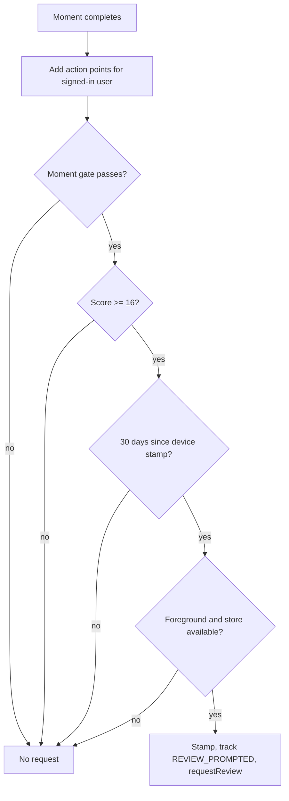
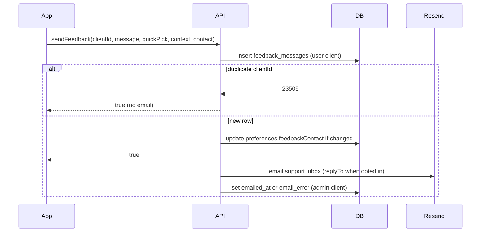

# Rating Ask and Rider Feedback - Plan

## Goal Capsule

- **Objective:** Engaged MotoVault riders are asked for a store rating at their best moments, and any rider can write to the developer from inside the app and choose to be contacted later.
- **Means:** an on-device happiness score gates the native review dialog at four moments (KTD1), and a new feedback table plus API mutation backs an in-app form that emails the support inbox (KTD5).
- **Authority:** Product Contract R-IDs win on behavior; KTDs win on mechanism; units override neither.
- **Product authority:** Owner (solo developer), decided in the 2026-10-12 brainstorm and planning session.
- **Stop conditions:** stop and report if the Enable or Maybe later buttons or the onboarding flow would change in any A/B arm, if any surface would request the review dialog after a sentiment answer, or if a user-scoped write would need the service-role client.
- **Execution profile:** one PR on branch `feat/store-review-direct` covering `supabase/`, `packages/types`, `apps/api`, `apps/mobile`; the owner merges after `ce-code-review`.
- **Open blockers:** None.

## Product Contract

### Summary

The store's own rating popup fires only at four high moments, and only for riders whose recent-activity happiness score passes a threshold, at most once every 30 days.
A "Write to the developer" form and a "Rate MotoVault" entry live in Help & Support and a new Feedback group on Profile.
Riders can opt in to being contacted, with an email address of their choice, from the form, the Notifications screen, or the onboarding notifications step.

### Problem Frame

MotoVault has about 6 App Store ratings in total (US 2, DE 2, SK 2) after months live, while a gamified competitor with ~1,800 users has 80.
The current prompt counts any two actions (expense logged, bike edited, and so on), then shows a custom "Enjoying MotoVault?" question; only riders who answer yes reach the native dialog.
In the last 90 days 72 riders saw that question, 41 said yes, and 36 said no, yet ratings barely moved, because iOS throttles the native dialog silently and the request often fires at chores or after the ride summary has already navigated away to Profile.
Pre-filtering by sentiment also conflicts with Apple guideline 5.6.1 and Google Play's In-App Review policy.
Riders have no in-app way to reach the developer: Help & Support only opens the phone's mail app, the 36 "no" answers live in analytics and nowhere actionable, and the database holds no contact consent beyond 4 promotional push opt-ins.

### Key Decisions

- **Native rating dialog only, never a sentiment pre-question.** Store rules forbid biasing who reaches the store; the feedback form is the separate outlet. Governs R1, R13. (session-settled: user-approved — chosen over keeping the "Enjoying MotoVault?" soft ask: Apple 5.6.1 and Google Play policy forbid gating, confirmed by the RevenueCat article the owner supplied.)
- **Ask over the ride summary right after Save.** The ride's stats are still on screen, which is the peak pride moment. Governs R3. (session-settled: user-directed — chosen over the saved ride's detail page and the Profile tab after landing.)
- **Only real rides from the 2nd ride on qualify.** Test rides and first-time setup are bad moments to ask. Governs R4. (session-settled: user-directed — chosen over any real ride, the 3rd real ride only, and any saved ride.)
- **Four prompt moments, not one.** Owner asked to "search more moments"; analytics showed riders who finish a ride return in days 1-7 at 76%, service loggers ~50%, Garage bike adders 27%, onboarding first-bike adders only 13%. Governs R2. (session-settled: user-directed — chosen over ride-only and over adding expense logging or the onboarding first bike.)
- **Happiness score with decay decides eligibility.** Recent, weighted engagement beats a lifetime count; one action alone never qualifies. Governs R5, R6. (session-settled: user-directed — chosen over "2+ actions in the last 14 days" and today's lifetime count, after reading the RevenueCat "happiness engine" article.)
- **30-day cooldown between requests.** Governs R7. (session-settled: user-directed — owner lowered it from the 120 days first chosen.)
- **In-app form, saved and emailed to the developer.** Riders need no mail app, and every message has a record. Governs R9, R10. (session-settled: user-directed — chosen over saved-only and over keeping the mail-app link.)
- **Quick picks inside the form instead of a separate survey.** The PostHog "How would you feel without MotoVault?" survey was stopped on 2026-10-12 because its framing is negative. Governs R11. (session-settled: user-directed — chosen over a one-tap card after the 3rd ride and over no question.)
- **Entry points in Help & Support and a Profile Feedback group.** Governs R8. (session-settled: user-directed — chosen over also adding What's New and ride summary links.)
- **Contact opt-in on the form, in Notifications, and in onboarding.** Owner wants to talk to riders who allow it. Governs R14-R18. (session-settled: user-directed — chosen over a form checkbox only and over leaving it out.)
- **Onboarding opt-in is one small unchecked line.** Onboarding is revenue-critical and A/B tested, so the addition must not alter its buttons or flow. Governs R17. (session-settled: user-directed — chosen over a fourth benefit row with a toggle and a separate mini-step.)
- **Rider-chosen contact email.** Owner asked for riders to be able to add an email to talk with them. Governs R15. (session-settled: user-directed — owner request.)
- **Onboarding opt-in is saved straight to the account, with no email field there.** The notifications step comes after sign-up in every onboarding flow, so no pre-account device memory is needed, and an email field would raise the keyboard over the A/B-tested buttons. Governs R15, R17, R18. (session-settled: user-approved — chosen over device memory synced at sign-up and over an email field in onboarding.)

### Requirements

**When the rating popup may fire**

- R1. The app requests the platform's native in-app review dialog directly, with no question, sheet, or alert before it, and nothing a rider answers anywhere in the app changes whether they are asked.
- R2. Only four moments may request the dialog: saving a qualifying ride (R3, R4), completing a maintenance task or logging a past service, adding a bike from the Garage (never the onboarding first bike), and watching a ride flyover to its end.
- R3. On a qualifying ride, the request happens while the ride summary is still on screen after Save succeeds, and the app moves on to its usual destination afterwards.
- R4. A ride qualifies when it is at least the rider's 2nd saved ride and exceeds a minimum distance and duration (starting values 5 km and 10 minutes).
- R5. Every request also needs the rider's happiness score to be at or above the threshold (starting value 16).
- R6. The happiness score is the sum of points for the rider's recent actions, each fading with its own half-life; starting weights are in the table below and are tunable from one place.
- R7. At most one request per rider on a device every 30 days, counted from the last request whether or not the operating system actually showed the dialog.

| Action | Points | Half-life |
|---|---|---|
| App opened | 1 | 1 day |
| Ride saved at or above the minimum distance and duration (any ride number) | 8 | 7 days |
| Maintenance task completed or past service logged | 6 | 7 days |
| Bike added from the Garage | 5 | 7 days |
| Ride flyover watched to the end | 4 | 3 days |
| Expense logged, trip created | 2 | 3 days |
| Subscribed to Pro | 10 | 14 days |

**Permanent entry points**

- R8. Help & Support and a new Feedback group on the Profile tab each offer "Write to the developer" and "Rate MotoVault".
- R9. "Rate MotoVault" opens the store's write-a-review page for MotoVault directly (App Store on iOS, Play Store on Android, web listing as fallback), without the 30-day limit.

**Writing to the developer**

- R10. "Write to the developer" opens an in-app form whose message is saved and emailed to the developer's support inbox, with the app version, platform, and the rider's bike attached; the form tells the rider this context is included.
- R11. The form offers optional quick picks ("I love…", "I wish…", "Something's broken") above a free-text message.
- R12. The rider sees a clear sent state, and a failed send keeps their text so they can retry.
- R13. Sending a message, its quick pick, and its content never affect rating eligibility (R1).

**Contact opt-in**

- R14. A rider can opt in to "the developer may contact me about my feedback", off by default, from a checkbox on the form, a toggle in Notifications, or a line on the onboarding notifications step; every place reads and writes the same single choice.
- R15. The form and the Notifications screen offer an optional "Email to reach me at", pre-filled with the account email and editable; it is separate from the login email and never changes how the rider signs in. The onboarding line uses the account email, editable later in Notifications.
- R16. When the account email is an Apple private relay address, the field starts empty and explains that the relay address is used unless the rider enters a personal one.
- R17. On the onboarding notifications step the opt-in is one small unchecked line that does not change the Enable or Maybe later buttons, is kept whichever button is tapped, and leaves existing onboarding experiments unchanged.
- R18. Every opt-in choice is saved to the rider's account with its date, the wording version shown, and the place it was made.
- R19. A rider can change their contact email or turn the opt-in off at any time from Notifications.

**Measurement**

- R20. Analytics records each rating request with the moment that triggered it, each "Rate MotoVault" tap, each message sent with its quick pick, and each opt-in change.

### Key Flows

- F1. Ride rating moment. **Trigger:** rider taps Save on the ride summary. The ride saves; if the ride qualifies (R4), the score passes (R5), and the cooldown has elapsed (R7), the native dialog is requested over the summary; the app then continues to its usual destination. **Covers R2, R3, R4, R5, R7.**
- F2. Writing in. **Trigger:** rider taps "Write to the developer" in Help & Support or Profile. They optionally pick a quick pick, type a message, optionally tick the contact opt-in and confirm the email, and send; the message is saved, emailed to the support inbox, and the rider sees it was sent. **Covers R8, R10-R12, R14, R15.**
- F3. Onboarding opt-in. **Trigger:** signed-in rider reaches the onboarding notifications step. They may tick the contact line, then tap Enable or Maybe later as today; the choice is saved to the account when onboarding completes. **Covers R14, R15, R17, R18.**

### Acceptance Examples

- AE1. A rider saves their first ride, 25 km. **Covers R4.** No rating request, because it is not yet the 2nd ride; it still adds to the score.
- AE2. A rider saves their 3rd ride, 3 km and 6 minutes. **Covers R4.** No request, because the ride is below the minimum distance and duration.
- AE3. A rider saves a 40 km ride this week, after a 30 km ride and a logged service earlier in the week. **Covers R3, R5.** The score passes 16, so the native dialog is requested over the ride summary right after Save.
- AE4. A rider qualified and was asked 12 days ago, then finishes another qualifying ride. **Covers R7.** No request until 30 days have passed.
- AE5. A rider logs three expenses in a day. **Covers R2, R6.** No request, because expense logging adds to the score but is not a prompt moment.
- AE6. A rider adds their first bike during onboarding. **Covers R2.** No request; adding a 2nd bike later from the Garage may request it.
- AE7. A rider sends "Something's broken: GPS lost signal" with the opt-in ticked and a Gmail address replacing their relay address. **Covers R10, R13, R15, R16.** The developer gets an email with the message, app version, platform, bike, and the Gmail address; the rider's rating eligibility is unchanged.
- AE8. A rider ticks the contact line on the onboarding notifications step and taps Maybe later. **Covers R17, R18.** When onboarding completes, the opt-in is saved to the account with its date, wording version, and source; notifications stay off.
- AE9. A rider taps "Rate MotoVault" two days after the native dialog was requested. **Covers R9.** The store's write-a-review page opens; the 30-day limit does not apply.

### Success Criteria

- Store ratings grow from ~6 to 30+ across App Store and Play within 90 days of the release reaching riders.
- The form receives real rider messages within the first weeks after release.

### Scope Boundaries

- A web admin inbox for messages, and replying or chatting inside the app.
- Bulk email or outreach tooling; the one-off outreach to paying users and the 4 promotional opt-ins is done by hand.
- Bringing back a PMF survey or the PostHog "without MotoVault" survey.
- Verifying the rider-entered contact email; a typo means the reply bounces.
- Replying to store reviews is a developer habit, not part of this build.

### Dependencies / Assumptions

- Messages are delivered to `support@motovault.app`, the address the listings and privacy policy already publish, and the developer replies from that inbox.
- The happiness score and rating cooldown live on the device, so a reinstall starts them from zero.
- iOS shows the native dialog at most about 3 times a year and Android applies an unpublished quota; with a 30-day cooldown, requests will outnumber dialogs shown.
- Release order: database change and API deploy before the mobile store build; an over-the-air update alone is not enough because the form depends on the new API.
- Replies to Apple private relay addresses arrive only if `motovault.app` is registered under Sign in with Apple → Email Sources in the Apple Developer portal; the 2026-10-12 outreach to 6 relay addresses produced no bounce, which suggests it already is.

### Sources / Research

- `apps/mobile/src/lib/store-review.ts` — current soft-ask gate and milestone call sites.
- `apps/mobile/src/app/(modals)/ride-summary.tsx` — Save handler requests the review then replaces to Profile immediately.
- `apps/mobile/src/app/(onboarding)/notifications.tsx` — onboarding notifications step (Enable / Maybe later).
- `apps/mobile/src/app/(tabs)/(profile)/support.tsx` and `notifications.tsx` — current Email Support row and notification toggles.
- `apps/mobile/src/lib/analytics-consent.ts` — versioned, timestamped consent model to mirror.
- `apps/api/src/modules/email/email.service.ts` — Resend email service (needs a new public method).
- `docs/ASO-Review-2026-07-15.md` — earlier recommendation not to gate the prompt on sentiment.
- RevenueCat, "How to hack your app store ratings" (2025): happiness score with decay, cooldown, review-gating caveat.

---

## Planning Contract

### Key Technical Decisions

- KTD1. **On-device happiness engine in `apps/mobile/src/lib/store-review.ts`.** One config object (`REVIEW_CONFIG` as const) holds the weights table, threshold, cooldown, and ride minimums from R4-R7; the engine stores timestamped events in MMKV, adds the current action's points before evaluating, and prunes events older than 60 days. Score events are keyed per signed-in user id (signed-out events are dropped); the cooldown stamp is per device, because the OS quota is per device. Governs R1, R5, R6, R7.
- KTD2. **Two entry calls, never one.** `recordReviewAction(action)` only adds points; `maybeRequestReview(moment)` adds points and may request. Only the four R2 moments call the second; everything else (app open, expense, trip, Pro purchase, notification MARK_DONE, receipt-scan service) calls the first. Notification MARK_DONE scores as the maintenance row (6 points, 7 days); a receipt-scan save scores as the expense row (2 points, 3 days). Governs R2, R13.
- KTD3. **Request guards, in order:** moment gate → score ≥ threshold → cooldown elapsed (a stamp in the future counts as elapsed) → app in foreground → `StoreReview.isAvailableAsync()`. The stamp is written only when `requestReview()` is actually called; native calls sit in try/catch. Legacy keys `review:actionCount` and `review:version` are deleted on first run. Governs R1, R7.
- KTD4. **Ride ordinal = local count or server overview.** A ride is "2nd or later" when the local `RIDE_SAVED` core-action count (after this save) is ≥ 2, or the ride summary's already-fetched overview shows a prior ride: `last30Days.rideCount ≥ 2` when `rideOverview.lastRide.id` equals this ride's id, otherwise `≥ 1`. The overview may or may not already count this ride, because `ride_rollups` updates asynchronously after `endRide`; the summary query selects `lastRide { id }` if it does not already. Distance and duration use the summary's `distanceM ≥ 5000` and `durationS ≥ 600`. A ride below the minimums earns no points; a first ride above them earns the full 8 (AE1). (session-settled: user-approved — chosen over a new all-time ride count field on the API: avoids a schema change and still lets riders who reinstalled qualify.) Governs R4.
- KTD5. **Feedback goes through a new `sendFeedback` GraphQL mutation backed by table `feedback_messages` (migration 00190).** The API inserts with the user client (INSERT-only RLS, no `.select()`), then emails the support inbox, then records `emailed_at` or `email_error` with the admin client. The mutation returns after the insert; the email runs after the response with an observed `.catch`. Governs R10, R12.
- KTD6. **Idempotent sends.** The client generates a UUID per draft (`clientId`), reused across retries and replaced after a confirmed send; `UNIQUE (user_id, client_id)` makes a retried insert hit `23505`, which the service treats as success and skips the email. (session-settled: user-approved — chosen over a plain double-tap guard: a timed-out request that the server already saved would otherwise send a duplicate email.) Governs R12.
- KTD7. **Context travels in the mutation input.** The app sends no version or platform headers, so the input carries `platform` (`DEVICE_PLATFORM`), `appVersion`, `updateId` (expo-updates, nullable), and `locale`; the server adds the rider's most recently updated active bike, read with the user client. Governs R10.
- KTD8. **Email shape.** Subject uses only the quick pick label and app constants; every rider value goes through `escapeHtml`. When the rider opted in, `replyTo` is the effective contact email; otherwise no `replyTo` is set and the body states that the rider did not opt in to contact, showing only the user id. `EmailService.send()` gains an optional `replyTo` and returns `{ ok, error? }` instead of swallowing. Governs R10, R14.
- KTD9. **Contact opt-in lives in `users.preferences.feedbackContact`** `{ enabled, email: string | null, decidedAt, wordingVersion, locale, source }`, typed by a new `FeedbackContactSchema` inside `UserPreferencesSchema`. `email: null` means "use the account email" so a later login-email change never leaves a stale copy. Every writer takes `wordingVersion` and `locale` from the client that showed the text, never from a server-side constant. No migration is needed: authenticated already may UPDATE `preferences` (00178). Governs R14, R15, R18, R19.
- KTD10. **Three writers, one shape.** The form sends `contactOptIn`, `contactEmail`, and `contactWordingVersion` inside `sendFeedback` (alongside its `locale`), and the server updates `feedbackContact` only when the value changed; the Notifications screen writes through the existing `UpdateUser` mutation using a `lastSentRef` like `privacy.tsx`; onboarding stores the choice in the onboarding store and `completeOnboarding` writes it from an optional `feedbackContactOptIn { wordingVersion, locale }` object sent only when the line is ticked, because that RPC merges preferences atomically and is already retried. (session-settled: user-approved — chosen over an immediate `UpdateUser` at the notifications step: its read-modify-write could race `completeOnboarding` and drop `onboardingCompleted`.) Governs R14, R17, R18.
- KTD11. **Wording version is per surface and per locale.** `FEEDBACK_CONTACT_WORDING_VERSION` is one integer bumped whenever any locale's opt-in text changes; the stored `locale` and `source` identify which text the rider saw. Governs R18.
- KTD12. **Ride summary holds before navigating only when a request was made.** Android awaits `requestReview()`; iOS waits 1.5 s, since it gives no shown or dismissed signal. Other moments keep their existing delayed `router.back`. (session-settled: user-approved — chosen over navigating immediately: the dialog would open over Profile instead of the ride stats.) Governs R3.
- KTD13. **Store URL is a pure function of the OS.** `getWriteReviewUrls(os)` returns the ordered URL list and is tested with both values; `openStoreReviewPage()` passes `process.env.EXPO_OS`, since jest-expo inlines `EXPO_OS` and `Platform.OS` is banned in mobile. Opening the page does not stamp the cooldown. Governs R9.
- KTD14. **Analytics: client-side and consent-gated only.** Events carry the moment, surface, quick pick, and opt-in state; never message text, the contact email, or its domain. The contact email is wrapped in `PostHogMaskView` wherever it renders as text. Existing `REVIEW_PROMPTED` stays (with `moment` and `score` properties) so the PostHog series continues; the soft-ask events are deleted. Governs R20.
- KTD15. **Abuse limits.** `THROTTLE_PRESETS.FEEDBACK = { limit: 5, ttl: 3_600_000 }` on `sendFeedback` via `GqlThrottlerGuard`; message 1-4000 characters after trimming (Zod and a DB `CHECK (char_length(message) <= 4000)`); contact email validated as an email, ≤ 254 characters, no CR or LF since it becomes a header. Governs R10, R15.

### High-Level Technical Design

Request decision at a prompt moment (directional, not code):

Feedback send path:

### Moment gates

| Moment | Call site | Gate beyond KTD3 |
|---|---|---|
| Ride saved | `apps/mobile/src/app/(modals)/ride-summary.tsx` `handleSave` | KTD4 ordinal, distance, duration |
| Maintenance completed / past service logged | `(garage)/complete-task.tsx`; `(garage)/add-maintenance-task.tsx` only when `isLog` | none |
| Bike added from Garage | `(garage)/add-bike.tsx` success | onboarding completed; never on the onboarding route stack |
| Flyover watched | `(modals)/ride-flyover.tsx` end detection | first natural end per screen visit and played time ≥ half the flyover duration |

### Assumptions

- `expo-store-review` is already in the 3.25.0 binary (`apps/mobile/package.json`), so no native change is needed.
- `NOTIFY_EMAIL` and `RESEND_API_KEY` are set on Render; `NOTIFY_EMAIL` falls back to `support@motovault.app`.

### Sequencing

U1 (schema and types) → U2 (API) → `pnpm generate` → U3 (engine) → U4 (moments) and U5 (form, entry points) → U6 (opt-in surfaces). U4 and U5 are independent once U3 and the generated types exist.

### System-Wide Impact

- **Privacy and GDPR:** `feedback_messages` rows cascade on `auth.users` deletion and join the data export in `apps/api/src/modules/users/data-export.service.ts`; emails already in the support inbox are outside that lifecycle.
- **Onboarding:** the persisted onboarding store gains a field, so its persist version bumps with a migrate function; the notifications step changes in every A/B arm at once, so experiment readouts should note the release date.
- **Release:** migration and API deploy must be live, and the live schema must expose `sendFeedback` and the new `CompleteOnboardingInput` field, before the store build is submitted; an old API would reject the new onboarding field and break onboarding.

### Risks

| Risk | Mitigation |
|---|---|
| Store build ships before the API, breaking `completeOnboarding` | Release gate in Documentation / Operational Notes; field is optional and sent only when ticked |
| Resend failure makes a message invisible | `email_error` column, `Logger.error` plus Sentry, documented SQL for unemailed rows |
| Concurrent `preferences` writes drop a key | Whole-object `feedbackContact` writes, `lastSentRef`, onboarding through the atomic RPC (KTD10) |
| iOS quota hides the dialog | Accepted; R9's permanent Rate row is always available |

### Documentation / Operational Notes

- Apply 00190 to prod through the Supabase Management API, then deploy the API on Render and confirm `sendFeedback` in the live schema, then submit the store build.
- Once the API is live, existing 3.25.0 riders can also receive the mobile changes by OTA; new installs need the store build because first-run onboarding uses the embedded bundle.
- PR body notes: release order, Apple relay email-source registration, and the end of the `review_soft_ask_*` PostHog series.
- Unemailed messages: `select id, created_at, email_error from feedback_messages where emailed_at is null order by created_at desc;`

---

## Implementation Units

### U1. Feedback table and shared schemas

- **Goal:** persist rider messages safely and define the shared validation shapes.
- **Requirements:** R10, R11, R14, R15, R18; KTD5, KTD6, KTD9, KTD11, KTD15.
- **Dependencies:** none.
- **Files:**
  - `supabase/migrations/00190_feedback_messages.sql` (new)
  - `packages/types/src/validators/feedback.ts` (new), `packages/types/src/validators/index.ts`
  - `packages/types/src/validators/user-preferences.ts` (`FeedbackContactSchema`)
  - `packages/types/src/constants/` (quick picks, contact source, wording version as const)
  - `packages/types/src/database.types.ts` via `pnpm generate:types` only
- **Approach:** follow the 00189 template: header comment, `BEGIN/COMMIT`, `user_id ... ON DELETE CASCADE`, `client_id uuid`, `message`, `quick_pick`, `platform`, `app_version`, `update_id`, `locale`, `motorcycle_id ... ON DELETE SET NULL`, `contact_allowed`, `contact_email`, `emailed_at`, `email_error`, `created_at`; `UNIQUE (user_id, client_id)`; length CHECKs; RLS on; `REVOKE ALL ... FROM PUBLIC, anon, authenticated`; `GRANT INSERT (<client columns>) TO authenticated` so `emailed_at` and `email_error` stay service-only; INSERT policy `WITH CHECK ((SELECT auth.uid()) = user_id)` plus an owned, non-deleted bike check when `motorcycle_id` is set. Export both schema and inferred type for every validator.
- **Test scenarios:**
  - `FeedbackInputSchema` rejects a whitespace-only message, a 4001-character message, an unknown quick pick, and an email containing `\r\n`; accepts a 4000-character message with emoji.
  - `UserPreferencesSchema` accepts `feedbackContact` with `email: null`, rejects a non-email string, and still passes unknown keys through.
- **Verification:** `pnpm --filter @motovault/types test`; after applying the migration locally or on a branch DB, a rolled-back `SET LOCAL role authenticated` probe shows insert succeeds for own `user_id`, fails for another user's, and `UPDATE ... SET emailed_at` is denied.

### U2. API: sendFeedback, email, onboarding opt-in, export

- **Goal:** accept messages, email the support inbox, and save opt-ins.
- **Requirements:** R10, R12-R15, R18; KTD5-KTD10, KTD15.
- **Dependencies:** U1.
- **Files:**
  - `apps/api/src/modules/feedback/` (new: module, resolver, service, `dto/send-feedback.input.ts`, spec files), registered in `apps/api/src/app.module.ts`
  - `apps/api/src/modules/email/email.service.ts` (`replyTo`, result return, `sendFeedbackNotification`)
  - `apps/api/src/config/constants.ts` (`THROTTLE_PRESETS.FEEDBACK`)
  - `apps/api/src/modules/users/users.service.ts`, `dto/complete-onboarding.input.ts` (`feedbackContactOptIn` input object), Zod onboarding schema in `packages/types`
  - `apps/api/src/modules/users/data-export.service.ts`
  - `apps/api/schema.graphql` via `pnpm generate`
- **Approach:** model on `modules/surface-reports` but insert without `.select()`. The service resolves the effective contact email (rider's email, or the JWT email when `null`), updates `feedbackContact` through `UsersService.update` only when `enabled` or `email` changed, then emails asynchronously. The email reads `users.email` with the admin client and the bike with the user client. Existing callers of `send()` keep their behavior by ignoring the returned result. `completeOnboarding` adds `feedbackContact` to its preferences object only when `feedbackContactOptIn` is present, with `enabled: true`, `email: null`, `source: 'onboarding'`, and the client's `wordingVersion` and `locale`.
- **Execution note:** write the service spec first for the duplicate and email-failure paths.
- **Test scenarios:**
  - New message: inserts once, returns true, calls `sendFeedbackNotification` with message, quick pick, version, platform, bike name.
  - Insert returns `23505`: returns true, sends no email, does not update preferences.
  - Opted in with a custom email: email has `replyTo` set to it and `feedbackContact` is written with `source: 'form'`; opted in with `email: null`: `replyTo` is the JWT email.
  - Not opted in: no `replyTo`, body states no contact consent.
  - Resend error: `email_error` is written with the admin client and the error is logged; the mutation result is unaffected.
  - Message with `<script>`: escaped in the HTML body; subject contains no message text.
  - Resolver carries `GqlThrottlerGuard` with `THROTTLE_PRESETS.FEEDBACK`.
  - `completeOnboarding` with `feedbackContactOptIn { wordingVersion: 1, locale: 'de' }` passes `feedbackContact` with those values and `enabled: true` in `p_preferences`; omitted leaves no key.
  - Data export includes the rider's `feedback_messages` rows.
- **Verification:** `pnpm --filter @motovault/api test`, `pnpm --filter @motovault/api typecheck`, `pnpm generate` with no unexpected schema drift.

### U3. Happiness engine and store link

- **Goal:** replace the soft ask with the scored, cooldown-gated native request and a testable store link.
- **Requirements:** R1, R5-R7, R9, R13, R20; KTD1-KTD3, KTD13, KTD14.
- **Dependencies:** none (mobile-only), but lands before U4.
- **Files:**
  - `apps/mobile/src/lib/store-review.ts` (replaces the soft-ask engine currently in the file)
  - `apps/mobile/src/lib/__tests__/store-review.test.ts`
  - `apps/mobile/src/lib/analytics.ts` (`REVIEW_PROMPTED` props, `REVIEW_STORE_PAGE_OPENED`, feedback and contact events)
- **Approach:** exports `REVIEW_ACTION`, `REVIEW_MOMENT`, `REVIEW_CONFIG` as const, `recordReviewAction`, `maybeRequestReview(moment, context)` returning whether a request was made, `getWriteReviewUrls(os)`, `openStoreReviewPage(surface)`. Use `date-fns` for day math. The user id comes from the auth store; with no user, record nothing.
- **Test scenarios:**
  - AE1: first ride, 25 km, 30 min, score otherwise 0 → no request, score rises by 8.
  - AE3: a ride and a service logged 2 days earlier plus a new qualifying ride (≈ 6.6 + 4.9 + 8 = 19.5, no app opens) → request, `REVIEW_PROMPTED` with `moment: 'ride'`; the same two events 6 days earlier (≈ 15.7) → no request.
  - AE4: stamp 12 days ago → no request; stamp 31 days ago → request; stamp 2 days in the future → request and re-stamp.
  - AE5: three `EXPENSE` actions → `recordReviewAction` only, never `requestReview`.
  - Decay: an 8-point ride from 7 days ago contributes 4.
  - `isAvailableAsync` false → no request and no stamp; `requestReview` throws → no crash.
  - User switch: user B starts with score 0 after user A built 20; the device stamp still applies.
  - Legacy `review:version` present → removed, no effect on eligibility.
  - `getWriteReviewUrls('ios')` → the `action=write-review` App Store URL; `('android')` → `market://details?id=com.motovault.app` then the web Play URL.
  - `openStoreReviewPage` tries each URL with `Linking.openURL` and falls back to the next only when the call rejects (no `canOpenURL`, which returns false negatives on Android 11+ without `<queries>`); it never touches the stamp.
- **Verification:** `pnpm --filter @motovault/mobile exec jest src/lib/__tests__/store-review.test.ts` passes, including both OS cases.

### U4. Wire the moments and point sources

- **Goal:** call the engine from the four moments and the point-only actions.
- **Requirements:** R2-R4, R6, R13; KTD2, KTD4, KTD12; Moment gates table.
- **Dependencies:** U3.
- **Files:**
  - `apps/mobile/src/app/(modals)/ride-summary.tsx`
  - `apps/mobile/src/app/(garage)/complete-task.tsx`, `add-maintenance-task.tsx`, `add-bike.tsx`
  - `apps/mobile/src/app/(modals)/ride-flyover.tsx`
  - `apps/mobile/src/features/receipt-scan/use-receipt-scan-save.ts`
  - `apps/mobile/src/app/_layout.tsx` (app-open on `AppState` active, at most once per 30 min; MARK_DONE points)
  - `apps/mobile/src/lib/subscription.ts` (Pro points on `PURCHASE_COMPLETED`, not restore)
  - Expense and trip call sites currently calling `maybeRequestReview`: `add-expense.tsx`, `add-ride-expense.tsx`, `hooks/use-create-trip-data.ts`
  - Remove calls in `health-report.tsx`, `edit-bike.tsx`, `(diagnose)/new.tsx`, `components/trip-share-sheet.tsx`
- **Approach:** ride summary computes the KTD4 gate, awaits `maybeRequestReview`, and applies the KTD12 hold only when it returns true; `savingRef` behavior is unchanged. Add-bike checks onboarding-completed state from the onboarding store or `me.preferences`. Flyover uses a new once-per-visit ref that scrubbing and restart never reset. Receipt-scan and MARK_DONE call `recordReviewAction` only, and receipt-scan skips it during onboarding.
- **Test scenarios:**
  - Ride summary: first ride on a fresh install whose overview already counts it (`lastRide.id` is this ride, `rideCount` 1) → no request.
  - Ride summary: 3rd ride of 40 km/45 min with a qualifying score requests the review, then calls `router.replace` after the iOS hold; a 3 km ride never requests and replaces immediately.
  - Add-maintenance in schedule mode does not request; in log mode it does.
  - Flyover: scrub to the end then play does not request; a full natural playback requests once, and a replay in the same visit does not.
  - Add-bike opened during onboarding does not request.
  - `grep -rn "maybeRequestReview" apps/mobile/src` lists only the screens in the Moment gates table and `store-review.ts`.
- **Verification:** affected screen tests pass under `pnpm --filter @motovault/mobile exec jest`; manual simulator check of the ride-summary hold on iOS.

### U5. Write-to-the-developer form and entry points

- **Goal:** riders can send a message and rate the app from Help & Support and Profile.
- **Requirements:** R8-R12, R14-R16, R20; KTD6, KTD7, KTD14.
- **Dependencies:** U2 (generated `SendFeedbackDocument`), U3.
- **Files:**
  - `apps/mobile/src/features/feedback/` (new: `feedback-screen.tsx`, `use-send-feedback.ts`, `contact-email.ts` for relay detection, tests)
  - `apps/mobile/src/app/(tabs)/(profile)/feedback.tsx` (thin route), `apps/mobile/src/config/routes.ts` (`PROFILE_ROUTE.FEEDBACK`), `apps/mobile/src/lib/analytics-screen.ts`
  - `apps/mobile/src/graphql/send-feedback.graphql`
  - `apps/mobile/src/app/(tabs)/(profile)/support.tsx`, `apps/mobile/src/app/(tabs)/(profile)/index.tsx` (Feedback group, re-indexed sections)
  - all 13 files in `apps/mobile/src/i18n/locales/`
- **Approach:** form uses `components/ui/editorial.tsx` rows and palette tokens in light and dark. Quick picks are single-select chips above the text field. The context line lists exactly what is attached. The opt-in checkbox shows the account value and is sent only on Send; the email field is shown only while the checkbox is ticked, and `contactEmail` is sent only when `contactOptIn` is true, so unticking never changes a stored email. Relay detection matches `@privaterelay.appleid.com` and `@private.icloud.com` only; for relay accounts the email field starts empty with neutral helper text. Text, quick pick, and `clientId` live in screen state, survive retries, and reset after a confirmed send. The form scrolls with keyboard avoidance so Send stays reachable; after a confirmed send it shows a confirmation with a Done button that returns to the originating screen. Chips use radio-group semantics, the checkbox exposes a checked role and label, and every new tappable row meets the platform minimum touch target. The throttle error maps to its own "try again later" message. Sending invalidates the `me` query key.
- **Test scenarios:**
  - Send with "Something's broken" and text → mutation input includes quick pick, platform, version, `clientId`; success state shows; draft cleared.
  - Network failure → error shown, text and `clientId` kept; retry reuses the same `clientId`.
  - Empty or whitespace text → Send disabled.
  - Relay account → email field empty with helper text; Gmail account → field prefilled.
  - Checkbox unticked with a typed email → input has `contactOptIn: false` and no `contactEmail`; the field hides.
  - Email with a newline → inline validation error, no request.
  - Support and Profile rows navigate to `PROFILE_ROUTE.FEEDBACK`; Rate rows call `openStoreReviewPage` with their surface.
- **Verification:** `pnpm --filter @motovault/mobile exec jest src/features/feedback`; `pnpm check:i18n`; simulator screenshots of the form in light and dark.

### U6. Contact opt-in in Notifications and onboarding

- **Goal:** riders can opt in or out and change their contact email outside the form.
- **Requirements:** R14-R19; KTD9-KTD11.
- **Dependencies:** U2, U5 (shared `contact-email.ts`).
- **Files:**
  - `apps/mobile/src/app/(tabs)/(profile)/notifications.tsx` (new "Talk to the developer" group: toggle plus email row)
  - `apps/mobile/src/app/(onboarding)/notifications.tsx` (unchecked line in the `OnboardingShell` `footer`)
  - `apps/mobile/src/stores/onboarding.store.ts` (field plus persist version bump and migrate)
  - `apps/mobile/src/app/(onboarding)/personalizing.tsx` (pass `feedbackContactOptIn`)
  - `apps/mobile/src/graphql/` operations for `completeOnboarding` if the input selection changes
  - all 13 locale files
- **Approach:** Notifications writes the whole `feedbackContact` object via `UpdateUser` with `source: 'notifications'` and a `lastSentRef`; the email row edits in a small sheet and renders the address inside `PostHogMaskView`. On `UpdateUser` failure the toggle reverts and an inline error shows; the email sheet uses the U5 validation and stays open on an invalid value or save error; relay accounts see the R16 empty state and helper text. The onboarding line is a checkbox row below the card that never moves Enable or Maybe later, meets the minimum touch target, and does not await anything.
- **Test scenarios:**
  - Toggle on → `UpdateUser` with `enabled: true`, `source: 'notifications'`, current wording version and locale; two quick toggles send the latest value.
  - Edit email → saved; clearing it saves `email: null`; an address with a newline shows an inline error and the sheet stays open.
  - `UpdateUser` rejects → toggle returns to its previous value with an error message.
  - Onboarding: tick then Maybe later → store holds the choice, notifications stay off, `completeOnboarding` input has `feedbackContactOptIn` with the shown wording version and locale; untouched → field omitted.
  - Onboarding store migrate from the previous version keeps existing answers and sets the new field to false.
- **Verification:** `pnpm --filter @motovault/mobile exec jest`; simulator run through each onboarding A/B arm confirming button positions are unchanged.

---

## Verification Contract

| Gate | Command or check | Applies to |
|---|---|---|
| Types tests | `pnpm --filter @motovault/types test` | U1 |
| API tests and types | `pnpm --filter @motovault/api test`, `pnpm --filter @motovault/api typecheck` | U2 |
| Mobile tests | `pnpm --filter @motovault/mobile exec jest` | U3-U6 |
| Codegen | `pnpm generate`, then no diff left unstaged in `packages/graphql/src/generated` | U1, U2, U5, U6 |
| i18n | `pnpm check:i18n` | U5, U6 |
| Full precheck | `pnpm precheck` | all |
| RLS probe | rolled-back `SET LOCAL role authenticated` insert/update probe against the applied migration | U1 |
| UI | iOS simulator screenshots of the form, Profile Feedback group, Notifications group, and onboarding line in light and dark | U5, U6 |

---

## Definition of Done

- Every R-ID is implemented and covered by a unit test or a simulator check listed above.
- No code path shows a sentiment question before or instead of the native review request.
- `maybeRequestReview` is called only from the screens in the Moment gates table.
- New strings exist in all 13 locales; every new analytics event has a call site; soft-ask events and keys are gone.
- All mobile surfaces use palette tokens and render in light and dark.
- No abandoned-attempt code remains in the diff; the existing failing Android store-link tests are replaced by `getWriteReviewUrls` tests.
- The PR body carries the release order, the Apple relay note, and the PostHog series note.
