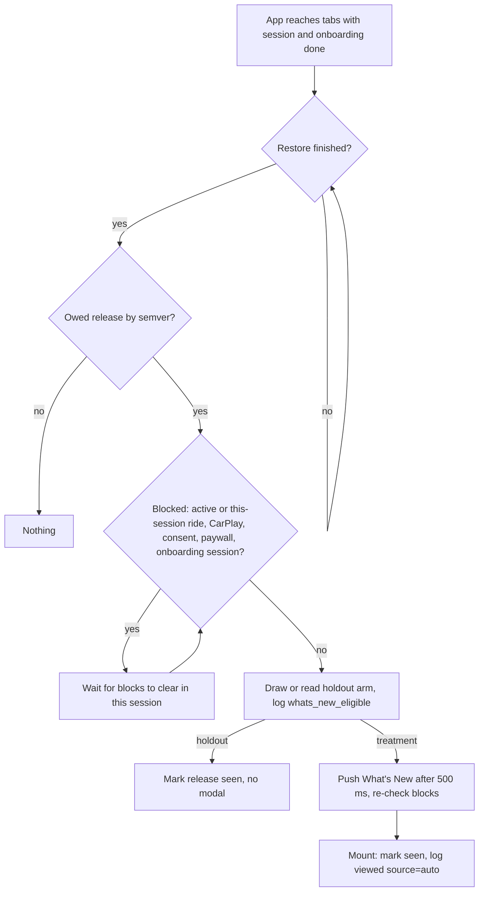
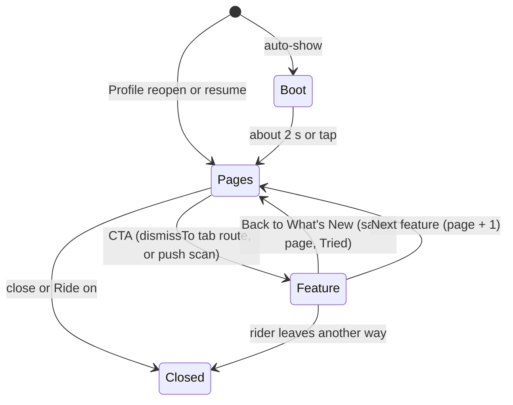

# What's New boot and carousel - Plan

## Goal Capsule

- **Objective:** After a store update, riders who open MotoVault see once, at a calm moment, what is new for their bike, personalised with their own rides, expenses and notes, and can try each feature and get straight back to the tour.
- **Means:** Replace the slide modal with a boot animation followed by a swipeable carousel. A semver "this or later" gate decides when it shows, and the page data comes from the cache plus a fetch bounded by the boot (KTD1, KTD3, KTD5, KTD6).
- **Authority:** the R-IDs in this plan, then the KTDs. The design prototype (Sources) illustrates the R-IDs and never amends them. Root `CLAUDE.md` and `apps/mobile/CLAUDE.md` override any unit approach.
- **Execution profile:** one PR, mobile only (`apps/mobile`), with no API, DB or migration change. Units are dependency-ordered for subagent dispatch in waves (see Sequencing).
- **Stop conditions:** stop and report instead of improvising if any of these happens:
  - a destination screen cannot show the return bar without changing its own navigation;
  - `check:mobile-structure` cannot be met without growing `src/app/_layout.tsx`;
  - the holdout needs a PostHog change from inside the code.
- **Who finishes:** `ce-work` implements, then the LFG pipeline reviews and opens the PR. The owner merges. The owner decides on any OTA onto the 3.28.0 runtime (see Operational Notes).

---

## Product Contract

### Summary

What's New becomes one full-screen component with these parts:
- a short boot that rolls to the rider's season distance and ends by saying how many features are new and how many the rider may have missed;
- one swipeable page per feature, each with a personalised line, a live demo tagged YOUR DATA or EXAMPLE, and one button that opens the real feature;
- a "Back to What's New" bar on that feature, which returns the rider to the same page marked Tried.

It shows on the first open after any store build at or above the newest release entry the rider hasn't seen. It never shows during onboarding, a ride, CarPlay, the consent prompt or a paywall. Profile › What's New reopens it without the boot. Half of riders are held out, so its effect can be measured.

### Problem Frame

Today's gate shows What's New only when the installed version exactly equals a release entry. Patch builds and releases without an entry (3.26, 3.27, and 3.28.0 today) show nothing, which is the structural cause of the 15.5% reach. "Seen" is recorded only from the modal's own buttons, so one rider saw it 54 times. The slides are generic, carry no rider data, and the feature button uses a navigation pattern the repo bans (`back()` then a delayed `push`). Earlier design rounds left the owner "lost": there was no single place, and no way back after trying a feature.

### Key Decisions

- KD1. **One What's New component, shown when a new store build is installed.** (session-settled: user-directed — chosen over spreading What's New across Home hero cards and other surfaces: the owner wants one component, shown when a build is published.) Governs R1, R2.
- KD2. **A boot, then a carousel: one full-screen page per feature. "Try it" opens the real screen, and coming back lands on the same page marked Tried.** (session-settled: user-approved — chosen over the round-2 dashboard-of-cards variants: the owner felt lost navigating the earlier designs.) Governs R8, R9, R10, R11, R16.
- KD3. **Real rider data first, a relevant example when there is none, with different wording and button for each.** (session-settled: user-directed — chosen over one generic demo for everyone: "If we get the data of the user, let it be displayed. If not let's just create some. The wording needs to be different also.") Governs R12, R13, R14, R15.
- KD4. **The scan demo is a clean data card, not a paper receipt.** (session-settled: user-directed — chosen over a paper receipt illustration: "change into clear data, no mimic of paper".) Governs R14.
- KD5. **A feature opened from What's New offers an obvious way back.** (session-settled: user-directed — chosen over making the rider find What's New again in settings: the owner flagged the dead end after tapping Road Atlas.) Governs R16, R17.
- KD6. **Light and dark both.** (session-settled: user-directed — chosen over a dark-only modal: an owner rule for every mobile surface.) Governs R21.
- KD7. **Scan a receipt and Notes + photos appear as "You may have missed" pages, not as "New in 3.28".** Research showed they shipped in 3.19.1 and 3.22.0. Only Road Atlas is new in 3.28.0. Governs R6, R7.

### Requirements

**When it shows**
- R1. Auto-show happens once, on the first app open where the installed build is at or above the newest release entry newer than the rider's last-seen release (semver order, not exact match).
- R2. Auto-show never happens during onboarding or the session that finished it, during a recording, paused or ended-but-unsaved ride, in a session where a ride ended, while CarPlay is connected or the phone scene is hidden, while the consent prompt is owed or on screen, or while a paywall is in flight. When a block clears later in the same session, it shows then.
- R3. The release counts as seen, and is never auto-shown again, the moment the carousel mounts or, for a held-out rider, the moment the gate decides to show it. Swiping it away or killing the app does not bring it back.
- R4. New installs never get an auto-show for the build they installed.
- R5. Profile › What's New reopens the latest release's pages at any time, without the boot.

**Which pages**
- R6. Pages are the newest release's features plus catch-up features (Scan a receipt, Notes + photos) that the rider has neither been shown in a carousel nor used on this device. They are capped at 3, current-release features first.
- R7. Each page's tag tells the truth: "New in 3.28" for current-release features, "You may have missed" for catch-up features.

**Boot**
- R8. The boot runs a gauge sweep and warning lamps that go out, then an odometer that rolls to the rider's season distance in their unit. When there is no season distance it shows the primary bike's odometer in that bike's own unit. With neither, the odometer is left out. It ends with a line counting only current-release pages as new ("1 new for your bike"), adding catch-up pages separately ("+ 2 you may have missed"). With no current-release page, it says only the catch-up part.
- R9. The boot lasts about 2 s, any tap skips it, and it appears only on auto-show. Under reduced motion it is a static frame shown for the same data window.

**Pages**
- R10. Each page shows: tag, "i of n", close, title, Tried chip, one personalised line, an animated demo panel tagged YOUR DATA or EXAMPLE, "where it lives", one copper CTA, and a Back / dots / Next row whose last-page label is "Ride on". On a tried page, the CTA reads "Open again" and its dot shows as tried.
- R11. Pages swipe horizontally and also move with Back and Next. Close or "Ride on" returns the rider to the screen beneath What's New: where they were before it opened, or the last feature screen they tried from it.

**Personal data**
- R12. **Road Atlas.** With rides, the rider's own recent routes draw on the map, and the line quotes their season distance and ride count. It quotes the share of new roads only when the rider's Territory detail is unlocked (Pro). Without rides, example routes are drawn, and the wording and CTA invite the first ride.
- R13. **Notes + photos.** With notes, the rider's latest note on the primary bike appears, an "Add a photo" slot pops in, and search finds it. Without notes, an example tyre-pressure note for the rider's bike appears, in bar (metric) or psi (imperial).
- R14. **Scan a receipt.** With expenses on the primary bike, its latest expense (place from its description, amount in its own currency, date) is "read" into a clean data card. The copy never claims it was typed by hand. Without expenses, an example fuel receipt appears in the rider's currency and units.
- R15. Examples use the rider's bike name, distance unit, currency and number/date locale. They are never worded as the rider's own data, and never show another rider's data.

**Trying a feature and coming back**
- R16. A page's CTA opens the real feature screen. For Road Atlas and Notes, that screen shows a fixed "‹ Back to What's New" bar, plus "Next feature ›" when a next page exists. Back returns to the same page with its Tried chip on. Next returns to the following page.
- R17. Scan opens the real scan flow through its metered entry (quota and paywall rules unchanged) on top of What's New. Closing the scan returns to the same page marked Tried, so it needs no return bar.

**Discovery and measurement**
- R18. Features from the latest carousel that the rider hasn't used show a small NEW chip on their entry rows until used.
- R19. A per-experiment 50/50 holdout decides whether eligible riders get the auto-show. Held-out riders still get Profile reopen and NEW chips. Both arms log the same eligibility event at the same decision point.
- R20. Analytics records, per page, eligibility, shown (with source auto or profile), page viewed, YOUR DATA versus EXAMPLE, CTA tapped, returned, boot skipped, and closed or completed. That lets "a shown feature used within 7 days" be read by arm.

**Quality**
- R21. Every surface works in light and dark, in km and mi, in every app currency, and in all mobile locales.

### Success Criteria

- Auto-show reach is well above today's 15.5%. It is measured as treatment-arm riders with `whats_new_viewed source=auto` divided by treatment-arm riders active on a build carrying the change, the same denominator as the baseline. Viewed against eligible is only a diagnostic for riders lost to guards.
- The treatment arm uses a shown feature within 7 days more often than the holdout. "Use" excludes opens made through What's New itself (Rider insights `entry=whats_new`). A completed scan or a note with a photo counts, whatever its entry.
- No rider sees the auto-show twice for one release (`whats_new_viewed` with `source=auto` per person and version ≤ 1).

### Scope Boundaries

- Older releases' slides (3.25.0 and earlier, except the two catch-up features) are no longer shown. The design's "older updates listed below" in Profile is not built.
- No server changes. There is no hand-typed versus scanned marker on expenses, and no fuel volume. The copy avoids both claims (R14).
- Considered and not built: persisting `expenses` and `notes` in the query cache, or an MMKV snapshot of them, to have rider data at cold start. Either would put personal records on disk across accounts and change other screens' cache behaviour. The boot-window fetch (KTD5) covers the common case. Evidence that would change this: a high `data_kind=example` share for riders who do have expenses or notes.
- Considered and not built: a session "interruption" flag set by consent, the ride summary and the rating prompt. The explicit guards in R2 cover the calm-moment goal without edits in three unrelated features. Evidence that would change this: riders seeing What's New directly after the rating prompt.
- Considered and not built: the prototype's closing summary screen that lists untried features. NEW chips (R18) carry that job in the app.
- Considered and not built: a "Tried" signal from the server. Tried and used are device-local. Evidence that would change this: catch-up pages shown to riders who demonstrably use the feature on another device.

#### Deferred to Follow-Up Work

- Native-speaker review of the machine-translated copy in the 12 secondary locales.
- A PostHog dashboard for the holdout read-out, and creating the holdout flag (owner, outside the code).
- Removing the now-unused i18n keys of retired slides from all locales.

### Outstanding Questions

- Owner, deferred and not blocking: keep the 50/50 holdout (R19)? It withholds the auto-show from half of consented riders in exchange for a measured effect. The code ships the holdout, but it is inert until the owner creates the PostHog flag (KTD8). Not creating the flag means everyone gets the auto-show.

### Sources

- Design prototype (machine-local, best effort; a missing file is not a blocker, and this plan's R-IDs govern any disagreement): `/private/tmp/claude-501/-Users-andrejmacm5-personal-MotoWise/7b7f6bf2-ad72-442d-8dd6-ac8bb35b628a/scratchpad/wn/project/WhatsNew.dc.html` (boot → pages → feature → closed), `WN-Flow.dc.html` (flow and rules), `WN-Data.dc.html` (wording and CTAs per page and data kind). Canvas: https://claude.ai/artifact/JAQDj55QBmYhgXGSG8bPGf.
- Navigation rule: `docs/solutions/ui-bugs/sheet-navigation-race-react-native-screens-4446.md` (one navigation action per decision; never `back()` then `push()`).
- Experiment precedent: `apps/mobile/src/lib/onboarding-experiment.ts`, `apps/mobile/src/stores/experiment.store.ts`, `apps/mobile/src/config/onboarding.ts`.

---

## Planning Contract

### Key Technical Decisions

- KTD1. **The gate is a pure decision plus one hook.** `lib/whats-new.ts` keeps a pure `isWhatsNewOwed`, rewritten to semver. The owed release is the newest entry with version ≤ installed. It is owed when that version is > `lastSeenVersion` (or `lastSeenVersion` is null) and it has at least one eligible page (R1). The hook `features/whats-new/use-whats-new-gate.ts` reads the ride store, CarPlay, consent, paywall and onboarding state, then calls the decision. `_layout.tsx` only mounts the hook, with net lines ≤ 0. Rationale: `_layout.tsx` has zero line headroom, `lib/` may not import `features/carplay`, and the gate-contract test moves with the decision. A small local semver compare is used, because the app has none.
- KTD2. **"Seen" is written on mount (auto-show) or at the gate decision (holdout), not on dismiss.** The `WHATS_NEW_VIEWED` event moves from before the push to the carousel's mount. The gate's module-level one-shot stays, for StrictMode and the session. A "session" is the JS process lifetime. The 500 ms timer re-checks every block when it fires.
- KTD3. **Release data becomes feature-based.** `data/whats-new-releases.ts` becomes:
  - a `WHATS_NEW_FEATURE` `as const` registry (`ROAD_ATLAS`, `RECEIPT_SCAN`, `NOTES_PHOTOS`), each with `introducedIn`, its i18n keys and its destination;
  - `WHATS_NEW_RELEASES`, a list of `{version, features}` with 3.28.0 = `[ROAD_ATLAS]`;
  - a `CATCH_UP_FEATURES` allowlist `[RECEIPT_SCAN, NOTES_PHOTOS]`.

  Old slide entries are removed. Page selection is a pure function of (release, `seenFeatures`, `usedFeatures`, platform), owned by R6.
- KTD4. **The store bumps to version 1, keeping the `whats-new` persist name and MMKV id.** New persisted fields: `seenFeatures`, `triedFeatures`, `usedFeatures`, and `holdout {experimentKey, arm}` (written only for a PostHog-assigned arm, KTD8). The page to resume travels in route params, not the store. A non-persisted `returnSessionOpen` flag (in memory, same store module, excluded via `partialize`) drives the return bar (KTD7). `migrate` keeps `lastSeenVersion`. Rationale: renaming the store drops every rider's last-seen version (the AsyncStorage migration key is `whats-new`).
- KTD5. **The data comes from a `buildBootSnapshot` built from the cache plus a fetch bounded by the boot.**
  - It reads synchronously from `queryClient`, only after the persisted cache has restored (`useIsRestoring() === false`):
    - `['rides','insights',tz,'headline']` (falling back to `['rides','insights',tz]`) for totals;
    - `['rides','list','home']` for route polylines;
    - `['motorcycles']` with `selectPrimaryBike`;
    - `['user','me']` and auth-store preferences for units and currency.
  - On every open (auto, profile, return), the screen starts `fetchQuery` calls with `retry: false` and `meta: { showErrorAlert: false }`, bounded to 1.5 s:
    - all-years expenses (`EXPENSES_ALL_YEARS`) and notes for the primary bike;
    - full insights when the rider is Pro.

    The scan quota is read if cached.
  - Each page's data freezes the first time that page is viewed, not when the boot ends. A skipped boot or a slow network therefore still upgrades a later page from example to the rider's data if the fetch lands before the rider swipes to it.
  - The page set is fixed when the pages first render. Prior use known by then (scan quota `used > 0`, any fetched note with a photo) is merged into `usedFeatures` before selection, so riders who already use a feature don't get "You may have missed".
  - The snapshot is a pure builder in `features/whats-new/build-boot-snapshot.ts`. Each page gets a discriminated `{kind: 'your_data' | 'example', source: 'cache' | 'fetched' | 'timed_out' | 'none', ...}` value.

  Rationale: expenses and notes are not persisted, and the boot already holds the screen, so a bounded fetch costs no extra wait. The cache-only rule from the design is relaxed for these fetches. This replaces an on-disk snapshot, which raised sign-out and privacy problems.
- KTD6. **Opening a feature is a single `router.dismissTo(href)` to the real tab route, with `from=whats-new` and the page index. The return bar re-presents What's New with one `router.push` and `resume` / `noBoot` params.**
  - `dismissTo` (react-navigation `POP_TO`) pops the modal back onto the existing root `(tabs)` route and navigates inside it. A `router.replace` from `(modals)` would instead swap the modal for a second `(tabs)` navigator on the root stack, adding one per round trip.
  - Scan is the exception: `useReceiptScanEntry` pushes the existing `/(modals)/scan-receipt` on the same modal stack, so back returns natively.
  - Rationale: rendering the real screens inside the modal leaks their own navigation into the tab stacks under the modal (Insights region and recap taps, Notes' sheet and photo viewer). Copying their routes is the ghost-sheet / 4446 risk. One `dismissTo`, followed by one push, follows the repo rule and leaves the real screen fully real.
  - This instantiates KD2 and KD5 (R16, R17). When the scan flow falls back to manual entry, it leaves What's New. That is accepted, and Profile reopen remains.
- KTD7. **The return bar is one shared component, rendered by destination screens that receive `from=whats-new` while `returnSessionOpen` is true.**
  - It is `features/whats-new/whats-new-return-bar.tsx`, placed in `RiderInsightsScreen` (entry `RIDER_INSIGHTS_ENTRY.WHATS_NEW`) and `NotesScreen`.
  - It sits above the tab bar using the screen's existing tab clearance.
  - The CTA sets `returnSessionOpen` and Tried. Closing What's New (close or "Ride on") clears the flag, so a stale `from` param on a tab screen no longer shows the bar.
  - Native back and swipe-back on the feature screen behave as the tab stack normally does. The bar never navigates anywhere other than What's New.
- KTD8. **The holdout copies the onboarding-experiment pattern, keyed by experiment.**
  - Config `WHATS_NEW_EXPERIMENT = {FLAG_KEY, EXPERIMENT_KEY, ENDS_AT, FLAG_FETCH_TIMEOUT_MS}`.
  - The arm is resolved per `EXPERIMENT_KEY`:
    - a PostHog variant when reachable: persisted sticky, with exposure sent;
    - PostHog unreachable, analytics off (pre-consent), or the flag unknown or disabled: treatment (show), not persisted, so a later eligible decision can still get a real variant.
  - After `ENDS_AT`, everyone is treatment.

  Rationale: a held-out rider without analytics adds nothing to the read-out, so only riders PostHog actually assigned are ever held out. That also avoids the `isFeatureFlagOn` pre-consent bias and keeps a missing flag from freezing early, engaged riders into one arm.
- KTD9. **The paywall signal is an exported read-only `isPaywallInFlight()`, plus `paywallFlightSettled()` returning the in-flight promise or null, from `lib/subscription.ts`.** The flight state is module-private today. A plain getter re-renders nothing, so the gate awaits the settled promise and then re-checks.
- KTD10. **The boot is a deliberate exception to the "animations under 300 ms" rule in `apps/mobile/CLAUDE.md`.** The exception is bounded: ≤ 2 s, tap to skip, auto-show only, and a static frame under reduced motion. It instantiates KD2 (R8, R9). The carousel's own transitions stay under 300 ms.
- KTD11. **The carousel is a horizontal `ScrollView` with `pagingEnabled` (precedent: `src/app/(modals)/carplay/onboarding.tsx`).** Demos use Reanimated 4 and react-native-svg, with no new dependency.
- KTD12. **"Used" is recorded where each feature already fires its analytics event:**
  - `RIDER_INSIGHTS_OPENED` in `rider-insights-screen.tsx`, except when `entry=whats_new`;
  - `RECEIPT_SCAN_COMPLETED` in the scan flow, only at the `outcome: 'success'` site;
  - `NOTE_CREATED` with a photo, or a photo added, in `use-notes.ts`.

  Each site gets a one-line store call. Rationale: CTA taps or returns miss riders who use the feature from its normal entry.

### High-Level Technical Design

Gate and session flow:

Carousel lifecycle:

Page data per page and kind:

| Page | your_data needs | example uses |
|---|---|---|
| Road Atlas | ≥ 1 route polyline in `rides.list.home`; totals from headline | bundled example paths, the rider's distance unit |
| Scan a receipt | latest expense for the primary bike, all years (fetched on open or cached) | per-currency example amount, a local brand-free place name, today minus a few days |
| Notes + photos | latest note for the primary bike | tyre-pressure note in bar or psi, the bike's name |
| Boot odometer | season `distanceM` > 0 | primary bike `currentMileage` in its own unit, otherwise hidden |

### Assumptions

- The 3.28.0 entry announces Road Atlas only. Ride-end odometer and purpose, and pause and auto-pause, are not given pages; the design approved three pages, and this keeps them.
- Riders with no `lastSeenVersion` who are not new installs (old riders, reinstalls with restored storage) are owed the newest release only, never every past release.
- A rider who saw the 3.19.1 or 3.22.0 slides under the old gate can still get those catch-up pages once, because per-feature seen state starts empty. This is accepted.
- The consent prompt wins the session. When consent is owed, What's New waits for the next cold start instead of following it.
- In early January, a season distance of 0 falls back to the bike odometer, and the atlas line uses "your last {n} rides" instead of "this season".
- Example scan amounts use a per-currency typical fuel fill. Currencies outside the table fall back to the rider's currency with a magnitude derived from the existing per-currency expense limits (exact source decided in U3).
- The secondary locales get machine translations now, and a native review follows.
- The holdout PostHog flag does not exist yet. Until the owner creates it, everyone is treatment and nobody is assigned (KTD8).

### Sequencing

Units run in waves; units in the same wave touch disjoint files and can go to separate subagents.

- Wave 1: U1 (data, decision, store), U2 (copy in all locales)
- Wave 2: U3 (snapshot builder, needs U1), U4 (holdout, analytics, paywall signal, needs U1)
- Wave 3: U5 (gate hook, needs U1 and U4), U6 (boot, needs U2 and U3), U9 (NEW chips and used signals, needs U1 and U2)
- Wave 4: U7 (carousel screen and pages, needs U1 to U4 and U6)
- Wave 5: U8 (feature hand-off and return bar, needs U7)
- Wave 6: U10 (end-to-end verification, needs all)

Because the navigation hand-off (KTD6) is the least proven piece, U8's device check of one `dismissTo` round trip may be spiked on a throwaway route as soon as wave 1 starts, so a dead end surfaces early.

---

## Implementation Units

| U-ID | Title | Key files | Depends on |
|---|---|---|---|
| U1 | Feature-based releases, semver decision, page selection, store v1 | `src/data/whats-new-releases.ts`, `src/lib/whats-new.ts`, `src/stores/whats-new.store.ts` | none |
| U2 | Copy and i18n keys in all locales | `src/i18n/locales/*.json` | none |
| U3 | Boot snapshot builder and examples | `src/features/whats-new/build-boot-snapshot.ts`, `whats-new-examples.ts`, `use-boot-snapshot.ts` | U1 |
| U4 | Holdout, analytics events, paywall signal | `src/lib/whats-new-experiment.ts`, `src/config/whats-new.ts`, `src/lib/analytics.ts`, `src/lib/subscription.ts` | U1 |
| U5 | Gate hook, guards, layout extraction | `src/features/whats-new/use-whats-new-gate.ts`, `src/app/_layout.tsx` | U1, U4 |
| U6 | Boot animation | `src/features/whats-new/whats-new-boot.tsx` | U2, U3 |
| U7 | Carousel screen, pages and demos | `src/features/whats-new/whats-new-screen.tsx`, `pages/*`, `src/app/(modals)/whats-new.tsx` | U1, U2, U3, U4, U6 |
| U8 | Feature hand-off, return bar, scan surface | `whats-new-return-bar.tsx`, `rider-insights-screen.tsx`, `notes-screen.tsx`, `src/config/routes.ts` | U7 |
| U9 | Profile reopen, NEW chips, used signals | `src/app/(tabs)/(profile)/index.tsx`, `src/components/ui/new-chip.tsx`, call sites | U1, U2 |
| U10 | End-to-end and visual verification | `.maestro/flows/whats-new.yaml` | all |

All paths below are under `apps/mobile/` unless they start with `docs/` or `packages/`.

### U1. Feature-based releases, semver decision, page selection, store v1

**Goal:** Replace the exact-match, slide-based model with features, a semver owed rule, and page selection.

**Requirements:** R1, R3, R4, R6, R7; KTD1, KTD3, KTD4.

**Dependencies:** none.

**Files:**
- `src/data/whats-new-releases.ts`
- `src/lib/whats-new.ts`
- `src/lib/version-compare.ts` (new)
- `src/stores/whats-new.store.ts`
- `src/lib/__tests__/whats-new.test.ts`
- `src/lib/__tests__/version-compare.test.ts` (new)
- `src/data/__tests__/whats-new-releases.test.ts`
- `src/stores/__tests__/whats-new.store.test.ts` (new)

**Approach:**
1. Define `WHATS_NEW_FEATURE` and the per-feature metadata: `introducedIn`, title, line and CTA key stems for both kinds, `whereKey`, and a destination id (no route strings here; U8 maps ids to hrefs). Then the `WHATS_NEW_RELEASES` entries (3.28.0, 3.22.0, 3.19.1, as feature lists) and `CATCH_UP_FEATURES`. Keep `SLIDE_PLATFORM` filtering only if a feature needs it (none does).
2. `isWhatsNewOwed(currentVersion, lastSeenVersion, pages)` and `owedRelease(...)` become pure and semver-based. `selectPages(release, store, os)` implements R6 and the tag kind implements R7.
3. Store v1 per KTD4, with `migrate` from v0 and actions `markReleaseSeen(version, features)`, `markTried`, `markUsed`, `setHoldoutArm` and `setReturnSessionOpen`. `markWhatsNewSeenForNewRider` also marks the current release's features as seen (R4).
4. Keep the old exports (`getLatestRelease`, `visibleSlides`, `getWhatsNewRelease`, and a 2-argument `isWhatsNewOwed` overload or wrapper) as deprecated shims, so the old route and `_layout.tsx` still typecheck until U5 and U7 replace their callers. U7 deletes the shims.

**Patterns to follow:** `src/stores/experiment.store.ts` (persisted store with sticky fields); the existing `createZustandMMKVStorage('whats-new')`.

**Test scenarios:**
- Installed 3.28.0, `lastSeen` 3.25.0 → owed release 3.28.0.
- Installed 3.28.3 (patch), `lastSeen` 3.25.0 → owed 3.28.0.
- Installed 3.29.0 with no 3.29.0 entry, `lastSeen` 3.28.0 → not owed.
- Installed 3.29.0 with no 3.29.0 entry, `lastSeen` 3.22.0 → owed 3.28.0 (the newest entry ≤ installed), not 3.25.0.
- Installed 3.28.0, `lastSeen` 3.28.0 → not owed.
- `lastSeen` null for an existing rider → owed the newest release only.
- Version compare handles `3.9.0 < 3.10.0`, missing patch segments, and non-numeric junk (treated as not owed).
- Pages for a rider with nothing seen or used → `[ROAD_ATLAS, RECEIPT_SCAN, NOTES_PHOTOS]`, the first tagged "new" and the rest "catch_up".
- Pages when `RECEIPT_SCAN` is in `usedFeatures` → it is excluded.
- Pages when every candidate is excluded → empty, and the decision is not owed.
- Pages are never more than 3.
- v0 persisted state `{lastSeenVersion:'3.25.0'}` migrates with `lastSeenVersion` kept and the new fields empty.
- `markWhatsNewSeenForNewRider` with native version 3.28.0 → not owed, and the features are marked seen.
- Every i18n key referenced by the registry resolves in `en.json` (replaces the old slide-key test).

**Verification:** the decision and selection tests pass, and mobile typecheck stays green with the shims in place.

### U2. Copy and i18n keys in all locales

**Goal:** Every string the carousel, boot, return bar, NEW chip and Profile row need exists in `en.json` and all 12 secondary locales, so later units only consume keys.

**Requirements:** R7, R10, R12–R16, R21.

**Dependencies:** none.

**Files:**
- `src/i18n/locales/en.json`, plus `es`, `de`, `fr`, `it`, `pt-BR`, `ja`, `hi`, `th`, `id`, `tr`, `pl` and `sk` (`es-ES.json` only if a Spain override is needed)

**Approach:**
1. Add keys under `whatsNew.*`:
   - chrome: tag new / catch-up, "i of n", Tried, YOUR DATA, EXAMPLE, Back, Next, "Ride on", close label, "Where it lives";
   - boot: "{{count}} new for your bike", "+ {{count}} you may have missed" and a catch-up-only variant (plurals), SEASON / ODO labels, "All systems OK", "Skip" (accessibility label);
   - tried-state CTA "Open again";
   - return bar: "Back to What's New", "Next feature";
   - "New" chip;
   - per feature and per kind: title, line, CTA and the demo labels.
2. Take the wording from WN-Data, except that R14's real-data line drops "typed by hand" ("On {{date}} you logged {{place}}, {{amount}}. Next time one photo of the receipt fills it in."). Use `{{x}}` interpolation and `_one` / `_other` plurals.
3. Translate the 12 secondary locales natively in tone; they are machine translations pending review (Deferred).
4. Leave the retired slide keys in place (Deferred).

**Patterns to follow:** existing `whatsNew.v3250.*` keys; `scripts/check-i18n-new-keys.ts` rules.

**Test expectation:** none. This unit is data. `pnpm check:i18n` and the U1 key-resolution test cover it.

**Verification:** `pnpm check:i18n` passes with every new `en.json` key present in all 12 secondary locales.

### U3. Boot snapshot builder and examples

**Goal:** One frozen, typed snapshot per open that tells each page and the boot whether it has the rider's data or an example, and what to show.

**Requirements:** R8, R12–R15, R21; KTD5.

**Dependencies:** U1 (feature ids).

**Files:**
- `src/features/whats-new/build-boot-snapshot.ts` (pure)
- `src/features/whats-new/whats-new-examples.ts` (pure example data: per-currency amounts, example route paths, the tyre-pressure note in bar or psi)
- `src/features/whats-new/use-boot-snapshot.ts` (waits for restore, runs the bounded fetch, freezes)
- `src/features/whats-new/__tests__/build-boot-snapshot.test.ts`
- `src/features/whats-new/__tests__/use-boot-snapshot.test.tsx`

**Approach:**
1. The pure builder takes the cache reads and preferences (measurement system, currency, language, device region, user id) and returns `{boot, pages: Record<feature, PageData>}`. Each `PageData` is a discriminated union on `kind`. Distances go through `ride-formatters` / `distanceParts`. The bike odometer is never converted. Money uses the record's own currency via `formatFor`. Dates use the existing `formatShortDate` (date-fns `parseISO` + Intl).
2. The hook builds the cache keys exactly as their owning hooks do (`deviceTimeZone()`, `expensesOptions(id, EXPENSES_ALL_YEARS)`, notes key) and gates on `useIsRestoring()`. It runs the bounded fetches from KTD5 with `retry: false` and `meta: { showErrorAlert: false }`. It exposes per-page data that freezes on first view (KTD5), plus the prior-use signals for page selection. A failed or timed-out fetch counts as no data, with `source: 'timed_out'`.
3. The Road Atlas share-of-new-roads value is included only when `territory.status` is READY. Route polylines are decoded with `src/utils/polyline.ts`.
4. Examples come from `measurementSystem`, `currency` and the primary bike's display name (`useBikeName`). With no bike, a generic "your bike".

**Patterns to follow:** `src/lib/widget-sync.ts` (synchronous cache reads); `src/lib/find-expense-in-cache.ts` (`getQueriesData` over a prefix); `use-rider-insights.ts` formatters.

**Test scenarios:**
- A cache with a headline (`distanceM` 2,507,000, 36 rides) and polylines → atlas `your_data` with formatted "2,507 km" for metric and "1,558 mi" for imperial.
- The same with insights READY and `newRoadShare` 0.84 → the line variant includes 84%. With LOCKED it has no share.
- No rides → atlas `example` with example paths, and the boot falls back to the bike's `currentMileage` in its `distanceUnit` (mi stays mi for a metric rider).
- No rides and no bike → boot odometer hidden.
- Latest expense `{description:'Repsol', amount 22.85, currency EUR, date}` → scan `your_data` with "€22.85", even when the rider's preferred currency is USD.
- An expense with an empty description → place falls back to `itemName`, then to the category label.
- No expenses, currency GBP → example in £. An unknown currency → falls back to the rider's currency with the limits-derived magnitude.
- Latest note "Chain slack 30 mm\nadjusted…" → notes `your_data` with the first line only.
- No notes, imperial → example tyre note in psi. Metric → in bar.
- The hook while restoring → no snapshot yet. After restore with a fetch timing out → `example` for expenses with `source: 'timed_out'`, no throw and no error alert.
- A fetch that resolves after the boot but before page 2 is first viewed → page 2 shows `your_data`. Once page 2 has been viewed, its data no longer changes.
- Fetched notes include one with a photo → `NOTES_PHOTOS` is reported as prior use. Cached scan quota `used: 2` → `RECEIPT_SCAN` is reported as prior use.
- Only an expense from last year exists → scan `your_data` (all-years read).
- A snapshot built for user A is never reused after the user id changes (the hook keys its memo by user id).

**Verification:** builder tests cover both kinds for every page and every unit/currency branch. No fetch blocks the UI, and none outlives its 1.5 s bound.

### U4. Holdout, analytics events, paywall signal

**Goal:** The measurement scaffolding and the missing paywall guard, with no UI.

**Requirements:** R2, R19, R20; KTD8, KTD9.

**Dependencies:** U1 (store field and action for the arm).

**Files:**
- `src/config/whats-new.ts` (new: `WHATS_NEW_EXPERIMENT`, `WHATS_NEW_ARM` as const, `BOOT_DURATION_MS`, `SHOW_DELAY_MS`, `DATA_FETCH_TIMEOUT_MS`)
- `src/lib/whats-new-experiment.ts` (new)
- `src/lib/analytics.ts`
- `src/lib/subscription.ts`
- `src/lib/__tests__/whats-new-experiment.test.ts` (new)
- `src/lib/__tests__/subscription-paywall-in-flight.test.ts` (new)
- `src/lib/__tests__/analytics-event-catalog.test.ts`, only if retired events need allowlisting

**Approach:**
1. `resolveWhatsNewArm()` follows KTD8. It borrows the fetch-with-timeout, exposure and super-property mechanics from `onboarding-experiment.ts`, but persists only a PostHog-assigned arm (`setHoldoutArm`). It also honours an `EXPO_PUBLIC_` dev override.
2. Events:
   - add `WHATS_NEW_ELIGIBLE {version, arm, arm_source, pages, source}`, `WHATS_NEW_PAGE_VIEWED {version, feature, page_index, data_kind, data_source, tag}`, `WHATS_NEW_RETURNED {feature, action: back|next}` and `WHATS_NEW_BOOT_SKIPPED {elapsed_ms}`;
   - keep `WHATS_NEW_VIEWED` (now `{version, source, pages, arm}`), `WHATS_NEW_CTA_TAPPED` (now `{feature, data_kind, page_index}`), `WHATS_NEW_DISMISSED` (now `{version, last_page, completed_all, tried_count}`) and `WHATS_NEW_SKIPPED`;
   - retire `WHATS_NEW_SLIDE_VIEWED` into the history-only allowlist with a reason.
3. Export `isPaywallInFlight()` and `paywallFlightSettled()` (KTD9).

**Patterns to follow:** `src/lib/onboarding-experiment.ts`, `src/config/onboarding.ts`, the `AnalyticsEvent` block at `src/lib/analytics.ts:796`.

**Test scenarios:**
- PostHog returns `holdout` → arm holdout, source posthog, persisted. The next call returns it without a fetch.
- PostHog unreachable (timeout) → treatment, source fallback, nothing persisted.
- The flag is unknown or disabled → treatment, nothing persisted.
- Analytics off (pre-consent) → treatment, nothing persisted, no exposure.
- A persisted arm under an old `EXPERIMENT_KEY` → ignored and re-resolved.
- Past `ENDS_AT` → treatment with no fetch.
- `isPaywallInFlight()` is false initially, true while `presentPaywall` awaits, and false after it resolves or rejects. `paywallFlightSettled()` resolves when the flight ends and is null when idle.
- The event catalog test passes, with every new event having a call site (U5, U7, U8 provide them) or being allowlisted.

**Verification:** the experiment and paywall tests pass, and the catalog test is green once U5, U7 and U8 have landed.

### U5. Gate hook, guards, layout extraction

**Goal:** All auto-show decisions live in one hook, and `_layout.tsx` shrinks.

**Requirements:** R1–R4, R19; KTD1, KTD2, KTD8, KTD9.

**Dependencies:** U1, U4.

**Files:**
- `src/features/whats-new/use-whats-new-gate.ts` (new)
- `src/app/_layout.tsx`
- `src/__tests__/whats-new-gate-contract.test.ts`
- `src/features/whats-new/__tests__/use-whats-new-gate.test.tsx` (new)
- `scripts/mobile-structure-baseline.json` (lower the `_layout.tsx` baseline if it shrinks)

**Approach:**
1. Move the effect at `_layout.tsx:337-355`, and the module one-shot, into the hook.
2. Add guards:
   - ride status `recording` / `paused`, or an `ended` ride with an unsaved summary (`ride-route.ts` rules);
   - `useCarPlayConnection().connected` or `!usePhoneSceneVisible()`;
   - `isConsentPromptOwed()` or the consent route on screen;
   - a ride that ended in this session (ride store status seen as `recording`, `paused` or `ended` since launch);
   - `isPaywallInFlight()`, awaiting `paywallFlightSettled()` before re-checking;
   - an onboarding finish in this session (`awaitingGarageCta` or a this-session flag).
3. When everything is clear: resolve the arm, then log `WHATS_NEW_ELIGIBLE`. Holdout → `markReleaseSeen`, no push. Treatment → `setTimeout(SHOW_DELAY_MS)`, re-check the guards, then push `/(modals)/whats-new` with a typed `Href`.
4. Rewrite the contract test to pin:
   - the decision lives in the hook, not inline in the layout;
   - the layout calls only the hook;
   - no `currentVersion === lastSeenVersion` anywhere.

**Patterns to follow:** existing guard reads listed in research (`features/ride/ride-route.ts:24`, `features/carplay/use-carplay.ts`, `lib/consent-prompt.ts`).

**Test scenarios:**
- Owed, all clear, treatment → one push after the delay, `ELIGIBLE` logged once, the release not yet marked seen (the mount does that).
- Owed, holdout → no push, `ELIGIBLE` with arm holdout, the release marked seen.
- A ride recording → no push. Status goes to idle with no ride summary this session → push. A ride ended this session → no push this session.
- CarPlay connected at launch → no push and no seen write.
- Consent owed → no push this session.
- A paywall in flight when the timer fires → no push, retried once the flight clears.
- StrictMode double mount → one push.
- Not owed → no arm draw and no event.
- The contract test fails if `_layout.tsx` reintroduces an inline version comparison.

**Verification:** the hook tests pass, the `_layout.tsx` net line change is ≤ 0, and `check:mobile-structure` passes.

### U6. Boot animation

**Goal:** The ~2 s instrument boot, which ends with the season (or ODO) figure and the new-feature count.

**Requirements:** R8, R9, R21; KTD10.

**Dependencies:** U2, U3 (snapshot `boot` shape).

**Files:**
- `src/features/whats-new/whats-new-boot.tsx`
- `src/features/whats-new/boot-gauge.tsx` (svg arc, ticks, needle)
- `src/features/whats-new/odometer-roll.tsx`
- `src/features/whats-new/__tests__/whats-new-boot.test.tsx`

**Approach:**
1. Use Reanimated 4 shared values for the needle sweep, the lamp fade-outs and the odometer digit wheels on `type.plate` with tabular numbers. Colours come from `useEditorialTheme` tokens and `tint()` only, with copper for the needle accent.
2. Tapping anywhere calls `onDone({skipped: true})`. A normal end calls `onDone({skipped: false})` at `BOOT_DURATION_MS`.
3. `useReducedMotion()` → render the final frame statically and call `onDone` after `BOOT_DURATION_MS`.
4. Accessibility: one label stating the figure and the counts, plus a labelled "Skip" button that is reachable by screen reader and switch control. The rest of the boot is hidden from the accessibility tree.
5. The ending line follows R8: the new count, plus the catch-up count when there is one.

**Patterns to follow:** `src/components/ui/bike-plate.tsx` (reduced motion, plate type); jest Reanimated mocks from `src/__tests__/screens/personalizing-whats-new.test.tsx`.

**Test scenarios:**
- Season data, 1 new and 2 catch-up pages → renders "SEASON" with the formatted figure and "1 new for your bike + 2 you may have missed".
- 0 new and 2 catch-up pages → only the catch-up line, and the word "new" never appears.
- ODO fallback → "ODO" with the bike name caption.
- No figure → no odometer element.
- A tap → `onDone` with `skipped: true` before the duration.
- Reduced motion → no animated components mounted, and `onDone` is called after the window.
- Light and dark both render without hard-coded colours (snapshot of style tokens).

**Verification:** tests pass, the colour and spacing guards pass, and simulator capture in both themes happens in U10.

### U7. Carousel screen, pages and demos

**Goal:** The What's New screen itself: boot → pages, three page types with their demos in both kinds, and the Back / dots / Next behaviour.

**Requirements:** R5, R9–R15, R20, R21; KTD2, KTD11.

**Dependencies:** U1, U2, U3, U4, U6.

**Files:**
- `src/features/whats-new/whats-new-screen.tsx`
- `src/features/whats-new/whats-new-page.tsx` (shared page chrome)
- `src/features/whats-new/pages/atlas-demo.tsx`
- `src/features/whats-new/pages/scan-demo.tsx`
- `src/features/whats-new/pages/notes-demo.tsx`
- `src/app/(modals)/whats-new.tsx` (shrinks to params plus `<WhatsNewScreen/>`)
- `scripts/mobile-structure-baseline.json` (lower or drop the route entry)
- `src/data/__tests__/whats-new-releases.test.ts` (repoint the source scan)
- `src/features/whats-new/__tests__/whats-new-screen.test.tsx`
- `src/lib/__tests__/analytics-screen.test.ts`, if the route mapping changes

**Approach:**
1. Route params:
   - `source` (`auto` | `profile` | `return`), where `return` behaves like `profile` but keeps the session's Tried state and logs no new `VIEWED`;
   - `resume` (page index);
   - `noBoot`.

   The boot shows only when `source=auto` and `!noBoot`.
2. On mount: `markReleaseSeen` (for auto), then log `VIEWED`. Page changes log `PAGE_VIEWED` with `data_kind` and `data_source`. The page set is fixed on the first render of the pages (KTD5).
3. Pager: a horizontal paging `ScrollView`. Back and Next call `scrollTo`. Closing on the last page logs `DISMISSED` with `completed_all`. Close uses one `router.back()` and clears `returnSessionOpen`.
4. Page chrome follows R10, including "Open again" and tried dots for tried pages. Back is hidden on page 1. With one page, the dots and "i of n" are omitted. The CTA handler comes from U8 (wire it to a passed callback here, a no-op until U8).
5. Accessibility:
   - announce "page i of n" on page change and move focus to the page title;
   - hide demo panels from the accessibility tree, exposing the YOUR DATA / EXAMPLE tag and the line as text;
   - 44 pt minimum targets for close, dots, Back, Next and the CTA;
   - sentences on the system face so Dynamic Type applies.
6. Delete the U1 shims and the old slide renderer here.
5. Demos:
   - **Atlas:** svg paths drawing in with a stroke-dash animation.
   - **Scan:** a clean data card. A copper scan line passes, then the field values fill in (no paper styling).
   - **Notes:** the note text fades in, then a dashed "Add a photo" slot and the search highlight.

   All demos are static under reduced motion.
6. The Tried chip reads `triedFeatures`. When the screen regains focus with `resume`, it scrolls to that page without animation.
7. Copper is only for actions. The NEW tag is graphite. Figures use Barlow Condensed via `type.*`.

**Patterns to follow:** `src/app/(modals)/carplay/onboarding.tsx` (paging ScrollView); `useEditorialTheme`; `type.*` roles.

**Test scenarios:**
- `source=auto` → boot first; after `onDone`, page 1 of 3 is visible, and `VIEWED {source:'auto'}` is logged once with the release marked seen.
- `source=profile` → no boot, pages straight away, no seen write.
- `resume=1` → opens on page 2 with no boot.
- Next on page 3 → "Ride on" closes, and `DISMISSED {completed_all:true}` is logged.
- Close on page 1 → `SKIPPED` and `DISMISSED {completed_all:false}`.
- A snapshot with atlas `example` → EXAMPLE tag, example line and "Record my first ride" CTA. With `your_data` → YOUR DATA tag, personal line and "Open my atlas".
- Scan `your_data` in USD for a EUR expense → the card shows the record's own currency.
- Notes `example` for imperial → the card shows psi.
- A feature in `triedFeatures` → its Tried chip is visible, its CTA reads "Open again", and its dot shows as tried.
- `source=return&resume=1` → page 2, no boot, no second `VIEWED`.
- A one-page carousel → no dots, no "i of n", only "Ride on".
- Changing page → an accessibility announcement of "page i of n".
- Reduced motion → demos render their end state.
- The route file contains only the params and the screen (source scan updated).

**Verification:** screen tests pass, the route baseline is lowered, and the visual pass happens in U10.

### U8. Feature hand-off, return bar, scan surface

**Goal:** CTAs open the real features in one navigation action, and the real screens offer the way back.

**Requirements:** R16, R17, R20; KTD6, KTD7.

**Dependencies:** U7.

**Files:**
- `src/features/whats-new/whats-new-return-bar.tsx`
- `src/features/whats-new/use-whats-new-cta.ts`
- `src/config/routes.ts` (`RIDER_INSIGHTS_ENTRY.WHATS_NEW`, garage notes route constant, What's New href builder)
- `src/features/rider-insights/rider-insights-screen.tsx`
- `src/components/bike-hub/notes/notes-screen.tsx`
- `src/app/(tabs)/(garage)/notes.tsx` (pass `from` / `wnPage`, if params are read in the route)
- `src/features/receipt-scan/scan-flow-constants.ts` (`SCAN_ENTRY_SURFACE.WHATS_NEW`)
- `src/features/whats-new/__tests__/use-whats-new-cta.test.ts`
- `src/features/whats-new/__tests__/whats-new-return-bar.test.tsx`

**Approach:**
1. The CTA hook maps destination ids to actions:
   - **Atlas:** `router.dismissTo` the `riderInsightsHref(WHATS_NEW)` route with `wnPage` (KTD6).
   - **Notes:** `router.dismissTo` the garage notes route with `motorcycleId`, `from=whats-new` and `wnPage`.
   - **Scan:** `useReceiptScanEntry({motorcycleId, surface: WHATS_NEW}).open()`. It stays in the modal stack.

   Each first sets `markTried`, sets `returnSessionOpen` (except Scan), and logs `CTA_TAPPED`. With no primary bike, Scan and Notes CTAs go to add-bike via the existing route.
2. The return bar shows only when the screen received `from=whats-new` (Insights reads its `entry`) and `returnSessionOpen` is true. Back does one `router.push` to `/(modals)/whats-new` with `{resume: wnPage, noBoot: 1, source: 'return'}`. Next does the same with `wnPage + 1`. Both log `RETURNED`. Hide Next on the last page.
3. In `NotesScreen`, when opened with `from=whats-new`, `openLinkedTask` takes its existing no-hub branch, so it does not `back()` into a screen that isn't the bike hub.
4. Verify on device:
   - after one and two round trips, the root stack holds exactly one `(tabs)` route;
   - no ghost sheet appears;
   - closing What's New hides the return bar.

   If a single `dismissTo` cannot reach the tab route, stop per the Goal Capsule and report.

**Patterns to follow:** the 4446 learning doc; `riderInsightsHref`; the `from` param in `src/app/(tabs)/(garage)/notes.tsx`.

**Test scenarios:**
- Atlas CTA → exactly one `dismissTo` call with the entry `whats_new` and the page, `markTried(ROAD_ATLAS)`, `returnSessionOpen` true, `CTA_TAPPED`, and no `back()` or `replace` call.
- Scan CTA with quota left → the scan entry `open()` with surface `whats_new`. With quota 0 → the same call, and the paywall gate inside it decides.
- The return bar with `from=whats-new` but `returnSessionOpen` false → not rendered.
- `NotesScreen` opened from What's New, tapping a linked task → takes the no-hub branch.
- Notes CTA with no primary bike → routes to add bike, not notes.
- The return bar with `wnPage=0` of 3 → shows Back and Next. Back pushes `resume=0`, `noBoot`. Next pushes `resume=1`.
- The return bar on the last page → no Next.
- `RiderInsightsScreen` with entry `profile` → no return bar. With `whats_new` → bar shown, above the tab bar clearance.
- `NotesScreen` without `from` → unchanged behaviour (regression).

**Verification:** hook and bar tests pass, and the device round-trip happens in U10.

### U9. Profile reopen, NEW chips, used signals

**Goal:** What's New is reachable later, untried features stay discoverable, and real use clears the chips and catch-up pages.

**Requirements:** R5, R6, R18; KTD12.

**Dependencies:** U1, U2.

**Files:**
- `src/app/(tabs)/(profile)/index.tsx` (row href gets `source=profile`; stays ≤ 300 lines)
- `src/components/ui/new-chip.tsx`
- `src/features/whats-new/use-feature-is-new.ts`
- `src/components/home/insights-card.tsx`
- the Profile Rider insights row
- `src/components/bike-hub/notes/*` entry row
- `src/features/rider-insights/rider-insights-screen.tsx` (`markUsed`)
- `src/features/receipt-scan/use-scan-flow.ts` (`markUsed` on completed)
- `src/components/bike-hub/notes/use-notes.ts` (`markUsed` on a note with a photo)
- `src/features/whats-new/__tests__/use-feature-is-new.test.ts`

**Approach:**
1. `useFeatureIsNew(feature)` is true when the feature is in the latest release's candidate set and not in `usedFeatures`.
2. The chip uses the existing `ESettingsRow` `badge` slot where the row is an `ESettingsRow`, otherwise inline. It never shows next to the scan quota badge (skip the chip when that badge is visible).
3. Each `markUsed` call is one line beside the existing analytics call, with the KTD12 conditions: Rider insights skips `entry=whats_new`, and scan marks only on `outcome: 'success'`.

**Patterns to follow:** `ESettingsRow` `badge` usage in `src/components/home/up-next.tsx`.

**Test scenarios:**
- A feature unused and in the latest set → chip visible. After `markUsed` → hidden.
- Holdout arm → chips still visible.
- Scan home action showing its free-scans badge → no NEW chip.
- `RIDER_INSIGHTS_OPENED` with entry `profile` → `usedFeatures` contains `ROAD_ATLAS`. With entry `whats_new` → it does not.
- A scan completing with outcome `cancelled` or an error → not marked used. With `success` → marked.
- `NOTE_CREATED` without a photo → not marked used. With a photo → marked.
- The Profile row pushes `/(modals)/whats-new` with `source=profile`.

**Verification:** tests pass, and the Profile file stays ≤ 300 lines.

### U10. End-to-end and visual verification

**Goal:** Prove the flows on a simulator in both themes and both unit systems, and fix what that surfaces.

**Requirements:** R1, R5, R10–R17, R21.

**Dependencies:** all.

**Files:**
- `.maestro/flows/whats-new.yaml` (new)
- `.maestro/README.md` (list the flow)

**Approach:**
1. Use a local build with RevenueCat, PostHog and Meta keys empty (never a store build or prod OTA, never a paywall).
2. Seed the gate by clearing the `whats-new` MMKV store or using a dev override, then drive:
   - auto-show → boot → swipe through → Atlas CTA → Back to What's New lands on the same page marked Tried → Next feature → close;
   - Profile › What's New opens with no boot.
3. Capture light and dark for the boot and each page with `test@test.com` (imperial and USD), and one metric/EUR account or toggled preference.
4. Inspect screens before writing selectors.

**Patterns to follow:** `.maestro/flows/rider-insights.yaml`, `.maestro/flows/receipt-scan-entry.yaml`; owner notes on simulator capture via Maestro MCP.

**Test expectation:** the Maestro flow above, plus screenshots attached to the PR.

**Verification:** the flow passes on the iOS simulator; screenshots show both themes with no hard-coded colours and correct units and currency; and the return path shows no ghost sheet.

---

## Verification Contract

| Gate | Command | Applies to |
|---|---|---|
| Mobile typecheck plus the unit's own Jest files | `pnpm --filter @motovault/mobile typecheck`, then Jest on the unit's test paths | every unit (the event catalog test and knip can be red until U8 lands) |
| Typecheck, Jest, router, colour, spacing, structure and deadcode guards | `pnpm verify:mobile` | after U8, and in U10 |
| i18n ratchet | `pnpm check:i18n` | U2 and any unit touching copy or files with legacy literals |
| Lint | `pnpm lint` (Biome) | every unit |
| Full precheck before push | `pnpm precheck:push` | final |
| E2E | Maestro flow `.maestro/flows/whats-new.yaml` on the iOS simulator | U10 |

Tests that must be rewritten rather than deleted: `src/__tests__/whats-new-gate-contract.test.ts`, `src/lib/__tests__/whats-new.test.ts` (the `999.0.0` exact-match assertion becomes the semver rule), `src/data/__tests__/whats-new-releases.test.ts` (`CURRENT`, slide count, source scan), and `src/lib/__tests__/analytics-event-catalog.test.ts`.

## Definition of Done

- Every R-ID is implemented and covered by a test or by the U10 flow.
- `pnpm verify:mobile`, `pnpm check:i18n` and `pnpm lint` pass. The structure baselines for `_layout.tsx` and `(modals)/whats-new.tsx` are equal or lower.
- No `enum`, no magic route strings (constants in `src/config/routes.ts`), no hard-coded colours or spacing, and no `back()` followed by `push()`.
- Light and dark screenshots of the boot and every page are attached to the PR.
- The old slide renderer and its helpers (`getWhatsNewRelease`, `getLatestRelease`, `visibleSlides`) are removed, with no orphan files (knip). Abandoned-attempt code is removed.
- No migration, API change, OTA or store build is part of this work.

---

## Appendix

### System-Wide Impact

- Navigation: one new cross-stack pattern (a modal dismissed to a tab route, then a push back to the modal), verified in U8 and U10.
- Analytics: four new events and changed props on existing What's New events. Dashboards reading `completed_all` were reading a constant `true` before.
- Onboarding: unchanged except that `markWhatsNewSeenForNewRider` also marks features. The onboarding paywall A/B is untouched.
- Rider insights, notes and scan get small, `from`-gated additions. With no `from` param their behaviour is unchanged.

### Risks

| Risk | Mitigation |
|---|---|
| A `dismissTo` from the full-screen modal to a tab route misbehaves on iOS Release (ghost sheet, duplicate tabs) | Early spike (Sequencing), the U8 device check, and the stop condition, which reports instead of improvising. |
| The open-time fetch adds network load | Only when What's New opens, bounded to 1.5 s, no retries, and only expenses and notes for one bike. |
| Machine translations read awkwardly | Native review is deferred and named in the PR. |
| Holdout misread because the flag is missing | No flag means treatment for everyone. The PR notes the owner step. |

### Operational Notes

- Carrying the change: it is JS-only. Riders on 3.28.0 get it with the next store build. An OTA onto the 3.28.0 runtime would also work (the installed version equals the 3.28.0 entry), but it needs the owner's go-ahead per `docs/runbooks/mobile-ota.md`.
- To run the holdout, the owner creates the PostHog flag `WHATS_NEW_EXPERIMENT.FLAG_KEY` (variants `treatment` / `holdout`, 50/50) before the store build is submitted or any OTA is published. Riders who open before the flag exists get treatment and are not assigned, which forfeits their place in the read-out. The PR description carries this as a checklist item.
- Reach depends on a release entry being added for every feature release (3.26 and 3.27 shipped without one). The PR description notes this for future releases.
