# #365 Activation: execution plan (issue-by-issue, in order)

Planner run, 2026-11-12; **revised the same day after the critic review** (`EXECUTION_PLAN-review.md`, 30 items; answers in §8). **Research only:** no app code, migration, PostHog, RevenueCat, GitHub or Supabase write was made.
Code is cited from the clean checkout of `origin/main` at `52d281e9` (`a clean checkout of origin/main`).
Paths starting `apps/`, `packages/`, `supabase/`, `docs/` are repo-relative. Every other code path is relative to `apps/mobile/src/`.

**Inputs:** `00-evidence-pack.md`, `05-session-replay-findings.md`, `board/99-synthesis.md`, `board/review-verdicts.md`,
`push-tokens-investigation.md` and the six deep dives `deep-dives/R1…R6`. Where a deep dive and an earlier file disagree,
the deep dive wins (it re-ran the numbers on code and events). Disagreements resolved here are listed in §1.4.

**Who this is for:** coding agents implementing one GitHub issue per task, in the order of §3A (the revised, split task list; one issue draft per task in `issues/`). Each task section plus the
files it cites is enough to start. Each bug/enhancement task links one or more **friction specs** (§5). A task is done only
when (1) its automated check passes where §5A says it runs (`jest (CI)` or `maestro (local, <device>)`, with the run log + screenshots in the PR body,
and for reproducible bugs a **red run on `origin/main`** first), and (2) its production metric exists as an insight on the PostHog dashboard
"#365 Activation & frictions" (T03b), or — for DB-only metrics — as a dated row of the weekly DB check (D2b, §3A.0).

**Tag legend:** `[SOURCE: …]` = backed by a query id, file:line or URL. `[UNBACKED — own idea]` = planner's judgement.

---

## 0. Conventions used everywhere

- **`{EXCL}`** = `toString(person_id) NOT IN (<excluded test/synthetic person ids: project test-account filter + is_synthetic users; list kept outside the repo>)` (the 12 test persons, `queries/q00-excluded-persons.md`) **AND** `coalesce(toString(properties.e2e_run), '') != 'true'` (E2E builds, super property from T01) **AND** `person_id NOT IN ({E2E_PERSONS})`, the list of historical e2e persons T02 finds once (`person.properties.email LIKE 'e2e-%'`). DB queries exclude `users.is_synthetic` and `email LIKE 'e2e-%'` (the runners set `is_synthetic = true`, T02). [review item 7]
- **`{RN}`** = `properties.$lib = 'posthog-react-native'`.
- **`{REL}`** (the release breakdown every metric uses) = `toString(properties.$app_version) AS ver, toString(properties.activation_fix_level) AS lvl, toString(properties.ota_update_id) AS ota, lower(coalesce(toString(properties.platform), toString(properties.$os))) AS plat`.
  Until T01 ships, `lvl` and `ota` read null on every event (Q-P4 below), so the read is by `ver` + calendar date of the OTA.
  Also `toString(properties.runtime_version) AS rt` once T01 ships (OTAs are per runtime, §3A.0).
- **Release marker** (one name set, replacing the five variants in R1/R3/R4/R5/R6): super properties `activation_fix_level` (integer),
  `ota_update_id` (`Updates.updateId ?? 'embedded'`), `ota_channel`, `is_embedded_launch`, `runtime_version`, `e2e_run` (only on E2E builds) and `platform`
  (already a super property at `hooks/use-analytics-super-properties.ts:70`; T01 registers it **earlier**, at client init) (T01).
  **The level is bumped only at a release cut** (store build commit or OTA publish commit), never per PR; `ACTIVATION_FIXES` in
  `config/activation.ts` maps every friction spec id to the level that first ships its fix [review item 3].
  PostHog annotation per platform × runtime: `#365 fixes: <platform> <version|runtime+OTA id|api> lvl <N> — <spec ids>` (T03a procedure).
- **Cohort for a first-session metric** = persons whose *first* `onboarding_completed` (or `onboarding_started` for onboarding metrics)
  falls in the window, broken down by the `{REL}` values *of that first event* (`argMin(..., timestamp)`).
- **SQL status:** HogQL marked *(run)* was executed in this planner session or the cited deep dive with the result shown.
  HogQL marked *(draft)* was written here and **not run**; T02 runs every draft once, fixes syntax, and records the baseline in
  `experiments.md` before any fix ships. A baseline number quoted next to a draft comes from the cited source query, not from the draft.
- **Reading rule (owner requirement, evidence pack §2):** weekly day-2 return swings 3–12% on 26–90 installs/week, so outcome
  metrics (completion, return, core action) can only show *large* changes and are read as **harm checks** (P06.3 rule: revert if
  `d + 1.645·SE < 0` at the 4- or 8-week look against the trailing 8 weeks) [SOURCE: board/99-synthesis.md §4 Experiment 2]. **Mechanical**
  friction metrics (the friction event itself: stuck sign-ins, limit loops, junk saves) are read directly: the target is usually 0 or a
  ceiling, and a few riders on the fix version are enough. Only Experiment 1 (randomized) can claim a lift.
- **Light/dark:** every UI task attaches screenshots in light and dark system mode to its PR (HUD screens stay `HUD_THEME`, always dark).
  `pnpm check:mobile-colors` must pass [SOURCE: CLAUDE.md "Guards"].
- **Paywall constraints:** `onboarding_paywall_2026q4` and RevenueCat `expd7c1d56904` keep running untouched; onboarding paywall
  surfaces (`onboarding_paywall`, `onboarding_garage_ready`) are never capped, moved or re-styled; every both-arm onboarding change
  is logged in the ledger with its date so the A/B readout can be cut before/after it.
- **Free tier:** logging maintenance/expenses, ride recording, history and basic stats stay free. `FREE_TIER_LIMITS.MAX_BIKES = 1` and
  `MAX_AI_DIAGNOSTICS_PER_MONTH = 1` are **not** changed by this plan [SOURCE: packages/types/src/constants/limits.ts:4-7].
- **Maestro:** no CI job runs Maestro (no `.github/workflows/*` mentions it), so every Maestro check is `maestro (local, <device>)`: the PR body carries the
  command, its log and screenshots. E2E builds bake `EXPO_PUBLIC_E2E_RUN=1` (T01 registers `e2e_run`); flows that seed data (diagnosis used) run against local
  Supabase via the runner's existing `SUPABASE_URL` override (`scripts/run-onboarding-e2e.sh:11-12`). Airplane-mode steps (`setAirplaneMode`, Android only) are
  tagged `android`; on iOS that check is jest only. Every testID a flow uses is created by the task named in §3A.4 and verified with `inspect_screen` on both platforms.
- **Maestro (cont.):** flows need a bundled preview/release build (not the dev client) and, for `onboarding.yaml`, a build with
  `EXPO_PUBLIC_OB_VARIANT=invested`; the runner `apps/mobile/scripts/run-onboarding-e2e.sh` creates and deletes a confirmed user
  [SOURCE: apps/mobile/.maestro/README.md:7-35]. RevenueCat is not available in test runs: close any paywall with `optional: true` and assert only
  app-owned UI (memory `feedback_no_revenuecat_in_tests`). Custom keyboard ignores `hideKeyboard` (tap a label instead); `inputText`
  concatenates if focus doesn't move; author selectors from `inspect_screen`, never from screenshots; the ride guard sheet buttons are not in the
  a11y tree today (memory `project_maestro_authoring`). Each new flow gets a script
  `"test:e2e:<name>": "E2E_FLOW=<file>.yaml E2E_EMAIL_PREFIX=e2e-<name> sh scripts/run-onboarding-e2e.sh"` in `apps/mobile/package.json`
  (pattern at `apps/mobile/package.json:17-27`) and a line in `apps/mobile/.maestro/README.md`.

### 0.1 Queries run in this planner session (PostHog project 155556, read-only `execute-sql`)

| Id | Query (abridged) | Result |
|---|---|---|
| Q-P1 | `Application Opened`, last 14 d, `{RN}`, `{EXCL}`, by platform × `$app_version`, `uniq(person_id)` | `(null)` 3.26.0 107 riders; android 3.26.0 34; ios 3.26.0 20; `(null)` 3.27.0 11; ios 3.27.0 10; `(null)` 3.28.0 7; ios 3.28.0 3; 3.19.x 4. **No android row on 3.27/3.28: Android production is binary 3.26.0.** (`platform` null on ~60% of opens.) |
| Q-P2 | `SELECT column_name FROM system.information_schema.columns WHERE table_name='system.dashboards'` | id, name, description, created_by_id, created_at, deleted, filters, variables |
| Q-P3 | `SELECT id,name,created_at FROM system.dashboards WHERE NOT deleted AND (name ILIKE '%activation%' OR '%365%' OR '%onboarding%' OR '%friction%')` | 738337 "Onboarding A/B 2026" (2026-06-10); 636265 "Onboarding Funnel" (2026-04-22). **No #365 dashboard exists.** |
| Q-P4 | `Application Opened`, 7 d, `{RN}`: `countIf(properties.ota_update_id IS NOT NULL)`, `countIf(properties.activation_fix_level IS NOT NULL)` by version | 3.26.0 0/0 of 232; 3.27.0 0/0 of 59; 3.28.0 0/0 of 36. Taxonomy warning: neither property exists. **Release-marker baseline = 0%.** |
| Q-P5 | S1 (§1.2) with completers whose first `onboarding_completed` is in [now−67 d, now−7 d), by first `$app_version` | 3.19.0 7/59; 3.19.1 14/86; 3.20.0 1/11; 3.21.0 7/33; 3.22.0 0/3; 3.25.0 1/3; **3.26.0 8/84 (9.5%)**; total 38/279 (13.6%) |
| Q-P6 | S2/S3 (§1.2) for persons whose first `onboarding_started` is in [now−60 d, now−2 d), by first `$app_version` | 3.19.0 43/118 completed, 11 d2; 3.19.1 66/100, 10; 3.21.0 27/46, 8; **3.26.0 90/153 completed (59%), 17 day-2 (11.1%)**; others n ≤ 14 |
| Q-P7 | FS-OB1a SQL (§5) as written there, 60 d | 3.21.0 2 riders authed on `/(onboarding)/sign-in`, 2 stuck; **3.26.0 10, 6 stuck**; all other versions 0/0 (reproduces R1 Q12; validates the SQL) |
| Q-P8 | S5: completers (first `onboarding_completed`, 60 d) with ≥ 2 `paywall_present_requested` in −10…+60 min (any) and ≥ 2 non-`onboarding*` surfaces in 0…+60 min | 3.19.0 10/6 of 42; 3.19.1 8/8 of 69; 3.21.0 3/3 of 33; **3.26.0 13/8 of 121**; 3.27.0 0/0 of 6; 3.28.0 1/1 of 4 (reproduces R3 Q5; validates the SQL) |

No Supabase query was run by the planner; DB numbers below come from the deep dives (cited).

---

## 1. Goal, success metrics, confidence, owner decisions

### 1.1 Goal

Riders who install MotoVault reach a first core action (a saved real ride, an expense, or a maintenance task) in their first session
and come back. Concretely, this plan (a) removes every first-session friction found in replays and events, each with a proof that it is
gone on the release that fixes it, (b) restores the day-0 service schedule (Experiment 2), and (c) builds and launches the one randomized
test, Experiment 1 "first-ride plan" [SOURCE: board/99-synthesis.md §4].

What the evidence says about expectations: first-session friction does **not** separate day-2 returners from non-returners in 100
replay-checked riders (paywalls 2/16 vs 10/84, ride attempts 3/16 vs 13/84); goal, push grant and early logging do
[SOURCE: deep-dives/R6-replays-returners.md §3.1, R6-q1/q2/F1]. So P1/P2 are **hygiene and trust fixes judged mechanically**, and the
levers for return remain Experiment 1 and Experiment 2. Nobody should promise a day-2 lift from the friction fixes.

### 1.2 Success metrics (each is a dashboard insight in T03, broken down by `{REL}`)

| # | Metric | Definition | Baseline [source] | Target | Read as |
|---|---|---|---|---|---|
| S1 | **Week-1 core action among completers** | completers (first `onboarding_completed`) with `ride_completed` (`below_min_ride` not true), `expense_added`, `maintenance_task_created` or `_completed` within 7 d | **61/367 (16.6%)**, first seen 08-14→11-04 [SOURCE: evidence pack §2, q01/q02]; Oct 16/127 (12.6%) [SOURCE: board/99 §4]; trailing 60 d 3.26.0 **8/84 (9.5%)** [SOURCE: Q-P5] | Exp 1 test arm ×2 vs control (the detectable effect, not a forecast); fix releases: no harm | Exp 1 primary (randomized); else harm check |
| S2 | **Onboarding completion** | first-seen persons (or starters) with `onboarding_completed` | **367/793 (46%)** of first-seen [SOURCE: evidence pack §2]; of starters 3.26.0 **90/153 (59%)** [SOURCE: Q-P6] | ≥ 50% of first-seen / ≥ 63% of starters on the first binary with P1+P2 onboarding fixes, 8-week read [UNBACKED — own target: +4 pts ≈ removing half of the confirmed OB1/OB3/OB6 loss] | harm check + mechanical sub-metrics FS-OB* |
| S3 | **Day-2 engaged return** (F14, canonical) [review item 17] | day-2 return (calendar day after first seen, UTC) **and** that day a core action or a `$screen` not on the F14 allow-list (home, What's New, onboarding/auth) — SQL board/06 Appendix B; route list = constant from T05d | **completers 37/367 (10.1%)**, all installs 39/793 [SOURCE: board/06-experimentation-analyst.md F14]; raw return kept as S3-raw: 72/793, completers 58/367, 3.26.0 starters 17/153 [SOURCE: evidence pack §2; Q-P6] | no harm; Exp 1 secondary (engaged only, the test arm sends notifications) | harm check only (weekly spread 3–12%); S3-raw only outside the Exp 1 read; 24–48 h variant reported beside it |
| S4 | **Day-0 service schedule** | (a) board: first bike created on sign-up day with ≥1 task within 1 day (DB, weekly DB check D2b); (b) R2-M1: onboarding-created bikes with an OEM task ≤ 5 min (DB); PostHog tile = share of `onboarding_completed` with a bike that have a server `service_plan_imported` within 5 min (T07a) | (a) **25/111 (23%)** weeks 10-12→11-02, pre-drop 127/204 (62%) [SOURCE: board/99 Appendix A]; (b) **10/151 (7%)** [SOURCE: deep-dives/R2 R2-M1] | (a) **≥ 55%** 4 straight weeks; (b) ≥ 95% 2 straight weeks | mechanical (DB, consent-independent) |
| S5 | **First-hour multi-paywall** | completers with ≥ 2 paywall requests in −10 min…+60 min of `onboarding_completed` | **15%** (43/291 ≥ 2, any surface) [SOURCE: 05 PO3]; current build 3.26.0: ≥ 2 any 13/121 (10.7%), **≥ 2 post-onboarding 8/121 (6.6%)** [SOURCE: deep-dives/R3 Q5] | ≥ 2 automatic post-onboarding ≤ 2% on the fix binary | mechanical |
| S6 | **Post-auth early-step regression** | 05's "viewed experience/bike_setup/welcome after sign-up/in" = **30% (22/73)** [SOURCE: 05 OB1-E] — **redefined** (R1 Q1: 12 of the 21 signed in *before* starting): starters who view an early step after a later one | redefined: **44/472 (9.3%)**, 3.26.0 **16/166 (9.6%)** [SOURCE: deep-dives/R6 R6-q8]; sign-in dead end 3.26.0 6 of 10 riders stuck [SOURCE: deep-dives/R1 Q12] | ≤ 3% per version [UNBACKED — own target, R6 F-OB1]; stuck sign-ins 0 | mechanical; SQL `deep-dives/R6-replays-returners.md:276-284` [review item 20] |

**Per-release success reading (owner requirement).** For every metric: (1) compare riders whose first event is on the fix level/version
with riders on the previous level/version **in the same calendar weeks** (staged store rollouts and OTAs make both populations
co-exist), within one platform (iOS and Android differ ×1.6 on day-2 return [SOURCE: evidence pack §2]); (2) then compare the fix level's
first 4 and 8 weeks with the trailing 8 weeks before the release date (P06.3). A change smaller than the weekly spread (3–12 pts on
day-2 return) is "no change shown", not "no effect". Mechanical metrics (targets of 0 or a ceiling) are judged on counts.

### 1.3 Confidence (pre-review; the revised scores are in §8.1: A 75%, B 78%)

**A — we know what needs to be done: 75%.**
- High-confidence root causes, confirmed in code and events: the onboarding schedule import never runs since the swipe deck was retired
  (90%) [SOURCE: deep-dives/R2 §3.1]; the diagnostics "Try Again" limit loop (90%) [SOURCE: R3 RC-1]; the onboarding sign-in dead end (85%)
  [SOURCE: R1 RC-A]; standstill rides saved as junk and the checklist ticking without a ride (80%) [SOURCE: R4 §3.2]; no paywall frequency cap (85%) [SOURCE: R3 RC-3];
  first-session fixes don't reach new installs via OTA (80%) [SOURCE: R3 RC-2]; PO5 is not a bug (92%) [SOURCE: R4 §3.1].
- Lower: OB2 Google sheet hang vs abandonment (60%), OB5 (40%), OB4 design vs latency (70%), RC-D Welcome remount (25%), PO12/PO13 (30–35%),
  PO14 (35%), the 3.26.0 diagnostics jump (cause unread) [SOURCE: R5 §3, R1 §3, R6 §3.2].
- The biggest unknown is not *what to fix* but *whether fixing it moves return*: friction does not separate returners (60%) [SOURCE: R6 §3.1].
- Raises A: T04/T05 events for 2–4 weeks (splits OB2/OB5/RC-B…F), T06 research answers, and the Experiment 1 randomized read.

**B — the plan is well defined: 70%.**
- Every task has files with path:line, a test, a production query and a release path; owner decisions are explicit (§1.4).
- Lowers it: 15 owner decisions gate about 20 tasks; most HogQL is *(draft)* until T02 runs it; several Maestro selectors/testIDs must be
  created first and checked with `inspect_screen`; Maestro cannot cover OAuth success, OS notification delivery or iOS airplane mode
  (jest covers those); sizes are estimates; the Experiment 1 timeline needs two store releases before 2027-01-06.
- Raises B: owner answers to §1.4; T02 baselines re-run; one Maestro dry run of `onboarding.yaml` on the current preview build.

### 1.4 Owner decisions needed (numbered; tasks cite them as D#)

1. **D1 Both-arm onboarding fixes during the paywall A/B.** T11, T12, T13, T14, T19, T20, T25 change navigation, persistence, the account
   screen's busy/cancel/wait behaviour and the bike search, identically in both `onboarding_paywall_2026q4` arms, without touching the
   paywall. The board rule says "no change to onboarding screens" [SOURCE: board/99 "What we decided not to do"]. Approve as bug fixes, with
   dates logged in the ledger? (Recommended: yes for T11–T14, T19, T20; T25 changes screen content — yes or wait.)
2. **D2 PostHog writes:** create the dashboard + insights (T03), an annotation per release, two alerts (T03), the feature flag
   `activation_365_first_session` (T35). Who creates them (owner, or an agent with explicit go-ahead per write)?
3. **D3 Standstill ride below both floors, ended from the guard:** discard in both arms now (recommended) or only in Exp 1's test arm (T09)?
   And: discard the 2/60 d auto-ended sub-floor rides too?
4. **D4 Checklist "first ride" row:** new label "Record your first ride" → Start Ride, or keep the rides list (T10)?
5. **D5 Paywall frequency cap:** 1 automatic paywall per feature per session, 2 per session, 10-min cooldown after an error; explicit
   Upgrade surfaces (`profile_subscriptions_row`, `profile_pro_banner`) exempt (T21). And: a free rider tapping Add bike sees "Update my bike"
   first, lowering direct `unlimited_bikes` impressions (≈7 riders/month, 0 purchases from them on ≥ 3.26) (T22).
6. **D6 Diagnostics copy and timeouts:** limit panel + exhausted CTA copy (T08, T24); 75 s client deadline vs fewer server retries (T17).
7. **D7 Backfill** the ~250 existing onboarding bikes without tasks (T39), and confirm the reminder scheduler cap before T07 creates ~10
   dated tasks per new bike (T06 answers the cap question).
8. **D8 Rider-edited OEM tasks survive a model change** (T23); a migration only if no "edited" signal exists (owner applies migrations).
9. **D9 Android Back on experience/Welcome:** leave silently (recommended) or "Leave setup? Your answers are saved" dialog (T19).
10. **D10 Keep the rider's email on the device** until onboarding ends (never the password) to restore the code step (T13).
11. **D11 Landing-sheet priority** in the first session (recall, OEM-imported, check-in, What's New) (T16).
12. **D12 Start Ride first-open change** (T27) and **Discover location ask** (T29): both arms before the slot (recommended) or inside/after Exp 1.
13. **D13 Experiment 1 ledger** (board decisions 1–5): the bundle holds the slot; primary S1; N = 64 Miller + one cap z-test; cap 2026-03-31;
    no start after 2027-01-06; keep-after-no-winner rule (lower bound > −3 pts); `maintain_bike` d1 copy; first chip "Today" vs "Later today";
    notification kind `activation` with `source`. Sign or amend (T35).
14. **D14 Release train:** store builds 3.29.0 (Release A, target submit 2026-11-30) and 3.30.0 (Release B, target submit 2026-12-08), both
    platforms, plus promotion of Android vc99 (FCM) to production (T18, T35).
15. **D15 Credential Manager licence/dependency** for Android Google sign-in, only if T04 data shows ≥ 10% hung sheets (T36).
16. ~~Is mobile session replay on?~~ **Answered:** 124 of 127 completers in 28 d have a recording [SOURCE: 05 Method].

---

## 2. Phases (chronological) and dependency graph — revised after review

| Phase | Window (target) | Tasks (issue order in §3A.1) | Ships as |
|---|---|---|---|
| **P0 Measurement first** | 11-13 → 11-21 | T01, T02, T03a, T03b, T04a–c, T05a–e, T06, **TR0** | T01/T04/T05 (mobile JS) → **TR0**: per-runtime OTA on the live runtimes (Android 3.26.0; iOS 3.26.0/3.27.0/3.28.0) from `release/<runtime>-365` branches, **and** embedded in Release A; T05e: API deploy; T02/T03a docs; T03b PostHog (D2) |
| **P1 Bugs that block activation** | 11-17 → 11-30 | T07a, T07b, T08–T13b, T14, T15, T16a, T16b, T17, release **T18** | T07a: API deploy (Render) **only after T02 baselines + T03a annotation** exist; mobile: **store binary 3.29.0 (Release A)**; per-runtime OTA of P1 JS to 3.26.0–3.28.0 runtimes only on owner go-ahead (§3A.0) |
| **P2 Friction removal** | 11-24 → 12-08 | T19a, T19b, T20, T21, T23, T22, T24, T25a, T25b, T26–T29 | T23, T25a: API deploy; mobile: **store binary 3.30.0 (Release B)**; OTA to 3.29.0 runtime for anything that misses the cut |
| **P3 Experiment 1 build + launch** | 11-24 → 12-15 (hard stop 2027-01-06) | T30–T35 | embedded in Release B; the flag defaults to control **and** local draws are disabled before `EXP1_START_AT` (T30); launch = flag flip + start date reached (T35) |
| **P4 Follow-ups** | 12-15 → 2027-03-31+ | T14b, T15b, T36–T39, T40, T41, T41b | conditional on 4 weeks of TR0/Release A data, or after the slot |

**Why store binaries and not OTA alone:** `fallbackToCacheTimeout` is unset in `apps/mobile/app.config.ts` (Expo default 0), so an OTA runs only on the *next* launch, and a brand-new rider's
first session runs the JS embedded in the store binary [SOURCE: R3 C19–C21, Q13]. **And an OTA reaches only its own runtime:** `runtimeVersion.policy: 'appVersion'`
with `version: '3.28.0'` on main [SOURCE: apps/mobile/app.config.ts:37, :59-61; docs/runbooks/mobile-ota.md:173-176], so an OTA from `main` reaches only 3.28.0 binaries
(≈10 of ≈190 riders in 14 d) — the per-runtime OTA rule is in §3A.0 [review item 1]. Every first-session fix and
Experiment 1's assignment must therefore be **in the binary new riders install**. OTAs still help returning riders and older binaries.
Android production is binary 3.26.0 today [SOURCE: Q-P1; R5 Q18].

```mermaid
graph TD
  T01[T01 release marker] --> T03b[T03b dashboard + alerts]
  T02[T02 ledger + baselines + DB check] --> T03a[T03a release procedure + status table]
  T02 --> T03b
  T03a --> T03b
  T01 --> T04a[T04a OAuth/auth events]
  T01 --> T04b[T04b onboarding nav/gate events]
  T01 --> T04c[T04c bike_setup_summary]
  T01 --> T05a[T05a paywall events]
  T01 --> T05b[T05b diagnostics events]
  T01 --> T05c[T05c ride guard + ride testIDs]
  T01 --> T05d[T05d landing/screen/edit/notif events]
  T02 --> T05e[T05e API server events]
  T03a --> T05e
  T04a & T04b & T04c & T05a & T05b & T05c & T05d --> TR0[TR0 instrumentation OTA per runtime]
  T03a --> TR0
  T06[T06 research batch]
  T02 & T03a & T06 --> T07a[T07a Exp2 schedule import API]
  T07a --> T07b[T07b client fields + service-plan flows]
  T05b --> T08[T08 diag limit loop]
  T05c --> T09[T09 junk ride not saved]
  T05d --> T10[T10 checklist first ride]
  T04a & T04b --> T11[T11 sign-in advances]
  T04a --> T12[T12 account hygiene]
  T04b --> T13a[T13a account/code draft + store v10]
  T13a --> T13b[T13b bike draft + resume]
  T04c --> T13b
  T04b --> T14[T14 local completion flag]
  T06 --> T14
  T04b --> T15[T15 no auth route after completion guard]
  T05d --> T16a[T16a Open my garage once]
  T05d --> T16b[T16b landing sheet queue]
  T08 --> T17[T17 diag errors/timeout]
  T07b & T08 & T09 & T10 & T11 & T12 & T13b & T14 & T15 & T16a & T16b & T17 & TR0 --> T18[T18 Release A 3.29.0]
  T04b --> T19a[T19a Android Back]
  T04b --> T19b[T19b iOS back]
  T19a --> T20[T20 Welcome resume]
  T05a --> T21[T21 LimitSheet + cap]
  T07a & T06 --> T23[T23 schedule refresh on edit API + dedup fix]
  T21 & T23 & T05d --> T22[T22 bike-limit update sheet]
  T21 & T08 --> T24[T24 exhausted diag CTA]
  T04c --> T25a[T25a API model ordering]
  T25a --> T25b[T25b client bike search]
  T23 --> T26[T26 add-your-model row]
  T05c --> T27[T27 start ride first open]
  T05d --> T28[T28 home taps respond]
  T05d & T06 --> T29[T29 discover first open]
  T05d & T02 --> T30[T30 flag + assignment + start gate]
  T09 & T30 & T05c --> T31[T31 teaching sheet]
  T10 & T30 --> T32[T32 plan card + scheduler]
  T32 --> T33[T33 Android delivery check]
  T33 --> T34[T34 day-1 fallback]
  T18 --> T35[T35 Release B 3.30.0 + Exp1 launch]
  T19a & T19b & T20 & T21 & T22 & T24 & T25b & T26 & T27 & T28 & T29 & T31 & T32 & T34 --> T35
  TR0 & T18 --> T14b[T14b cached-me rule, conditional]
  TR0 & T18 & T06 --> T15b[T15b sign-in after completion, conditional]
  TR0 --> T36[T36 Credential Manager decision]
  T04c --> T37[T37 NHTSA cache, conditional]
  TR0 --> T38[T38 same-user session drop, conditional]
  T07a --> T39[T39 backfill, owner-run]
  T35 --> T40[T40 Exp1 readout]
  T35 --> T41[T41 post-slot + replay rerun]
  T02 --> T41b[T41b PO15/PO16 verify]
```

OTAs from `main` after the 3.29.0 bump reach only 3.29.0; older runtimes need an OTA from a `release/<runtime>-365` branch (§3A.0).



Edges added after review (item 13): T02/T03a/T06 → T07a; T07a → T23 → T22; T08 → T24 (T08 ships its own in-form limit panel; T24 later routes the
exhausted CTA to T21's `LimitSheet`, which reuses T08's copy keys — so no T21 → T08 edge is needed); T06 item 6 → T23; T06 item 7 → T07a.

---
## 3. Tasks

Template per task: **Type · Size · Depends · Blocks · Friction specs · Release path · Constraints**, then Why / What / How (files,
approach, tests) / Acceptance / Verification / Out of scope / Risks. Sizes: S ≤ 1 day, M 2–4 days, L > 4 days.
Every task's PR body lists its task id and friction spec ids, the check location and run log (§5A.1), and the testIDs it adds (§3A.4). It does **not**
bump `ACTIVATION_FIX_LEVEL`: only the release cut does (§3A.0 rule 2), which also adds the Release log row (§6) and the status (§6.1).

### P0 — Measurement first

#### T01 — Release marker: `activation_fix_level`, `ota_update_id` and friends on every event
- **Type** instrumentation · **Size** S · **Depends** — · **Blocks** T03, T04, T05 and every metric's per-release read · **Specs** FS-M ·
  **Release** OTA now + embedded in Release A (T18) · **Constraints** no PII.
- **Why.** OTAs keep `$app_version`/`$app_build` (Android has run binary 3.26.0 b93 through every November OTA) [SOURCE: R5 Q18; Q-P1]; no event carries
  the update id (0% today) [SOURCE: Q-P4; R1 C14; R6 §2.4]; first sessions run embedded JS [SOURCE: R3 RC-2]. Without this no fix can be read per release.
  Five deep dives proposed five names; this task fixes one set (§0).
- **What.** Super properties on every event: `activation_fix_level` (integer constant), `ota_update_id` (`Updates.updateId ?? 'embedded'`),
  `ota_channel` (`Updates.channel`), `is_embedded_launch` (`Updates.isEmbeddedLaunch`), `runtime_version` (`Updates.runtimeVersion`), and
  `platform` (`process.env.EXPO_OS`) registered at client init so early onboarding events stop having `platform = null` [SOURCE: R5 6b].
- **How.**
  - New `config/activation.ts`: `export const ACTIVATION_FIX_LEVEL = 1 as const;` with a header comment: "bump by 1 in every PR that ships
    a #365 friction fix" → **superseded** (review item 3): bump only at a release cut; see §3A.
  - `lib/analytics.ts`: build the marker object once (`buildReleaseMarker()` reading `expo-updates`), register it right after the PostHog client
    is created (`lib/analytics.ts:55`) **and** again on consent grant, because `registerSuperProperties` (`lib/analytics.ts:490`) no-ops while
    analytics is off (comment at `lib/analytics.ts:388`).
  - `hooks/use-analytics-super-properties.ts:64-71`: include the marker in `buildSuperProperties` so the keyed re-register keeps it.
  - Jest `lib/__tests__/analytics-release-marker.test.ts` (mock `expo-updates`): embedded launch → `ota_update_id: 'embedded'`,
    `is_embedded_launch: true`; OTA launch → the id; level equals the exported constant; registered at init and on consent.
- **Acceptance.** Jest passes; `pnpm verify:mobile` green; on a preview build with a consenting test account, Live events show all six properties.
- **Verification (prod).** FS-M (redefined, §5A): among `Application Opened` from the runtimes an OTA targeted, over 7 days, ≥ 90% carry that `ota_update_id` or a later one; for a binary, opens with the new `$app_version` carry the expected level (100%).
- **Out of scope.** Any CI guard that forces a level bump (optional idea in R4 F-R4-7; not required).
- **Risks.** Riders on binaries older than the OTA keep null until their second launch → read `ota_update_id IS NULL` as "pre-marker JS".

#### T02 — Ledger, canonical definitions, baseline re-run and scoreboard SQL (docs only)
- **Type** research/docs · **Size** S · **Depends** — (re-run part after T01 ships for the `lvl` column) · **Blocks** T03, T30, T35 · **Specs** all ·
  **Release** repo docs commit · **Constraints** read-only queries; no PostHog writes.
- **Why.** `experiments.md` does not exist [SOURCE: board/review-verdicts.md P06.1]; most metrics in §5 are drafts; OB1-E's 22/73 headline
  counts auth-first riders [SOURCE: R1 Q1, T8].
- **What.** Create `docs/research/activation-365/experiments.md` with: canonical definitions (S1–S6, engaged return per board/06 F14,
  canonical too-short trigger), the Experiment 1 ledger text for D13, the strata, the reading rule (§0), and a "both-arm changes" log
  (date, task, release) used to cut the onboarding A/B and Exp 1 readouts. Create `docs/research/activation-365/queries/fs/<spec-id>.sql`,
  one file per §5 metric, each run once read-only with the result and date pasted as a comment; fix any draft that fails.
- **How.** PostHog `execute-sql` (read-only) and the Supabase Management API SELECT recipe from the task brief; record each query and result.
- **Acceptance.** Every §5 spec has a `.sql` file with a dated baseline; S1–S6 re-run on the trailing 8 weeks by version; ledger lists D13 items.
- **Verification.** Files exist; numbers within the binomial noise of the cited baselines, or the difference is explained in the file.
- **Out of scope.** Creating PostHog insights (T03).

#### T03 — PostHog dashboard "#365 Activation & frictions", alerts and the release-marking procedure
- **Type** instrumentation (PostHog write, **owner-approved, D2**) · **Size** S · **Depends** T01, T02 (T04/T05 for insights on new events —
  add those tiles when the events land) · **Blocks** "done" of every bug/enhancement task · **Specs** all · **Release** PostHog + runbook docs.
- **Why.** Owner requirement: watch each fix release's effect; no such dashboard exists [SOURCE: Q-P3].
- **What.**
  1. Dashboard **"#365 Activation & frictions"** on project 155556. One SQL insight per success metric S1–S6 and per friction metric in §5,
     each named `<spec id> — <short name>`, each broken down by `ver`, `lvl` and `plat` (`{REL}`), each with its description field holding:
     definition, baseline + source + date, target, and "mechanical" or "harm check". Use the `.sql` files from T02 verbatim.
  2. Two alerts: FS-PO5 `hud_without_any_start > 0` weekly; FS-M share of opens with `activation_fix_level` < 95% three days after a release.
     Plus an Android push-token tile (rows with `platform='android'` in `device_push_tokens` per week, from the DB check in T06) so P04.2 (PR #393) is visible.
  3. **Release-marking procedure**, written into `docs/runbooks/mobile-release.md` (after the OTA/E2E section around line 56) and
     `docs/runbooks/mobile-ota.md`: on the day a binary reaches production (per platform), an OTA is published, or an API fix deploys on Render,
     create a PostHog annotation `#365 fixes: <version|OTA id|api> lvl <N> — <task ids>` dated the go-live day, then add a row to §6 Release log here
     (version, date, platform, tasks, annotation id). Every 2, 4 and 8 weeks after each release, read the dashboard by `lvl` vs the previous `lvl`
     in the same calendar weeks, per platform, and record the read in `experiments.md`.
- **How.** `exec search dashboard-create`, `insight-create`, `annotation`, `alert` tools; one call per write, each with the owner's go-ahead.
- **Acceptance.** Dashboard URL recorded in `experiments.md`; every §5 spec id has a tile (tiles for not-yet-existing events show "no data" until T04/T05 ship); runbook lines merged.
- **Verification.** `SELECT id, name FROM system.dashboards WHERE name = '#365 Activation & frictions'` returns one row; annotation list shows the first entry.
- **Risks.** Tile sprawl (≈ 40 tiles): order tiles as §5 and keep S1–S6 at the top.

#### T04 — Instrumentation A: auth and onboarding navigation
- **Type** instrumentation · **Size** M · **Depends** T01 · **Blocks** T11–T15, T19, T20, T25, T36, T38 metrics · **Specs** FS-OB1a–f, FS-OB2a–c,
  FS-OB3, FS-OB4, FS-OB5 · **Release** OTA + Release A · **Constraints** events only, no UI change, no email/free text in properties.
- **Why.** OAuth attempts, cancels, errors and durations are invisible (no event on tap/cancel/error; `sign_in_oauth_clicked` is web-only)
  [SOURCE: hooks/use-oauth-sign-in.ts:28-38; R5 Q1–Q3]; RC-B…RC-F cannot be separated [SOURCE: R1 §2.2 Q4, Q9]; bike search has no timing [SOURCE: R5 Q16].
- **What (exact names; add to `AnalyticsEvent` in `lib/analytics.ts` and to `packages/analytics/src/events.ts`):**
  | Event | Properties | Fire location |
  |---|---|---|
  | `auth_oauth_started` | `provider: 'google'\|'apple'`, `surface: 'onboarding_account'\|'onboarding_sign_in'\|'login'\|'register'` | `hooks/use-oauth-sign-in.ts` before calling the provider (hook gains a `surface` arg) |
  | `auth_oauth_result` | `provider`, `surface`, `outcome: 'success'\|'cancelled'\|'in_progress'\|'no_play_services'\|'cannot_present'\|'error'`, `stage: 'sheet'\|'token_exchange'`, `duration_ms`, `is_new_user`, `error_code` (code only, no message) | same hook, `finally`; timing marks from `lib/oauth.ts:121-182` |
  | `auth_email_submitted` | `surface`, `mode: 'signup'\|'signin'` | `app/(onboarding)/account.tsx` and `app/(onboarding)/sign-in.tsx` email handlers |
  | `auth_post_signin_wait` | `wait_ms`, `outcome: 'advanced'\|'already_onboarded'\|'me_error'\|'timeout'` | `app/(onboarding)/account.tsx:125-148` advance effect |
  | `onboarding_resumed` (extend) | add `resumed_from_screen` (persisted `lastViewedScreen`), `away_s`, `cold_start: true`, `pending_code_step: 0\|1`, `had_session: 0\|1` | `app/(onboarding)/index.tsx:82-96`; persist `lastViewedScreen`/`lastViewedAt` on every step view in `stores/onboarding.store.ts` |
  | `onboarding_back` | `from`, `to`, `trigger: 'hardware'\|'gesture'\|'button'`, `ms_on_screen` | `hooks/use-onboarding-flow.ts` |
  | `onboarding_welcome_mounted` | `reason: 'initial'\|'back'\|'remount'`, `had_progress` | `app/(onboarding)/index.tsx:47-57` |
  | `gate_routed` | `group`, `onboarding_completed_source: 'local'\|'me_cache'\|'me_network'\|'none'`, `me_age_s` (once per cold start) | `app/_layout.tsx:453-467` NavigationGate |
  | `auth_session_lost` | `during_onboarding`, `last_step` | null-session branch `app/_layout.tsx:579-711` before `resetForSignOut()` (`:698`) |
  | `bike_setup_summary` | `outcome: 'completed'\|'skipped'\|'back'\|'left'`, `duration_ms`, `make_queries`, `model_queries`, `make_picked_via`, `model_picked_via: 'list'\|'search'\|'custom'\|'none'`, `model_list_size`, `model_fetch_ms`, `year_changed` | `app/(onboarding)/bike-setup.tsx` on leave; counters in `components/onboarding/bike-setup/make-grid.tsx`, `model-picker.tsx` |
  Also: `surface` on `user_signed_up`/`user_signed_in`.
- **How.** Jest per event under `src/__tests__/` / `lib/__tests__/` asserting one fire per action with typed properties; document in `docs/onboarding-ab-event-schema.md`.
- **Acceptance.** Jest passes; `pnpm verify:mobile`; after the OTA, `read-data-schema` lists each event within 48 h.
- **Verification.** `SELECT event, count() FROM events WHERE timestamp > now() - INTERVAL 7 DAY AND event IN ('auth_oauth_started','auth_oauth_result','onboarding_back','onboarding_welcome_mounted','gate_routed','auth_session_lost','bike_setup_summary') GROUP BY event` → all non-zero within 7 days (except `auth_session_lost`, which may be rare).
- **Risks.** `Application Backgrounded` on Android account step = Google sheet open for 80/81 sign-ups [SOURCE: R5 Q10] — never use it as "left the app".

#### T05 — Instrumentation B: post-onboarding events and test hooks
- **Type** instrumentation · **Size** M · **Depends** T01 · **Blocks** T08–T10, T16, T21–T24, T27–T32 · **Specs** FS-PO2a–d, FS-PO3, FS-PO4a/b,
  FS-PO5, FS-PO6, FS-PO7, FS-PO10, FS-PO14, FS-PO17, FS-R2-3, FS-PO1 · **Release** OTA + Release A.
- **Why.** `diagnostic_started` re-fires on every focus (51 started vs 47 submitted) [SOURCE: R3 C13, Q9]; paywall events can't tell automatic
  from rider-tapped [SOURCE: R3 F-R3-6]; ride guard lacks `gps_fix`/`max_speed_kmh` [SOURCE: ride-hud.tsx:213-228; board/99 instr. 3]; no
  first-landing event [SOURCE: evidence pack §9]; bike edits untracked [SOURCE: R2 C14]; no testIDs on Start Ride/HUD/checklist and the guard sheet is not in the a11y tree [SOURCE: R4 §2.3].
- **What.**
  - Paywall: `trigger: 'auto'|'rider_tap'`, `gate_policy` (`'none'` now, `'capped_v1'` after T21), `session_paywall_index`,
    `minutes_since_onboarding_completed` on `paywall_present_requested/viewed/result` (`lib/subscription.ts:133-149`); new events
    `paywall_suppressed {feature, surface, reason}` and `limit_sheet_viewed {feature, surface}` (constants only; fired by T21).
  - Diagnostics: move `diagnostic_started` out of `useFocusEffect` (`app/(tabs)/(diagnose)/new.tsx:70-79`) into `components/diagnosis/use-start-diagnosis.ts:6-13`
    and `use-diagnostic-entry-gate.ts:22-46` with `entry: 'list'|'detail'|'quick_action'`; `diagnostic_failed` gains `reason`, `elapsed_s`.
  - Ride: `ride_too_short_shown` gains `gps_fix` (new `hadFixRef` set when any point is buffered, `ride-hud.tsx:93,140-151`), `max_speed_kmh`,
    `has_real_ride`, `variant: 'default'` (T31 adds `'teaching'`).
  - `post_onboarding_landed {screen, onboarding_variant, ms_since_cta, overlay}` on first focus of a `(tabs)` route after completion
    (`hooks/use-screen-tracking.ts` + a once-flag).
  - `screen_load_timed {screen: 'discover'|'diagnosis_result'|'home', ms_to_content, outcome}`.
  - `garage_bike_edited {changed_fields, from_capture_level, source, schedule_refreshed_count}` (`app/(tabs)/(garage)/edit-bike.tsx:195-305`);
    `oem_schedule_imported` gains `context: 'bike_hub'` (`components/bike-hub/shell/use-bike-actions.ts:52-97`).
  - `notification_permission_status {granted, previous, platform}` on app foreground (`app/_layout.tsx` AppState listener).
  - testIDs: `tab-ride-fab` (`app/(tabs)/_layout.tsx:137`), `start-ride-screen`, `start-ride-button` (`app/(modals)/start-ride.tsx`), `ride-hud-root`,
    `ride-guard-sheet`, `ride-guard-keep`, `ride-guard-end-anyway`, `ride-guard-variant-default` (`app/(modals)/ride-hud.tsx:332-436`; render the sheet
    content so its buttons are in the a11y tree — verify with `inspect_screen`), `checklist-row-<id>` (`components/home/onboarding-checklist.tsx:153-182`),
    `home-screen`, `tab-discover`, `garage-add-bike-header`, `service-task-card-<n>`, `segment-service`.
- **How.** Jest: `lib/__tests__/subscription.test.ts` (extend), `components/diagnosis/__tests__/use-start-diagnosis.test.tsx`, event-shape tests.
  Switch `apps/mobile/.maestro/flows/log-ride.yaml` from point taps (`:14-19, 56-71`) to the new ids.
- **Acceptance.** Jest; `inspect_screen` on iOS sim + Android emulator lists every id incl. guard buttons; `log-ride.yaml` passes using ids.
- **Verification.** FS-PO2 started/submitted ratio ≈ 1.0 on the new level; `trigger` present on 100% of paywall events on the new level.

#### T06 — Research batch (no code): open questions that gate P1/P2
- **Type** research · **Size** S · **Depends** — · **Blocks** T14, T15, T07 (reminder cap), T23, T29 · **Release** findings appended to `experiments.md`.
- **Items** (each: query/read, result, date):
  1. FS-PO12 and FS-PO13 baselines (queries in §5) [SOURCE: R6 T2].
  2. Cause of the 3.26.0 diagnostics jump (hour-1 diagnosis 29/117 = 25% vs 3–9% before): read the 3.26.0 diff for new entry points (Home tools
     icon, onboarding symptom step, quick action `app/_layout.tsx:925-928`) and a `$screen` path count by version; name the entry point with path:line [SOURCE: R6 T3, R6-q3].
  3. Which commit each 3.26.0 store binary was built from (EAS build list) — confirms RC-2 [SOURCE: R3 OQ1].
  4. Whether submit `FORBIDDEN` is ever the daily `checkBudget` or circuit breaker, not the monthly limit (`apps/api/src/modules/ai-budget/ai-budget.service.ts:62-66, 320-373`) [SOURCE: R3 OQ3].
  5. Is `complete_onboarding` idempotent (second call → second bike?) — read `supabase/migrations/00191_complete_onboarding_make_only_bike.sql:84-117` and its 00194 re-apply [SOURCE: R1 OQ6].
  6. Is there a column that marks an OEM task as edited by the rider (`maintenance_tasks`)? [SOURCE: R2 OQ4].
  7. Does the maintenance reminder scheduler cap first notifications when ~10 dated tasks appear at once? [SOURCE: R2 OQ5, R2 §7].
  8. Watch replay `01a19f85` at 03:54:55–03:55:01 (PO8) and `01a1815d` 07:19:20–40 / `01a18bae` 07:24:50–07:25:06 (PO5) [SOURCE: R4 §3.1, §3.3].
  9. Android push tokens after vc99 reaches production: `select platform, count(*) from device_push_tokens where created_at > now() - interval '7 days' group by 1` (DB, read-only) [SOURCE: push-tokens-investigation.md "Verify"].
  10. Week-1 engaged-return (F14) re-run of R6-q2 on the 100 scanned riders [SOURCE: R6 §3.1].
- **Acceptance.** Every item answered or marked "could not answer: <why>". **Out of scope.** New Replay Vision scans (cost credits; owner approval).

### P1 — Bugs that block activation

#### T07 — Experiment 2: import the service schedule when onboarding creates the bike (API)
- **Type** bug · **Size** S · **Depends** — (T06 item 7 before deploy) · **Blocks** T23, T26, T39 · **Specs** FS-PO1H (Exp 2), FS-R2-4 ·
  **Release** API deploy on Render (reaches every app version at once) + annotation · **Constraints** both Exp 1 arms equally (allowed during the slot,
  log the date); tier label kept on make-generic tasks; logging stays free.
- **Why.** `completeOnboarding` imports OEM tasks only for `acceptedOemScheduleIds` (`apps/api/src/modules/users/users.service.ts:235-264`), filled only by the
  swipe deck that is in no flow since 2026-08-24 (`app/(onboarding)/maintenance.tsx:1-12`, `config/onboarding.ts:111-121`) and sent only when non-empty
  (`app/(onboarding)/personalizing.tsx:282`). The old 62% came from riders adding the bike in the garage (auto-import, `apps/api/src/modules/motorcycles/motorcycles.resolver.ts:88-114`)
  after the RPC dropped make-only bikes; migration 00191 (2026-10-15) kept those bikes and closed that route. Onboarding bikes with OEM tasks ≤ 5 min: 10/151 (7%).
  Root cause confidence 90% [SOURCE: deep-dives/R2 §3.1, R2-DB1–DB4, R2-M1].
- **What.** When `input.bikeMake` is set, import the full waterfall (no id filter) for the bike the RPC created, in the rider's unit; keep the id-filter
  branch for the intent cohort; never fail onboarding on import errors. Add server event `service_plan_imported {tier, task_count, source:'onboarding'}`
  (server-side capture like `signup_completed`, `apps/api/src/modules/analytics/signup-events.service.ts`), and return `servicePlanTaskCount`/`servicePlanTier` as
  new nullable fields on the `completeOnboarding` result so the client can put them on `onboarding_completed` (non-breaking for old clients).
- **How.**
  - `apps/api/src/modules/users/users.service.ts:235-264`: use the RPC's returned `motorcycle_id` instead of "latest bike"; call
    `oemSchedulesService.autoPopulateForBike(...)` with `acceptedIds = undefined`.
  - `apps/api/src/modules/oem-schedules/oem-schedules.service.ts:178-273`: add optional `measurementSystem` param overriding the `users.measurement_system`
    read (`:207-216, 233-238`), because `personalizing.tsx:187-205, 299-326` writes the unit **after** `completeOnboarding` [SOURCE: R2 C12]. Pass it from `input.bikeMileageUnit`.
  - Jest `apps/api/src/modules/users/users.service.spec.ts`: bike + no accepted ids → one unfiltered call; `bikeMileageUnit:'mi'` → imperial conversion;
    no bike → no call; import throws → onboarding still succeeds; called twice → no duplicate tasks (dedup by `oem_schedule_id`, `oem-schedules.service.ts:178-273`).
  - `pnpm generate` if the GraphQL result type changes; client reads the new fields in `personalizing.tsx` (`trackOnboardingCompleted`) — ships with Release A.
  - Maestro `onboarding-service-plan.yaml` and `onboarding-make-only-service-plan.yaml` (FS-PO1H) + `MAKE_ONLY` branch in `_shared/onboarding-to-account.yaml`;
    fix the stale comment at `_shared/onboarding-to-account.yaml:85-87` [SOURCE: R2 C15, T6].
- **Acceptance.** Spec cases pass; `pnpm verify:api`; both Maestro flows pass on a preview build against the deployed API.
- **Verification.** S4(b) ≥ 95% for 2 weeks after deploy; S4(a) ≥ 55% for 4 straight weeks; FS-R2-4 100%; harm check on S1/S3 vs trailing 8 weeks read next to the Exp 1 control trend.
- **Out of scope.** Home plate "Set up service plan" (board rank 11, after the slot); backfill (T39); seeding new model rows (MT-07) — tracked in T39's note.
- **Risks.** ~10 dated tasks per new bike may start reminders (T06 item 7, D7); make-generic intervals differ from model ones (keep tier label).

#### T08 — Diagnostics: stop the "Try Again" limit loop
- **Type** bug · **Size** S · **Depends** T05 · **Blocks** T17, T24 · **Specs** FS-PO2a · **Release** OTA + Release A · **Constraints** AI not promoted; copy D6; light/dark.
- **Why.** After `FORBIDDEN`, `new.tsx` calls `requirePro('full_ai_diagnostics')` and sets `submitError` to the raw English server text
  (`app/(tabs)/(diagnose)/new.tsx:220-228`); the review step shows an enabled "Try Again" (`components/diagnostic-flow/step-review-submit.tsx:145, 414-454`); every tap re-submits,
  hits the limit and presents the paywall again. 3 of 5 limit riders on 3.26.0 looped 2–3× within seconds [SOURCE: R3 RC-1, Q2, Q3]. Confidence 90%.
- **What.** On `FORBIDDEN`: set typed `limitReached` state (not `submitError`); render a localized limit panel ("This month's free diagnosis is used. It's back on {date}.",
  date from `useDiagnosticQuota().resetDate`, `components/diagnosis/use-diagnostic-quota.ts:46-82`) with "See Pro plans" (`presentPaywall` with `trigger:'rider_tap'`)
  and "Done"; no "Try Again" in this state; automatic paywall at most once per form instance; never render server text.
- **How.** Files: `app/(tabs)/(diagnose)/new.tsx`, `components/diagnostic-flow/step-review-submit.tsx`, `stores/diagnostic-flow.store.ts`, `src/i18n/locales/*.json` (all 7 app locales).
  Jest `app/(tabs)/(diagnose)/__tests__/new-limit.test.tsx`: mock `gqlFetcher` → `FORBIDDEN`; `presentPaywall` called once; second submit is a no-op; no raw message rendered.
  Runner support: `scripts/run-onboarding-e2e.sh` opt-in `E2E_SEED_DIAGNOSIS_USED=1` inserting one `content_generation_log` success row for the test user (deleted with the user) [SOURCE: R3 T7].
  Maestro `diagnose-limit-loop.yaml` (Android emulator for airplane mode) — steps in FS-PO2a.
- **Acceptance.** Jest + Maestro pass; light/dark screenshots; `pnpm check:i18n`.
- **Verification.** FS-PO2a: 0 riders with ≥ 2 `diagnostic_limit_reached` in one session on the fix level (baseline 3/5 on 3.26.0).
- **Out of scope.** Changing the 1/month free limit (R3 OQ7: product question).

#### T09 — A standstill ride ended from the guard is not saved
- **Type** bug · **Size** S–M · **Depends** T05 · **Blocks** T31 · **Specs** FS-PO4b · **Release** OTA + Release A (before the slot so control is clean) ·
  **Constraints** D3; ride recording stays free; floors 30 s / 50 m unchanged [SOURCE: utils/ride-constants.ts:25-26].
- **Why.** "End Anyway" → `executeEndRide` → summary that says "RIDE SAVED" with Save primary (`app/(modals)/ride-hud.tsx:202-211, 244-257`;
  `app/(modals)/ride-summary.tsx:193-279`). 26 of 72 new riders' first ride is a live sub-50 m ride [SOURCE: R4 S-R4-01]; 15 `below_min_ride=true` saves by 13 riders on ≥ 3.21, of which **13 saves / 11 riders via the summary** and 2/2 via auto-end [SOURCE: R4 Q-R4-08, R4:159-161].
- **What.** When the guard fires below **both** floors and it is not the no-GPS ≥ 120 s branch, "End Anyway" becomes "End without saving": end + discard
  + toast "Not saved: rides under {{seconds}} s or {{meters}} m aren't kept" (interpolated from `MIN_RIDE_ELAPSED_S`/`MIN_RIDE_DISTANCE_M`) + route to Home;
  fire `ride_discarded {reason:'below_min_guard'}`; no `ride_completed`.
- **How.** Extract `discardEndedRide(rideId, reason)` from `ride-summary.tsx:256-279` into `features/ride/ride-controller.ts`; call it in the guard's end handler in
  `ride-hud.tsx`; 7 locales. Update `log-ride.yaml` (it expects "RIDE SAVED" for a standstill ride, `:62-80`) to a moving route (`setLocation` sequence / `travel`);
  new `ride-standstill-not-saved.yaml`. Jest `features/ride/__tests__/ride-controller.test.ts` (`discardEndedRide` enqueues `deleteRide`, clears the record).
- **Acceptance.** FS-PO4b checks; a ≥ 30 s / ≥ 50 m ride still reaches the summary; CarPlay end path unchanged.
- **Verification.** FS-PO4b: 0 `below_min_ride=true` with `save_trigger='summary'` on the fix level; DB share of live sub-50 m first rides < 5% for sign-ups after release.
- **Risks.** A real GPS-poor ride < 50 m and < 120 s is dropped (rider chose "End without saving" explicitly).

#### T10 — Checklist "first ride" row: no tick without a real ride, and it leads to a ride
- **Type** bug · **Size** S · **Depends** T05 · **Blocks** T32 · **Specs** FS-PO10 · **Release** OTA + Release A · **Constraints** D4; light/dark; both arms (before the slot).
- **Why.** Every row press calls `completeItem` before navigating (`components/home/onboarding-checklist.tsx:153-160`); FIRST_RIDE completes on any completed
  ride (`lib/checklist-signals.ts:44-47`) and links to the empty rides list (`stores/checklist.store.ts:66-72`). 17 riders ticked it by tap, 14 without a real ride [SOURCE: R4 Q-R4-10].
- **What.** Data-backed items never tick on tap; FIRST_RIDE needs a completed ride with duration ≥ `MIN_RIDE_ELAPSED_S` and distance ≥ `MIN_RIDE_DISTANCE_M`;
  FIRST_RIDE label "Record your first ride" → `/(modals)/start-ride` (D4).
- **How.** Add `distanceM`/`durationS` to the Home rides fragment in `apps/mobile/src/graphql/` → `pnpm generate`; `lib/checklist-signals.ts`,
  `components/home/use-checklist-signals.ts`, `stores/checklist.store.ts` (persist migration for the deep link), `onboarding-checklist.tsx`, 7 locales.
  Jest: `lib/__tests__/checklist-signals.test.ts` (0 m ride does not complete; 60 s / 800 m does), `components/home/__tests__/onboarding-checklist.test.tsx` (press on data-backed row does not call `completeItem`).
  Maestro `checklist-first-ride.yaml`.
- **Verification.** FS-PO10: `trigger='tap'` completions of `first_ride` = 0; data-ticked without a real ride = 0 on the fix level.

#### T11 — Onboarding sign-in screen advances when the session lands; OAuth double-tap guard
- **Type** bug · **Size** S · **Depends** T04 · **Specs** FS-OB1a · **Release** OTA + Release A · **Constraints** D1; banner light/dark; 7 locales.
- **Why.** `app/(onboarding)/sign-in.tsx` has no reaction to a new session (no `useEffect` on session; only `goToGetStarted`, `:82`), while the root gate keeps
  `(onboarding)` mounted for unfinished accounts (`app/_layout.tsx:459`). 15/72 auth riders repeated auth within 2 min, 9 never completed; on 3.26.0, 6 of 10
  sign-in-screen riders had no screen change 10 s after auth [SOURCE: R1 RC-A, Q11, Q12]. Confidence 85%.
- **What.** Mirror `app/(onboarding)/account.tsx:125-148`: when a session exists and `me` settled → already onboarded: let the gate route to tabs; else
  `router.replace(getResumeRoute(...) ?? OB_ROUTE.EXPERIENCE)` with a one-line "Account ready — let's set up your garage" banner. Module-level in-flight guard
  in `hooks/use-oauth-sign-in.ts` (second tap while pending = no second provider call). `testID="onboarding-sign-in-screen"`.
- **How.** Jest `app/(onboarding)/__tests__/sign-in-session-advance.test.tsx` (session + `me.onboardingCompleted:false` → replace; `true` → no replace) and
  `__tests__/hooks/use-oauth-sign-in.test.ts` (double tap). Maestro `onboarding-signin-unfinished-account.yaml` + runner `scripts/run-onboarding-signin-e2e.sh`
  (creates a confirmed, not-onboarded user via the admin API like `run-onboarding-e2e.sh`). Run the flow on `origin/main` first: it must **fail** (proves the repro).
- **Verification.** FS-OB1a: 0 stuck on the fix level after ≥ 5 sign-in-screen auths.

#### T12 — Account screen: busy state from tap, silent cancel, bounded post-sign-in wait
- **Type** bug · **Size** S–M · **Depends** T04 · **Specs** FS-OB2b, FS-OB2c · **Release** OTA + Release A · **Constraints** D1; no copy/order change; light/dark.
- **Why.** Cancel on the Google sheet shows "Error — Something went wrong" (`lib/oauth.ts:169-171`, `lib/oauth-error-alert.ts:19`); no busy state during OAuth
  (`app/(onboarding)/account.tsx:85,152-207`); the "Creating your account…" overlay waits on `me` with retries and no upper bound (`account.tsx:110,125-148`,
  `lib/query-client.ts:176-181`); >10 s for 6/105 OAuth sign-ups, max 141 s [SOURCE: R5 C4–C7, Q8].
- **What.** `oauthBusy` from tap to settle (buttons disabled, spinner on the tapped button); `expected` cancel → no alert; advance after
  `ACCOUNT_ME_WAIT_MS = 8000` even if `me` is loading (root gate still routes onboarded accounts to tabs); fire `auth_post_signin_wait`.
- **How.** Files `app/(onboarding)/account.tsx`, `lib/oauth-error-alert.ts`, `hooks/use-oauth-sign-in.ts`. Jest `__tests__/screens/account-post-signin-wait.test.tsx`
  (fake timers: `me` never resolves → `goNext` once at 8 s, outcome `timeout`; resolves onboarded at 1 s → no `goNext`). Maestro `onboarding-oauth-cancel.yaml` (Android).
- **Verification.** FS-OB2b: 0 OAuth sign-ups with > 10 s to the next step; FS-OB2c: 0 error alerts on `outcome='cancelled'`.

#### T13 — Persist the account/code draft and the bike draft; resume to the screen the rider was on
- **Type** bug · **Size** M · **Depends** T04 (`lastViewedScreen`) · **Specs** FS-OB3, FS-OB1c · **Release** OTA + Release A · **Constraints** D1, D10; never persist the password.
- **Why.** Resume targets the screen after the last *completed* one (`config/onboarding.ts:577-583`); the account step never records completion and keeps
  email/code in component state (`hooks/use-email-code-step.ts:4-13,54`); bike-setup keeps its search in component state. Completion after resume: bike-setup 7/27,
  account 5/15 [SOURCE: R1 RC-C, Q13]; email code lost after relaunch in 1 of 19 senders (3 replays) [SOURCE: R5 Q13; 05 OB3].
- **What.** Onboarding store v10 (`stores/onboarding.store.ts:203-233`, migration from v9): `accountDraft {email, mode, codeSentAt}` and
  `bikeDraft {makeId, make, modelQuery, year}`; on mount within 1 h of `codeSentAt`, reopen the code step for that address (verifyOtp needs no password; the
  recover branch falls back to the form with email prefilled); resume targets the last *viewed* screen when it has a draft; clear drafts in `reset()`,
  `resetForSignOut()` and on success; fire `email_code_step_restored {age_s}`.
- **How.** Files `stores/onboarding.store.ts`, `app/(onboarding)/account.tsx`, `app/(onboarding)/sign-in.tsx`, `components/auth/email-code-step.tsx`,
  `hooks/use-email-code-step.ts`, `app/(onboarding)/bike-setup.tsx`, `config/onboarding.ts`. Jest `stores/__tests__/onboarding.store.test.ts` (migration keeps
  fields; reset clears drafts; `partialize` never contains a password), `__tests__/hooks/use-email-code-step.test.ts`. Maestro: runner
  `run-onboarding-email-code-e2e.sh` gets `RELAUNCH=1` → new middle flow `onboarding-email-code-relaunch.yaml`; `onboarding-bike-resume.yaml`.
- **Verification.** FS-OB3 restored = relaunched-with-code (100%); FS-OB1c completion after resume ≥ 50% for bike-setup and account (judge after ≥ 15 resumes each).

#### T14 — Onboarding completion survives a cold start (no relapse into onboarding)
- **Type** bug · **Size** S–M · **Depends** T04 (`gate_routed`), T06 item 5 · **Specs** FS-OB1e, FS-OB6 (part) · **Release** OTA + Release A.
- **Why.** `onboardingCompleted` is not persisted (`stores/auth.store.ts:78-89,140-152`); a 7-day persisted `me` is restored on cold start
  (`lib/query-persist.ts:67-74`); "Open my garage" wipes the onboarding store (`personalizing.tsx:389-393`). 10/291 completers saw onboarding again; 4 completed twice;
  `532d475d` routed to Welcome 6 min after completing [SOURCE: R1 RC-E, Q6, Q7]. Confidence 45% (raise with `gate_routed` first: if 4 weeks show 0 `me_cache` relapses, re-scope).
- **What.** Persist `onboardingCompletedForUserId` in the auth store (set wherever `setOnboardingCompleted(true)` is called; cleared on sign-out/user change); gate uses
  local flag for the session's user || server `me` from the **network**; a cached `me` older than the session's sign-in cannot say "not completed". A second
  `complete_onboarding` is a no-op server-side (per T06 item 5; migration only if needed, owner-approved).
- **How.** Files `stores/auth.store.ts`, `app/_layout.tsx` (gate `:417-419, 453-467`), `app/(onboarding)/personalizing.tsx`. Jest `app/__tests__/navigation-gate.test.tsx`
  (three cases in FS-OB1e). Maestro `onboarding-complete-relaunch.yaml` (Android, `setAirplaneMode`).
- **Verification.** FS-OB1e = 0 on the fix level; DB: no account with 2 bikes created ≤ 2 min apart by onboarding.

#### T15 — No sign-in screen or onboarding after completion (PO12/PO13)
- **Type** bug (investigate → fix) · **Size** M · **Depends** T04, T06 item 1 · **Specs** FS-PO12, FS-PO13 · **Release** OTA + Release A.
- **Why.** 5 replays: Google SignInHub / sign-in after completion (`01a16e01`, `01a17532`, `01a1b0c2`) and back into onboarding (`01a1ace6`, `01a1b1de`) [SOURCE: R6 F-PO12, F-PO13].
  Any null-session event after a user existed runs `resetForSignOut()` (`app/_layout.tsx:698`, gated in `lib/auth-state-change.ts:86-117`). Confidence 30–35%.
- **What.** (1) Baselines (T06). (2) Repro on Android with a Google account; find any `GoogleSignin.signIn`/`signInSilently` call outside `(onboarding)`/`(auth)`
  (consumers of `hooks/use-oauth-sign-in.ts`: `account.tsx`, `sign-in.tsx`, `register.tsx`, `login.tsx`). (3) A `TOKEN_REFRESHED` or transient null session after
  completion must not navigate to `(auth)` nor reset onboarding. If (2) finds nothing and baselines are 0, close as "not reproduced" with the metric left on the dashboard.
- **How.** Jest `lib/__tests__/auth-state-change.test.ts` (blip after completion → no `(auth)` route, no `resetForSignOut`). Maestro `post-onboarding-no-signin.yaml`.
- **Verification.** FS-PO12 and FS-PO13 = 0 per version.

#### T16 — "Open my garage" lands on Home once, fast; at most one sheet over Home on landing
- **Type** bug · **Size** M · **Depends** T05 (`post_onboarding_landed`) · **Specs** FS-OB6, FS-PO17 · **Release** OTA + Release A · **Constraints** paywall hand-off and placement untouched; D11; light/dark.
- **Why.** Retry shows after a bare 8 s timer even when steps are ticked (`app/(onboarding)/personalizing.tsx:376-383`); `onboarding_completed` twice for 6/282;
  7 completer replays (loops ×4, black 10 s, white 28 s, Retry with all ticked) [SOURCE: R6 F-OB6, R6-q3]; 5 replays with competing landing sheets [SOURCE: R6 F-PO17].
- **What.** CTA disabled after the first tap and `handleContinue` idempotent (`personalizing.tsx:389-393`); never render the payoff again once `completionSent && mutationDone`;
  Retry only when the mutation **failed** (keep "Skip and continue"); a first-session sheet queue so at most one of recall / OEM-imported / check-in / What's New shows (priority D11).
- **How.** Files `app/(onboarding)/personalizing.tsx`, `app/(tabs)/(home)/index.tsx` (`home-screen` testID), the sheet owners. Jest `app/(onboarding)/__tests__/personalizing.test.tsx`.
  Maestro `post-onboarding-landing.yaml` (both paywall arms via `EXPECTED_ARM` as in `run-onboarding-paywall-e2e.sh`; screenshots light + dark).
- **Verification.** FS-OB6 (a) 0 completed-twice, (b) p90 `ms_since_cta` < 3,000; FS-PO17 ≤ 1 overlay.

#### T17 — Diagnosis failures: offline pre-check, deadline, localized errors
- **Type** bug · **Size** S–M · **Depends** T05, T08 · **Specs** FS-PO2b · **Release** OTA + Release A · **Constraints** D6.
- **Why.** Successful diagnoses take 6 s p50 / 11 s p90; failures p90 47 s, max 141 s, 7/14 offline, under a 300 s client timeout (`lib/graphql-client.ts:30-41,55-63`);
  raw server text shown (`new.tsx:228`); no server row for any failure, so the free diagnosis is never burned [SOURCE: R3 RC-4, Q8, S1–S2].
- **What.** Offline pre-check with `expo-network` (`Network.getNetworkStateAsync`, installed at `apps/mobile/package.json:71`) and `isNetworkError` (`lib/network-error.ts:47`); **add no native dependency** (`@react-native-community/netinfo` is not installed) [review item 10] → "You're offline. Your answers are kept…" with `diagnostic_failed {reason:'offline_precheck'}`;
  `GQL_TIMEOUT_MS.DIAGNOSIS = 75_000` on `SubmitDiagnosticDocument`; "Still working…" after 10 s; error classes → i18n keys (offline, throttled `TOO_MANY_REQUESTS`,
  timeout, server); after a timeout, re-submit disabled until `diagnosticQuota` refetch shows the diagnosis unused.
- **How.** Files `lib/graphql-client.ts`, `app/(tabs)/(diagnose)/new.tsx`, `components/diagnostic-flow/step-review-submit.tsx`, locales. Jest
  `app/(tabs)/(diagnose)/__tests__/new-timeout.test.tsx` (fake timers). Maestro `diagnose-offline.yaml` (Android, `setAirplaneMode`).
- **Verification.** FS-PO2b: p90 submit→failed ≤ 75 s; failures per failing rider ≤ 1.5; post-send offline failures 0.

#### T18 — Release A: store binary 3.29.0 "#365 fixes A" (iOS + Android)
- **Type** release · **Size** S · **Depends** T01, T04, T05, T08–T17 (merged) · **Blocks** T35 · **Release** store builds per `docs/runbooks/mobile-release.md`;
  OTAs per `docs/runbooks/mobile-ota.md` with `--environment production` only and the owner's go-ahead (CLAUDE.md hard rule) · **Constraints** D14.
- **What.** Version bump in `apps/mobile/app.config.ts`; `ACTIVATION_FIX_LEVEL` equals the highest level merged; release notes list task ids;
  pre-promotion E2E: `onboarding-paywall-verify.yaml` both arms (required by the runbook), `onboarding.yaml`, plus every new flow from T07–T17.
  On go-live per platform: annotation + §6 row (T03 procedure). Android also carries the FCM config from PR #393 (vc99 line).
- **Acceptance.** Both binaries in production; FS-M ≥ 95% on 3.29.0 within 3 days; first `is_embedded_launch=true` events with the new level.
- **Verification.** 2/4/8-week dashboard reads recorded in `experiments.md`.

### P2 — Friction removal

#### T19 — Android Back steps once and leaves onboarding instead of rewinding it
- **Type** enhancement · **Size** M · **Depends** T04 (`onboarding_back`) · **Blocks** T20 · **Specs** FS-OB1b · **Release** OTA + Release B · **Constraints** D1, D9; iOS swipe-back unchanged.
- **Why.** No `BackHandler` in `app/(onboarding)` or `components/onboarding`; Back pops one screen per press down to Welcome (`app/(onboarding)/_layout.tsx:42-64`).
  49 riders made ≥ 3 back steps ≤ 5 s apart; 7 completed vs ~57% of others; replays label these "the app reset" [SOURCE: R1 RC-B, Q8, Q9].
- **What.** `BackHandler` registered by every step via `hooks/use-onboarding-flow.ts`: one step back via `getPreviousRoute` (`replace`, param `from:'back'`),
  debounced to one step per 400 ms; on experience/Welcome return `false` so the OS backgrounds the app (prefer this to `exitApp()`, which can kill the process and lose resume);
  forward after Back keeps answers. The email code step keeps its own handler.
- **How.** Files `hooks/use-onboarding-flow.ts`, `app/(onboarding)/*.tsx`. Jest: extend `src/config/__tests__/onboarding.test.ts` for `getPreviousRoute` per variant with/without bike.
  Maestro `onboarding-back-preserves.yaml` (Android; testID `goal-chip-<id>-selected` added here).
- **Acceptance.** FS-OB1b checks pass on Android; iOS unchanged.
- **Verification.** FS-OB1b ≤ 5% of Android starters with ≥ 3 fast backs; S2 harm check (completion of starters not below trailing 8 weeks).
- **Out of scope.** "Leave setup?" dialog unless D9 says yes. **Risks.** OEM differences in Back behaviour → test a Samsung too.

#### T20 — Welcome resumes on any non-Back remount
- **Type** bug · **Size** S · **Depends** T04, T19 (`from:'back'` param) · **Specs** FS-OB1d · **Release** OTA + Release B · **Constraints** D1.
- **Why.** Welcome resumes once per JS runtime (`resumeHandledThisLaunch`, `app/(onboarding)/index.tsx:23-29,47-57`); 11 riders saw Welcome again in a live runtime
  with progress, 7 on 3.26.0; cause unknown (25%) [SOURCE: R1 RC-D, Q4, Q10].
- **What.** Replace the module flag with "resume unless `params.from === 'back'` or the store has no progress"; keep a per-mount double-fire guard; fire `onboarding_welcome_mounted`.
- **How.** Jest `app/(onboarding)/__tests__/welcome-resume.test.tsx`. No Maestro (trigger unknown); FS-OB1c's relaunch flow covers activity recreation.
- **Verification.** FS-OB1d: 0 unexplained (`reason != 'back'`) Welcome mounts with progress. **Out of scope.** Finding the remount trigger (the event will name it).

#### T21 — `LimitSheet` and a session frequency cap for feature-gate paywalls
- **Type** enhancement · **Size** M · **Depends** T05 · **Blocks** T22, T24 · **Specs** FS-PO3, FS-PO2c (part) · **Release** OTA + Release B ·
  **Constraints** D5; onboarding surfaces exempt via `isOnboardingPaywallSurface`; a rider-tapped path to the paywall always exists; light/dark; 7 locales.
- **Why.** `requirePro`/`requireAccess` present on every call (`hooks/use-pro-gate.ts:64-105`); `presentPaywall` only de-duplicates concurrent requests
  (`lib/subscription.ts:770-792`); five MAX_BIKES entry points each present (R3 C18). On 3.26.0, 9/22 gate-paywall sessions had ≥ 2 views and 8/22 a same-feature repeat
  ≤ 60 s; riders re-tap 1–11 s after dismissing [SOURCE: R3 RC-3, Q7, Q10]. 2 of 3 gate purchases (all 3.19.1) came on a repeat view, so a hard cap is rejected [SOURCE: R3 Q12].
- **What.** New `lib/paywall-frequency.ts` ledger (in memory; resets on cold start or > 30 min background): 1 automatic present per feature per session, 2 per session,
  10-min cooldown after a `paywall_result: error`. Capped calls open `components/paywall/limit-sheet.tsx` (feature copy; bikes: "Free includes 1 bike. Update your bike, or see Pro";
  diagnostics: reset date) with "See Pro plans" (`trigger:'rider_tap'`, never capped); fire `paywall_suppressed` and `limit_sheet_viewed`; set `gate_policy:'capped_v1'`.
- **How.** Consulted by `hooks/use-pro-gate.ts:64-105`, `app/(tabs)/(garage)/index.tsx:128-130`, `hooks/use-profile-data.ts:118-128`. Jest `lib/__tests__/paywall-frequency.test.ts`
  (rules in FS-PO3). Maestro `gate-frequency-cap.yaml` (seeded used diagnosis). `onboarding.yaml` and `onboarding-paywall-verify.yaml` must still pass unchanged.
- **Verification.** FS-PO3: 0 sessions with ≥ 2 automatic same-feature views; S5 ≤ 2%; guardrail: gate purchases + `rider_tap` views not zero over 8 weeks (counts).
- **Out of scope.** Onboarding paywall, RC experiment, placement `feature_gate` config. **Risks.** A lost repeat-view purchase (expected small; guardrail counts).

#### T22 — Bike limit: "Update my bike" before "Add a second bike (Pro)"
- **Type** enhancement · **Size** M · **Depends** T21 (sheet), T23 (edit refreshes schedule), T05 (`garage_bike_edited`) · **Specs** FS-PO1 · **Release** OTA + Release B ·
  **Constraints** D5; `MAX_BIKES` unchanged (no second free bike); light/dark; 7 locales; Home switcher "+" is a gate, not Home content (log date for Exp 1).
- **Why.** 7/118 completers on 3.26.0 hit the bike paywall on day 0; none of the 29 day-0 bike-paywall riders ever got a second bike, deleted one, or (for make-only) set a model;
  several opened `edit-bike` around the paywall [SOURCE: R2 §3.2, R2-PH3, R2-PH4, R2-DB5]. Editing is free but not offered at that moment (`app/(tabs)/(garage)/edit-bike.tsx:195-305`).
- **What.** One hook `hooks/use-add-bike-gate.ts` with pure `decideBikeLimitAction({isPro, bikeCount}) → 'open_form'|'offer_update'|'paywall'` used by all entries
  (`app/(tabs)/(garage)/index.tsx:121-134`, `app/(tabs)/(home)/index.tsx:358-366`, `hooks/use-profile-data.ts:119`, `app/(tabs)/(garage)/add-bike.tsx:136-147`):
  free with ≥ 1 bike → `LimitSheet` variant "Your plan has one bike" with primary "Update <bike name>" → `edit-bike?id=` and secondary "Add a second bike — Pro" → existing paywall
  (`feature:'unlimited_bikes'`, `surface:<entry>`). Events `bike_limit_sheet_shown`, `bike_limit_choice {choice}`. testIDs `bike-limit-sheet`, `bike-limit-update`, `bike-limit-second-bike`.
- **How.** Jest `hooks/__tests__/use-add-bike-gate.test.ts`. Maestro `bike-limit-update-bike.yaml` (iOS + Android). Update `.maestro/README.md` note that `add-bike.yaml` expects the paywall.
- **Verification.** FS-PO1: of riders shown the sheet ≥ 50% choose update and save; day-0 bike paywall ≤ 2% of completers. **Out of scope.** Free bike swap/delete loophole (rejected, R2 §4.2 F/G).

#### T23 — Changing make/model/year refreshes the bike's schedule (API)
- **Type** enhancement · **Size** M · **Depends** T07, T06 item 6 · **Blocks** T22, T26 · **Specs** FS-R2-3 · **Release** API deploy (+ annotation); migration only if needed → owner applies · **Constraints** D8.
- **Why.** `updateMotorcycle` never touches tasks (`apps/api/src/modules/motorcycles/motorcycles.resolver.ts:116-123`, `motorcycles.service.ts:98-162`); after T07 a make-only bike carries make-generic rows.
- **What.** If make/model/year/variant changed: soft-delete pending, never-completed, rider-unedited OEM tasks via `soft_delete_maintenance_task` (RPC, user client —
  `apps/api/src/modules/maintenance-tasks/maintenance-tasks.service.ts:411`; CLAUDE.md "Soft delete goes through a SECURITY DEFINER RPC"), then `autoPopulateForBike`
  unfiltered with the rider's unit; return `scheduleRefreshedCount`. **Dedup fix (review item 12):** the dedup in `autoPopulateForBike`
  (`apps/api/src/modules/oem-schedules/oem-schedules.service.ts:222-228`) reads soft-deleted rows too; add `.is('deleted_at', null)`
  (`maintenance_tasks.deleted_at`, `packages/types/src/database.types.ts:2001`) so retired tasks with the same schedule ids are re-created.
- **How.** Jest `apps/api/src/modules/motorcycles/motorcycles.resolver.spec.ts` (identity change retires only eligible tasks then imports; nickname/odometer change → no call). `pnpm verify:api`; `pnpm generate` if the type changes.
- **Verification.** FS-R2-3: ≥ 20% of make-only onboarding bikes get a model within 7 d on the fix level, with `schedule_refreshed_count > 0`. **Risks.** Never delete rider-edited or completed tasks.

#### T24 — Exhausted diagnose CTA and the "1 bike on Free" hint
- **Type** enhancement · **Size** S · **Depends** T21 · **Specs** FS-PO2c · **Release** OTA + Release B · **Constraints** D6; the CTA gets *quieter* (AI not promoted); light/dark contrast.
- **Why.** With the quota used, the CTA looks unchanged and the limit is only a caption (`components/diagnosis/quota-note.tsx:13-30`, `app/(tabs)/(diagnose)/index.tsx:141-163`);
  3 riders got 6 upfront paywalls, re-tapping 1.4–7 s after dismissing [SOURCE: R3 Q1, Q7].
- **What.** When `quota.isExhausted` (known), the list CTA and `[id].tsx:116` "Start new" read "Free diagnosis used · back on {date}" in a muted style and open the `LimitSheet`,
  never the form or the paywall directly; unknown keeps today's optimistic CTA. Garage add button shows "1 bike on Free".
- **How.** Jest `components/diagnosis/__tests__/diagnose-cta.test.tsx` (available / exhausted / unknown). Maestro `diagnose-quota-used.yaml`.
- **Verification.** FS-PO2c: 0 automatic upfront paywalls; `limit_sheet_viewed` for the same riders.

#### T25 — Bike search: one make+model search, popular-first models, year before model; reject junk makes
- **Type** enhancement · **Size** M · **Depends** T04 (`bike_setup_summary`) · **Specs** FS-OB4, FS-R2-5 · **Release** API deploy **first**, then OTA + Release B
  (memory `project_vercel_render_deploy_race`) · **Constraints** D1 (screen content change before the arms diverge); keep `bike_added.capture_level` semantics; light/dark.
- **Why.** The make search placeholder promises "e.g. 'Yamaha MT-07'" but matches makes only (`components/onboarding/bike-setup/make-grid.tsx:31-61`, `i18n/locales/en.json:750`);
  models show the first 6 alphabetically (`model-picker.tsx:35-54`); year defaults to current−3 below the list (`app/(onboarding)/bike-setup.tsx:96-98,231-237,520-535`);
  bike_setup is the slowest step (p50 44 s / p90 146 s Android) and 60–75% of onboarding bikes are make-only every week [SOURCE: R5 OB4, Q14–Q16]. Junk makes ("A", "V", "S", "P") are saved [SOURCE: R2 R2-DB5].
- **What.** (a) Query tokens after a matched make search that make's models → "Yamaha MT-07" rows; (b) models ranked by fleet count then alphabetically (API ordering on
  `motorcycleModels`, `apps/api/src/modules/motorcycles/motorcycles.resolver.ts` / `nhtsa.service.ts:118-135`, or reuse `makeStats`); (c) year stepper above the model list;
  (d) custom make requires ≥ 3 letters or a known/NHTSA make before "Use 'X'".
- **How.** Jest `__tests__/components/make-grid-search.test.tsx`, `model-picker-ranking.test.tsx`, custom-make rule test. Split `_shared/onboarding-to-account.yaml` at the bike step into
  `_shared/onboarding-to-bike-setup.yaml`; Maestro `onboarding-bike-search.yaml` ("Yamaha MT-07" and "mt07").
- **Verification.** FS-OB4: dwell p50 ≤ 25 s, p90 ≤ 75 s; model share ≥ 60%; bike_setup drop-off not above baseline. FS-R2-5: junk makes 0.
- **Out of scope.** NHTSA cache persistence (T37, only if `model_fetch_ms` p90 > 3 s). **Risks.** Moves `bike_added` and goal→placement inputs; add, never rename, properties.

#### T26 — "Add your model" row for make-only bikes in the bike hub
- **Type** enhancement · **Size** S · **Depends** T23, T05 · **Specs** FS-R2-3 (source `bike_hub`) · **Release** OTA + Release B · **Constraints** bike hub only (not Home: Exp 1 slot); light/dark; 7 locales.
- **Why.** 52/104 onboarding bikes on 3.26.0 are make-only; 117 blank-model live bikes, 7 ever had a task; most never tap Add, so T22 does not reach them [SOURCE: R2 R2-PH4, R2-DB6].
- **What.** In `components/bike-hub/overview/overview-segment.tsx`, when `model === ''`, a row "Add your model for its exact service schedule" → edit-bike; show the tier on make-generic tasks.
- **How.** Maestro step appended to `onboarding-make-only-service-plan.yaml` (tap row → edit-bike visible). **Verification.** FS-R2-3 by `source='bike_hub'`.

#### T27 — Start Ride first open: one clear Start, bike preselected, permission in context, denial never a silent spinner
- **Type** enhancement · **Size** M · **Depends** T05 · **Specs** FS-PO14 · **Release** OTA + Release B · **Constraints** D12; HUD stays `HUD_THEME`; copy shares the floors interpolation with T31.
- **Why.** 67 of 130 completers who opened Start Ride on day 0 did not start (52%); replays show setup-screen exits, a spinner, a denied-permission return [SOURCE: R6 F-PO14, R6-q9].
  Denied location should show "Location required" (`app/(modals)/start-ride.tsx:99-102`); start flow `:81-148`.
- **What.** First diagnose with `$screen` + last-tap data (record in `experiments.md`); then: Start button above the fold, onboarding bike preselected, in-context permission once,
  denied → alert with Open Settings (never a spinner), one line "Short test rides aren't saved (under {{seconds}} s or {{meters}} m)".
- **How.** Jest `app/(modals)/__tests__/start-ride.test.tsx` (`{reason:'denied'}` → alert + busy cleared). Maestro `start-ride-first-open.yaml` (deny and allow runs).
- **Verification.** FS-PO14 ≤ 35% per version (test arm: riders with `next_ride_plan_set` subtracted). **Out of scope.** Changing ride floors.

#### T28 — Home taps always respond (checklist rows, bike card, receipt card, empty states)
- **Type** bug · **Size** S–M · **Depends** T05 · **Specs** FS-PO6 · **Release** OTA + Release B · **Constraints** light/dark.
- **Why.** 5 dead-tap and 5 empty-state replays; first-hour `$rageclick` 15/282, 3.26.0 7/117 [SOURCE: R6 F-PO6, R6-q3]; autocapture is off so dead taps are invisible in events [SOURCE: 05 PO6].
- **What.** Break `$rageclick` down by `$screen_name`/`$el_text` first (record the worst control); every checklist deep link resolves to a registered route; bike card,
  receipt card and empty rows either navigate/open a sheet or stop looking tappable.
- **How.** Jest `__tests__/stores/checklist.store.test.ts` (every `ALL_CHECKLIST_ITEMS[].deepLink` is a registered route). Maestro `home-taps-respond.yaml`.
- **Verification.** FS-PO6 first-hour rage riders ≤ 3%; 0 dead checklist links.

#### T29 — Discover first open: no unprompted location dialog; skeleton, timeout and Retry
- **Type** enhancement · **Size** S + S · **Depends** T05 (`screen_load_timed`), T06 item 8 · **Specs** FS-PO7, FS-PO8 · **Release** OTA + Release B · **Constraints** D12; light/dark.
- **Why.** Discover asks for location on mount (`app/(tabs)/(discover)/index.tsx:503`, `hooks/use-user-country.ts:30-45`); PO8's "Descargar mapas" is not an app string and the session
  backgrounded 0.37 s after `discover_tab_viewed` (likely an OS/Play-services dialog, 35%) [SOURCE: R4 §3.3, Q-R4-11]; 2 replays of slow/stuck Discover [SOURCE: R6 F-PO7].
- **What.** `useUserCountry` disabled until a "Use my location" tap in "Near you" (`components/discover/near-you-section.tsx`) with a reason line; skeleton cards while loading;
  error + Retry after 10 s; `screen_load_timed {screen:'discover'}`.
- **How.** Jest `hooks/__tests__/use-user-country.test.ts`. Maestro `discover-first-open-android.yaml`.
- **Verification.** FS-PO7 p90 < 3,000 ms, timeout < 1%; FS-PO8 first-visit backgrounding ≤ 2 s → ~0.

### P3 — Experiment 1 "first-ride plan" (build + launch)

The spec is the board's single spec [SOURCE: board/99-synthesis.md §4 Experiment 1] with R4's code corrections [SOURCE: deep-dives/R4 §3.4].
**Correction to the board and R4 T5:** the code must be **embedded in the store binary** (Release B), not only shipped by OTA, because assignment happens in the
first session and new installs run embedded JS [SOURCE: R3 RC-2]. Launch = flag flip once Release B is ≥ 90% of new installs on both platforms.

#### T30 — Flag `activation_365_first_session` and sticky assignment after the paywall
- **Type** experiment · **Size** M · **Depends** T05, T02 (ledger) · **Blocks** T31, T32, T34, T35 · **Specs** FS-EXP1 · **Release** Release B (flag default control) ·
  **Constraints** crossed (factorial) with `onboarding_paywall_2026q4` and `expd7c1d56904`, never nested; D13.
- **Why.** `isFeatureFlagOn` is false whenever analytics is off, so every pre-consent EEA/UK/CH install would land in control (SRM by region)
  (`lib/feature-flags.ts:18-25`); for `garage_first`, `onboarding_completed` fires before the paywall; the cold-start branch completes without `handleContinue`
  (`app/(onboarding)/personalizing.tsx:366-371` vs `:389-393`) [SOURCE: R4 §3.4].
- **What.** `lib/activation-experiment.ts` mirroring `lib/onboarding-experiment.ts:13-40,67-71`: PostHog multivariate `control`/`test` if it answers (source `posthog`);
  flag off/unknown → `control` (kill switch); cannot ask → uniform local draw (source `local`); sticky `activationArm/AssignedAt/Source/ExposurePending` in
  `stores/experiment.store.ts:20-68` (version-2 migration); assign in one `completeOnboardingAndAssign()` called from `handleContinue` **and** the cold-start branch, only
  for riders with no real ride; `activation_exposure {experiment, arm, source, onboarding_variant, notifications_granted}` + super property `activation_arm`; pending exposure flushed on consent.
- **How.** Jest `lib/__tests__/activation-experiment.test.ts` (each source path, stickiness across relaunch and sign-out, no re-roll, exposure once, pre-consent flush,
  assignment after the garage_first paywall) + a 10,000-draw SRM simulation in the test.
- **Verification.** FS-EXP1 SRM χ² per platform weekly passes; exposure count ≈ completers. **Risks.** Assignment drift if a completion path bypasses the shared function.

#### T31 — Teaching sheet for a standstill first ride (test arm)
- **Type** experiment · **Size** M · **Depends** T09, T30, T05 · **Specs** FS-PO4a · **Release** Release B · **Constraints** `HUD_THEME`; floors unchanged; copy D13.
- **What.** Pure `features/activation/guard-variant.ts` `selectGuardVariant({elapsedS, distanceM, hasRealRide, arm})`: teaching only for test arm, `distance_m < 10`,
  too-short branch, no real ride. Title "Test ride: all good" if `gps_fix`, else "Testing it out?"; body states both floors interpolated from the constants;
  buttons "Got it" (= T09 discard), "Keep recording", "Remind me on my next ride day" (opens T32 chips, `action:'remind_me'`); `variant:'teaching'`.
- **How.** Jest `app/(modals)/__tests__/ride-guard-variant.test.ts` (all branches incl. no-GPS ≥ 120 s, distance 9/10/50). Maestro `ride-standstill-teaching.yaml` with `EXPECTED_ARM`.
- **Verification.** FS-PO4a hygiene: 0 teaching sheets with `distance_m ≥ 10` or after a real ride; ≥ 95% eligible test-arm sheets are teaching.

#### T32 — "When's your next ride?" plan card + local scheduler (test arm)
- **Type** experiment · **Size** M · **Depends** T10, T30 · **Blocks** T33, T34 · **Specs** FS-EXP1 (plan chain) · **Release** Release B · **Constraints** light/dark via `useEditorialTheme`; 7 locales; no Pro/price wording.
- **What.** `components/home/activation-plan-card.tsx` on top of `OnboardingChecklist` for test-arm riders with no real ride (replacing the FIRST_RIDE row); chips
  Today|Later today (D13), Tomorrow, This weekend, Not sure yet; fire times from `features/activation/plan-fire-time.ts` (+3 h capped 19:00; 10:00; Saturday 10:00; none);
  in-context permission once after a chip; one local notification via `lib/notifications.ts` kind `activation`, `source:'plan_card'`; opens Start Ride via the response handler
  (`app/_layout.tsx:975`); cancelled by any core action; events `next_ride_plan_set {when, source, permission_granted}`, `reminder_scheduled/opened {kind:'activation', source}`,
  `activation_nudge_presented` (`getPresentedNotificationsAsync`); pre-ticked "Bike added" row.
- **How.** Jest `features/activation/__tests__/plan-fire-time.test.ts` (chips, cap, TZ, DST, Saturday), `scheduler.test.ts` (max one activation notification, cancel on core action).
  Maestro `first-ride-plan-card.yaml` (`EXPECTED_ARM=test` asserts card; `control` asserts absent). Delivery is not Maestro-provable → T33.
- **Verification.** Plan-set rate among eligible test-arm completers; kill the card if < 1 in 10 after 8 weeks [SOURCE: board/99 §4].

#### T33 — Android next-day local notification delivery check (gate for T34 and reminder copy)
- **Type** research (device) · **Size** S · **Depends** T32 build · **Blocks** T34 · **Release** — · **Constraints** stock Pixel (Android 14+) and a Samsung on default battery settings.
- **What.** Schedule next-day 18:00; record delivery time and `activation_nudge_presented`; write results in `experiments.md`. Pass = delivered within 1 h on both;
  fail → Android gets card + sheet without reminder copy [SOURCE: board/99 §4; Android alarms docs as cited there].

#### T34 — Day-1 fallback local notification (test arm)
- **Type** experiment · **Size** S–M · **Depends** T30, T32, T33 · **Specs** FS-EXP1 (d1 chain) · **Release** Release B · **Constraints** one activation notification per rider in week 1; Apple 4.5.4 (no Pro/price/"free").
- **What.** Granted test-arm riders with no plan and no core action by end of day 0 → one `activation` notification next day 18:00 local, `source:'d1_fallback'`, goal-branched copy
  (`maintain_bike` copy = D13 owner bet), cancelled by any core action. Jest scheduling rules. Stop rule: revocations test ≥ control + 3 after 4 weeks → disable d1 only.

#### T35 — Release B (3.30.0) and Experiment 1 launch
- **Type** release/experiment · **Size** S · **Depends** T18, T19–T29 (those merged by the cut; the rest ride a later OTA and are logged), T30–T34 · **Blocks** T40, T41 ·
  **Constraints** D2, D13, D14; latest start 2027-01-06 [SOURCE: board/99 D7].
- **What.** Store builds 3.30.0 both platforms with the Exp 1 code and the flag defaulting to control; E2E as T18 plus `first-ride-plan-card.yaml`,
  `ride-standstill-teaching.yaml` in both arms. Owner signs the ledger (D13) and creates the PostHog flag 50/50, no targeting (D2). Flip when 3.30.0 serves ≥ 90% of new installs.
  Annotation `#365 Exp1 launch 3.30.0 lvl <N>`; §6 row.
- **Verification.** Daily: Miller counts (ship if T − C ≥ 16; stop no-winner at T + C = 64); weekly SRM per platform × region; crash rate by arm.

### P4 — Follow-ups

#### T36 — Decide on Credential Manager for Android Google sign-in
- **Type** research → enhancement · **Size** M (L with store release) · **Depends** T04 (2–4 weeks of `auth_oauth_*`) · **Specs** FS-OB2a · **Constraints** D15; native → store release only.
- **Why.** The free module uses the deprecated legacy Google Sign-In SDK on Android [SOURCE: R5 C1–C2, Context7 docs cited there]; every OB2 replay is Android [SOURCE: R5 Q17].
- **What.** If "started, no result" ≥ 10% of Android Google starts, spike Credential Manager behind a flag; device check Pixel + Samsung; else close with the numbers.
- **Verification.** Android Google started→success ≥ 90% on the new build.

#### T37 — Persist the NHTSA model catalog (only if needed)
- **Type** enhancement · **Size** S · **Depends** T04/T25 data showing `model_fetch_ms` p90 > 3 s · **Release** API deploy · Files `apps/api/src/modules/motorcycles/nhtsa.service.ts:387-425`, `apps/api/src/modules/redis/*`. Target p90 ≤ 1.5 s.

#### T38 — Keep the onboarding run across a same-user session drop (conditional)
- **Type** bug · **Size** S · **Depends** T04 + 4 weeks · **Specs** FS-OB1f · Only if `auth_session_lost {during_onboarding:true}` ≥ 2 riders/month: keep the store when the next session is the
  same user id; login copy "Sign in to continue setting up". Files `lib/auth-state-change.ts`, `app/_layout.tsx`. Jest `lib/__tests__/auth-state-change.test.ts`.

#### T39 — Backfill service schedules for existing onboarding bikes; seed missing model rows
- **Type** enhancement (data) · **Size** S–M · **Depends** T07a, D7 · **Release** **owner-executed** (like migrations): a reviewed `SECURITY DEFINER` RPC in a migration
  that the owner applies and runs, after a dry-run SELECT of the target rows; never a service-role script writing user rows [review item 11; CLAUDE.md hard rules]; model rows via the data pipeline (memory `project_data_sourcing_pipeline`), MT-07 first [SOURCE: board/99 Exp 2 step 2].
- **Verification.** DB: share of live onboarding bikes with ≥ 1 OEM task. **Risks.** Reminder burst for old riders (cap per T06 item 7).

#### T40 — Experiment 1 readout and ship/revert
- **Type** experiment · **Depends** T35 · **When** a Miller boundary fires or 2026-03-31. One-sided two-proportion z-test at the cap on everyone enrolled + 90% interval; keep if lower
  bound > −3 pts and qualitative signals are not negative, else revert [SOURCE: board/99 §4]. Cut the readout at every both-arm change date in the ledger.

#### T41 — Post-slot candidates and replay re-run per fix level
- **Type** research · **Depends** T35 (and T40 for the candidates) · Queue, in order: P05.3 install-reason card, P05.2 plate "Set up service plan", day-1 nudge own slot (spring, only if Exp 1 wins),
  P04.3a iOS provisional. Re-run the R6 returner comparison on ~100 first sessions per `activation_fix_level` (needs owner approval for any new Replay Vision scan).

### Common fields for P1–P4 tasks that do not state them

- **Out of scope (all):** any change to onboarding paywall surfaces, their order or copy; `FREE_TIER_LIMITS`; ride floors; AI-diagnostics promotion; India targeting.
- **Risks (all):** small numbers (~7 installs/day) — read mechanical metrics as counts and outcomes as harm checks; consent gap (EEA decliners invisible, 17–27% of new users
  [SOURCE: evidence pack §1]); a both-arm change during Exp 1 must be logged with its date (T02 ledger) so the readout can be cut.
- **Blocks:** where a task does not list it, read it from the §2 dependency graph.
- **Release path rule:** see §3A.0 (per-runtime OTA). Short form: mobile JS → the next store binary (new riders' first session) and, optionally, a per-runtime OTA (new riders' first session) [SOURCE: R3 RC-2]; API → Render deploy before any dependent OTA;
  DB change → migration file, applied to production only by the owner (CLAUDE.md "Changing a data model").

---

---

## 3A. Revised task list after review (supersedes §3 where they differ)

§3 stays as the long-form reasoning for each task. Where §3A splits, re-orders or changes a task, §3A wins, and the issue draft in
`issues/<order>-<task id>-<slug>.md` is the final spec an agent implements.

### 3A.0 Release-path rules (apply to every task) [review items 1, 3, 4, 5, 30]

1. **Per-runtime OTA.** `runtimeVersion.policy: 'appVersion'` [SOURCE: apps/mobile/app.config.ts:59-61], so an OTA reaches only binaries whose `version` equals the
   runtime it was published for [SOURCE: docs/runbooks/mobile-ota.md:3, 173-176]. Every OTA row in a task names:
   - **target runtimes** and expected reach from Q-P1 (14 d `Application Opened`, riders): **3.26.0 ≈ 161** (Android 34, iOS 20, platform-null 107 — Android production
     is binary 3.26.0 b93), **3.27.0 ≈ 21** (iOS), **3.28.0 ≈ 10** (iOS; Android 3.28.0 vc98 is in Play review per memory `project_sentry_batch_1112` — re-check before each publish);
   - **branch to publish from:** `main` only for the runtime equal to main's `version`; for an older runtime, a `release/<runtime>-365` branch cut at that store build's
     release commit with the task commits cherry-picked (the procedure in memory `reference_ota_hotfix_older_runtime`), published with the `Mobile OTA Update` workflow
     (it lets you pick the git branch; `docs/runbooks/mobile-ota.md:24-31`) — never with a local env file (CLAUDE.md hard rule);
   - **native-diff check per runtime** (`docs/runbooks/mobile-ota.md:157-188`): no change to `apps/mobile/package.json` native deps, `app.config.ts`, `plugins/`, `modules/`
     since that runtime's binary, or the change is not imported by JS;
   - **owner go-ahead per publish** (CLAUDE.md "Mobile OTA").
   P0 instrumentation (T01, T04a–c, T05a–d) is JS-only and ships as **TR0** to all live runtimes, so T14b/T15b/T36/T38 gates get data ~3 weeks before Release A.
   P1/P2 fixes ship in the store binaries; an OTA of them to older runtimes is optional and owner-decided (D14b).
2. **Level bump only at a release cut.** `ACTIVATION_FIX_LEVEL` changes only in the commit that cuts a store build (T18, T35) or an OTA publish (TR0, later OTAs).
   PRs never bump it. The same commit updates `ACTIVATION_FIXES: Record<FrictionSpecId, number>` in `config/activation.ts` (spec id → level that first ships its fix)
   and the friction status table (§6.1). Levels: 1 = TR0, 2 = Release A, 3 = Release B, 4+ = later OTAs/builds.
3. **Order for API + client changes:** merge API PR → Render deploy finishes (check the deploy is live, memory `project_render_env_needs_deploy`) → `pnpm generate` on `main`
   (it reads production) → client PR → store build / OTA [SOURCE: CLAUDE.md "Commands"; memory `project_vercel_render_deploy_race`]. Old clients must keep working (nullable fields only).
4. **No deploy without a baseline and an annotation.** Every production change (API deploy, OTA, store build) is blocked until (a) T02 recorded the baselines of the specs it
   touches and (b) T03a's procedure exists; on go-live the annotation is made **per platform and per runtime** (Android and iOS go live on different days).
5. **PostHog writes are batched for the owner (D2):** each task that needs PostHog writes lists them (insight names, annotation text); the owner approves the named list once
   per release, not per call. SQL insights support alerts [SOURCE: PostHog docs "Alerts", docs-search 2026-11-12]; the free tier allows 5 alerts in total, so #365 uses at most 2.
6. **DB metrics (D2b, recommended B + C):** PostHog has no Supabase/Postgres warehouse source [SOURCE: review W2, W3]. So:
   (B) facts that matter per release become **server-side PostHog events**: `service_plan_imported` (T07a), `onboarding_bike_created {capture_level, make_valid}` and
   `ride_saved {below_min, distance_m, duration_s, is_first}` (T05e); push tokens use the existing `push_token_registered` (`lib/push-token.ts:132`);
   (C) the rest (S4(a)/(b) DB form, FS-R2-4, FS-OB1e cross-check, FS-PO4b DB share) are **weekly DB checks**: `queries/db/<spec>.sql`, run read-only by the agent or owner
   every Monday via the Supabase Management API SELECT recipe, result row appended to `experiments.md`, plus a PostHog annotation when a threshold is crossed.
   (A) a read-only Postgres warehouse source in PostHog is the owner's option; it would replace (C).
7. **Both-arm changes** during the onboarding paywall A/B or Exp 1 are logged in `experiments.md` with the go-live date per platform (T02 ledger). T27 and T29 ship in Release B,
   the same binary as Exp 1's launch: they are **launch-day both-arm changes**, read on mechanical metrics only (review item 29).

### 3A.1 Ordered task list (issue order)

| # | Task | Title | Type | Phase | Size | Depends on | Release path |
|---|---|---|---|---|---|---|---|
| 01 | T01 | Release marker super properties + `ACTIVATION_FIXES` map + `e2e_run` | instrumentation | P0 | S | — | TR0 + Release A |
| 02 | T02 | `experiments.md` ledger, baselines, SQL files, weekly DB check, e2e exclusion | research | P0 | M | — | docs commit |
| 03 | T03a | Release-marking runbook, per-runtime OTA procedure, friction status table | instrumentation | P0 | S | T02 | docs commit |
| 04 | T03b | PostHog dashboard "#365 Activation & frictions", 2 alerts, weekly cohort table | instrumentation | P0 | M | T01, T02, T03a | PostHog (owner-approved batch) |
| 05 | T04a | OAuth/auth events incl. `auth_error_alert_shown` | instrumentation | P0 | S | T01 | TR0 + Release A |
| 06 | T04b | Onboarding navigation, resume and gate events | instrumentation | P0 | M | T01 | TR0 + Release A |
| 07 | T04c | `bike_setup_summary` event | instrumentation | P0 | S | T01 | TR0 + Release A |
| 08 | T05a | Paywall `trigger`/`gate_policy` props + `paywall_suppressed`/`limit_sheet_viewed` constants | instrumentation | P0 | S | T01 | TR0 + Release A |
| 09 | T05b | Diagnostics events: `diagnostic_started` once per entry, failure reasons | instrumentation | P0 | S | T01 | TR0 + Release A |
| 10 | T05c | Ride guard props, ride/HUD testIDs, guard sheet in a11y tree, `log-ride.yaml` on ids | instrumentation | P0 | M | T01 | TR0 + Release A |
| 11 | T05d | Landing/screen-load/bike-edit/notification events, F14 route constant, `source` on task completion, tab/checklist testIDs | instrumentation | P0 | M | T01 | TR0 + Release A |
| 12 | T05e | API server events `onboarding_bike_created`, `ride_saved` | instrumentation | P0 | S | T02, T03a | API deploy |
| 13 | T06 | Research batch (no code) | research | P0 | S | — | docs |
| 14 | TR0 | Instrumentation OTA to live runtimes (lvl 1) | release | P0 | S | T01, T03a, T04a–c, T05a–d | per-runtime OTA |
| 15 | T07a | Exp 2: import the service schedule when onboarding creates the bike (API) | bug | P1 | S | T02, T03a, T06 | API deploy |
| 16 | T07b | Client reads service-plan fields; service-plan Maestro flows | bug | P1 | S | T07a | Release A |
| 17 | T08 | Diagnostics: stop the "Try Again" limit loop | bug | P1 | S | T05b | Release A |
| 18 | T09 | A standstill ride ended from the guard is not saved | bug | P1 | M | T05c | Release A |
| 19 | T10 | Checklist "first ride" row: no tick without a real ride | bug | P1 | S | T05d | Release A |
| 20 | T11 | Onboarding sign-in advances when the session lands; OAuth double-tap guard | bug | P1 | S | T04a, T04b | Release A |
| 21 | T12 | Account screen: busy state, silent cancel, bounded wait | bug | P1 | M | T04a | Release A |
| 22 | T13a | Persist the account/code draft (store v10 migration) | bug | P1 | M | T04b | Release A |
| 23 | T13b | Persist the bike draft; resume to the last viewed screen | bug | P1 | M | T13a, T04c | Release A |
| 24 | T14 | Local onboarding-completion flag survives a cold start | bug | P1 | S | T04b, T06 | Release A |
| 25 | T15 | Guard: an auth blip after completion never routes to `(auth)` | bug | P1 | S | T04b | Release A |
| 26 | T16a | "Open my garage" once: idempotent CTA, Retry only on failure | bug | P1 | S | T05d | Release A |
| 27 | T16b | At most one sheet over Home on landing (+ `landing_sheet_shown`) | bug | P1 | M | T05d | Release A |
| 28 | T17 | Diagnosis failures: offline pre-check, 75 s deadline, localized errors | bug | P1 | M | T05b, T08 | Release A |
| 29 | T18 | Release A: store 3.29.0 (lvl 2) | release | P1 | S | T07b–T17, TR0 | store builds |
| 30 | T19a | Android Back steps once and leaves onboarding | enhancement | P2 | M | T04b | Release B |
| 31 | T19b | iOS swipe-back cannot rewind past the account step | enhancement | P2 | S | T04b | Release B |
| 32 | T20 | Welcome resumes on any non-Back remount | bug | P2 | S | T19a | Release B |
| 33 | T21 | `LimitSheet` and a session frequency cap for gate paywalls | enhancement | P2 | M | T05a | Release B |
| 34 | T23 | Edit make/model/year refreshes the schedule (API) + dedup ignores retired tasks | enhancement | P2 | M | T07a, T06 | API deploy |
| 35 | T22 | Bike limit: "Update my bike" before "Add a second bike (Pro)" | enhancement | P2 | M | T21, T23, T05d | Release B |
| 36 | T24 | Exhausted diagnose CTA opens the LimitSheet; "1 bike on Free" hint | enhancement | P2 | S | T21, T08 | Release B |
| 37 | T25a | API: models ranked popular-first | enhancement | P2 | S | T04c | API deploy |
| 38 | T25b | Client bike search: make+model in one search, year first, no junk makes | enhancement | P2 | M | T25a | Release B |
| 39 | T26 | "Add your model" row for make-only bikes in the bike hub | enhancement | P2 | S | T23 | Release B |
| 40 | T27 | Start Ride first open: clear Start, bike preselected, no silent spinner | enhancement | P2 | M | T05c | Release B (launch-day both-arm) |
| 41 | T28 | Home taps always respond | bug | P2 | M | T05d | Release B |
| 42 | T29 | Discover first open: no unprompted location ask; skeleton, timeout, Retry | enhancement | P2 | M | T05d, T06 | Release B (launch-day both-arm) |
| 43 | T30 | Exp 1 flag, sticky assignment, embedded start/stop gate | experiment | P3 | M | T05d, T02 | Release B |
| 44 | T31 | Teaching sheet for a standstill first ride (test arm) | experiment | P3 | M | T09, T30, T05c | Release B |
| 45 | T32 | "When's your next ride?" plan card + local scheduler (test arm) | experiment | P3 | M | T10, T30 | Release B |
| 46 | T33 | Android next-day local notification delivery check | research | P3 | S | T32 | device check |
| 47 | T34 | Day-1 fallback local notification (test arm) | experiment | P3 | S | T30, T32, T33 | Release B |
| 48 | T35 | Release B 3.30.0 (lvl 3) + Exp 1 launch | release | P3 | S | T18, T19a–T34 | store builds + flag |
| 49 | T14b | Cached `me` cannot say "not completed"; server idempotency (conditional) | bug | P4 | S | TR0, T18 | next build / OTA |
| 50 | T15b | Investigate and fix sign-in screens after completion (conditional) | bug | P4 | M | TR0, T18, T06 | next build / OTA |
| 51 | T36 | Decide on Credential Manager for Android Google sign-in | research | P4 | M | TR0 | store build if yes |
| 52 | T37 | Persist the NHTSA model catalog (conditional) | enhancement | P4 | S | T04c | API deploy |
| 53 | T38 | Keep the onboarding run across a same-user session drop (conditional) | bug | P4 | S | TR0 | next build |
| 54 | T39 | Backfill schedules for existing onboarding bikes (owner-run) | enhancement | P4 | M | T07a | owner-applied migration |
| 55 | T40 | Experiment 1 readout and ship/revert | experiment | P4 | S | T35 | decision |
| 56 | T41 | Post-slot candidates and replay re-run per fix level | research | P4 | S | T35 | research |
| 57 | T41b | Verify PO15/PO16 and decide (tracking) | research | P4 | S | T02 | research |

### 3A.2 What changed per task (deltas against §3)

- **T01** registers the marker at client creation (`lib/analytics.ts:55`) and on consent; `platform` is moved earlier, not added; adds `e2e_run` (`EXPO_PUBLIC_E2E_RUN === '1'`)
  and the `ACTIVATION_FIXES` map; the level is bumped only at release cuts (3A.0 rule 2).
- **T02** also: e2e exclusion (`{E2E_PERSONS}` list; runners set `users.is_synthetic = true` for created users, `scripts/run-onboarding-e2e.sh`), the weekly DB check
  files `queries/db/*.sql`, the S3 engaged-return SQL, S6 SQL (R6:276-284), FS-PO9 SQL. Size S → M.
- **T03 → T03a + T03b.** T03a: runbook text (release marking per platform × runtime, per-runtime OTA, 2/4/8-week reads, friction status table). T03b: dashboard, tiles,
  2 alerts (SQL insights), the saved weekly install-cohort table (board instrumentation #10) — one owner-approved batch.
- **T04 → T04a/b/c** (OAuth/auth incl. `auth_error_alert_shown`; onboarding nav/resume/gate; `bike_setup_summary`).
- **T05 → T05a/b/c/d + T05e.** T05d adds board instrumentation #7 (`source` on `maintenance_task_completed`) and #8 (F14 engaged route allow-list constant + test) and the
  `landing_sheet_shown` constant; T05e is the API side of D2b.
- **TR0** (new): the instrumentation OTA, per runtime.
- **T07 → T07a (API) + T07b (client + Maestro).** T07a is blocked by T02/T03a (baseline + annotation) and T06 item 7 (reminder cap).
- **T08** ships its own in-form limit panel; T24 later moves the exhausted CTA to `LimitSheet`.
- **T13 → T13a/T13b** (the v9 → v10 store migration is in T13a; T13b adds the bike draft fields in a v11 step or re-uses v10 fields defined up front in T13a — T13a defines both drafts' types).
- **T14** keeps only the local completion flag (safe regardless of cause); the cached-`me` rule and server idempotency move to **T14b**, gated on 4 weeks of `gate_routed`.
- **T15** keeps only the jest-backed guard "a session blip after completion never routes to `(auth)` nor resets onboarding"; investigation/fix moves to **T15b**.
- **T16 → T16a** (personalizing CTA/Retry; onboarding, **D1 covers it**, `onboarding-paywall-verify.yaml` both arms required) **+ T16b** (Home sheet queue, D11).
- **T17** uses `expo-network`, no native dependency.
- **T19 → T19a (Android) + T19b (iOS: `gestureEnabled: false` on steps after account in `app/(onboarding)/_layout.tsx`, in-screen back button kept).**
- **T20** stays in Release B: the fix (resume unless `from === 'back'`) is safe whatever the remount cause; the event names the cause.
- **T22** cites the existing edit-bike model search: `TEST_ID.MODEL_SEARCH = 'edit-bike-model-search'` (`app/(tabs)/(garage)/edit-bike.tsx:66-84`), rendered at `:540-583`;
  saving needs a model (`isValid`, `:288`). No picker reuse needed.
- **T23** adds the dedup fix (`deleted_at` filter) and a spec case "year change → same schedule ids → tasks re-created".
- **T25 → T25a (API ordering, deploy first) + T25b (client).** Placement check (review item 16): the onboarding paywall placement reads only the goals and the pending intent
  (`lib/onboarding-paywall.ts:44-50`); bike make/model/year are written as RevenueCat attributes "targeting only, not copy" (`:64-80`). T25b raises the share of riders
  with a model attribute; it does not change placement or variant. D1 sub-decision D1c: confirm no RevenueCat targeting rule reads `bikeModel`.
- **T30** adds `EXP1_START_AT` and `EXP1_STOP_AT = 2027-03-31` constants: no local draw (and no PostHog-arm use) outside the window; before start everyone is `control` with
  `source: 'pre_start'` and no exposure event. Riders drawn locally can only be stopped by an OTA (documented in the ledger). **D1 covers T30** (hooks into `handleContinue`).
- **T39** is owner-run via a reviewed `SECURITY DEFINER` RPC migration after a dry-run SELECT.

### 3A.3 Owner decisions added or changed

- **D1 (amended):** T11, T12, T13a, T13b, T14, T16a, T19a, T19b, T20, T25b, **T30** change onboarding screens identically in both paywall arms. **D1c:** confirm no RC targeting reads bike attributes (T25b).
- **D2 (amended):** one batched approval per release for the named list of PostHog writes (T03b list; annotations from T03a).
- **D2b (new):** DB metrics source — (B)+(C) recommended; (A) warehouse source optional.
- **D14b (new):** OTA P1/P2 fixes to older runtimes (3.26.0–3.28.0) via release branches, or ship them only in 3.29.0/3.30.0.
- **D16 (new):** `EXP1_START_AT` date (recommended: the day 3.30.0 is ≥ 90% of new installs on both platforms, set by an OTA to 3.30.0 if it moves).

### 3A.4 testIDs: which task creates which id [review item 9]

Only `home-screen` (`app/(tabs)/(home)/index.tsx:269`), the `home-action-*` ids (`:132-150`), the `edit-bike-*` ids (`app/(tabs)/(garage)/edit-bike.tsx:66-84`)
and `hub-tab-dock` (`app/(tabs)/_layout.tsx:215`) exist on main. Every other id is created by exactly one task and checked with Maestro `inspect_screen` on iOS and Android
(output pasted in the PR):

| Task | testIDs it adds |
|---|---|
| T05c | `tab-ride-fab`, `start-ride-screen`, `start-ride-button`, `ride-hud-root`, `ride-guard-sheet`, `ride-guard-keep`, `ride-guard-end-anyway`, `ride-guard-variant-default` |
| T05d | `tab-home`, `tab-garage`, `tab-diagnose`, `tab-discover`, `tab-profile`, `checklist-row-<id>`, `garage-add-bike-header`, `segment-service`, `service-task-card-<n>`, `rides-empty-cta`, `diagnose-new` |
| T08 | `diagnose-limit-panel`, `diagnose-limit-see-pro`, `diagnose-limit-done` |
| T11 | `onboarding-sign-in-screen` |
| T16b | `recall-sheet`, `oem-imported-sheet`, `whats-new-sheet` |
| T19a | `goal-chip-<id>` and `goal-chip-<id>-selected` |
| T21 | `limit-sheet`, `limit-sheet-see-pro`, `limit-sheet-close` |
| T22 | `bike-limit-sheet`, `bike-limit-update`, `bike-limit-second-bike` |
| T24 | `diagnose-cta-exhausted`, `diagnose-step-bike` |
| T26 | `bike-hub-add-model-row` |
| T27 | `start-ride-bike-preselected`, `start-ride-location-required` |
| T29 | `near-you-use-location`, `trip-card-<n>`, `discover-skeleton`, `discover-retry` |
| T31 | `ride-guard-variant-teaching`, `ride-guard-got-it`, `ride-guard-remind-me` |
| T32 | `activation-plan-card`, `plan-chip-<when>`, `plan-card-scheduled` |

---

## 4. Coverage table (every finding and every board proposal)

| Finding / proposal | Where it goes | Note |
|---|---|---|
| OB1 onboarding goes back | T11 (RC-A), T19 (RC-B), T13 (RC-C), T20 (RC-D), T14 (RC-E), T38 (RC-F); metrics T04 | four mechanisms, not one reset [SOURCE: R1 §3] |
| OB1-E post-auth 22/73 | T02 redefines (S6); FS-OB1 | 12 of 21 authenticated first [SOURCE: R1 Q1] |
| OB1-H relaunch/resume | T13 | |
| OB1-H2 null-session reset | T38 (conditional), T15 | not confirmed (20%) |
| OB2 Google blank/spinner | T04 (measure), T12 (spinner, cancel), T36 (Credential Manager) | |
| OB3 email code reset | T13 | |
| OB4 bike search slow | T25 (+T37 if latency) | |
| OB5 leave sign-up without trying | T04 (measure, FS-OB5); no UI change | account gate is a product decision; 3 of 5 cited replays never reached account [SOURCE: R5 Q17] |
| OB6 "Open my garage" loops/Retry/black | T16, T14 | |
| OB7 leave right after onboarding paywall | **Not doing** (record only, FS-OB7 tile) | paywall A/B running, hard constraint |
| PO1 MAX_BIKES on "my" bike | T22 (+T21 sheet, T23 schedule refresh) | |
| PO1-H make-only bike → no schedule | T07 (Exp 2), T26, T23 | cause is the retired swipe deck, not blank models [SOURCE: R2 §3.1] |
| PO2 diagnostics first → limit/error/wait | T08, T17, T24; T06 item 2 (3.26.0 jump) | AI not promoted; T24 makes the CTA quieter |
| PO3 repeated paywalls | T21 | headline corrected: 3.26.0 8/121 [SOURCE: R3 Q5] |
| PO4 standstill "too short" | T09 (junk save, both arms), T31 (teaching, test arm) | |
| PO5 HUD opens after onboarding | **Not a bug** (92%); regression guard flow + alert in FS-PO5 (T05 testIDs, T03 alert) | [SOURCE: R4 §3.1] |
| PO6 dead taps / empty states | T28 | |
| PO7 slow/stuck Discover | T29 | |
| PO8 "Download maps" modal | T06 item 8 (watch), T29 (location ask) | not an app string (35% OS dialog) |
| PO9 leave garage in ≤ 20 s | Exp 1 (T30–T35) outcome; FS-PO9 tile only | behaviour, not a defect |
| PO10 checklist works | T10 (fix FIRST_RIDE), T32 (plan card replaces the row in test arm) | |
| PO11 What's New on day 0 | **Not doing** — settled since 3.25.0; FS-PO11 regression tile | [SOURCE: board/99 §1.7] |
| PO12 sign-in after completion (new, R6) | T15 | |
| PO13 back to onboarding after completion (new, R6) | T14, T15 | |
| PO14 Start Ride opened, no ride (new, R6) | T27 | |
| PO15 receipt scan extraction fails (new, R6) | **Not doing now** — owned by the receipt-scan epic; n = 1 | |
| PO16 planned trip missing in My trips (new, R6) | **Not doing now** — SEEN once; verify before work | |
| PO17 competing landing sheets (new, R6) | T16 | |
| R2 junk makes (F-R2-5) | T25 | |
| R2 edit doesn't refresh schedule (F-R2-3) | T23, T26 | |
| R2 imperial targets (F-R2-4, latent) | T07 | |
| R3 RC-2 first session runs stale JS | T01 (`is_embedded_launch`), T18/T35 store binaries | |
| R4 junk ride saved; checklist ticks on tap | T09, T10 | new vs board |
| R6 3.26.0 diagnostics jump | T06 item 2 | |
| Measurement gaps (05 list 1–5; evidence pack §9) | T01, T04, T05 | |
| P06.1 scoreboard + ledger | T02, T03 | |
| P06.2 randomized slot | T30, T35, T40 | + 04's cap z-test [SOURCE: board/99 D3] |
| P02.1 / P03.1 plan card | T32 | |
| P02.2 / P01.1 / P03.2 / P05.1 teaching sheet | T31 (+T09 discard) | |
| P04.1 / P01.2 day-1 fallback | T34 (gated by T33) | |
| P04.2 Android FCM | **Done** in PR #393; verification only: T06 item 9, T03 tile, Release A/B | not re-planned |
| P05.2 step 5 import fix (Exp 2) | T07 (+T39 backfill/model rows) | |
| P05.2 plate "Set up service plan" | T41 (after the slot) | board rank 11 |
| P05.3 install-reason card | T41 (before or after the slot only) | |
| P06.3 ship-on-no-harm | §0 reading rule; used by every P1/P2 task | |
| P04.3a iOS provisional | T41 | after device check |
| P04.3b goal-matched permission copy | **Not doing this season** — onboarding screen inside the paywall A/B | |
| P03.3 Saturday message | **Parked** — one activation message per rider | |
| P01.3 / P02.3 | merged into P05.2 (T07, T41) | withdrawn |

---

## 5. Friction specs

Format per spec: **Tasks** · (1) Repro (preconditions, account, platform) · (2) Expected after fix · (3) Automated check · (4) Production metric (definition,
SQL, baseline + source, target, breakdown). Unless stated: breakdown = `{REL}` of the cohort's first event; window = trailing 28 or 60 days; `{EXCL}` and `{RN}` applied.
"Verbatim at <file:lines>" means copy that SQL, replace its test-person placeholder by `{EXCL}` and add the `{REL}` columns. A task is done only when (3) passes and (4) is a tile on the T03 dashboard.

### FS-M — Fixes can be read per release
- **Tasks** T01, T03. (1) Ship an OTA; `$app_version` stays the same [SOURCE: R4 Q-R4-12]. (2) Every event carries the §0 marker; each release has an annotation.
- (3) Jest `lib/__tests__/analytics-release-marker.test.ts`. No E2E (Maestro cannot install an OTA in order) [SOURCE: R3 F-R3-2].
- (4) *(run, Q-P4 shape)* `SELECT toString(properties.$app_version) AS ver, toString(properties.activation_fix_level) AS lvl, count() FROM events WHERE timestamp >= now() - INTERVAL 3 DAY AND event = 'Application Opened' AND {RN} GROUP BY ver, lvl`.
  **Baseline 0%** [SOURCE: Q-P4]. **Target ≥ 95%** of opens on the newest level within 3 days.

### FS-OB1a — Onboarding sign-in screen does nothing after auth (RC-A)
- **Tasks** T11. (1) iOS sim or Android emulator, preview build, `clearState`+`clearKeychain`; a confirmed account with `preferences.onboardingCompleted=false` (runner creates it);
  Welcome → "Already have an account? Sign in" → email + password. (2) Within 5 s the app leaves sign-in: unfinished → resume target or experience with "Account ready" banner;
  onboarded → Home. OAuth buttons disabled while a provider call is pending.
- (3) Maestro `onboarding-signin-unfinished-account.yaml` (runner `scripts/run-onboarding-signin-e2e.sh`): `clearState`, `clearKeychain`, `launchApp` → wait "Let's get started" →
  tap "Already have an account? Sign in" → consent `runFlow when` (as `_shared/onboarding-to-account.yaml`) → "Continue with email" → `inputText` email/password (tap a label to dismiss the custom keyboard) →
  submit → `extendedWaitUntil: {visible: ".*How long have you.*", timeout: 8000}` → `assertNotVisible: {id: "onboarding-sign-in-screen"}`; second case with an onboarded user → Home tab visible.
  Jest `app/(onboarding)/__tests__/sign-in-session-advance.test.tsx` and the double-tap test (OAuth success can't run in Maestro).
- (4) Riders whose auth happened while the last `$screen` was `/(onboarding)/sign-in` and who had no `$screen` in the next 10 s. *(run, Q-P7)*:
  ```sql
  WITH p AS (SELECT person_id, argMin(toString(properties.$app_version), timestamp) AS ver,
      arraySort(x -> tupleElement(x, 1), groupArrayIf(tuple(timestamp, toString(properties.$screen_name)), event = '$screen')) AS scr,
      groupArrayIf(timestamp, event IN ('user_signed_up','user_signed_in')) AS auths
    FROM events WHERE timestamp >= now() - INTERVAL 60 DAY AND {RN} AND {EXCL}
      AND event IN ('$screen','user_signed_up','user_signed_in') GROUP BY person_id HAVING length(auths) > 0)
  SELECT ver,
    countIf(arrayExists(a -> tupleElement(arrayLast(s -> tupleElement(s, 1) <= a, scr), 2) = '/(onboarding)/sign-in', auths)) AS riders_auth_on_signin,
    countIf(arrayExists(a -> tupleElement(arrayLast(s -> tupleElement(s, 1) <= a, scr), 2) = '/(onboarding)/sign-in'
      AND NOT arrayExists(s -> tupleElement(s, 1) > a AND tupleElement(s, 1) <= a + INTERVAL 10 SECOND, scr), auths)) AS riders_stuck
  FROM p GROUP BY ver ORDER BY ver
  ```
  (Add `lvl` via `argMin(toString(properties.activation_fix_level), timestamp)` after T01.) **Baseline 3.26.0: 6 of 10 stuck; 3.21.0 2/2** [SOURCE: Q-P7, matches R1 Q12]. **Target 0** (allow 1 genuine network failure) after ≥ 5 auths on the fix level.
  Secondary: riders with ≥ 2 auth events within 2 min, baseline 15/72 per 60 d [SOURCE: R1 Q11], target ≤ 2.

### FS-OB1b — Back-walk rewinds onboarding (RC-B)
- **Tasks** T19. (1) Android emulator, gesture nav, preview build, anonymous; `_shared/onboarding-to-account.yaml`; press Back ×5. (2) One step per Back, answers kept, no paywall re-present;
  Back on experience/Welcome backgrounds the app; relaunch (warm) shows the same screen.
- (3) Maestro `onboarding-back-preserves.yaml` (tag `android`): to account → `pressKey: back` → goals with chosen chip `assertVisible: {id: "goal-chip-track_rides-selected"}` →
  back ×2 → bike setup with the chosen bike → Continue ×2 → account visible → back until experience → back → `assertNotVisible: ".*How long have you.*"` → `launchApp` (no clearState) →
  `assertVisible: ".*How long have you.*|.*bike.*"`. Jest `src/config/__tests__/onboarding.test.ts` `getPreviousRoute` cases.
- (4) Starters with ≥ 3 backward `/(onboarding)/…` screen moves ≤ 5 s apart (R1 Q8 method), and `uniqIf(person_id, event='onboarding_back' AND properties.trigger='hardware')` after T04. *(draft)*:
  ```sql
  SELECT ver, plat, count() AS starters, countIf(fast_backs >= 3) AS backwalkers, countIf(fast_backs >= 3 AND done) AS backwalkers_completed
  FROM (SELECT person_id, argMin(toString(properties.$app_version), timestamp) AS ver,
          argMin(lower(coalesce(toString(properties.platform), toString(properties.$os))), timestamp) AS plat,
          countIf(event = 'onboarding_completed') > 0 AS done,
          countIf(event = 'onboarding_back' AND toInt(properties.ms_on_screen) <= 5000
                  AND toString(properties.trigger) IN ('hardware','gesture')) AS fast_backs   -- after T04b; keep R1 Q8's $screen method beside it [review item 23]
        FROM events WHERE timestamp >= now() - INTERVAL 28 DAY AND {RN} AND {EXCL}
          AND event IN ('onboarding_started','onboarding_back','onboarding_completed')
        GROUP BY person_id HAVING countIf(event = 'onboarding_started') > 0)
  GROUP BY ver, plat
  ```
  **Baseline Android 25/187 (13%), 2 completed; iOS 15/70 (21%), 2 completed** [SOURCE: R1 Q8]. **Target ≤ 5% Android (T19a); ≤ 8% iOS (T19b)** [UNBACKED — own target]; S2 not below trailing 8 weeks.

### FS-OB1c — Resume loses the screen and in-screen progress (RC-C)
- **Tasks** T13. (1) Android emulator, "Don't keep activities" ON; (a) bike setup: pick brand, type model → kill → relaunch; (b) see FS-OB3. (2) Reopens on bike setup with the brand selected;
  a resume never lands on a screen before the one the rider left.
- (3) Maestro `onboarding-bike-resume.yaml`: shared steps to bike setup → select a make (as `add-bike.yaml`) → `stopApp` → `launchApp` (no clearState) → `assertVisible` the make chip. Jest store migration test (T13).
- (4) Completion after `onboarding_resumed` by `resume_target` — verbatim at `deep-dives/R1-onboarding-reset.md:268-276`, plus `{REL}`, and after T04 `restored_draft` share.
  **Baseline bike-setup 7/27 (26%), account 5/15 (33%)** [SOURCE: R1 Q13]. **Target ≥ 50% each** (judge after ≥ 15 resumes per target).

### FS-OB1d — Welcome shows again in a live runtime (RC-D)
- **Tasks** T20. (1) Not reproduced; candidates Back to Welcome, error-boundary retry, activity recreation. (2) A Welcome mount with progress resumes unless it came from Back.
- (3) Jest `app/(onboarding)/__tests__/welcome-resume.test.tsx` (flag already true + `lastCompletedScreen` + no `from:'back'` → `router.replace` resume). No Maestro: trigger unknown.
- (4) `uniqIf(person_id, event='onboarding_welcome_mounted' AND properties.had_progress AND properties.reason != 'back')` by `{REL}` (after T04). **Baseline 11 riders / 60 d, 7 on 3.26.0** (pre-event proxy) [SOURCE: R1 Q4, Q10]. **Target 0**.

### FS-OB1e — A finished rider is routed back into onboarding (RC-E)
- **Tasks** T14. (1) iOS sim preview build: finish `onboarding.yaml`; kill within 2 s of "Open my garage"; airplane mode on → relaunch (or seed the persisted cache with `onboardingCompleted:false` in a dev build).
  (2) Home (or offline banner on Home), never Welcome/experience.
- (3) Maestro `onboarding-complete-relaunch.yaml` (Android; iOS runs online): `runFlow: onboarding.yaml` → `stopApp` → `setAirplaneMode: enabled` → `launchApp` → `assertVisible` Home tab →
  `assertNotVisible: "Let's get started"` → `setAirplaneMode: disabled`. Jest `app/__tests__/navigation-gate.test.tsx` (local flag + cached `false` → tabs; network `true` → tabs; error, no flag → onboarding).
- (4) Completers with any `onboarding_step_viewed` (not paywall) after `onboarding_completed` + 5 s, and riders with ≥ 2 `onboarding_completed`. *(draft)*:
  ```sql
  SELECT ver, count() AS completers, countIf(relapse) AS relapsed, countIf(n_oc >= 2) AS completed_twice
  FROM (SELECT person_id, argMinIf(toString(properties.$app_version), timestamp, event = 'onboarding_completed') AS ver,
          minIf(timestamp, event = 'onboarding_completed') AS t0, countIf(event = 'onboarding_completed') AS n_oc,
          maxIf(timestamp, event = 'onboarding_step_viewed' AND toString(properties.step) != 'paywall') > t0 + INTERVAL 5 SECOND AS relapse
        FROM events WHERE timestamp >= now() - INTERVAL 60 DAY AND {RN} AND {EXCL}
          AND event IN ('onboarding_completed','onboarding_step_viewed') GROUP BY person_id HAVING n_oc > 0)
  GROUP BY ver
  ```
  **Baseline 10/291 (3.4%), 4 completed twice** [SOURCE: R1 Q7]. **Target 0** on the fix level. DB cross-check: accounts with 2 bikes created ≤ 2 min apart.

### FS-OB1f — Session drop mid-onboarding wipes the run (RC-F / OB1-H2)
- **Tasks** T38 (conditional). (1) Android emulator; sign up at account; admin `auth.admin.signOut(userId)`; background 65 min → foreground. (2) Only if the event shows it matters:
  login says "Sign in to continue setting up", and the same user resumes at the saved step.
- (3) Jest `lib/__tests__/auth-state-change.test.ts` (null then SIGNED_IN same id keeps `lastCompletedScreen`; different id wipes). Maestro not possible (server revocation; candidate for the runner).
- (4) `uniqIf(person_id, event='auth_session_lost' AND properties.during_onboarding)` per month by `{REL}`. **Baseline unknown** (not instrumented). **Decision rule:** fix only if ≥ 2 riders/month.

### FS-OB2a — Google sign-in sheet hangs or is abandoned (Android)
- **Tasks** T04, T36. (1) Android emulator with Google Play image (API 34) + Google account; account step → "Continue with Google": (a) Back on the picker, (b) double tap, (c) airplane mode after picking.
  (2) (a) back on account, no alert, buttons enabled, `outcome:'cancelled'`; (b) one sheet, busy state; (c) friendly network message ≤ 10 s, `outcome:'error', stage:'token_exchange'`.
- (3) Maestro `onboarding-oauth-cancel.yaml` (tag `android-oauth`): to account → tap Google → `extendedWaitUntil: {visible: "(?i)choose an account|sign in with google", timeout: 20000}` → `back` →
  `extendedWaitUntil: {visible: "Continue with Google"}` → `assertNotVisible: "Something went wrong.*"` → double tap (second `optional: true`) → picker once → `back`. Success path: jest
  `__tests__/hooks/use-oauth-sign-in.test.ts` (resolve / cancel / in-progress / network → one `auth_oauth_started` + one `auth_oauth_result`, no `presentOAuthError` on cancel).
- (4) Verbatim at `deep-dives/R5-signin-and-measurement.md:197-209` (M-OB2, replace `activation_release` by `activation_fix_level`); "started, no result" = started − (success+cancelled+error).
  **Baseline: no OAuth events yet; proxy Android account viewers without `signup_completed` 20/124 (16.1%), 15 backgrounded and never returned** [SOURCE: R5 Q9, Q11]; proxy SQL verbatim at `R5…:213-221`.
  **Target** Android account-step loss ≤ 10%; started-no-result ≤ 5% of Google starts.

### FS-OB2b — Long "Creating your account…" spinner after the session lands
- **Tasks** T12. (1) Sim/emulator; block the API host right after the Apple/Google sheet returns; sign in at account. (2) Overlay ≤ 8 s, flow advances, `me` keeps loading.
- (3) Jest `__tests__/screens/account-post-signin-wait.test.tsx` (fake timers). Not Maestro: the network can't be cut at that exact moment.
- (4) Seconds from server `signup_completed` to the next onboarding step view — verbatim at `R5…:230-242`; after T04 `auth_post_signin_wait.wait_ms` p90.
  **Baseline 6/105 OAuth sign-ups > 10 s, max 141 s** [SOURCE: R5 Q8]. **Target 0 > 10 s** (excluding backgrounded gaps) per 4 weeks.

### FS-OB2c — Cancelling Google shows "Something went wrong"
- **Tasks** T12. (1) As FS-OB2a(a). (2) No alert. (3) Covered by `onboarding-oauth-cancel.yaml` assertion and the jest cancel case.
- (4) `countIf(event='auth_error_alert_shown' AND properties.outcome='cancelled')` (new event, T04a, fired by `presentOAuthError`) over `countIf(event='auth_oauth_result' AND properties.outcome='cancelled')`, by `{REL}` [review item 21]. **Baseline:** every cancel alerts today (code: `lib/oauth.ts:169-171`, `lib/oauth-error-alert.ts:19`) [SOURCE: R5 C4]. **Target 0**.

### FS-OB3 — Email code lost when the rider leaves to read it
- **Tasks** T13. (1) iOS sim, preview build, fresh install → account → "Continue with email" → `delivered+…@resend.dev` + password → code step → terminate app → relaunch.
  (2) Reopens on "Enter your code" for the same address, no password field; code continues onboarding; > 1 h → email form prefilled.
- (3) Maestro: `run-onboarding-email-code-e2e.sh` with `RELAUNCH=1` → part 1 `onboarding-email-code-signup.yaml` → new `onboarding-email-code-relaunch.yaml`: `stopApp` →
  `launchApp: {clearState: false}` → `extendedWaitUntil: {visible: "Enter your code", timeout: 30000}` → `assertVisible: "${TEST_EMAIL}"` → part 2 `onboarding-email-code-verify.yaml`.
  Jest `__tests__/hooks/use-email-code-step.test.ts` (persists `{email, sentAt}`, never the password).
- (4) Verbatim at `R5…:251-260` (M-OB3). **Baseline 16/19 verified (84%), 1 lost after relaunch** [SOURCE: R5 Q13]. **Target** restored = relaunched-with-code (100%); verified ≥ 90% (60 d).

### FS-OB4 — Bike search is slow and ends without a model
- **Tasks** T25. (1) Any platform, fresh install, bike setup; task "Yamaha MT-07, 2019": type "Yamaha MT-07" in the make search. (2) A "Yamaha MT-07" row appears directly; year chosen before/with the model; popular models first.
- (3) Maestro `onboarding-bike-search.yaml`: `_shared/onboarding-to-bike-setup.yaml` → tap "Start typing your bike.*" → `inputText: "Yamaha MT-07"` → `extendedWaitUntil: {visible: "(?i)MT-07", timeout: 15000}` →
  tap → year 2019 → Continue → reveal shows "MT-07"; repeat with "mt07". Jest `make-grid-search.test.tsx`, `model-picker-ranking.test.tsx`.
- (4) Dwell bike_setup viewed → completed/skipped and model share — verbatim at `R5…:269-283` (M-OB4). **Baseline p50 44 s Android / 37 s iOS, p90 146 / 109 s; model 62/141 (44%)** [SOURCE: R5 Q14, Q16];
  share > 60 s 3.26.0 56/133 (42%) [SOURCE: R6-q8]. **Target p50 ≤ 25 s, p90 ≤ 75 s, model ≥ 60%, > 60 s ≤ 25%.**

### FS-OB5 — Riders leave the sign-up screen without trying
- **Tasks** T04 (measure only). (1) Device check: Android 5.5" fresh install, account step shows all options + reassurance without scrolling, light and dark. (2) We know the split tried vs not.
- (3) Maestro `onboarding-account-visible.yaml` (asserts "Continue with Google", "Continue with email", "Already have an account?"; iOS also Apple). Jest: `auth_email_submitted` fires on submit.
- (4) Verbatim at `R5…:292-299` (M-OB5). **Baseline** loss 20/124 Android, 3/40 iOS since 10-15 [SOURCE: R5 Q9]; stopped at account 63/472, 3.26.0 21/166 [SOURCE: R6-q8]. **Target:** establish the split (2–4 weeks); no target until then.

### FS-OB6 — "Open my garage" loops, shows Retry, or a blank screen
- **Tasks** T16, T14. (1) iOS sim + Android emulator, "3G/High latency" link conditioner, fresh install, finish onboarding in each paywall arm, tap "Open my garage" once.
  (2) Home within 5 s; personalizing never again; no Retry with all ticked; no blank screen > 3 s.
- (3) Maestro `post-onboarding-landing.yaml`: `runFlow: onboarding.yaml` → `extendedWaitUntil: {visible: {id: "home-screen"}, timeout: 10000}` → `assertNotVisible: ".*Personalizing.*|Open my garage|Retry"` →
  wait 5 s → assert again → `takeScreenshot` light; runner repeats in dark (`xcrun simctl ui booted appearance dark` / `adb shell cmd uimode night yes`). Jest `app/(onboarding)/__tests__/personalizing.test.tsx`.
- (4) (a) completed twice — verbatim at `R6…:340-345` with SCOREBOARD-CTE at `R6…:250-261`; (b) p90 `post_onboarding_landed.ms_since_cta` (after T05).
  **Baseline (a) 6/282 (2.1%)** [SOURCE: R6-q3]; (b) none. **Target (a) 0; (b) p90 < 3,000 ms.**

### FS-OB7 — Riders leave right after the onboarding paywall (record only)
- **Tasks** none (paywall A/B running). (4) Last `onboarding_step_viewed` = `paywall` among non-completers, by `onboarding_variant` and `{REL}`. **Baseline 3 of 67 drop-offs (28 d)** [SOURCE: 05 §A]. Tile only.

### FS-PO1 — Adding "my" bike hits the bike paywall
- **Tasks** T22. (1) New free account, finish with a make-only bike (Honda chip); Garage header "+", "Add a bike", Home switcher "+", Profile "Add bike". (2) "Your plan has one bike" sheet:
  primary "Update Honda" → edit-bike prefilled, save keeps one bike and the schedule follows (FS-R2-3); secondary opens today's paywall; Pro riders never see it.
- (3) Maestro `bike-limit-update-bike.yaml`: `runFlow: onboarding.yaml` with `MAKE_ONLY: "true"` → Garage → `tapOn: {id: garage-add-bike-header}` → `assertVisible: {id: bike-limit-sheet}` →
  `tapOn: {id: bike-limit-update}` → `assertVisible: {id: edit-bike-make}` → set model via `edit-bike-model-search` → save → model on the card → exactly one bike card; repeat sheet assertion from the Home switcher.
  Jest `decideBikeLimitAction` in `hooks/__tests__/use-add-bike-gate.test.ts`.
- (4) Completers with an `unlimited_bikes` paywall request within 1 day — verbatim at `deep-dives/R2-bike-limit-and-schedule.md:277-287`; plus `bike_limit_choice` split.
  **Baseline 3.26.0 7/118 (5.9%)** [SOURCE: R2-PH4]; first hour MAX_BIKES 7/117 [SOURCE: R6-q3]. **Target ≤ 2%** direct; ≥ 50% of sheet viewers choose update and save within 10 min.

### FS-PO1H — Experiment 2: the onboarding bike gets no service schedule
- **Tasks** T07. (1) Fresh install, new free account; onboarding **Yamaha → MT-09 → 2019** (12 model rows, years 2014–2025, read-only `oem_maintenance_schedules` query DB-1 in §8) → finish → Garage → bike → Service segment; repeat with "Not sure of the details?" → Honda chip.
  (2) Both bikes have ≥ 1 pending OEM task within seconds; Home plate shows the next item, not "No service due" (`components/home/home-plate.ts:96-103`); make-generic tasks show the tier; imperial → miles.
- (3) Maestro `onboarding-service-plan.yaml`: `runFlow onboarding.yaml` → `assertNotVisible: "No service due"` → tap `"Garage(,.*)?"` → bike card → `tapOn: {id: segment-service}` →
  `extendedWaitUntil: {visible: {id: "service-task-card-.*"}}`; `onboarding-make-only-service-plan.yaml` (MAKE_ONLY branch) + tier label. Jest `users.service.spec.ts` (T07).
- (4) Primary DB metric (consent-independent), R2-M1: onboarding-created live bikes (`motorcycles.created_at = users.onboarding_completed_at`) with an OEM task (`maintenance_tasks.source='oem'`) created < bike + 5 min, weekly.
  SQL: R2 §2.2 R2-M1 definition (`deep-dives/R2…:91-97`) with q08 exclusions (board/99 Appendix A CTE `u`). **Baseline 10/151 (7%)** [SOURCE: R2-M1]. **Target ≥ 95%** 2 weeks.
  Board metric S4(a) verbatim at `board/99-synthesis.md:271-289`, **baseline 25/111 (23%)**, **target ≥ 55%** 4 weeks. PostHog per version: verbatim at `R2…:249-258` (needs T07 client fields).
  Read by **deploy date** (API reaches all versions at once) with the annotation.

### FS-R2-3 — Changing make/model/year does not change the schedule
- **Tasks** T23, T26. (1) Free account, make-only Honda (after T07 it has make-generic tasks) → Bike → Edit → model "CB500F" → save → Service segment. (2) Pending, never-completed, unedited OEM tasks retired; new waterfall imported; rider's tasks untouched.
- (3) Jest `motorcycles.resolver.spec.ts`; Maestro tail of `bike-limit-update-bike.yaml` asserts a service task after the edit.
- (4) `garage_bike_edited` with `from_capture_level='make'` and `changed_fields` containing `model`, over riders with a make-only onboarding bike, 7 d. **Baseline not measurable** (no event); DB proxy 117 blank-model live bikes, 7 ever with a task [SOURCE: R2-DB6]. **Target ≥ 20%** [UNBACKED — own target, R2].

### FS-R2-4 — Imperial riders get wrong targets from an onboarding import (latent)
- **Tasks** T07. (1) US region / "mi" toggle, odometer 10,000 mi, finish onboarding. (2) First oil target = odometer + round(interval_km / 1.609) mi.
- (3) Jest `users.service.spec.ts` `bikeMileageUnit:'mi'`; Maestro `onboarding-service-plan.yaml` imperial run asserts "mi". (4) DB: onboarding bikes with `mileage_unit='mi'` and OEM tasks whose `target_mileage − current_mileage` equals the miles conversion ±1. **Baseline n/a. Target 100%.**

### FS-R2-5 — Junk makes saved in onboarding
- **Tasks** T25. (1) Bike setup → type "A" → "Use 'A'". (2) Not offered until ≥ 3 letters or a known make. (3) Jest custom-make rule. (4) DB: onboarding bikes whose `make` has < 3 letters or is not a known/NHTSA make. **Baseline 4 of 29** bike-paywall riders [SOURCE: R2-DB5]. **Target 0** new.

### FS-PO2a — Diagnostics "Try Again" limit loop
- **Tasks** T08. (1) iOS sim/Android emulator preview build, free user with a seeded used diagnosis (`E2E_SEED_DIAGNOSIS_USED=1`); reach the form before the quota loads (airplane mode on, Diagnose → Start, fill 4 steps, airplane off) → Analyze → dismiss → "Try Again".
  (2) Localized limit panel with "See Pro plans" (rider tap) and "Done"; no "Try Again"; ≤ 1 automatic paywall per form.
- (3) Maestro `diagnose-limit-loop.yaml` (Android for `setAirplaneMode`): steps above → optional dismiss → `assertVisible: ".*free diagnosis is used.*"` → `assertNotVisible: "Try Again"` → `assertVisible: "See Pro plans"`. Jest `new-limit.test.tsx`.
- (4) Riders with ≥ 2 `diagnostic_limit_reached` in one `$session_id` — verbatim at `deep-dives/R3-first-hour-paywalls.md:395-402`. **Baseline 3.26.0: 3 of 5 limit riders, 9 events** [SOURCE: R3 Q2, Q9]. **Target 0.**

### FS-PO2b — Diagnosis failures: long waits, raw text, offline submits
- **Tasks** T17. (1)(a) Airplane mode → Analyze; (b) proxy delaying `submitDiagnostic` 120 s. (2)(a) blocked offline message, no request; (b) "Still working…" at 10 s, stop at 75 s with "Your free diagnosis wasn't used"; no raw server text.
- (3) Maestro `diagnose-offline.yaml` (Android): fill → airplane on → Analyze → `assertVisible: ".*offline.*"` → `assertNotVisible: ".*Failed to analyze.*|.*Network request failed.*"`. Jest `new-timeout.test.tsx` (fake timers; Maestro can't delay one GraphQL op).
- (4) Verbatim at `R3…:545-550`. **Baseline failure p90 47 s (max 141); 10 failures / 3 riders on 3.26.0; 7/14 offline after send** [SOURCE: R3 Q8, Q9]. **Target p90 ≤ 75 s; ≤ 1.5 failures per failing rider; 0 post-send offline.**

### FS-PO2c — Exhausted diagnose CTA looks available
- **Tasks** T24. (1) Free user, seeded used diagnosis, network on → Diagnose tab. (2) CTA "Free diagnosis used · back on {date}" (muted) → `LimitSheet`, never the form. (3) Maestro `diagnose-quota-used.yaml`
  (`assertVisible: ".*Free diagnosis used.*"` → tap → `assertVisible: {id: limit-sheet}` → `assertNotVisible: {id: diagnose-step-bike}`). Jest `diagnose-cta.test.tsx`.
- (4) Verbatim at `R3…:510-517`. **Baseline 6 upfront paywalls / 3 riders (60 d)** [SOURCE: R3 Q1, Q7]. **Target 0** automatic upfront paywalls.

### FS-PO2d — Diagnostics is the first action much more often on 3.26.0 (research)
- **Tasks** T06 item 2. (4) First-hour `diagnostic_started` (after T05: once per entry) among completers by `{REL}` and `entry`. **Baseline 3.26.0 29/117 (25%) vs 3–9% on 3.19–3.21** [SOURCE: R6-q3]. Target: none (policy: handle, don't promote); the owner decides on the entry point.

### FS-PO3 — Repeated automatic paywalls in one session
- **Tasks** T21. (1) Free user, seeded diagnosis: Diagnose → Start → dismiss → Start again; Garage "Add a Bike" → dismiss → Home "+" → Profile "Add bike". (2) ≤ 1 automatic present per feature, ≤ 2 per session;
  later taps open `LimitSheet` with "See Pro plans" (`rider_tap`, never capped); 10-min cooldown after an error; onboarding surfaces unchanged.
- (3) Maestro `gate-frequency-cap.yaml` (light then dark): Garage Add → optional dismiss → Add again → `assertVisible: {id: limit-sheet}` + `".*1 bike.*Free.*"` → Diagnose Start → dismiss → Start → `assertVisible: {id: limit-sheet}` →
  `assertVisible: "See Pro plans"`. Jest `lib/__tests__/paywall-frequency.test.ts` (5 rules incl. session reset).
- (4) Sessions with ≥ 2 automatic same-feature `paywall_viewed` (non-onboarding) — verbatim at `R3…:473-485`; plus `paywall_suppressed` counts. **Baseline 3.26.0 9/22 sessions ≥ 2 views (41%), 8/22 same-feature ≤ 60 s** [SOURCE: R3 Q10].
  **Target 0.** S5 *(run, Q-P8)* first-hour ≥ 2 post-onboarding requests **3.26.0 8/121** → ≤ 2%. Guardrail: gate purchases + `rider_tap` views ≠ 0 over 8 weeks (baseline 3 gate purchases/60 d, all 3.19.1) [SOURCE: R3 Q11–Q12].

### FS-PO3b — First session runs the store binary's JS, so OTA fixes miss new riders
- **Tasks** T01, T18, T35. (1) Install a binary built before a JS fix, publish the fix as OTA, reinstall, complete onboarding in one launch → fix absent (`Updates.isEmbeddedLaunch`). (2) First-hour fixes are in the binary.
- (3) Jest marker test (FS-M); release checklist line "first-session fixes are embedded" in `docs/runbooks/mobile-release.md` (manual). No E2E.
- (4) Verbatim at `R3…:425-435`, then `countIf(properties.is_embedded_launch = true)` after T01. **Baseline 3.26.0: 4 of 5 limit riders hit it on their install launch** [SOURCE: R3 Q13]. **Target 0** on the first binary embedding T08.

### FS-PO4a — Standstill first attempt is treated as an error (Exp 1 test arm)
- **Tasks** T31. (1) Sim with fixed `setLocation`, new account, test arm, FAB → Start → wait 5 s → hold to end. (2) Teaching sheet ("Test ride: all good"/"Testing it out?"), both floors, three buttons; control unchanged.
- (3) Maestro `ride-standstill-teaching.yaml` (`EXPECTED_ARM=test`): `tapOn: {id: "start-ride-button"}` → `extendedWaitUntil: RECORDING` → wait 5 s → `longPressOn: ".*Hold to end ride.*"` → `assertVisible: {id: "ride-guard-variant-teaching"}` →
  `assertVisible: ".*30 seconds.*50 m.*"` → `tapOn: {id: "ride-guard-got-it"}` → `assertNotVisible: ".*RIDE SAVED.*"`; control run asserts `ride-guard-variant-default`. Jest `ride-guard-variant.test.ts`.
- (4) Mechanism + outcome by arm — verbatim at `deep-dives/R4-first-ride.md:376-389`. **Baseline ≥ 3.21: 3/20 standstill-first riders saved a real ride ≤ 7 d** [SOURCE: R4 Q-R4-06] (board 1/13). **Target:** hygiene 0 bad teaching sheets; outcome descriptive only.

### FS-PO4b — A standstill ride is saved as a ride
- **Tasks** T09. (1) As FS-PO4a, control/today; tap "End Anyway". (2) Ended + discarded + toast; no "RIDE SAVED"; rides list "No rides yet"; `ride_discarded {reason:'below_min_guard'}`.
- (3) Maestro `ride-standstill-not-saved.yaml`: standstill → end → `tapOn: {id: "ride-guard-end-anyway"}` → `assertNotVisible: ".*RIDE SAVED.*"` → Profile → Rides → `assertVisible: "No rides yet"`; updated `log-ride.yaml` (moving). Jest `ride-controller.test.ts`.
- (4) Verbatim at `R4…:408-414`. **Baseline ≥ 3.21: `save_trigger='summary'` 13 saves / 11 riders (target metric); all 15 / 13 incl. auto-end (60 d); DB 26 of 72 first rides are live < 50 m** [SOURCE: R4 Q-R4-08, S-R4-01]. **Target 0** summary junk saves; DB < 5%.

### FS-PO5 — Ride HUD opens without a start (regression guard; not a bug today)
- **Tasks** T05 (testIDs), T03 (alert). (1) Both platforms, fresh install, each paywall arm, Home, wait 15 s, relaunch. (2) Never `/(modals)/ride-hud` without Start/Resume.
- (3) Maestro `first-session-no-auto-hud.yaml`: `runFlow: onboarding.yaml` → `assertNotVisible: {id: "ride-hud-root"}` → wait 10 s → assert → `stopApp`/`launchApp` → assert → `tapOn: {id: "tab-ride-fab"}` → `assertVisible: {id: "start-ride-screen"}` → `assertNotVisible: {id: "ride-hud-root"}`.
- (4) Verbatim at `R4…:342-352`. **Baseline 0 views / 0 riders** [SOURCE: R4 Q-R4-05]. **Target 0** every version (alert).

### FS-PO6 — Taps that do nothing on Home
- **Tasks** T28. (1) Fresh account with the onboarding bike; tap every checklist row, bike card, receipt card, empty list rows. (2) Visible response ≤ 300 ms; navigates or opens a sheet.
- (3) Maestro `home-taps-respond.yaml`: for each `id: checklist-row-<id>` tap → `extendedWaitUntil` target testID (timeout 5000) → back; `assertVisible: {id: "rides-empty-cta"}`. Jest checklist deep-link test.
- (4) First-hour `$rageclick` riders — verbatim at `R6…:401-406`, broken down also by `$screen_name`. **Baseline 15/282; 3.26.0 7/117 (6%)** [SOURCE: R6-q3]. **Target ≤ 3%.**

### FS-PO7 — Discover slow or stuck
- **Tasks** T29. (1) Android emulator, cold start, new account, Discover within 10 s; repeat throttled. (2) Cards ≤ 3 s; skeletons; error + Retry at 10 s.
- (3) Maestro `discover-first-open-android.yaml`: `runFlow: onboarding.yaml` → `tapOn: {id: "tab-discover"}` → `extendedWaitUntil: {visible: {id: "trip-card-0"}, timeout: 8000}`.
- (4) `quantile(0.9)(toFloat(properties.ms_to_content))` and `countIf(properties.outcome != 'content')/count()` on `screen_load_timed` with `properties.screen = 'discover'` by `{REL}`. **Baseline not measurable** (2 replays) [SOURCE: R6 F-PO7]. **Target p90 < 3,000 ms; non-content < 1%.**

### FS-PO8 — Unexplained modal on first Discover / route tap
- **Tasks** T06 item 8, T29. (1) Android (emulator + real phone), Spanish locale, fresh install, finish onboarding, Discover, then FAB. (2) No dialog without a rider action; location asked only after "Use my location".
- (3) Same flow: after `tab-discover`, wait 3 s → `assertNotVisible: "Allow.*location|While using the app|Only this time|Descargar.*"` → `assertVisible: {id: "near-you-use-location"}` → tap → OS dialog visible. Jest `use-user-country.test.ts`.
- (4) First Discover visits with `Application Backgrounded` ≤ 2 s after `discover_tab_viewed` — verbatim at `R4…:478-488`. **Baseline: run once in T02** (n = 1 seen). **Target ~0.**

### FS-PO9 — Leave the garage within seconds (behaviour; Exp 1 outcome)
- **Tasks** T30–T35. (4) Completers whose last day-0 event is < 60 s after `onboarding_completed` with ≤ 1 `$screen` — event-based SQL in §5A (re-readable per version without new scans) [review item 20]. **Baseline 22/100 scanned sessions < 60 s, 3 returned** [SOURCE: R6-q1/q2]. Read by Exp 1 arm; no Maestro (behaviour).

### FS-PO10 — "First ride" checklist row ticks without a ride and leads to an empty list
- **Tasks** T10. (1) New account → Home → tap "See your first ride stats". (2) Stays unticked; opens Start Ride; sub-floor ride doesn't tick; real ride does.
- (3) Maestro `checklist-first-ride.yaml`: `tapOn: {id: "checklist-row-first_ride"}` → `assertVisible: {id: "start-ride-screen"}` → close → `assertVisible: {id: "checklist-row-first_ride", checked: false}`. Jest (T10).
- (4) Verbatim at `R4…:430-436`. **Baseline tap 17 riders (3 with a real ride); data 20, of which 12 with a real ride → 8 data-ticked without a real ride (baseline of the "= 0" target)** [SOURCE: R4 Q-R4-10]. **Target tap = 0; data-ticked without a real ride = 0.**

### FS-PO11 — What's New shown to brand-new riders (settled; regression tile)
- **Tasks** none. (3) Existing `apps/mobile/.maestro/flows/whats-new.yaml` stays green. (4) Completers with `$screen` containing `whats-new` within 1 h of `onboarding_completed`, by `{REL}`. **Baseline 0/90 after 10-12** [SOURCE: board/99 §1.7]. **Target 0.**

### FS-PO12 — A sign-in screen appears after onboarding
- **Tasks** T15, T15b. **Regression guard only** in Maestro (`onboarding.yaml` signs up by email; the repro needs a Google account) [review item 8]. (1) Android, Google-created account; after Home open Profile, Diagnose → New, Discover. (2) No sign-in / Google picker while the session is valid.
- (3) Maestro `post-onboarding-no-signin.yaml`: `runFlow: onboarding.yaml` → each of `tab-profile`, `tab-diagnose`, `diagnose-new`, `tab-discover` → `assertNotVisible: ".*Sign in.*|.*Continue with Google.*|.*Choose an account.*"`. Jest `auth-state-change.test.ts`.
- (4) Verbatim at `R6…:449-455`. **Baseline: T06 item 1** (3 replays). **Target 0.**

### FS-PO13 — App returns to onboarding after completion
- **Tasks** T14, T15. (1) Email-code account, finish, background 2 min, relaunch; airplane mode during the first minute on Home. (2) Home; never experience / verification / "how did you hear".
- (3) Tail of `post-onboarding-landing.yaml`, **tagged `android`** (Maestro `setAirplaneMode` is Android-only; iOS = jest only) [review item 24]: `stopApp` → `setAirplaneMode: enabled` → `launchApp` → `assertVisible: {id: "home-screen"}` → airplane off → wait 10 s → `assertNotVisible: ".*How long have you.*|.*hear about us.*"`.
- (4) Verbatim at `R6…:468-474`. **Baseline: T06 item 1**; lower bound completed-twice 6/282 [SOURCE: R6-q3]. **Target 0.**

### FS-PO14 — Start Ride opened on day 0, no ride
- **Tasks** T27. (1) New account, location not asked; Home → Start Ride; deny, then allow. (2) Start above the fold, bike preselected, permission once in context, denial → alert (never spinner), "short test rides aren't saved" line.
- (3) Maestro `start-ride-first-open.yaml`: `launchApp: {permissions: {location: deny}}` after setup → `tapOn: {id: "tab-ride-fab"}` → `assertVisible: {id: "start-ride-button"}` → tap → `assertVisible: ".*Location.*required.*"`;
  second run `permissions: {location: allow}` + `setLocation` → `assertVisible: {id: "ride-hud-root"}`. Jest `start-ride.test.tsx`.
- (4) Completers with a `$screen` containing `start-ride` on day 0 and no `ride_started` that day, by `{REL}`. *(draft)* `uniqIf(person_id, opened AND NOT started)` per R6-q9. **Baseline 67/130 (52%)** [SOURCE: R6-q9]. **Target ≤ 35%** (subtract `next_ride_plan_set` riders in the test arm).

### FS-PO15 / FS-PO16 — Receipt-scan fallback; trip missing in My trips (not doing now; full specs in §5A, tracked by T41b)
- Tiles only once event names are confirmed (`features/receipt-scan/use-scan-flow.ts`; `trip_created` vs empty trips list ≤ 10 min). Baselines unknown (1 replay each) [SOURCE: R6 F-PO15, F-PO16].

### FS-PO17 — Several sheets over Home on landing
- **Tasks** T16. (3) `post-onboarding-landing.yaml` asserts at most one of `{id: "recall-sheet"}`, `{id: "oem-imported-sheet"}`, `{id: "whats-new"}` visible. (4) First-session riders with ≥ 2 `landing_sheet_shown {sheet, ms_since_landed, queue_position}` within 60 s of `post_onboarding_landed` (T05d constant, fired by T16b) [review item 22]. **Baseline unknown** (5 replays). **Target 0.**

### FS-EXP1 — Experiment 1 "first-ride plan"
- **Tasks** T30–T35, T40. (1) New account, either paywall arm; runner repeats until the arm is drawn (`EXPECTED_ARM`, as `run-onboarding-paywall-e2e.sh`). (2) Test arm: plan card, teaching sheet, d1 fallback; control: today's app.
- (3) Maestro `first-ride-plan-card.yaml` (test: `assertVisible: {id: "activation-plan-card"}` → `tapOn: {id: "plan-chip-tomorrow"}` → optional "Allow" → `assertVisible: {id: "plan-card-scheduled"}` → relaunch → still scheduled; control: card absent).
  Jest assignment, fire-time and scheduler tests (T30, T32); delivery via T33.
- (4) Exposure by arm × `onboarding_variant` × platform — verbatim at `R4…:455-461`; primary S1 by `properties.activation_arm` (first `onboarding_completed` after launch). **Baseline 61/367 (16.6%), Oct 16/127; 3.26.0 trailing 8/84** [SOURCE: board/99 §4; Q-P5].
  **Rule:** Miller N = 64 (ship T − C ≥ 16; stop T + C = 64) + one one-sided z-test at the cap; power 0.76 for ×2 at 12.6% and 2.1 completers/day [SOURCE: board/99 Appendix B]. SRM χ² weekly per platform × region.

---

---

## 5A. Friction spec changes after review (supersede §5 where they differ)

### 5A.1 Where each automated check runs, and whether it can show the bug [review items 8, 24]

`jest (CI)` = runs in `pnpm verify:mobile`/`verify:api` in CI. `maestro (local, <device>)` = run by the implementing agent; command, log and screenshots go in the PR body.
**Red first** = run the Maestro flow (or jest test) on `origin/main` before the fix; it must fail, and the failing log goes in the PR. **Guard only** = the flow cannot reproduce
the bug and only protects the fixed behaviour.

| Spec | Jest (CI) | Maestro (local) | Red first | Notes |
|---|---|---|---|---|
| FS-M | `analytics-release-marker.test.ts` | — | — | OTA order not reproducible in Maestro |
| FS-OB1a | `sign-in-session-advance.test.tsx`, OAuth double tap | iOS sim + Android emu: `onboarding-signin-unfinished-account.yaml` | **yes** | |
| FS-OB1b | `onboarding.test.ts` `getPreviousRoute` | Android emu: `onboarding-back-preserves.yaml` (tag `android`); iOS sim: `onboarding-ios-swipe-back.yaml` (T19b) | **yes** (Android) | |
| FS-OB1c | store migration test | Android emu ("Don't keep activities"): `onboarding-bike-resume.yaml` | **yes** | |
| FS-OB1d | `welcome-resume.test.tsx` | — | jest red first | trigger unknown |
| FS-OB1e | `navigation-gate.test.tsx` | Android emu: `onboarding-complete-relaunch.yaml` (tag `android`) | guard only | the stale-cache race is not forced by Maestro |
| FS-OB1f | `auth-state-change.test.ts` | — | — | conditional (T38) |
| FS-OB2a | `use-oauth-sign-in.test.ts` | Android emu with Google account: `onboarding-oauth-cancel.yaml` (tag `android-oauth`) | yes (cancel alert) | success path jest only |
| FS-OB2b | `account-post-signin-wait.test.tsx` | — | jest red first | network cut at that moment not scriptable |
| FS-OB2c | cancel case | same as FS-OB2a | **yes** | |
| FS-OB3 | `use-email-code-step.test.ts` | iOS sim: `onboarding-email-code-relaunch.yaml` via `RELAUNCH=1` | **yes** | |
| FS-OB4 | `make-grid-search.test.tsx`, `model-picker-ranking.test.tsx` | both: `onboarding-bike-search.yaml` | yes (no "MT-07" row today) | |
| FS-OB5 | `auth_email_submitted` fires | both: `onboarding-account-visible.yaml` | — | measure only |
| FS-OB6 | `personalizing.test.tsx` | both: `post-onboarding-landing.yaml` | guard only | needs a link conditioner Maestro cannot set |
| FS-PO1 | `use-add-bike-gate.test.ts` | both: `bike-limit-update-bike.yaml` | yes (paywall shows today) | |
| FS-PO1H | `users.service.spec.ts` | both: `onboarding-service-plan.yaml`, `onboarding-make-only-service-plan.yaml` | **yes** ("No service due" today) | |
| FS-R2-3 | `motorcycles.resolver.spec.ts`, `oem-schedules.service.spec.ts` (dedup) | tail of `bike-limit-update-bike.yaml` | yes | |
| FS-R2-4 | `users.service.spec.ts` mi case | imperial run of `onboarding-service-plan.yaml` | yes | |
| FS-R2-5 | custom-make rule | — | jest red first | |
| FS-PO2a | `new-limit.test.tsx` | Android emu: `diagnose-limit-loop.yaml` (tag `android`, local Supabase seed) | **yes** | |
| FS-PO2b | `new-timeout.test.tsx` | Android emu: `diagnose-offline.yaml` (tag `android`) | **yes** | 75 s deadline jest only |
| FS-PO2c | `diagnose-cta.test.tsx` | both: `diagnose-quota-used.yaml` (local Supabase seed) | yes | |
| FS-PO3 | `paywall-frequency.test.ts` | both: `gate-frequency-cap.yaml` | **yes** | RevenueCat absent in test runs: assert app UI only |
| FS-PO4a | `ride-guard-variant.test.ts` | both: `ride-standstill-teaching.yaml` (`EXPECTED_ARM`) | — | new feature |
| FS-PO4b | `ride-controller.test.ts` | both: `ride-standstill-not-saved.yaml` | **yes** | |
| FS-PO5 | — | both: `first-session-no-auto-hud.yaml` | guard only | not a bug |
| FS-PO6 | checklist deep-link test | both: `home-taps-respond.yaml` | yes for dead links | |
| FS-PO7 | `use-user-country.test.ts` | Android emu: `discover-first-open-android.yaml` | guard only | latency not reproducible |
| FS-PO8 | same | same flow + Spanish locale | guard only | OS dialog |
| FS-PO10 | `checklist-signals.test.ts` | both: `checklist-first-ride.yaml` | **yes** | |
| FS-PO11 | — | both: `whats-new.yaml` (exists) | guard only | settled |
| FS-PO12 | `auth-state-change.test.ts` | both: `post-onboarding-no-signin.yaml` | **guard only** | needs a Google account; email sign-up in the flow |
| FS-PO13 | `auth-state-change.test.ts` | Android emu: tail of `post-onboarding-landing.yaml` (tag `android`) | guard only | iOS: jest only |
| FS-PO14 | `start-ride.test.tsx` | both: `start-ride-first-open.yaml` | yes (spinner on deny) | |
| FS-PO17 | sheet queue test | both: `post-onboarding-landing.yaml` | guard only | |
| FS-EXP1 | assignment, start-gate, fire-time, scheduler tests | both: `first-ride-plan-card.yaml` | — | delivery: T33 device check |

### 5A.2 FS-M redefined [review item 4]
- **OTA:** among `Application Opened` with `runtime_version` in the runtimes the OTA targeted, over the 7 days after publish, the share whose `ota_update_id` equals the new id or
  a later one. Target ≥ 90% of riders seen ≥ 2 times in those 7 days (an OTA applies on the next launch). Riders on other runtimes and EEA decliners are not in the denominator.
- **Binary:** opens with `$app_version` = the new version carry `activation_fix_level` = the expected level: target 100% (a mismatch means a wrong cut).
- Alert (T03b): binary rule only (deterministic). The OTA share is read in the 2/4/8-week review, not alerted.

### 5A.3 New and completed metric SQL [review items 17, 20]
- **S3 engaged return:** board/06 Appendix B SQL, route list from the T05d constant (`config/engaged-routes.ts`), with `{REL}`.
- **S6 / FS-OB1 (post-auth early-step regression):** verbatim `deep-dives/R6-replays-returners.md:276-284` with `{EXCL}` and `{REL}`. Target ≤ 3% per version [UNBACKED — own target].
- **FS-PO9 (event-based, re-readable per version):** *(run, Q-P9, 2026-11-12)*
  ```sql
  SELECT ver, count() AS completers, countIf(left_fast) AS left_under_60s
  FROM (SELECT ver, t0,
          arrayFilter(x -> tupleElement(x, 1) >= t0 AND toDate(tupleElement(x, 1)) = toDate(t0), ev) AS day0,
          arrayMax(arrayMap(x -> tupleElement(x, 1), day0)) < t0 + INTERVAL 60 SECOND
            AND length(arrayFilter(x -> tupleElement(x, 2) = '$screen', day0)) <= 1 AS left_fast
        FROM (SELECT person_id,
                argMinIf(toString(properties.$app_version), timestamp, event = 'onboarding_completed') AS ver,
                minIf(timestamp, event = 'onboarding_completed') AS t0,
                groupArray(tuple(timestamp, event)) AS ev
              FROM events
              WHERE timestamp >= now() - INTERVAL 60 DAY AND {RN} AND {EXCL}
                AND event NOT IN ('Application Backgrounded','$exception','$feature_flag_called','$set','$identify')
              GROUP BY person_id HAVING countIf(event = 'onboarding_completed') > 0))
  GROUP BY ver ORDER BY ver
  ```
  Result: **3.26.0 11/121 (9.1%)**; 3.19.0 2/42; 3.19.1 0/69; 3.20.0 1/11; 3.21.0 0/33; 3.22.0 0/3; 3.25.0 0/3; 3.27.0 0/6; 3.28.0 0/4. It is lower than the replay figure
  (22/100 < 60 s) because the replay counted the session end, while this counts any later day-0 event; it is the per-version tile, the replay figure stays the qualitative baseline.
  Target: none (behaviour; Exp 1 outcome read by arm).
- **FS-PO15 — receipt scan falls back to manual entry.** (1) Repro: free account, Expenses → scan a blurred receipt photo (fixture). (2) Expected: a clear "Couldn't read this receipt"
  message and a prefilled manual form; no silent empty form. (3) Check: existing `receipt-scan-entry.yaml` stays green (guard only). (4) Metric: scan-started riders whose scan
  ended in the manual form, by `{REL}` (event names confirmed in T41b from `features/receipt-scan/use-scan-flow.ts`). Baseline unknown (1 replay). **Status: not fixing now**
  (owned by the receipt-scan epic, memory `project_receipt_scan`); T41b decides.
- **FS-PO16 — a planned trip is missing in "My trips".** (1) Repro: Discover → plan a trip → save → My trips. (2) Expected: the trip is listed within 2 s. (3) Check: a jest test on
  the trips list query invalidation after `trip_created` (written in T41b only if reproduced). (4) Metric: riders with `trip_created` and a My-trips `$screen` within 10 min whose
  list rendered empty (needs a `trips_list_viewed {count}` event, proposed in T41b). Baseline unknown (1 replay, SEEN once). **Status: not fixing now**; T41b verifies.

### 5A.4 Metric source per spec (D2b) [review item 2]

| Spec / metric | PostHog tile (event) | Weekly DB check (`queries/db/…sql`) |
|---|---|---|
| S4(a) board day-0 schedule | — | `s4a-day0-schedule.sql` (board/99:271-289) |
| S4(b) / FS-PO1H | `service_plan_imported` within 5 min of `onboarding_completed` (T07a) | `s4b-r2m1.sql` (R2:91-97) |
| FS-R2-4 | `service_plan_imported.unit` = `mi` share | `fs-r2-4-imperial.sql` |
| FS-R2-5 | `onboarding_bike_created.make_valid = false` (T05e) | — |
| FS-PO4b DB share | `ride_saved {below_min:true, is_first:true}` (T05e) | `fs-po4b-first-ride.sql` |
| FS-OB1e cross-check | — | `fs-ob1e-two-bikes.sql` |
| Android push tokens | `push_token_registered` by `platform` (`lib/push-token.ts:132`) | — |

---

## 6. Release log (fill during implementation; one row per binary per platform, OTA, or API deploy)

| # | Version / runtime + OTA id / API | Go-live date | Platform | `activation_fix_level` | Tasks + spec ids shipped | PostHog annotation id | Notes (staged %, E2E run link, publish branch) |
|---|---|---|---|---|---|---|---|
| 0 | 3.26.0 (b93 Android / b106 iOS), 3.27.0, 3.28.0 | before 2026-11-12 | both | null | — (baseline) | — | Android production = 3.26.0 [SOURCE: Q-P1] |
| 1 | | | | | | | |
| 2 | | | | | | | |

**How to read a row:** 2, 4 and 8 weeks after go-live, open the dashboard, filter `lvl` = this row's level vs the previous level, same calendar weeks, per platform;
then the trailing-8-week comparison (§0). Record both in `experiments.md` under the row number.

### 6.1 Friction status table (one row per spec; updated at every release cut and every 2/4/8-week read) [review item 3]

Status values: `open` → `shipped` (in a release; level known) → `verified` (production metric met target on that level, read date given) / `regressed` / `not fixing`.
`ACTIVATION_FIXES` in `apps/mobile/src/config/activation.ts` must match the "Level" column.

| Spec | Task(s) | Level | Release row (§6) | Maestro run (PR link) | 2-wk read | 4-wk read | 8-wk read | Status |
|---|---|---|---|---|---|---|---|---|
| FS-M | T01, TR0 | | | n/a | | | | open |
| FS-OB1a | T11 | | | | | | | open |
| FS-OB1b | T19a, T19b | | | | | | | open |
| FS-OB1c | T13b | | | | | | | open |
| FS-OB1d | T20 | | | n/a | | | | open |
| FS-OB1e | T14, T14b | | | | | | | open |
| FS-OB1f | T38 | | | n/a | | | | open (conditional) |
| FS-OB2a | T04a, T36 | | | | | | | open (measure) |
| FS-OB2b | T12 | | | n/a | | | | open |
| FS-OB2c | T12 | | | | | | | open |
| FS-OB3 | T13a | | | | | | | open |
| FS-OB4 | T25a, T25b | | | | | | | open |
| FS-OB5 | T04a | | | | | | | open (measure) |
| FS-OB6 | T16a | | | | | | | open |
| FS-OB7 | — | — | — | — | | | | not fixing (paywall A/B) |
| S6 / FS-OB1 | T11, T13a/b, T14, T19a/b, T20 | | | n/a | | | | open |
| FS-PO1 | T22 | | | | | | | open |
| FS-PO1H (S4) | T07a, T07b | | | | | | | open |
| FS-R2-3 | T23, T26 | | | | | | | open |
| FS-R2-4 | T07a | | | | | | | open |
| FS-R2-5 | T25b | | | n/a | | | | open |
| FS-PO2a | T08 | | | | | | | open |
| FS-PO2b | T17 | | | | | | | open |
| FS-PO2c | T24 | | | | | | | open |
| FS-PO2d | T06 | — | — | — | | | | research |
| FS-PO3 / S5 | T21 | | | | | | | open |
| FS-PO3b | T01, T18, T35 | | | n/a | | | | open |
| FS-PO4a | T31 | | | | | | | open (Exp 1) |
| FS-PO4b | T09 | | | | | | | open |
| FS-PO5 | T05c, T03b | | | | | | | guard (not a bug) |
| FS-PO6 | T28 | | | | | | | open |
| FS-PO7 | T29 | | | | | | | open |
| FS-PO8 | T06, T29 | | | | | | | open |
| FS-PO9 | T30–T35 | | | n/a | | | | Exp 1 outcome |
| FS-PO10 | T10 | | | | | | | open |
| FS-PO11 | — | — | — | whats-new.yaml | | | | guard (settled) |
| FS-PO12 | T15, T15b | | | | | | | open |
| FS-PO13 | T14, T15, T15b | | | | | | | open |
| FS-PO14 | T27 | | | | | | | open |
| FS-PO15 | T41b | — | — | — | | | | not fixing now |
| FS-PO16 | T41b | — | — | — | | | | not fixing now |
| FS-PO17 | T16b | | | | | | | open |
| FS-EXP1 | T30–T35, T40 | | | | | | | open |

---

## 7. Queries and reads added in the revision run (2026-11-12, all read-only)

| Id | Where | Query / read | Result |
|---|---|---|---|
| Q-P9 | PostHog `execute-sql` | FS-PO9 event-based SQL (§5A.3), 60 d, `{RN}`, 12-person `{EXCL}` | 3.26.0 11/121; 3.19.0 2/42; 3.19.1 0/69; 3.20.0 1/11; 3.21.0 0/33; 3.22.0 0/3; 3.25.0 0/3; 3.27.0 0/6; 3.28.0 0/4 |
| Q-P10 | PostHog `execute-sql` | `SELECT count() … FROM (SELECT person_id, count() FROM events WHERE timestamp >= now() - INTERVAL 90 DAY AND {RN} AND person.properties.email LIKE 'e2e-%' GROUP BY person_id)` | **0 persons, 0 events**: existing E2E runs have not polluted PostHog (they decline consent or never identify); the `e2e_run` rule protects the ~25 new flows |
| Q-P11 | PostHog `docs-search` | "insight alerts which insight types are supported" | Alerts are supported on trends, funnels and SQL (HogQL) insights; free tier 5 alerts in total [SOURCE: https://posthog.com/docs/alerts] |
| DB-1 | Supabase Management API SELECT | `select column_name from information_schema.columns where table_name='oem_maintenance_schedules'` (the table is `oem_maintenance_schedules`, not `oem_schedules`) | id, make, model, year_from, year_to, task_name, … variant, service_type |
| DB-2 | same | `select make, model, count(*) from public.oem_maintenance_schedules where model <> '' group by 1,2 order by 3 desc limit 15` | top: YAMAHA MT-09 12 rows; DUCATI Monster 821 11; BMW R 1250 GS 10; … 84 make+model pairs, 24 makes |
| DB-3 | same | make-generic rows (`model` null/empty) by make | 10 rows each for KTM, BMW, APRILIA, KAWASAKI, DUCATI, GENERIC, HARLEY-DAVIDSON, HONDA, HUSQVARNA, PIAGGIO |
| DB-4 | same | year ranges for candidate test bikes | YAMAHA MT-09 2014–2025 (12); BMW R 1250 GS 2019– (10); **no rows for MT-07 or any CB500** |
| C-1 | code | `apps/api/src/modules/oem-schedules/oem-schedules.service.ts:222-228` | dedup select has no `deleted_at` filter (confirms review item 12) |
| C-2 | code | `packages/types/src/database.types.ts:1994-2031` (`maintenance_tasks` Row) | `deleted_at` exists (`:2001`); **no "edited by rider" column** (answers T06 item 6 partly: only `updated_at`, `:2025`) |
| C-3 | code | `apps/mobile/src/lib/onboarding-paywall.ts:44-50, 64-80` | placement = goals + pending intent only; bike make/model/year are RC attributes ("targeting only, not copy") |
| C-4 | code | `apps/mobile/src/app/(tabs)/(garage)/edit-bike.tsx:66-84, 288, 540-583` | `edit-bike-make`, `edit-bike-model-search` etc. exist as `TEST_ID` constants; save requires a model |
| C-5 | code | testID grep over `apps/mobile/src` | exist: `home-screen`, `home-action-*`, `edit-bike-*`, `hub-tab-dock`; missing: every other id in §3A.4 |
| C-6 | code | `apps/mobile/package.json:71, 84`; `src/lib/network-error.ts:47`; `scripts/run-onboarding-e2e.sh:11-12` | `expo-network`, `expo-updates` installed; no NetInfo; runner supports a local Supabase override |
| C-7 | docs | `docs/runbooks/mobile-ota.md:3, 24-31, 157-188`; memory `reference_ota_hotfix_older_runtime` | OTA reaches only the matching runtime; the workflow publishes from a chosen git branch; older runtimes via release branch + cherry-pick |

---

## 8. Answers to review

Every item of `EXECUTION_PLAN-review.md` §1, with what changed. "Fixed" means the change is in this file (section named) **and** in the issue drafts in `issues/`.

| # | Item | Answer | Where |
|---|---|---|---|
| 1 | OTA path does not reach Android production | **Fixed.** Per-runtime OTA rule (target runtimes + reach from Q-P1, publish branch `release/<runtime>-365`, native-diff check, owner go-ahead). New task **TR0** ships P0 instrumentation to 3.26.0/3.27.0/3.28.0 runtimes, so T14b/T15b/T36/T38 gates get data before Release A; P1/P2 fix OTAs to older runtimes are owner decision D14b. | §2, §3A.0 rule 1, TR0 |
| 2 | DB metrics cannot be PostHog tiles | **Fixed.** D2b: (B) server events `service_plan_imported` (T07a), `onboarding_bike_created`, `ride_saved` (T05e), push via `push_token_registered`; (C) weekly DB checks recorded in `experiments.md`; (A) warehouse source optional. Metric-source table per spec. | §3A.0 rule 6, §5A.4, T05e, T02 |
| 3 | Per-PR level bumps collide | **Fixed.** Level changes only at a release cut; `ACTIVATION_FIXES` spec→level map; per-friction status table. | §0, §3A.0 rule 2, §6.1, T01, T03a |
| 4 | FS-M target unreachable | **Fixed.** Per-runtime 7-day OTA share (≥ 90% of riders seen twice) and a deterministic binary rule (100%); only the binary rule is alerted. | §5A.2, T03b |
| 5 | Annotation/dashboard procedure | **Fixed.** T02 + T03a block every production change incl. T07a (edges added); one batched owner approval per release; alerts on SQL insights confirmed supported (Q-P11), max 2 of the free tier's 5; annotations per platform × runtime. | §3A.0 rules 4–5, T03a, T03b |
| 6 | Exp 1 local draw ignores the flag | **Fixed.** `EXP1_START_AT` / `EXP1_STOP_AT` embedded; no local draw outside the window; before start everyone is control with `source:'pre_start'` and no exposure; ledger states that local-draw riders can only be stopped by an OTA. D16 sets the date. | §3A.2 T30, T30, T35 |
| 7 | E2E pollution | **Fixed.** `e2e_run` super property from `EXPO_PUBLIC_E2E_RUN=1` builds, added to `{EXCL}` with a historical e2e person list (Q-P10: 0 today); runners mark created users `is_synthetic`; DB checks exclude synthetic and `e2e-%`; seeding flows run on local Supabase. Forcing consent decline was not chosen: the marker keeps the flows' own analytics assertions possible. | §0, T01, T02 |
| 8 | No CI runs Maestro | **Fixed.** Per-spec check location, "red first" on `origin/main` for reproducible bugs (incl. FS-OB1b, FS-OB1c, FS-OB3, FS-PO2a, FS-PO4b, FS-PO10), "guard only" for FS-OB6, FS-PO12, FS-PO5, FS-PO13 (iOS jest only); PR body carries command, log and screenshots. Adding Maestro to CI is out of scope (needs a macOS runner and a preview build per PR). | §0, §5A.1 |
| 9 | Missing testIDs | **Fixed.** testID ownership table; each issue lists its ids and requires `inspect_screen` on both platforms. Correction: `edit-bike-make` and `edit-bike-model-search` **do exist** as `TEST_ID` constants (`edit-bike.tsx:66-84`), the critic's literal grep missed them. | §3A.4, C-4, C-5 |
| 10 | NetInfo not installed | **Fixed.** T17 uses `expo-network` + `isNetworkError`; no native dependency. | §3 T17, T17 issue |
| 11 | T39 backfill unsafe | **Fixed.** Owner-run, reviewed `SECURITY DEFINER` RPC migration, dry-run SELECT first; no service-role user writes. | §3 T39, §3A.2, T39 issue |
| 12 | T23 dedup re-imports nothing | **Fixed.** `.is('deleted_at', null)` in the dedup (`oem-schedules.service.ts:222-228`; column at `database.types.ts:2001`); spec case "year change → same ids → re-created". Confidence 95% (column read). | §3 T23, C-1, C-2 |
| 13 | Missing graph edges | **Fixed.** Added T02/T03a/T06 → T07a, T07a → T23 → T22, T08 → T24; T08 ships its own in-form panel, T21's sheet reuses its copy keys, so no T21 → T08 edge. | §2 |
| 14 | T14/T15/T20 ahead of their evidence | **Fixed for T14 and T15**: Release A keeps only the cause-independent parts (local completion flag; jest guard against `(auth)` routing after completion); the rest moves to conditional T14b/T15b gated on 4 weeks of TR0 data. **Partly disagree for T20:** its fix (resume unless `from==='back'`) is safe whatever the remount cause and costs one condition; it stays in Release B with the event naming the cause. | §3A.1, §3A.2 |
| 15 | T16/T30 missing from D1 | **Fixed.** D1 now lists T16a and T30; T16a acceptance requires `onboarding-paywall-verify.yaml` in both arms and a ledger date. | §3A.3, T16a, T30 |
| 16 | T25 and placement inputs | **Answered.** Placement reads goals + pending intent only (`lib/onboarding-paywall.ts:44-50`); bike fields are RC attributes "targeting only" (`:64-80`). T25b changes no placement; D1c asks the owner to confirm no RC targeting rule reads `bikeModel`. | §3A.2, C-3 |
| 17 | S3 reintroduces measurement bugs | **Fixed.** S3 = F14 engaged return (completers 37/367); raw return kept as S3-raw outside the Exp 1 read; 24–48 h variant beside it. | §1.2, §5A.3 |
| 18 | Board instrumentation without a task | **Fixed.** #7 `source` on `maintenance_task_completed` and #8 F14 route constant + test in T05d; #10 weekly install-cohort table in T03b. | T05d, T03b |
| 19 | iOS back-walks | **Fixed.** New T19b (no swipe-back past the account step on iOS; in-screen back kept); FS-OB1b iOS target ≤ 8% [UNBACKED]. | §3A.1, §5 FS-OB1b |
| 20 | Frictions without a full spec | **Fixed.** FS-PO9 event SQL run (Q-P9); S6 SQL cited (R6:276-284) with [UNBACKED] target; FS-PO15/16 full specs + T41b tracking task. OB1/OB1-E now point at S6 / FS-OB1 explicitly. | §5A.3, T41b |
| 21 | FS-OB2c not measurable | **Fixed.** `auth_error_alert_shown {provider, outcome, error_code}` in T04a. | §5 FS-OB2c, T04a |
| 22 | FS-PO17 from one property | **Fixed.** `landing_sheet_shown {sheet, ms_since_landed, queue_position}` (constant T05d, fired by T16b); metric = riders with ≥ 2 within 60 s. | §5 FS-PO17, T16b |
| 23 | FS-OB1b metric mismatch | **Fixed.** `ms_on_screen ≤ 5000`, `trigger IN ('hardware','gesture')`, ≥ 3; `$screen` method kept beside it. | §5 FS-OB1b |
| 24 | Airplane mode on iOS | **Fixed.** Airplane-mode tails tagged `android`; iOS = jest only. | §0, §5A.1 |
| 25 | Tasks too large | **Fixed.** T03 → a/b, T04 → a/b/c, T05 → a/b/c/d (+e), T07 → a/b, T13 → a/b, T16 → a/b, T19 → a/b, T25 → a/b; T02 to M. | §3A.1 |
| 26 | Edit-bike model search | **Answered.** It exists (`edit-bike.tsx:66-84, 540-583`) and saving needs a model (`:288`); no picker reuse needed. | §3A.2 T22 |
| 27 | Africa Twin has no model rows | **Fixed.** FS-PO1H repro uses Yamaha MT-09 2019 (12 rows, DB-2/DB-4); make-only branch uses the Honda chip (10 make-generic rows, DB-3); FS-R2-3 edits a make-only BMW to R 1250 GS 2021 (10 rows). | §5 FS-PO1H, T07b, T23 |
| 28 | Small citations | **Fixed.** (a) `lib/analytics.ts:55`, platform moved earlier; (b) `fallbackToCacheTimeout` unset → default 0; (c) FS-PO4b baseline 13/11 via summary; (d) FS-PO10 baseline 8; (e) S6 target tagged [UNBACKED]. | §0, §2, §3 T01/T09, §5 |
| 29 | T27/T29 vs Exp 1 control | **Fixed (ledger option).** They ship in Release B as launch-day both-arm changes, logged in the ledger, read on mechanical metrics only. Moving them to Release A was rejected: Release A already holds 15 tasks and T27 needs a diagnosis step first. | §3A.0 rule 7, T27, T29 |
| 30 | API-then-client order | **Fixed.** merge API → Render deploy live → `pnpm generate` on main → client PR (T07b) → Release A. | §3A.0 rule 3, T07a/T07b |

### 8.1 Confidence after revision

**A — we know what needs to be done: 75%.** Unchanged from the planner's 75% (critic: 70%). Raised by: the T23 dedup defect is now confirmed in code and fixed in the plan (C-1, C-2);
T25's placement question is answered (C-3); test bikes with real model rows exist (DB-2/DB-4). Held down by: whether friction fixes move return at all (R6 §3.1, 60%); low-confidence causes
(OB2 60%, OB5 40%, RC-D 25%, PO12/PO13 30–35%) that are now explicitly behind data gates (T14b, T15b, T36, T38). Raised further by: 4 weeks of TR0 events on the live runtimes and the Exp 1 read.

**B — the plan is well defined: 78%** (critic 55%, planner 70%). All four blocking items have a concrete rule: per-runtime OTA (TR0), D2b metric sources, a testID owner per id, the Exp 1
start gate. Every task is an issue with files, tests, a check location and a metric. Held down by: owner decisions D1/D1c/D2/D2b/D14/D14b/D16 still open; most HogQL is still *(draft)*
until T02 runs it; release branches for older runtimes are a manual, error-prone step; dates assume ~1 agent-PR per day.

---

## 9. Owner decisions — DECIDED 2026-11-12

The owner delegated every decision ("decide for me with the best solution", 2026-11-12). These rulings are binding for the tasks;
a task that cites D# follows the ruling below. Change a ruling only with the owner.

| # | Decision | Ruling | Why |
|---|---|---|---|
| D1 | Both-arm onboarding fixes during the paywall A/B (T11, T12, T13a, T13b, T14, T16a, T19a, T19b, T20, T25b, T30) | **Approved as bug fixes**, shipped identically to both `onboarding_paywall_2026q4` arms. Each ship date is logged in `experiments.md` and annotated in PostHog; the paywall screens, copy, placement and offerings are not touched. | They fix broken behaviour that hurts both arms equally; identical exposure keeps the A/B comparison valid. |
| D1c | Does any RevenueCat targeting read bike attributes? | **Verified: no.** The only targeting rule (`b8bf6277e0`) reads `customAttribute:has_had_trial`; audiences use sandbox/status/purchase fields only (RevenueCat API, 2026-11-12). T25b may change bike fields freely. | Checked, not assumed. |
| D2 | Who makes PostHog writes | **The implementing agent**, from a named list per release (dashboard, insights, 2 alerts, annotations, flag `activation_365_first_session`), each write recorded in the release log (§6) with its id. No other PostHog writes. | Keeps writes traceable without blocking on the owner for each one. |
| D2b | Source for database metrics | **(B) server-side PostHog events + (C) a weekly read-only DB check** (script in T02). **No** warehouse connection of the production DB to PostHog (A). | No production DB credentials outside Supabase; events cover the dashboard, the weekly check covers what events cannot. |
| D3 | Standstill ride ended from the guard | **Discard in both arms** (not saved, not in history, does not tick the checklist; `ride_discarded {reason:'below_floor'}` fires). Auto-ended rides below both floors are **discarded too**, with the same event. | A sub-floor ride is a test tap, not a ride; saving it pollutes history, stats and the first-ride signal. |
| D4 | Checklist first-ride row | **"Record your first ride" → opens Start Ride**; ticks only after a real saved ride. | The current row ticks on tap and leads to an empty list (FS-PO10). |
| D5 | Paywall frequency cap; bike limit | **Auto-present a gate paywall at most once per feature per session and at most 2 per session; 10-min cooldown after a paywall error; after the cap the app shows `LimitSheet` with a rider-tapped "See Pro plans".** Explicit upgrade surfaces (profile subscriptions row, Pro banner) are exempt. **Add bike for a free rider with one bike opens "Update my bike" first**, "Add a second bike (Pro)" second. The 1-bike free limit stays. | Stops repeat paywalls (15% of riders) while keeping every purchase path; 2 of 3 gate purchases came on a repeat view, so the rider-tapped path stays. |
| D6 | Diagnostics copy and timeouts | **Localized limit panel** "This month's free diagnosis is used. It's back on {date}." (all 7 app locales), exhausted CTA opens `LimitSheet` without promoting AI; **75 s client deadline** with offline pre-check and localized error + Retry; server retries unchanged. | Failures, not slow successes, cause the long waits (p90 47 s, up to 141 s). |
| D7 | Backfill existing bikes; reminder burst | **Yes, backfill the ~250 onboarding bikes** via an owner-run `SECURITY DEFINER` RPC after a dry run that reports counts (migration applied by the owner per `docs/runbooks/supabase-migrations.md`). **Backfilled and newly imported tasks schedule no immediate reminders: overdue items are shown as "due now" in the app, and at most 1 reminder per bike per 7 days.** | Gives every existing rider the service plan without a notification storm. |
| D8 | Detect rider-edited OEM tasks on a model change | **No migration. Proxy: refresh only pending OEM tasks with `updated_at` within 60 s of `created_at` and no completion; never touch completed or rider-edited tasks.** | Safe default; a wrong guess only leaves an old interval in place. |
| D9 | Android Back on the first steps | **Back steps one screen; on the experience step Back returns to Welcome; Back on Welcome leaves the app. No dialog.** Progress is persisted (T13a/T13b), so a rider who leaves resumes where they were. | Platform-native, and with persistence nothing is lost. |
| D10 | Keep the rider's email on the device until onboarding ends | **Yes, in SecureStore, cleared when onboarding completes or on sign-out. Never the password or the code.** | Restores the code step after the rider reads the email (FS-OB3). |
| D11 | Landing-sheet priority in the first session | **At most one sheet on landing. Order: (1) analytics consent if required, (2) safety recall for the rider's bike, (3) "Service plan ready", (4) Exp 1 plan card (test arm only). Everything else (What's New, check-in) waits for a later session.** | Safety first, then the value the rider came for; never stacked sheets (FS-PO17). |
| D12 | Start Ride first-open (T27) and Discover location ask (T29) | **Ship in both arms before the Exp 1 slot opens** (in Release B, before `EXP1_START_AT`). | Bug-level fixes; shipping them before the slot keeps the experiment clean. |
| D13 | Experiment 1 ledger | **Signed as specified:** the bundle holds the single slot; primary S1 (week-1 core action among completers, baseline 61/367); Miller N = 64 + one one-sided z-test at the cap; cap **2027-03-31**; no start after **2027-01-06**; after a capped no-winner keep the bundle if the 90% lower bound > −3 pts, else revert; first chip **"Later today"**; `maintain_bike` day-1 copy **"When did you last service your {model}?"** (opens the bike's service plan); notification kind `activation` with a `source` property. | The board's recommended design; "Later today" avoids promising a ride the same minute; the maintenance copy matches what those riders came for. |
| D14 | Release train | **3.29.0 (Release A) submit target 2026-11-30; 3.30.0 (Release B) 2026-12-08; both platforms.** Promote Android **vc99 (FCM)** to production as soon as vc98 clears Google review. | Matches the dependency graph and the 2027-01-06 hard stop. |
| D14b | OTA the P1/P2 fixes to older runtimes? | **No.** Older runtimes (3.26.0–3.28.0) get only the TR0 instrumentation OTA; fixes ship in 3.29.0/3.30.0. Exception: a crash or data-loss fix may get a per-runtime OTA. | New riders run the binary's embedded JS anyway; release-branch OTAs are manual and error-prone. |
| D15 | Credential Manager for Android Google sign-in | **Keep the data gate:** adopt it in T36 only if T04a data shows ≥ 10% hung Google sheets over 4 weeks. | Avoids a native auth migration without evidence. |
| D16 | `EXP1_START_AT` | **The first day 3.30.0 is ≥ 90% of new installs on both platforms, but not later than 2027-01-06.** If not reached by then, do not start the slot this season; ship the bundle on the no-harm path (P06.3). | Assignment must run in the binary new riders install. |
| TR0 | Per-runtime instrumentation OTA | **Go-ahead**, following `docs/runbooks/mobile-ota.md` (`--environment production`, one publish per runtime 3.26.0, 3.27.0, 3.28.0 from `release/<runtime>-365` branches), each recorded in the release log and annotated. | Measurement must reach the riders who are on those runtimes today. |
| — | Commit the research and plan; create the GitHub issues | **Yes.** Commit `docs/research/activation-365/` (emails and person ids redacted) via a docs PR; create one issue per draft under #365 in plan order, with "Blocked by" links. | Agents need the plan and its evidence on `main`. |
