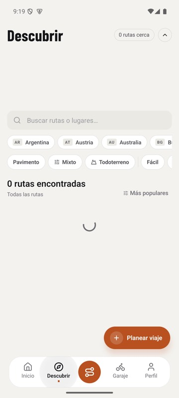
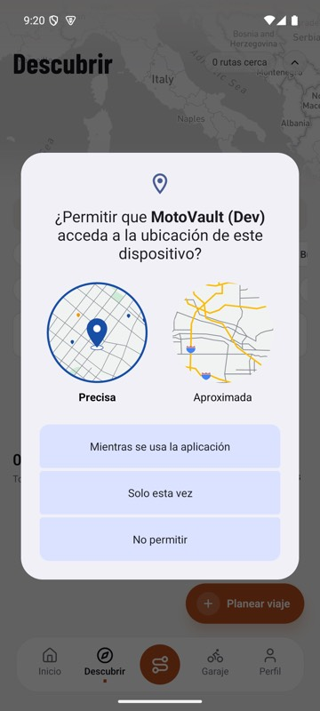

# T06 (#410): research batch findings

Part of #365. Date of every read below: **2026-11-13**. Read-only throughout: PostHog project 155556 (EU) `execute-sql` and existing
Replay Vision observations (no new scans), Supabase production `SELECT` only, `asc` / `eas build:list` listing only, code read at
`origin/main` `ca4704c3` unless another commit is named. One local device run (item 8) on the T00 Android emulator against the local stack.
Only aggregates and replay session ids are reported: no emails, names or person ids.

**Exclusion used in PostHog reads (`{EXCL}`).** The project test-account filter (4 person ids + `person.properties.internal != true`) plus the
q00 list re-derived today from Supabase (`is_synthetic`, `e2e-%`, the three test domains, the test account, users soft-deleted 2026-11-10:
26 user ids, mapped through `person_distinct_ids`). Build the id list with the recipe in [`queries/q00-excluded-persons.md`](../queries/q00-excluded-persons.md);
the ids themselves stay outside the repo. Queries marked "filter only" use the project filter without the q00 list. `{RN}` = `properties.$lib = 'posthog-react-native'`.

**SQL.** The exact HogQL/SQL for q1a, q2a, items 4, 5, 9 and 10 is in [`queries/q09-t06-research.md`](../queries/q09-t06-research.md). Each was re-run on
2026-11-13 and gave the numbers below, so a reviewer can spot-check any of them.

| # | Question | Answer in one line | Gates |
|---|---|---|---|
| 1 | Confirm PO12/PO13 riders with replays | PO12 as measured is mostly a cold-start `/(auth)` flash, not a sign-in screen: 11/292 → **4/292** without it (3.26.0 5 → 1). Replays could not be watched; existing observations + event timelines below | T15, T15b |
| 2 | Cause of the 3.26.0 diagnostics jump | The Home action row (3.25.0 Race Plate redesign) put "Diagnose" right under the plate: **26 of 29** first-hour diagnoses on 3.26.0 came Home → Diagnose list (29 of 29 counting a `/(tabs)` timestamp tie, see item 2) | T03b tile, owner |
| 3 | Commit of each 3.26.0 store binary | Android vc93 = `0a0687d7` (PR #311 head, 2026-10-12); iOS b106 = local build, commit **could not answer** (ASC API blocked). Both predate #318 | RC-2 |
| 4 | Is submit `FORBIDDEN` ever the daily budget / circuit breaker? | **No.** Breaker and global cap throw 500/503, not 403; the per-user daily cap (50) was never reached (max 6/day in 120 d) | T08, T24 |
| 5 | Is `complete_onboarding` idempotent? | **Bike: yes for a sequential repeat with the same bike. Call: no** (resets `onboarding_completed_at`, re-runs OEM import and Meta event; different bike details or a concurrent double call → second bike or an error) | **T14, T14b** |
| 6 | Rider-edited OEM task signal | D8 proxy stands. Only trigger: `set_maintenance_tasks_updated_at` (any UPDATE). No system path updates live tasks today | T23 reviewer note |
| 7 | Reminder cap on ~10 dated tasks | Recorded as answered: no immediate burst; same-day clustering at interval anniversaries; cap built in T07a | T07a |
| 8 | PO8 dialog type + replays | **The OS location permission dialog** (Android permission controller), requested by Discover on mount. No Play-services prompt seen. Replays could not be watched | **T29** |
| 9 | Android push tokens after vc99 | vc99 is still not in production. Android tokens 3 (all 7 d, **all 3 from test/synthetic users**); iOS 106 total / 7 in 7 d. `push_token_registered` is in the code (#393) but no production build carries it yet, so PostHog has none | T18, T03b tile |
| 10 | F14 engaged return on the 100 scanned riders | Day-2 raw **16/100**, day-2 engaged **13/100**, week-1 engaged 16/100 (7/72 with a full week), week-1 core action 17/100 | Exp 1 baseline |

---

## 1. PO12 / PO13: confirm riders with replays

**Query/read.**
- (q1a) PostHog, per completer, 60 d, `{RN}` + `{EXCL}`: the V1 §3.5 `po12_signin_1h` predicate, plus a second count that drops a `$screen`
  `/(auth)` followed within 3 s by a `$screen` starting with `/(tabs)` (the cold-start flash), grouped by the `$app_version` of
  `onboarding_completed`.
- (q1b) PostHog, filter only, completers since 2026-10-14 (inside the 30-day replay retention): first PO12 and first PO13 event per person, its
  `$session_id` and seconds after `onboarding_completed`. Then the full event timeline of those sessions.
- (q1c) Existing Replay Vision observations of scanner A (`01a1cfa6-4f63-7b8b-bd0c-9dbd6bace7a1`, 107 first sessions, read with
  `vision-scanners-observations-list` / `vision-observations-get`) and `vision-observations-list` for the new PO12 sessions.

**Result.**

| ver | completers | PO12 (V1 form) | PO12 without the `/(auth)` flash |
|---|---|---|---|
| 3.20.0 | 11 | 2 | 2 |
| 3.21.0 | 33 | 2 | 1 |
| 3.26.0 | 121 | 5 | 1 |
| 3.27.0 | 6 | 2 | 0 |
| others (3.19.x, 3.22.0, 3.25.0, 3.28.0) | 121 | 0 | 0 |
| **all** | **292** | **11** | **4** |

PO12 sessions in replay retention (q1b):

| Session | Platform | What the events show |
|---|---|---|
| `01a18bbc` (3.26.0) | iOS | Later cold start: `Application Opened` → `/(auth)` → `/` → `/(tabs)/(home)` within 1 s, then Start Ride. **Flash, not a sign-in screen** |
| `01a185e8` (3.26.0) | iOS | Same cold-start flash (`/(auth)` → home in 1 s) |
| `01a16a08` (3.26.0) | iOS | Same cold-start flash, then bike detail, OEM schedule import |
| `01a1bb64` (3.26.0) | iOS | Same cold-start flash, then Discover / trips |
| `01a14063` (3.26.0) | Android | Real: `/(onboarding)/sign-in` → backgrounded 2 s (Google account picker) → reopened → `user_signed_in` → Home → Diagnose → `diagnostic_failed` |

Replay observations that already exist for the R6 PO12/PO13 sessions (scanner A, read only):

| Session | Kind | What the observation says (AI text, not watched by a person) |
|---|---|---|
| `01a16e01` | PO12 | Tapping the profile/settings icon "triggers a Google sign-in hub activity", then back to the dashboard and a ride |
| `01a17532` | PO12 | A diagnostic start "interrupted by a Google sign-in prompt" |
| `01a1b0c2` | PO12 | Browsing Discover, "briefly interrupted by a Google Sign-In activity" |
| `01a1ace6` | PO13 | After onboarding, a route-creation tap "loops back to the email verification and social source selection steps" |
| `01a1b1de` | PO13 | Feature guide, then back into onboarding (R6) |

PO13 sessions since 2026-10-14 (q1b, events only): `01a1b1e6` (3.26.0) relaunch 6 min after completion shows Welcome → experience, then the gate
moves to `/(tabs)/(home)` (a real relapse, RC-E). `01a14f5e` and `01a1c6dc` show Welcome 2 and 5 days later. `01a1d212` opens
`/(onboarding)/notifications` from Profile 15 s after completion. `01a1405c` and `01a13c14` see `account` 32–39 s after completion, inside the
normal onboarding tail (the `garage_first` order fires `onboarding_completed` before the paywall/account, R4 §2.3), so those two are not relapses.

**Conclusions.**
- **Could not answer as specified (watch 3–5 replays): the agent cannot play recordings**, and new Replay Vision scans are out of scope. The
  confirmation above comes from existing AI observations (5 sessions) and event timelines (11 sessions).
- The FS-PO12 SQL counts a cold-start render of the `/(auth)` group as "saw sign-in": 7 of the 11 hits are that sub-second flash. The 3 Google
  SignInHub interruptions in the R6 replays emit **no** `$screen`, so the SQL does not count them at all. FS-PO12 both over- and under-counts.
  For T03b/T15: drop `/(auth)` views followed by `/(tabs)` within 3 s, and measure SignInHub with T04a's `auth_oauth_started` outside onboarding.
  Corrected baseline today: **4/292**, 3.26.0 **1/121**.
- PO13 needs a 60 s grace after `onboarding_completed` (account/heard_about/notifications in the `garage_first` tail are not relapses).

**Source.** PostHog q1a–q1c 2026-11-13 (q1a SQL in `queries/q09-t06-research.md`); plan §5 FS-PO12/PO13; `validation/V1-metrics.md` §3.5; `deep-dives/R6-replays-returners.md` §2.1.

---

## 2. Cause of the 3.26.0 diagnostics jump (29/117)

**Query/read.**
- (q2a) PostHog, completers 90 d, `{RN}` + `{EXCL}`: first `diagnostic_started` within 1 h of `onboarding_completed`, and the last non-diagnose
  `$screen` before it, by version.
- (q2b) PostHog, filter only: the 3 events before that first `diagnostic_started`.
- (q2c) Same as q2a split by platform (person-level `platform`, build heuristic as in V1 §3.1).
- (code) `git log -S "home-action-diagnose"`; Home screen at the 3.26.0 Android build commit `0a0687d7` and before 3.25.0 (`1edc49cd^`);
  the quick action in `app/_layout.tsx`.

**Result.**

| ver | completers | diagnosis in hour 1 | entry screen before it |
|---|---|---|---|
| 3.19.0 / 3.19.1 | 109 / 111 | 7 / 7 | `/new` (old route) |
| 3.21.0 | 33 | 4 | `/(tabs)/(home)` 4 |
| **3.26.0** | **120** | **29** | **`/(tabs)/(home)` 26**, `/(tabs)` 3 |
| 3.28.0 | 8 | 3 | `/(tabs)/(home)` 3 |

- q2b: on 3.26.0 the path is `$screen /(tabs)/(home)` → `diagnostic_list_viewed` → `$screen /(tabs)/(diagnose)` → `diagnostic_started` in 25 of
  29 (no event in the 20 s before for 3). Nobody came through the quick action (`/(tabs)/(diagnose)/new` directly) or an onboarding step.
- q2c: the jump is on both platforms: 3.26.0 Android 23/94, iOS 6/27 (3.21.0 Android 4/28, iOS 0/5). Not a platform-mix effect.
- Code: Diagnose has been a Home quick action since before 3.25.0, but as the 1st of a 4-column grid in section 6, below the masthead, bike switcher,
  hero card with metrics and attention banner (`1edc49cd^:apps/mobile/src/app/(tabs)/(home)/index.tsx:747-756`). The 3.25.0 Race Plate redesign
  (#298, `1edc49cd`, 2026-10-09) moved it into the 4-button `HomeActionRow` directly under the bike plate, above the fold
  (`0a0687d7:…/(home)/index.tsx:171-176`). 3.25.0 shipped to 3 completers (iOS), so 3.26.0 is the first release most riders saw it in.
- The quick action (`apps/mobile/src/app/_layout.tsx:926-929` on `origin/main`, `id: 'new-diagnostic'`) opens `/(tabs)/(diagnose)/new` and is not
  the entry for any of the 29. There is no onboarding symptom step in the 3.26.0 flow.

**Entry point (path:line, `origin/main`):** `apps/mobile/src/app/(tabs)/(home)/index.tsx:161-165` (`HOME_ACTION.DIAGNOSE`, testID
`home-action-diagnose`, `router.push('/(tabs)/(diagnose)')`), rendered by `HomeActionRow` at `:403`. Confidence 85% (strong entry signal on
both platforms; the redesign changed the whole Home, so placement is the leading but not the only change).

**FS-PO2d tile baseline (T03b):** first-hour diagnosis via Home → Diagnose, 3.26.0 **26/120**; all entries 29/120.
**Correction (T02 review, 2026-11-13):** q2a's last-screen rule is order-dependent when `/(tabs)` and `/(tabs)/(home)` share a
timestamp (same-day re-runs gave 26, 27, 28). Counting that tie as Home, all 29 of 29 came from Home. The tile column is
`po2d_diag_1h_via_home` in `queries/fs/fs-po2d.sql`: 3.26.0 **29/121** (60 d).

**Source.** PostHog q2a–q2c 2026-11-13 (q2a SQL in `queries/q09-t06-research.md`); git `1edc49cd`, `0a0687d7`, `origin/main` `ca4704c3`.

---

## 3. Which commit each 3.26.0 store binary was built from

**Query/read.** `asc builds list --app 6760291360` (read-only); `eas build:list --platform all --app-version 3.26.0 --json` (from
`apps/mobile`); `git branch -r --contains`; `git log --grep "#318"`.

**Result.**
- `asc`: **failed**, "A required agreement is missing or has expired … An Account Holder must accept it at appstoreconnect.apple.com/agreements".
  This blocks every App Store Connect API call for the account (owner action, not done here).
- EAS lists one 3.26.0 build: **Android vc93**, `dc0043b7-f837-4e66-8b35-fbda546722f5`, profile `production`, created 2026-10-12 21:59 UTC,
  **`gitCommitHash 0a0687d7`** ("docs(solutions): index the local supabase start learning"), only on `origin/feat/store-review-direct` (the PR #311
  head before its squash-merge `17629203`), runtime 3.26.0, channel `production`.
- **iOS build 106** was a local EAS build, so EAS does not list it, and ASC could not be read. **Could not answer the exact commit.** The release
  record says it was built from the same PR #311 head before merge and was already in App Review on 2026-10-12.
- #318 (the up-front diagnosis gate) merged as `7f4f35e5` on **2026-10-16**, after both binaries were cut. So **neither 3.26.0 binary embeds
  #318**, which confirms RC-2 for both platforms whatever the exact iOS commit.

**Source.** `eas build:list` 2026-11-13; `asc` error 2026-11-13; git; release notes kept outside the repo (3.26.0 release record).

---

## 4. Is submit `FORBIDDEN` ever the daily budget or the circuit breaker?

**Query/read.** Code: `apps/api/src/modules/diagnostics/diagnostics.resolver.ts:87` (`enforceFeatureLimit` first), `diagnostic-ai.service.ts:139`
(`checkBudgetForUser` inside `analyze`), `apps/api/src/modules/ai-budget/ai-budget.service.ts:127-140, 180-238, 319-344`,
`packages/types/src/constants/limits.ts:6, 107-114`. DB (production, read-only): per user per UTC day successful `content_generation_log` rows
and daily `sum(cost_cents)`, last 120 days.

**Result.**
- Submit order: (1) monthly free quota `enforceFeatureLimit` → `ForbiddenException(upsell)` when `count >= MAX_AI_DIAGNOSTICS_PER_MONTH` (= 1);
  (2) in `analyze`: circuit breaker → **`InternalServerErrorException`** (500); global daily spend ≥ `GLOBAL_DAILY_SPEND_CAP_CENTS` (5000) →
  trips the breaker and throws **500**; spend lookup error → **503**; per-user daily count ≥ `FREE_DAILY_GENERATIONS` (50) / `PRO_DAILY_GENERATIONS`
  (200) → **`ForbiddenException`** "daily AI generation limit".
- So the only `FORBIDDEN` other than the monthly quota is the per-user daily cap. The breaker and the global cap never return 403.
- DB, 120 days: max successful generations by one user in one UTC day **6** (0 user-days ≥ 50); max daily spend **14 cents** (0 days ≥ 5000).

**Answer.** **No.** In the data window every submit `FORBIDDEN` is the monthly free-tier limit. T08/T24 can treat `FORBIDDEN` on submit as
"monthly limit reached"; keep a separate copy only if the daily-cap message ever appears (it would need 50 generations in a day).

**Source.** Code at `origin/main`; Supabase SELECT 2026-11-13 (SQL in `queries/q09-t06-research.md`, item 4).

---

## 5. Is `complete_onboarding` idempotent?

**Query/read.** `supabase/migrations/00191_complete_onboarding_make_only_bike.sql:22-141`; the 00194 re-apply
(`supabase/migrations/00194_local_currency_amounts_and_php.sql:21-24, 61`, body diffed against 00191: identical except `'PHP'` in the currency
list); the caller `apps/api/src/modules/users/users.service.ts:185-282`; `oem-schedules.service.ts:222-234` (dedup); production DB read-only:
live bikes per user with the same make/model/year, and pairs of live bikes created ≤ 10 min apart, excluding test/synthetic users.

**Result (what a second call does).**

| Part | Second call, same bike details | Second call, different bike details (make, model or year) | Two calls at the same time |
|---|---|---|---|
| Bike | no new bike: it finds the live bike (`SELECT … make, model, year, deleted_at IS NULL`, 00191 `:93-99`) and updates mileage/nickname/photo/unit | **a second bike**, non-primary (`is_primary` only when no live primary, `:110-115`) | no lock and no unique key on (user, make, model, year): both can miss the SELECT and insert. With no primary yet, the second insert fails on `idx_motorcycles_one_primary_per_user` and that call returns an error to the app although the first succeeded |
| `users` row | preferences merged again; **`onboarding_completed_at` reset to `NOW()`** (`:71-76`) | same | same |
| API side effects | OEM import again, onto the user's **most recently created** live bike (`users.service.ts:235-264`), dedup by `oem_schedule_id` per bike, so no duplicate tasks on the same bike; if the rider added another bike since, the accepted schedule lands on that other bike. Meta `CompleteRegistration` sent again (`:267-279`) | same | same |

Production check: 1 user ever has two live bikes with the same make/model/year (2026-05-15, before 00191, not from this RPC: both bikes were
created after `onboarding_completed_at`). Other close pairs are a user adding several bikes on purpose. No sign that a repeat call created a
duplicate since 00191 (2026-10-15).

**Answer.** The RPC is bike-idempotent for a sequential repeat with the same bike, and nothing else in it is idempotent.

**Consequence for T14 and T14b (explicit).**
- **T14 (Release A, client only):** needs **no migration**. Its local completion flag stops the relapse that leads to a second call, and when a
  relapse still reaches `complete_onboarding` with the same bike, no second bike is created. T14's DB verification ("no account with 2 bikes
  created ≤ 2 min apart by onboarding") is a valid check. T14 should still guard the client against a double submit (disable the final button
  while the mutation runs) because the concurrent case is not safe server-side.
- **T14b (conditional):** "a second `complete_onboarding` is a no-op" is **not true today**, so if T14b's gate fires it **needs an
  owner-approved migration**: early return when `onboarding_completed_at IS NOT NULL` (do not reset the timestamp, do not insert a bike), plus
  in `UsersService.completeOnboarding` skip the OEM import and the Meta event when the user was already completed (or the RPC reports it).
  Until then, any metric that reads `users.onboarding_completed_at` sees the **last** call, not the first.

**Source.** Migrations and API code at `origin/main`; Supabase SELECT 2026-11-13 (SQL in `queries/q09-t06-research.md`, item 5).

---

## 6. Rider-edited OEM task signal (answered by D8; trigger note for T23's reviewer)

**Recorded answer.** `maintenance_tasks` has no "edited by rider" column, only `updated_at` (`packages/types/src/database.types.ts:1994-2031`).
T23 uses the D8 proxy: pending, never completed, `updated_at` within 60 s of `created_at`. This no longer gates T23.

**Query/read (trigger note).** Production `pg_trigger` on `public.maintenance_tasks`; `cron.job` commands; API writes to `maintenance_tasks`
(`grep` in `apps/api/src`); SQL functions that `UPDATE maintenance_tasks` in `supabase/migrations/`.

**Result.**
- One trigger: `set_maintenance_tasks_updated_at BEFORE UPDATE … EXECUTE FUNCTION update_updated_at()` (from
  `supabase/migrations/00020_create_maintenance_tasks_table.sql:36`). **Any** UPDATE bumps `updated_at`, rider or system.
- No `pg_cron` job touches `maintenance_tasks` (9 jobs checked). The reminder push writes its dedup to `maintenance_push_log`, not to the task
  (`apps/api/src/modules/push-tokens/maintenance-push.service.ts:134, 165`).
- API UPDATEs: only `MaintenanceTasksService` update and complete (`apps/api/src/modules/maintenance-tasks/maintenance-tasks.service.ts:322, 363`),
  both rider actions. SQL UPDATEs: the soft-delete RPCs (set `deleted_at`, so the row leaves the proxy's population) and the one-off data
  migrations 00128/00129 (historic).

**Note for T23's reviewer.** Today the proxy is clean: no system path updates a live task. It breaks the moment a system write UPDATEs task rows
(T07a import into existing rows, T39 backfill, T23's own schedule refresh): those rows would look rider-edited 60 s after creation. Any such
write must either skip the trigger's meaning (write a marker, e.g. `metadata.system_updated_at`) or be excluded by `source`/time when T23 reads the
proxy.

**Source.** Supabase SELECT 2026-11-13; code at `origin/main`.

---

## 7. Reminder scheduler cap when ~10 dated tasks appear at once (recorded answer)

**Answered (doc review 2026-11-12):** no immediate burst, because imported tasks get due dates in the future; the risk is same-day clustering when
several intervals fall due on the same anniversary. Today `sendDuePush` sends one push per task
(`apps/api/src/modules/push-tokens/maintenance-push.service.ts:61, 125-158`), so the cap (one combined push per bike, at most one per bike per
7 days) is built inside T07a before its deploy.

**Source.** Plan §3 T06 item 7, §9 D7; doc review 2026-11-12. Nothing re-run.

**Hand-off to `experiments.md`.** The issue asks for this answer in `experiments.md`. That file does not exist on `origin/main` yet: T02 (#399)
creates it. This PR does not create it, so the two PRs do not both add the same file. Until T02 lands, this section is the record. When T02
creates `experiments.md` (or whichever of the two PRs merges second), it must:
1. link this file (`research/t06-findings.md`) as the T06 findings;
2. copy the item 7 answer above into `experiments.md` word for word;
3. carry the item 1 and item 2 tile baselines (FS-PO12 4/292, FS-PO2d 26/120) and the item 10 engaged-return numbers.

If the owner prefers, this PR can add the stub `experiments.md` instead; that is a merge-order decision for the coordinator.

---

## 8. PO8: dialog type on a device, and the three replays

**Device check (query/read).** Under the shared device lock, 2026-11-13 09:15–09:21 CET. AVD `mv_repro` (Pixel 7, Android 15
`google_apis` arm64), system locale switched to **es-ES**, **fresh install** (`adb uninstall` + `adb install`) of the T00 `e2e-android-local` APK
(3.28.0 / versionCode 99 JS, RevenueCat/PostHog/Meta off, local Supabase + local API, app label "MotoVault (Dev)"). Production was not touched: no
production sign-up. Onboarding was not re-run; the rider was put on Home by signing in with a local QA account on the local stack, which has
onboarding completed. Location permission before the tap: `ACCESS_FINE_LOCATION` / `ACCESS_COARSE_LOCATION` `granted=false`; device location on
(`location_mode 3`). Tapped the **Descubrir** tab, took screenshots at +0.85 s and +1.7 s, recorded the screen, and read `logcat`.

**Result.**
- +1.7 s after the tap (`t06-item8-discover-1.7s.jpg`): Discover is rendering ("0 rutas encontradas", spinner). No dialog yet.
- `logcat`: `START … act=android.content.pm.action.REQUEST_PERMISSIONS … GrantPermissionsActivity` **1.2 s after the tap**; the window is
  on screen at about +3.6 s on this loaded host (load average 15).
- The dialog (`t06-item8-discover-dialog.jpg`): **Android's location permission dialog** from `com.android.permissioncontroller`:
  "¿Permitir que MotoVault (Dev) acceda a la ubicación de este dispositivo?" with Precisa / Aproximada and "Mientras se usa la aplicación" /
  "Solo esta vez" / "No permitir".
- After "Mientras se usa la aplicación": no second dialog in the next 5 s (no Google Play services location-accuracy prompt). That prompt was not
  tested with device location switched off.
- `GrantPermissionsActivity` is a separate translucent activity on top of `MainActivity`. It pauses `MainActivity`, which React Native reports as
  `AppState` background, so `Application Backgrounded` fires: this matches the production signature (42 of 43 Android first Discover visits
  background within 2 s, median 0 s, iOS 0/28) [SOURCE: V1-q36]. On iOS the system alert does not pause the app, hence 0/28.
- Code path: `apps/mobile/src/app/(tabs)/(discover)/index.tsx:503` → `useUserCountry()` → `requestForegroundLocationPermission()`
  (`apps/mobile/src/utils/location-permission.ts:16-23`); `weather-strip.tsx` shares the same in-flight request.

**Replays (query/read).** Existing scanner A observations and the R4 event timelines; no new scans.

| Session | Window | What is known |
|---|---|---|
| `01a19f85` (PO8, 3.26.0, Android, `es-US`) | 03:54:55–03:55:01 | Events: `discover_tab_viewed` 03:54:55.848 → `Application Backgrounded` 03:54:56.216 → `Became Active` 03:55:00.234; no start-ride, route or trip screen in the session (R4 Q-R4-11). The AI observation (confidence 0.9) says a "Descargar mapas" modal appeared after a "Ruta" tap; "Descargar mapas" is not an app string, and the tab bar's ride button is an unlabeled Route icon |
| `01a1815d` (PO5) | 07:19:20–40 | Observation: ride tracking UI after a short loading state, "ride too short", then bike edit. R4: the rider opened Start Ride and tapped Start; HUD 0.04–0.3 s after `ride_started` |
| `01a18bae` (PO5) | 07:24:50–07:25:06 | Observation: "immediately enters the Ride HUD", then "Ride too short". R4: same as above; the system location dialog is not in the recording |

**Could not answer (watch the replays): the agent has no way to play a recording** (the MCP returns metadata and existing AI text only; a new Replay
Vision scan is out of scope and would also not see a system dialog, which mobile replay does not capture).

**Answer for T29.** The dialog is the **OS location permission request that Discover makes on mount**, not a Play-services prompt and not an app
modal. The 4 s background in `01a19f85` (opened Discover → backgrounded 0.37 s later → active again 4 s later) fits a rider answering that dialog.
T29's fix is the one in the plan: no permission request on Discover mount; ask only after "Use my location"; keep a skeleton/timeout/Retry for the
"near you" list. Confidence 85% (device + code + production signature; the "Descargar mapas" text in the AI summary stays unexplained).

**Source.** Device run 2026-11-13 (screenshots in this folder; `logcat`); PostHog replay observations; `deep-dives/R4-first-ride.md` §3.1, §3.3.

---

## 9. Android push tokens after vc99

**Query/read.**
- DB: `select platform, count(*) filter (where created_at > now() - interval '7 days'), count(*), max(created_at)::date from device_push_tokens group by 1`,
  and the Android rows joined to `users` for test/synthetic flags (counts only).
- PostHog (filter only, 30 d): every event matching `%push%` or `%notification_perm%` by `platform`, `$app_version`, `$app_build`; persons on
  builds 98/99 in 7 d.

**Result.**

| platform | last 7 d | total | latest | of them test/synthetic |
|---|---|---|---|---|
| android | 3 | 3 | 2026-11-12 | **3** |
| ios | 7 | 106 | 2026-11-12 | — |

- The success event exists in code: `apps/mobile/src/lib/push-token.ts:132` calls `trackEvent(AnalyticsEvent.PUSH_TOKEN_REGISTERED, { platform })`,
  added with `push_token_registration_failed` by #393 (`52d281e9`, 2026-11-12). Plan §3A.0 rule 6 relies on it.
- PostHog has **no `push_token_registered` rows yet**, because no production build carries #393: vc99 is the first binary with it and is still an
  internal draft. The only push-token events are the 3 `push_token_registration_failed` events (1 person, Android 3.28.0 **vc99**, 2026-11-12), so
  all vc99 events so far are failures. `notification_permission_result` keeps firing on Android 3.26.0 vc93 (33) and 3.28.0 vc98 (1).
- 7 d `Application Opened` on vc99: 4 persons (3 after `{EXCL}`); vc98: 10 (9). vc99 is still the internal draft (V3 §2); Play production is vc98.
  The Play track itself was not read (listing it needs a Play edit).

**Answer.** No change from the baseline: no non-test Android token yet. **Re-check `push_token_registered` by platform once vc99 or 3.29.0
reaches production.** Until then the T03b Android-token tile can read the DB (`device_push_tokens`). The reason is that no shipped build carries
#393 yet, not that the event is missing: once a build with #393 is live, the PostHog event and the DB count should agree.

**Source.** Supabase SELECT 2026-11-13; PostHog 2026-11-13 (SQL in `queries/q09-t06-research.md`, item 9); code at `origin/main`.

---

## 10. F14 engaged return re-run of R6-q2 on the scanned riders

**Query/read.** Scanned sessions = the 107 `session_id`s of scanner A (`vision-scanners-observations-list`, read). Owners = persons with an event in
those sessions (107). Per owner `ob_day = toDate(min(onboarding_completed))` (UTC), events 2026-10-01 → 11-13:
- d2 raw = `Application Opened` / `Application Became Active` / `$screen` on `ob_day + 1` (R6-q2 definition);
- d2 engaged (F14, board/06 Appendix B) = d2 raw **and** that day a core action (`ride_completed` with `below_min_ride != true`, `expense_added`,
  `maintenance_task_created`, `maintenance_task_completed`) or a `$screen` not on the F14 allow-list (home, What's New, onboarding/auth names);
- week-1 engaged = the same on days `ob_day+1 … ob_day+6`; week-1 core = a core action on days `ob_day … ob_day+6`.

**Result.**

| Population | n | d2 raw | d2 engaged | week-1 engaged | week-1 core action |
|---|---|---|---|---|---|
| R6 eligible (completed ≤ 2026-11-10) | 100 | **16** | **13** | 16 | 17 |
| eligible today (completed ≤ 2026-11-11) | 105 | 17 | 14 | — | — |
| full week observable (completed ≤ 2026-11-05) | 72 | — | — | **7** | — |

- d2 raw 16/100 reproduces R6-q2 exactly. **3 of the 16 day-2 returns were not engaged** (only Home / What's New / onboarding screens that day).
- d2 engaged 13% here vs the cohort F14 baseline 37/367 (10.1%) of completers [SOURCE: board/06 F14].

**Source.** PostHog 2026-11-13 (noncanonical one-off query; the governed metric catalog is empty). SQL in `queries/q09-t06-research.md`, item 10.
